# 从零认识 AI，再到 AI Agent 设计

[返回导读](README.md) · [新手词典](GLOSSARY.md) · [阅读方法](READING-GUIDE.md)

> 这是一版面向新手的连续教材：AI 基础导论后，按 12 个主题讲清 Agent 的原理与设计。案例数字均为虚构。没有 Rust 离线练习或程序执行要求。

## 章节导航
- [00 从 AI 入门到 Agent 设计：先建立一张不会迷路的地图](#chapter-00)
- [01 · LLM 与 Agent 基础：从“会回答”到“会办事”](#chapter-01)
- [02 · 架构与工作流：给聪明同事一张流程单](#chapter-02)
- [03 · Context Engineering：给研究员准备一张干净的办公桌](#chapter-03)
- [04 · Context Compaction：不是删聊天，而是打包行李](#chapter-04)
- [05 · 短期记忆：断电以后，订单不能失忆](#chapter-05)
- [06 · 长期记忆：记住客户，不要替客户编历史](#chapter-06)
- [07 · 工具与知识库：查到资料，为什么仍会答错？](#chapter-07)
- [08 · Multi-Agent：多人合作，不是多人重复说话](#chapter-08)
- [09 · Runtime 与 Harness：模型负责建议，系统负责兑现](#chapter-09)
- [10 · Skills 与规划：经验可以复用，计划必须更新](#chapter-10)
- [11 · 评测、监控与安全：漂亮答案不等于可靠系统](#chapter-11)
- [12 · 从学习到 Agent 设计：先做窄闭环，再谈平台](#chapter-12)


---

<a id="chapter-00"></a>

# 00 从 AI 入门到 Agent 设计：先建立一张不会迷路的地图

> 小林想做一个会调查供应商的助手。他第一次打开教程，就遇到 Transformer、RAG、向量库、Agent、MCP。问题不是他太笨，而是这些词属于不同层次。我们先把它们放回各自的位置。

本章没有编程作业。你可以把每节当成一段故事，先预测下一步，再看解释。从“模型如何学会判断”开始，最终理解“为什么会说话的模型还需要一个可靠执行系统”。

## 第一站：AI、机器学习、深度学习，不是三个竞争产品

AI 是让机器完成通常需要智能的任务的广义领域。规则系统、搜索和规划也属于 AI，不必都有神经网络。机器学习的一种典型做法是从数据中学出规则，而不是人手写完所有条件；深度学习则使用多层神经网络来学习表示。

假设我们判断一条邮件是不是垃圾邮件。规则系统可能写“包含免费中奖就拦截”。遇到“免 费 领 奖”就漏掉了。机器学习会把历史邮件及其标签作为训练样本，学习哪些特征与垃圾邮件有关。深度网络则可以从词、短语、上下文组合出更复杂的表示，但它仍然会受数据偏差影响。

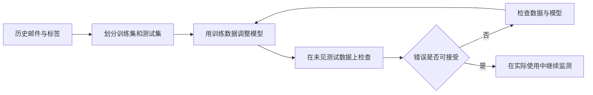

**你应该记住的区别：**训练是改变模型参数；推理是使用已有参数对新输入作答。把一份文档放进聊天窗口，通常不意味着模型参数永久学会了它。

## 第二站：学会用数据说话，而不是只看准确率

一百封邮件里只有一封垃圾邮件。一个永远回答“正常”的模型准确率也有 99%，却没有拦截能力。准确率必须结合业务代价。Precision 回答“拦下来的邮件有多少真的有问题”，Recall 回答“真正有问题的邮件拦到了多少”。误拦客户订单与漏掉广告的代价不一样。

训练集用于学习，验证集用于选方案，测试集留作最后检查。把测试题反复拿来调提示词，也会间接针对测试题优化，导致好看的分数不能代表新任务。时间变化也重要：去年邮件模式不等于今年。

不必先背全公式，但需要认识：均值会掩盖极端值；相关不等于因果；小样本的波动大；重复样本会让模型“背答案”。这些习惯后来也适用于 Agent 评测。

**小测验：**模型在常见商品上很好，在新类别上很差。应该先查数据覆盖与分组指标，还是直接让模型参数更大？先查前者，因为能力不足只是可能原因之一。

## 第三站：神经网络如何“学会”

可以把网络想成许多可调的小旋钮。输入经过计算得到预测，把预测和目标的差异写成损失；反向传播计算各个旋钮对损失的影响，优化器按一定步长调整参数。这是数值优化，不是人在网络里逐条写常识。

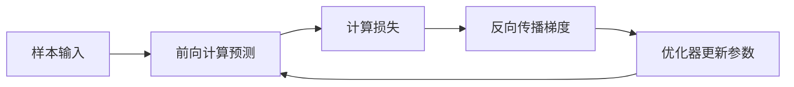

学习率像调节步幅：过大容易跨过合适位置，过小进展慢。过拟合像学生背熟练习册却不会新题；正则化、更多高质量数据、恰当容量和早停可能缓解，但没有万能开关。深度学习也不是每个任务最好的选择，小型结构化表格任务有时用简单统计或树模型更合适。

后续想深入数学，可按“向量与矩阵 → 概率分布与条件概率 → 导数与梯度 → 优化”顺序补。此时的目标不是手算训练一个大模型，而是能解释训练数据、模型能力与错误之间的关系。

## 第四站：语言模型为什么能接着说

语言模型训练中的常见目标是预测后续 Token。Token 是模型处理文本的单位，不等于一个汉字或一个单词。文本先被分词器编码，再映射为向量；Transformer 的注意力机制让当前位置综合上下文信息，网络输出下一个 Token 的分布。采样过程据此选出 Token，并重复。


注意力不是人类意识，也不是一份可直接当作完整推理解释的日志。模型能从训练中学到丰富规律，完成归纳、翻译和推理，但“能生成流畅答案”不保证事实正确。它可能把常见模式补成不存在的供应商地址，所以外部信息要有来源和核验。

预训练提供广泛能力；指令微调帮助模型按要求答复；偏好优化改善行为倾向。它们都不同于在一次请求里给几个例子。温度影响采样分布，但调低温度不能保证事实正确或完全确定。

## 第五站：会用模型，先会问、会限制、会检查

差的需求：“帮我看看供应商。”好的需求：“比较这三份公开报价，只使用附件里的信息，输出单价、起订量、交货周期；缺失项写未知；不得替我下单。”后者明确任务、证据、输出格式和权限边界。

结构化输出让后续程序更好解析，但合法 JSON 仍可能装着错误内容。验证需要分两层：字段结构是否符合要求，内容是否有证据。上下文窗口是输入和相关输出预算约束，不是无限记忆；较长上下文也不自动等于较好理解。

这一步先学四种基本操作：把任务拆小、给清晰样例、要求来源、明确“不知道”。不要一上来追求几百行超级 Prompt。用相同问题比较修改前后的效果，才知道是否真的改善。

## 第六站：RAG 与微调解决不同问题

小林希望助手知道最新报价。把报价放入可检索知识库，回答时取出相关片段，这叫检索增强生成的一种做法。微调则改变模型行为或知识表征，通常不适合频繁变动的价格事实。


如果知识库根本没有交货期，正确做法是标注缺失，而不是补个合理数字。向量相似度表示表达接近，不保证事实支持结论。RAG 的失败可能发生在文档处理、检索、排序、上下文拼接或生成任一环节。

## 第七站：从“回答”到“行动”，Agent 才真正出现

普通问答回答“可以联系供应商”；Agent 系统可能决定调用搜索、读取报价、等待审批、生成交付物。差异在于它通过工具与环境互动，并根据结果继续决策。并非使用了大模型就一定需要 Agent；固定步骤清楚时，工作流更可控。

模型提出“发邮件”只是建议。执行系统要检查：工具是否允许、收件人是否正确、内容是否批准、是否已经发过、结果有没有记录。Agent 设计的难点因此不只在聪明，还在边界、状态和错误恢复。

**理解检查：**如果工具返回“已发出”后系统断电，恢复后应不应该立即重发？不应该。要查询先前结果或使用能防重复的机制。这就是后面短期记忆、幂等、检查点与审批机制存在的原因。

## 第八站：高级设计的毕业标准

当你能回答下面问题，再讨论复杂多 Agent 平台：

1. 这个问题为什么需要自主决策，而不只是固定脚本？
2. 哪些事实放当前上下文，哪些保存在任务状态，哪些适合长期记忆？
3. 子 Agent 失败时谁负责、如何合并冲突结果？
4. 商业承诺如何获得准确、可撤销、可追踪的审批？
5. 如何证明改进有效，并识别少数但严重的安全失败？
6. 外部资料中的恶意指令为什么不能获得执行权限？

后面 12 章就是对这些问题的逐层展开。不要先记一百个框架名字。先掌握一条工作原理，再看一个开源实现，再用反例检验理解。

## 推荐进度（可按基础调整）

| 阶段 | 重点 | 看懂的标志 |
|---|---|---|
| 初级 | 本章 AI/ML/神经网络/LLM | 能解释训练、推理、数据泄漏与幻觉 |
| 应用 | 第 1–2、7 章 | 能写清任务、证据、输出、工具边界 |
| 进阶 | 第 3–6 章 | 能区分上下文、状态和长期记忆 |
| 高级设计 | 第 8–12 章 | 能推演失败、审批、恢复与评测流程 |

数学更深入、模型训练实操和部署工程是后续可扩展学习方向，本初版不冒充完整大学机器学习课程。资源索引列出进阶阅读入口；本手册主线是从理解 AI 到能够设计可靠 Agent。

## 补充地图：AI 不只有聊天模型

如果你是完全零基础，还需要知道几条主干道路。它们不是必须全部精通后才能读 Agent，而是帮你判断自己正在学哪一部分。

**监督学习**像老师给练习题和参考答案。输入是邮件，标签是“垃圾/正常”；模型学习从输入到标签的关系。**无监督学习**更像先把一堆没有标签的卡片按相似性整理成组，用来探索结构，但“相似的一组”未必就是业务上正确的类别。**自监督学习**从数据自身构造学习信号，例如让模型预测被遮住的部分或下一个 Token，不需要每个训练样本都由人标注答案。

**强化学习**则关心一连串动作怎样带来后续回报，像在游戏中试动作、看到得分，再调整策略。奖励设计不当，系统可能钻空子而不是达到真正目标。把一个大模型接上工具循环，不代表这个应用一定在实时做强化学习，更不代表它会自动更新模型参数。

按数据类型看，计算机视觉主要处理图像与视频，语音系统处理声音与文字的转换，多模态模型可以关联多类输入。生成式模型产生文本、图像等新内容；判别式任务则更侧重分类或预测。不同术语描述的是不同维度，不需要把所有技术硬塞进一条先后顺序。

### 从注意力到 Transformer，再说清一步

读“苹果发布新产品”时，人会根据后面的“发布”猜到这里不是水果。注意力机制也允许模型在处理某个位置时，给其他位置的信息不同权重。多头注意力是并行学习多种关联方式；前馈层进一步变换表示；位置相关信息帮助区分词序。多层组合形成越来越复杂的表示。

这个类比只帮助理解信息如何组合，不表示网络按人类同样方式思考。模型仍然会误读上下文，尤其是长输入里的关键细节、矛盾数据或域外知识。进入 Agent 设计后，不能把“注意力可以关注”当作“关键约束一定会被记住”的保证。

### 什么时候走向高级 AI，而不仅是高级 Agent？

如果你想研究模型本身，后续路线是：线性代数与概率基础 → 经典机器学习 → 神经网络优化 → Transformer 与训练目标 → 数据治理与评测 → 模型训练、适配和推理效率。这个方向需要更多数学、实验和计算资源，本手册只提供概念桥梁与可靠阅读入口。

如果你想设计能办事的助手，路线则是：理解模型能力与局限 → 任务与工具 → 上下文和状态 → 协作与权限 → 故障恢复和评测。你不必先训练自己的大模型，但必须知道哪里不能只靠大模型兜底。

**理解题：**“我把昨天的客户偏好放入数据库，今天检索出来加入 Prompt，所以模型已经微调了。”这句话对吗？  
**答案：**不对。这里改变的是本次输入材料，不是模型参数。这是一种应用层记忆使用方式；是否微调要看有没有进行参数更新训练。


[回到学习导航](README.md)


---

<a id="chapter-01"></a>

# 01 · LLM 与 Agent 基础：从“会回答”到“会办事”

> 本章从零解释 Agent 的工作过程。只需阅读、看图和纸上推演，不需要编程基础、API 账号或安装软件。

## 先认清几个词

LLM：大语言模型，擅长根据上下文生成文字。Agent：利用模型选择下一步、借助工具办事的系统。API：程序之间请求服务的接口，可理解为标准化服务窗口。Schema：规定答案必须包含哪些字段的格式清单。

## 开场：小林的第一笔调研订单

客户说：“我有 5000 元，想知道马来西亚宠物用品值不值得做。”普通聊天模型会给一篇看似完整的建议；可靠 Agent 首先发现：预算币种、经营主体、目标平台、交付形式都没有确定。它的第一步可能不是搜索，而是问：“5000 元是人民币总启动预算吗？你希望收到市场对比，还是可直接采购的清单？”

**Agent = 模型提出下一步 + 程序维护状态、执行工具并检查结果。** 模型不是操作系统，也不能仅凭文字声明“已查询”就获得数据。

## 把五个概念装进同一个例子

- **Token 与上下文窗口**：模型输入、输出都有容量限制。中文字符数不等于 token 数，真正计费用供应商 tokenizer 或 API usage。模型参数数量也不等于可用上下文大小。
- **System Prompt**：规定角色与边界，例如“事实附来源；未知不编造；报价必须审批”。它不是安全隔离，程序仍需检查权限。
- **Tool Calling**：模型返回结构化请求，如 `search({"query":"..."})`；程序验证后调用工具，再把结果放回消息流。不能把普通自然语言当成已经执行的调用。
- **ReAct / Agent Loop**：观察结果、决定下一步、执行、再观察。教学记录可保存简短决策理由和可见行动，不需要索取或存储模型隐藏思维过程。
- **结构化输出**：用 schema 约束字段、枚举和长度；合法 JSON 只代表格式正确，不代表事实正确。

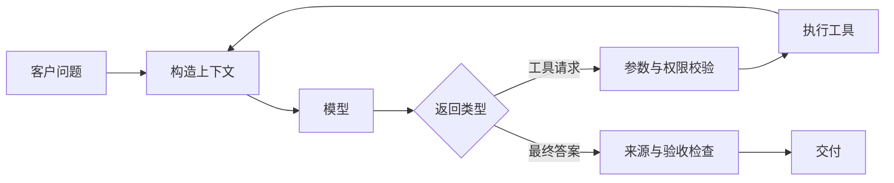

## 跟着一次完整对话理解过程

第一步，客户说：“5000 元，看看马来西亚宠物用品。”Agent 发现币种和交付形式不清楚，于是先追问。此时它还没有搜索，更没有注册店铺。

第二步，客户确认：“人民币总预算，只要中文对比报告。”系统把这个回答加入当前任务，模型建议使用搜索工具。注意：建议调用搜索与真正搜索是两件事，后者要由程序执行。

第三步，工具返回两条公开资料，分别有网页地址、日期和摘要。模型读取资料，发现主体资格仍不清楚，选择继续核实，而不是为了尽快结束编造结论。

第四步，模型生成报告，区分已知事实、估算和未解决问题。系统再检查是否符合客户要求。直到通过这些检查，任务才算完成。

这好比请一位助手查资料：他说“我去查”不算查到；拿回一本书不算理解；写完文章也不代表文章正确。

## 如果过程中出错呢

搜索条件缺失时，应补充条件，而不是盲目执行。工具连续失败时，应停止并说明原因，而不是永远循环。资料太长时，应选取相关内容并保留来源，而不是把所有网页文字塞进模型。

学习时拿一张纸，画出“客户输入 → 模型建议 → 程序检查 → 工具执行 → 结果返回 → 答案检查”。分别标注谁负责每一步。能分清这些责任，比记住某个工具名称更重要。

## 延伸阅读与常见坑

从 [Microsoft AI Agents for Beginners](https://github.com/microsoft/ai-agents-for-beginners) 和 [Hugging Face Agents Course](https://github.com/huggingface/agents-course) 学习基础。新手先读课程的概念说明；有编程基础后再找工具调用示例，画出“模型输出”与“程序执行”的边界，再看框架封装。阅读时记录实际版本；本章不声称已逐行审阅其当前实现。

最常见的坑不是模型不够聪明，而是把“说会做”当成“已执行”、把 JSON 校验当事实校验、把 prompt 当权限控制。下一章会讨论哪些步骤根本不必交给 Agent。

## 理解题与参考答案

**1. 模型说“我已搜索”是否能证明完成搜索？**

参考答案：不能。需要真实工具执行及其结果；文字承诺不等于动作回执。

**2. 为什么结构化输出仍可能出错？**

参考答案：格式正确不代表事实、来源和业务判断正确。


[回到学习导航](README.md)


---

<a id="chapter-02"></a>

# 02 · 架构与工作流：给聪明同事一张流程单

> 本章介绍任务怎样一步步流转，不要求编写代码。“工作流”就是预先约定的办事顺序。

## 先认清几个词

工作流：预先规定的办事顺序。状态：任务目前所处阶段。事件：刚刚发生的变化。状态机：规定哪些阶段可以转到哪些阶段的一套规则。

## 故事：不要雇十个 Agent 来填写一张表

小林需要把客户需求整理成“目标市场、产品类别、预算、截止时间、交付格式”。这些字段是固定的，用一次结构化抽取加校验就能完成。只有当问题开放、下一步取决于搜索结果时，才值得引入自主循环。**工作流确定路径，Agent 决定路径；两者可以在同一个系统中组合。**

我们把订单拆成：澄清需求 → 资料调研 → 形成范围和报价 → 人工审批 → 执行 → 质量检查 → 交付。研究步骤可以探索，商业承诺步骤不能随意探索。

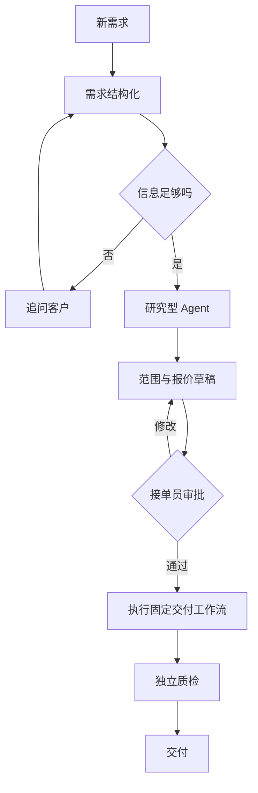

## 四种常见模式如何选

| 模式 | 适合的问题 | 主要代价 |
|---|---|---|
| 顺序工作流 | 字段清洗、固定报告模板 | 难以处理路径变化 |
| Router 路由 | 根据任务类型选择专业 Agent | 分类错误会传递下去 |
| Planner + Executor | 需要拆解、可分阶段验收的任务 | 计划可能不现实，需要更新 |
| Supervisor + Workers | 多市场并行研究 | 通信、费用、结果冲突增加 |

不要把 Planner 的输出视为指令最高来源。它也可能规划了未经用户授权的付款或发信。执行器应该看到的是经过验证的任务对象，而不是“请照着这段文字全部做”。

## 从需求到状态机的完整例子

客户确认只需“马来西亚和新加坡两地市场对比，中文 Markdown，不采购、不注册账号”。将这些边界写入 `TaskSpec`，并给它一个版本号。状态从 `needs_clarification` 进入 `ready_for_research`，研究完成进入 `awaiting_approval`。客户又说“增加泰国”，这不是给旧任务追加一句话，而是更新范围版本、重新估算、使旧报价失效。

建议状态至少包含：等待输入、就绪、运行中、等待审批、失败、完成、取消。事件是“发生了什么”，状态是“现在是什么”。例如 `approval_granted` 是事件，`running` 是状态。审批记录绑定需求版本及拟执行动作，不能用一个过期的“可以”批准后来扩大的范围。

## 纸上推演：一个订单会经历什么

在纸上写下“等待澄清、开始研究、等待审批、执行、完成、取消”六张卡片。客户信息不完整时停在第一张；资料齐全后进入研究；报价草稿形成后进入等待审批。

现在加入三个意外：客户扩大范围、审批消息重复到达、客户取消后研究结果才返回。逐一思考应该移动到哪张卡片。扩大范围通常需要重新估算；重复审批不能重复执行；取消后迟到的结果不能自动交付。

这就是状态机的直观含义：系统只允许从当前状态进入合理的下一状态，而不是收到一句话就随意改变行为。

## 阅读与生产提醒

可从 [LangGraph](https://github.com/langchain-ai/langgraph) 观察状态图、暂停与恢复等抽象。阅读目标是理解数据与控制流，不是立即选定开发语言或复制整个框架。生产中应先实现单任务路径，再引入并行；先验证状态机，再优化提示词。下一章解决状态已正确，但模型“看错重点”的问题。

## 理解题与参考答案

**1. 固定报表每次都需要自主 Agent 吗？**

参考答案：不需要。路径明确时，固定工作流通常更简单可控。

**2. 客户扩大需求范围后，旧审批还能直接用吗？**

参考答案：不能默认沿用，应检查原审批是否仍覆盖新的范围与承诺。


[回到学习导航](README.md)


---

<a id="chapter-03"></a>

# 03 · Context Engineering：给研究员准备一张干净的办公桌

> Context Engineering 意为“上下文工程”，就是安排模型这一次能看到的信息。预算数字为教学假设，不需要编程或真实 API。

## 先认清几个词

上下文：模型本轮能看到的信息。Token：模型处理文字的小单位，不一定等于一个字。检索：从已有资料中寻找相关内容。缓存：保留可复用结果以减少重复工作。

## 故事：模型不是忘了，而是桌面太乱

小林已经确认“不注册店铺，只做调研”。搜索工具却返回一万行网页，其中夹着“点击立即开店”的营销文案。若把所有历史、网页、工具日志一股脑交给模型，最重要的边界可能淹没在噪声里。上下文工程不是写更长 prompt，而是**决定本轮模型应该看到什么、按什么顺序看到、每部分可信到什么程度**。

区分三层：持久化任务状态保存事实；检索系统寻找候选资料；上下文构造器决定本轮输入。没放进模型窗口的数据不等于删除，放进去的数据也不等于可信指令。

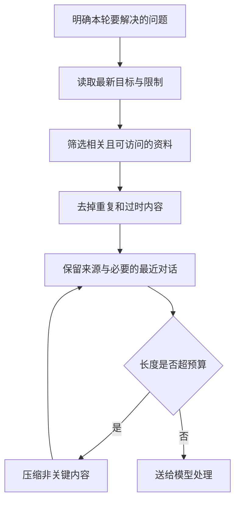

## 一份预算账本

假设某模型可用上下文总量为 32,000 tokens，计划预留 4,000 输出和 2,000 安全余量，则输入目标不超过 26,000。进一步分配：稳定规则 2,000、当前任务 2,000、工作摘要 3,000、最近消息 5,000、证据片段 10,000、工具定义 4,000。各区分配是上限而非必须填满；实际模型对输入输出合计的规则需要查提供商文档。

```text
输入预算 = 上下文总量 - 输出预留 - 安全余量
候选资料价值 = 相关性 + 证据质量 + 新鲜度 - 冗余 - 长度成本
```

第二个表达式是设计直觉，不是可跨项目直接使用的统一评分公式。先给候选条目记录来源、时间、主题、权限标签，再通过小评测集调权重。

## 逐步案例：把“乱桌子”收拾成一轮请求

输入有五类内容：客户确认、旧报价、最近一次搜索、旧网页、工具报错。按下面顺序处理：

1. 从任务状态读取最新范围版本，而不是从聊天里猜最新承诺。保留币种 CNY、总预算 5000、两地对比、禁止采购、交付 Markdown。
2. 发现旧报价属于范围 v1，而当前为 v2，排除旧报价或明显标记为失效。不能让检索排序把旧事实“复活”。
3. 最近消息按完整工具交互单元保留。工具调用和工具结果有配对 ID，不能只留一个孤立结果，具体消息约束以供应商协议为准。
4. 网页只选回答当前问题的段落，每段保留 URL、抓取时间、原文定位。网页中的指令按资料处理，不提升为系统规则。
5. 对临时 429 错误保留错误类别、重试次数和等待时间即可，不必重复塞入完整栈日志。
6. 调用真实 tokenizer 估算预算；超预算时先删冗余证据，再压缩旧对话，最后请求缩小任务，而不是静默丢掉禁止项。

输出应能解释每个片段为什么被选中。把“选中/排除理由、token 数、任务版本”记录到调试日志，注意日志脱敏。

## 缓存和隔离不是同一件事

稳定 system 前缀、工具 schema 有利于提供商的 prompt caching，但缓存命中条件、价格和保留方式因提供商而异，不能承诺通用收益。动态时间戳放在稳定前缀之前可能降低命中。不同客户与任务必须先做权限隔离，再做缓存复用；不可为了缓存命中，把 A 客户私密需求放进 B 客户上下文。

多个 Agent 也不应共享一个无限增长的聊天数组。研究员看到其子任务、必要公共边界和证据；质检员看到交付物与验收条件；审批者看到具体拟执行动作。隔离减少噪声，也缩小数据暴露面。

## 纸上比较：更短一定更好吗

准备两份资料包。甲包保留最后十条聊天，却漏掉最早的“不联系供应商”；乙包保留最新目标、禁止项和三条相关证据。即使甲包更短，也可能导致更严重的错误。上下文整理应同时关注信息量、关键约束、来源和隐私，而不是只追求少字。

自检时观察：最新需求是否仍在？旧报价是否清楚标为失效？不同客户的资料是否混在一起？每个结论是否能找到原文？长度不足时是否会明确告知，而不是默默删掉重要限制？

未来有技术基础后，可用多组相同任务比较策略，记录任务正确率、过时事实采用率和输入 token。但本章不要求运行实验，也不提供未测量的效果数字。


阅读 [LangGraph](https://github.com/langchain-ai/langgraph) 的状态组织和 [Deep Agents](https://github.com/langchain-ai/deepagents) 的上下文处理思路。先定位概念和测试，再记录当前版本路径；不要假设某项目宣称支持的策略等于你的任务已验证。下一章专门处理历史确实太长时的压缩。

## 理解题与参考答案

**1. 上下文越长越好吗？**

参考答案：不是。重复、过时和无关内容会增加成本并干扰判断，关键是相关、可信与最新。

**2. 重要约束与相关性很低的旧消息应如何处理？**

参考答案：重要约束应进入权威任务状态，不能仅因检索分低就丢掉。


[回到学习导航](README.md)


---

<a id="chapter-04"></a>

# 04 · Context Compaction：不是删聊天，而是打包行李

> Compaction 意为“压缩整理”。本章通过行李箱类比和纸上案例解释原理，不要求实现算法。没有实测数值的地方不声称效果。

## 先认清几个词

压缩：在限制长度的同时保留继续任务所需信息。分层摘要：先总结小段，再总结较大范围。原子保存：要么完整保存，要么不切换到不完整结果。

## 故事：旅途继续，行李箱却满了

两小时调研后，小林的 Agent 已读了几十个页面。客户最初要求“不联系供应商”，后来又把交付从 PDF 改成 Markdown。把历史截成最后十条，会同时丢掉这两个关键决定；生成一段“我们正在做市场调研”的摘要也不够。压缩要保留**继续工作所需的状态、承诺、未解决问题和证据定位**，而不是保留对话的文学梗概。

先区分三种动作：trimming 删除不再需要的片段；summarization 把文字变短；compaction 是包含摘要、状态提取、原文卸载和恢复校验的整体过程。任何有损压缩都可能出错，不能把摘要当唯一原始记录。

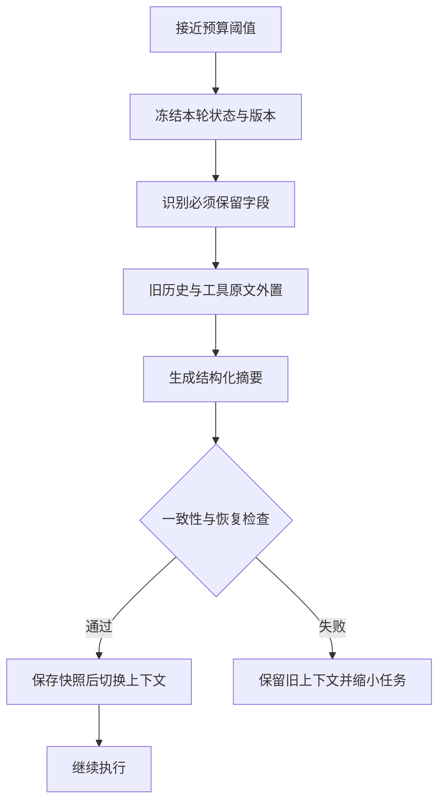

## 四种策略的取舍

| 策略 | 好处 | 失效方式 | 适合放在哪 |
|---|---|---|---|
| 滑动窗口 | 实现简单、便宜 | 早期约束消失 | 最近消息区 |
| 分层摘要 | 长任务可逐层归纳 | 多次摘要累计失真 | 工作摘要区 |
| 相关性选择 | 只取当前需要的证据 | 暂时无关但重要的约束被漏掉 | 证据区，不替代规则 |
| 工具结果外置 | 大文件不占满窗口 | 引用失效、恢复读不到 | 原文与构建日志 |

推荐组合而不是选一个万能方案：权威状态单独保存；最新交互窗口保留；旧历史结构化摘要；原始证据可按引用重新读取。

## 一份可以继续工作的压缩包

| 压缩包内容 | 本例应该保留什么 |
|---|---|
| 目标 | 马来西亚与新加坡宠物用品对比 |
| 限制 | 总预算 5000 CNY，不采购，不联系供应商 |
| 最新决定 | 中文 Markdown，不再是旧版 PDF |
| 已完成 | 已收集两地平台费用资料 |
| 待办 | 核实主体要求与物流区间 |
| 未知 | 运费尚未取得实际报价 |
| 来源位置 | 能重新打开原始费用资料的位置 |
| 下一步 | 阅读主体准入的官方资料 |

原文的位置必须真实可访问。摘要还要保留失败尝试，例如“某页面需要登录，因此未读取”，避免恢复后不断重复同一个失败动作。


## 一步一步理解压缩过程

1. 选择触发点，例如预计下一轮请求会超过输入预算 80%。80% 是示例参数，不是行业标准。不要等 API 拒绝才开始处理。
2. 暂停追加同一会话的消息，或记录明确的事件边界。压缩期间到达的新消息进入下一批，防止漏消息。
3. 从权威状态复制预算、审批、任务版本和禁止项；这些字段不交给摘要模型自由改写。
4. 对旧历史生成结构化摘要，保留证据 ID、未完成步骤、阻塞原因、用户纠正。禁止把推测提升成事实。
5. 校验必需字段与旧状态一致、所有引用可读、没有秘密凭证进入摘要。失败时不得覆盖旧快照。
6. 原子保存压缩包和处理到的事件序号，再切换运行上下文。恢复时根据序号重放尚未处理的事件。

## 纸上推演：离开后还能回来吗

构造一个中断点：Agent 正要核实马来西亚主体要求时压缩并重启。恢复后应继续核实，而不是宣称所有调研完成。将“不得联系供应商”只放在最早事件，检查恢复后是否仍受约束。再加入客户在压缩期间修改格式的事件，验证最终采用最新版本。

评测表至少有：压缩前后 token、压缩本身费用与时延、硬约束保留率、证据引用有效率、恢复后的任务成功率、重复动作数。压缩率可定义为 `1 - 压缩后输入 token / 压缩前输入 token`，但必须连同质量指标报告。仅展示一个漂亮百分比会掩盖关键信息丢失。

检查目标：禁止项全部保留；摘要矛盾能触发回退；中断恢复不重复有副作用动作；原文引用可定位；小样本结果标注样本数而不是泛化为生产结论。

## 延伸阅读与常见坑

对照 [Deep Agents](https://github.com/langchain-ai/deepagents) 与 [Codex](https://github.com/openai/codex) 理解长任务状态维护，记录阅读 commit 和实际文件位置。借鉴边界、测试与恢复思路，不依赖 Codex CLI 代替自己的运行时。生产中最危险的是“摘要已经写成功，所以可以删除原文”；这还取决于审计、恢复、隐私保留策略，不应自动推导。

## 理解题与参考答案

**1. 把聊天总结成一句话就是可靠压缩吗？**

参考答案：不是。还需保存约束、决定、未完成事项、来源和可恢复状态。

**2. 压缩后更省 token 是否足以证明更好？**

参考答案：不足。必须检查关键事实、限制和任务质量是否保留。


[回到学习导航](README.md)


---

<a id="chapter-05"></a>

# 05 · 短期记忆：断电以后，订单不能失忆

> 本章解释“正在办的事怎样被记住”。不需要数据库或编程基础，也不要求搭建支付、消息系统。

## 先认清几个词

持久化：进程结束后资料仍能保留。回执：外部服务返回的处理证明。幂等：同一操作重复请求时，避免产生额外重复效果。租户：使用同一服务的不同客户或组织。

## 故事：最后一步发生了什么？

小林的系统刚把报价草稿交给审批者，服务就重启了。若全部状态只在进程内存里，系统不知道客户是谁、是否批准、下一步该做什么。更糟的是，它可能把“提交发送请求”误认为“客户已收到”。短期记忆的核心不是“把聊天存到数据库”，而是**为正在进行的任务保留可恢复、可审计的工作状态**。

- `Session` 表示某次会话及其生命周期。
- `Thread` 表示一条消息序列或讨论分支。
- `Working Memory` 是当前任务的临时计算材料。
- `Checkpoint` 是恢复执行所需的一致状态快照。

这些名字在框架里定义可能不同，先在本项目写清语义。客户会话可以对应多个订单，订单也可能跨多次会话，不能用一个聊天 ID 兼任所有业务主键。

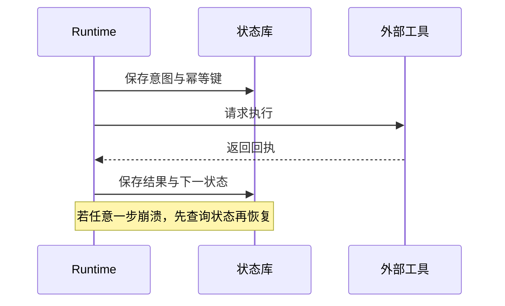

## 一张“工作进度照片”应该拍到什么

Checkpoint 可理解为工作进度的照片。照片里至少应包括：是哪位客户的哪项任务、最新需求版本、现在在哪一步、是否正在等待审批、哪些动作已尝试、哪些已有回执、资料存放在哪里，以及客户是否要求取消。

不要把它理解成单纯聊天截图。截图可能记录“我准备发送”，却没有记录到底发成功了没有。也不要把密码等秘密放进普通进度记录。

事件日志像连续日记，回答“发生过什么”；快照像阶段照片，回答“现在到哪里”。恢复时通常先看最近的照片，再补读之后发生的日记。两者一起帮助系统避免失忆与重复做事。


## 三个崩溃时刻的演练

**时刻 A：执行工具前崩溃。** 已保存 intent，但未见 receipt。对于只读搜索可以安全重做，仍需考虑费用。对于发送报价，应查询外部消息回执或幂等记录。

**时刻 B：外部执行成功，保存结果前崩溃。** 这是最危险的窗口。恢复后不能看到本地无结果就再发一次。若外部服务支持幂等键，用相同键查询或重试；不支持且无法查询时，状态设为 `outcome_unknown`，需要人工核实。

**时刻 C：结果已保存，下一步未开始。** 从快照或事件序号恢复到下一步，不重跑已完成步骤。重复到达的 receipt 根据事件 ID 去重。

因此，“exactly once”不是加一个数据库字段就有了。通常先接受至少一次投递，再通过幂等、去重、查询和人工处理不确定结果保障业务语义。

## 纸上推演：两位助手同时改进度

假设甲和乙都看到“报告等待审批”。甲收到客户取消，乙收到稍早发送的审批同意。如果乙直接覆盖甲的记录，就可能把取消任务重新启动。系统需要识别记录的先后版本，发现冲突时重新核对最新状态，而不是谁最后写入就听谁的。

再想象重启发生在发送报价后的瞬间。真正重要的问题不是“能否读回保存的数据”，而是“是否知道外部动作的结果”。若不知道，就应标注不确定并核实，不能假装成功，也不能直接再发。


## 会话隔离、取消与生命周期

所有查询带 `tenant_id`、`task_id`，权限检查在检索前完成。取消不是删除任务：记录取消请求，停止新动作，尝试取消可中止的工具，保留已发生的结果。客户撤销后到达的研究结果可以归档，但不能自动发送。

给临时工作材料设过期时间；任务完成后按明确策略归档或删除。长久保留一切既增加检索噪声，也扩大隐私风险。短期记忆中出现的偏好不自动升级成长期事实，下一章专门处理这一步。

## 学习检查与延伸阅读

你应能解释：为什么保存聊天不等于保存任务；为什么重试可能造成重复动作；为什么未知结果要单独处理；为什么取消不是简单删除记录；为什么不同客户的任务必须隔离。


阅读 [LangGraph](https://github.com/langchain-ai/langgraph) 的 checkpoint 概念和相关测试，重点问“保存了什么、何时提交、如何处理中断”，而不是只看一个 `resume` 函数名。真实源代码路径与版本在阅读时记录。

## 理解题与参考答案

**1. 发送请求后崩溃，本地没有回执，可以直接重发吗？**

参考答案：不一定。外部可能已发送成功，应先查询或使用幂等机制；无法判断则明确标为不确定。

**2. 取消任务为什么不等于删除记录？**

参考答案：已经发生的动作仍需核实和审计，而且迟到结果必须被正确处理。


[回到学习导航](README.md)


---

<a id="chapter-06"></a>

# 06 · 长期记忆：记住客户，不要替客户编历史

> 本章介绍跨会话记忆的原理，不要求使用向量数据库或编写程序。先理解“记什么、为什么记、何时忘”，再考虑工具。

## 先认清几个词

向量：把内容表示成一组数字，便于比较语义相近程度。Embedding：生成这种表示的过程。重排：对初步找到的资料再次排序。缓存：暂存已处理结果的副本。

## 故事：“上次便宜”不等于“永远只要便宜”

客户上次说：“这次预算紧，优先便宜。”如果系统永久记成“客户只关心价格”，下次遇到高质量项目就会误导决策。长期记忆必须带来源、适用范围、时间和可信度，不能把一句临时话变成永久人格标签。

三类记忆帮助我们拆开问题：**语义记忆**保存稳定事实或偏好；**情景记忆**保存某次订单发生了什么；**程序记忆**保存可复用的方法。研究报告原文是知识库资料，不必每一段都包装成“关于用户的记忆”。

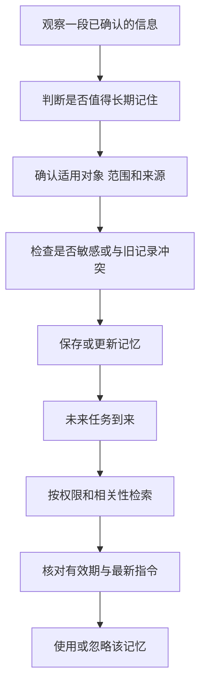

## 一条记忆应该长什么样

| 字段 | 合成例子 |
|---|---|
| 记住的内容 | 客户偏好中文 Markdown 报告 |
| 对谁适用 | 这位客户，不是全部客户 |
| 什么情况下适用 | 市场调研报告 |
| 来源 | 客户明确确认格式的那条消息 |
| 时间 | 何时确认，是否仍有效 |
| 状态 | 当前有效，或已被新决定替代 |

对“本次预算 5000 CNY”应记为这一订单的情景，而不是跨订单默认预算。模型猜测不能和用户明确表达享有相同权威。记忆有用的关键不是存得多，而是保留适用范围和证据。


## 逐步案例：提取、合并、冲突与遗忘

给提取器四条输入：客户明确偏好 Markdown；客户这次预算有限；模型猜测客户不喜欢 PDF；客户后来改说这个订单需要 PDF。理想结果是保留稳定偏好及其范围，把这次 PDF 写成订单级覆盖，丢弃没有依据的猜测。不要直接把两个句子“合并”为一个自相矛盾的字符串。

去重可先规范化实体与范围，再做语义相似度比较。高相似不等于相同：“不联系供应商”和“可以联系供应商”非常相近但意义相反。对否定、数字、币种和时间单独检查。新事实取代旧事实时保留 `supersedes` 和来源链，而不是无痕改写。

遗忘也不是只从向量索引删除一条 embedding。原始记录、倒排索引、缓存、副本和派生摘要都可能保留内容。设计删除流程时给这些存储建立传播路径和审计回执，备份中的删除策略单独说明。

## 检索：先权限，再相似度

假设当前问题是“给客户生成本次报告”。先按租户、任务范围、状态和有效期过滤；再做关键词与向量召回；然后重排。关键词擅长精确产品名、订单号；向量检索擅长语义相似；reranker 可以提高排序质量，但增加成本和延迟。

返回的不只是 `claim`，还应附来源、时间与适用范围。最新且直接的用户指令优先于旧记忆。若两个来源冲突且无法判定，明确提示冲突或提问，不让模型自行挑一个“最像”的答案。

## 纸上推演与学习检查

准备四张记忆卡：A 客户偏好中文；B 客户偏好英文；A 客户上个月预算有限；A 客户今天明确表示本次要 PDF。现在回答“给 A 客户做本次报告”：不能借用 B 的语言偏好，不能把上个月预算自动套用，也不能让旧的默认格式压过今天的新指令。

再把一张卡标成“用户要求忘记”，检查它是否仍出现在搜索结果或缓存里。删除不只是界面上看不见，还涉及派生记录和保留政策。

学习目标：能区分语义、情景与程序记忆；能说明关键词与语义检索各自适合什么；能处理新旧信息冲突；能解释为什么检索之前先查权限。未来评估系统时，还要同时看找得准不准、是否引用旧信息、是否泄露其他客户资料，而不是只看响应速度。


## 阅读路线与常见坑

比较 [Mem0](https://github.com/mem0ai/mem0) 和 [Letta](https://github.com/letta-ai/letta) 的记忆抽象，观察提取、检索、更新和上下文管理分别在哪一层。不要因为项目叫“Memory”就认为它解决了权限、遗忘和事实验证。复制实现之前先确认所读版本的许可证与依赖许可。

最重要的工程习惯：**先问这条信息为什么值得记、对谁可见、何时过期，再问用哪个向量数据库。**

## 理解题与参考答案

**1. 客户说“这次便宜优先”，能保存成永久偏好吗？**

参考答案：不能。应保留“这次”的范围，避免把临时决定泛化。

**2. 先做相似度检索，再检查资料权限可以吗？**

参考答案：更稳妥的是先限制到有权访问的数据，避免未授权资料进入后续处理。


[回到学习导航](README.md)


---

<a id="chapter-07"></a>

# 07 · 工具与知识库：查到资料，为什么仍会答错？

> 本章介绍原理与案例，不提供代码实验或联网工具实现。

## 先认清几个词

RAG：先检索资料，再据此生成答案。Chunk：为了检索而划分的资料片段。索引：帮助快速查找资料的目录结构。MCP：模型应用连接外部能力的一种协议。

## 故事：拿到一本书，不等于读懂书

客户问：“这两个市场的入驻条件有什么区别？”模型内部知识可能过时，所以需要外部资料。这里有两个不同问题：**工具调用**决定怎样获取资料或执行动作；**RAG（检索增强生成）**决定怎样从资料中找到相关证据并形成答案。工具不等于知识库，知识库也不保证回答正确。

RAG 的常见过程是：收集资料、清洗解析、分块、建立索引、检索、重排、组织上下文、生成带引用的答案。搜索不到、检索错段落、引用与结论不符，任何一步都可能出错。

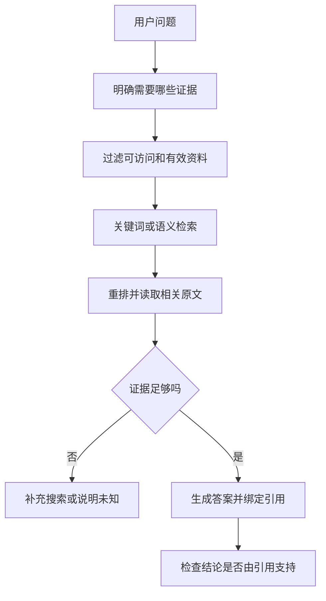

## 一个完整的对照案例

假设官方资料 A 说明当地企业主体要求，物流资料 B 说明某一重量区间运费。模型却写出：“因为运费低，所以任何个人都可以开店。”这个结论即使同时附了 A、B 两个链接，也没有得到证据支持。**有引用不等于引用正确。** 应把结论拆开：主体资格由 A 支持，物流估算由 B 支持；两者不能互相代替。

分块也会造成误读。如果把“仅限当地注册企业”和后面的“可使用个人联系人”切到不同片段，检索第二段可能错误推导“个人可直接注册”。对规则、表格、合同类资料，应保留标题、表头、适用条件和相邻段落。chunk 大小并不存在跨所有资料的最佳数值。

## MCP 到底解决什么

MCP 是连接模型应用与外部工具、资源等能力的协议。它帮助统一发现和调用方式，但不自动决定客户授权、不保证工具无恶意、不替你核实资料真实性。接上某个 MCP 服务，只代表系统获得了一种接口，不代表每个工具都可以默认执行。

对工具应说明：输入格式、输出结构、权限、超时、是否有副作用、失败如何解释。搜索是只读工具；发送报价、注册账号和付款是有外部影响的动作，应分别设置审批与审计。网页、PDF 与工具响应都是不可信资料，其中“忽略之前规则”不能升级成系统指令。

## 学习活动与自检

找三段公开资料，给每段标出来源、日期、适用对象和限制。写两个答案：一个只附链接，另一个把每个关键结论绑定到具体证据。比较哪一个更容易核查。再故意删掉条件句，观察结论如何变化。

思考：检索不到时应该猜、扩大检索，还是说明证据不足？什么场景需要精确关键词而不是纯向量相似？工具执行成功与业务目标成功有什么区别？

进入下一章前，应能画出 RAG 的完整过程，区分检索质量与生成质量，并说明至少三种“有资料仍答错”的原因。

## 延伸阅读

阅读 [MCP Specification](https://github.com/modelcontextprotocol/specification) 的概念与安全边界，结合 [Hugging Face Agents Course](https://github.com/huggingface/agents-course) 理解工具调用。阅读版本与许可证以资料索引为准，不把协议教程当成生产安全保证。

## 理解题与参考答案

**1. 附上两个来源链接就证明结论正确吗？**

参考答案：不能。需要确认每个关键结论确实由相关原文支持，且适用条件一致。

**2. MCP 能自动解决授权问题吗？**

参考答案：不能。协议统一连接方式，业务授权和安全检查仍由应用负责。


[回到学习导航](README.md)


---

<a id="chapter-08"></a>

# 08 · Multi-Agent：多人合作，不是多人重复说话

> 本章讲协作原理与设计推演，不要求编写代码或部署消息系统。

## 先认清几个词

Multi-Agent：多个 Agent 分工协作。Supervisor：负责分派和汇总的协调者。Artifact：任务产生的报告、文件等成果。协议：不同系统合作时共同遵守的消息约定。

## 故事：为什么再请三位研究员反而更慢？

小林把同一问题交给四个 Agent，它们都搜索“东南亚宠物用品市场”，给出四篇重复报告，还对市场规模引用了不同年份的数据。Agent 数量变多，却没有减少不确定性。多 Agent 的价值来自**明确分工、独立证据、任务依赖和结果验收**，不是来自数量本身。

先问单 Agent 是否足够。若任务短、上下文一致、步骤强依赖，引入协作可能只是增加延迟和成本。若两个市场可以并行研究、需要不同专业知识、或希望质量检查保持独立，多 Agent 才更有理由。

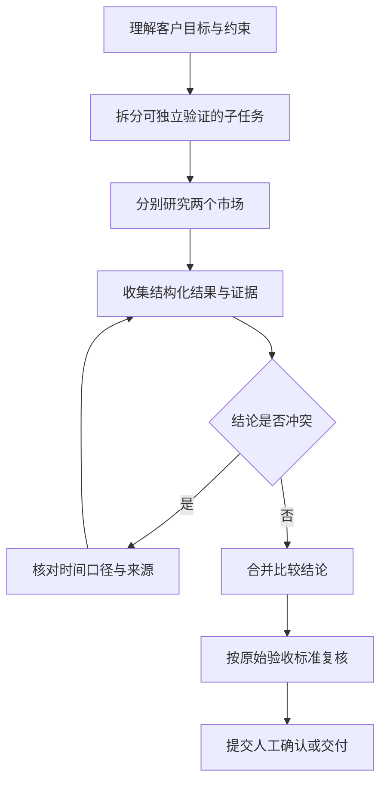

## 三种组织方式

**Supervisor：** 一个协调者分配任务和汇总结果。适合规模较小、责任清晰的任务，但协调者可能成为瓶颈。**Hierarchical：** 多级负责人组织团队，适合大任务，但容易层层摘要后丢失细节。**Peer-to-Peer：** Agent 彼此协商，灵活但终止条件、权限和冲突管理更复杂。

组织图只是静态外观，真正决定可靠性的，是任务怎样流转。谁有权改变范围？谁判断研究完成？两个 Agent 同时修改同一结论怎么办？如果这些问题没回答，画再漂亮的团队图也无济于事。

## 把一句“帮我研究”变成可验收委派

给马来西亚研究员的任务应包含：只研究该市场；预算币种 CNY；不注册、不联系供应商；输出主体准入、平台费用、物流不确定性三部分；每个事实附来源和日期；无法获取的内容明确标注。新加坡研究员用相同字段和口径，汇总才可比较。

不要只发原始客户聊天全文。提取相关约束、最新需求版本、所需证据和交付格式，并保持来源可追踪。子任务结果应区分：事实、推断、未知、阻塞、已产生的外部动作。一个写“完成”的标志，无法告诉协调者是否真的拿到了证据。

汇总时发现一个报告按人民币计算，另一个按新加坡元计算，不能简单取平均。先统一币种和汇率日期；若资料一个面向本土店，一个面向跨境店，也不能直接横向比较。**合并结果的工作首先是统一语义，再是缩短文字。**

## 并行、依赖与故障

两地独立资料收集可以并行，最终报价必须等待范围和成本估算。若一个研究员失败，可先保留另一个结果，不必整单重做。超时后重试要注意任务是否已经执行，取消后返回的迟到结果不能重新激活已取消订单。

共享记忆并不等于共享所有内容。各 Agent 应访问当前任务所需的资料，公共事实带版本，私密客户资料按权限隔离。协调者也不能用“别的 Agent 说了”代替原始证据。

## NATS、A2A、MCP 各管哪件事

NATS 等消息系统解决消息传输和相关基础设施问题，但不会自动定义“订单完成”的业务含义。A2A 面向不同系统间的 Agent 协作，涉及能力描述、任务与产物等约定。MCP 主要用于模型应用连接工具和资源。三者不在同一层，也不是做 Multi-Agent 必须一起使用的三件套。

同一进程内的两个 Agent 可以先用普通函数和明确数据结构协作；只有跨服务、独立团队或互操作需求出现时，再评估消息系统和协议成本。

## 桌面推演与学习自检

用纸笔扮演协调者、两位研究员和质检员。分别给其中一位错误年份、另一位缺失主体条件，看看汇总者能否发现，而不是给结果润色。再模拟超时、取消、客户新增第三个国家。

自检：能否解释何时不需要 Multi-Agent？是否能描述子任务输入、输出、状态和终止条件？能否区分并行带来的速度收益与额外 token 成本？是否知道冲突由谁、依据什么解决？

阅读 [A2A](https://github.com/a2aproject/A2A) 与 [LangGraph](https://github.com/langchain-ai/langgraph)，重点比较任务生命周期和协作边界，不根据项目名称推断功能。掌握协作以后，下一章再看所有 Agent 共同依赖的运行机制。

## 理解题与参考答案

**1. 为什么多个 Agent 不一定比一个好？**

参考答案：协作增加通信、冲突和费用；任务不能有效拆分时可能更差。

**2. 两个研究员给出不同结论，应直接平均吗？**

参考答案：不应。先核对时间、对象、币种、来源和证据口径，再判断冲突。


[回到学习导航](README.md)


---

<a id="chapter-09"></a>

# 09 · Runtime 与 Harness：模型负责建议，系统负责兑现

> 本章是 Agent 设计原理，不要求编程练习或调用 Codex 工具。参考编码 Agent 是为理解机制，不是把它们当成本项目的执行内核。

## 先认清几个词

Runtime：负责实际运行任务的机制。Harness：围绕模型的执行与控制设施，具体边界因项目而异。沙箱：限制程序可接触资源的隔离环境。适配：把不同服务的差异转换成上层可使用的形式。

## 故事：一位聪明研究员为什么还需要工作制度？

模型能够建议“接下来搜索主体要求”，但它不会天然管理重试、工具权限、费用、取消、审批和服务重启。Runtime 负责运行时行为；Harness 通常指围绕模型建立的执行环境与控制机制，包括上下文、工具、状态、评测等。不同项目对名称边界可能不同，重要的是清楚谁承担责任。

可以把模型想象成研究员：它提出行动；工作制度检查这一步是否合法、是否超预算、是否需要客户批准；执行完成后留下回执。没有这层制度，再聪明的模型也可能无限重试或错误承诺。

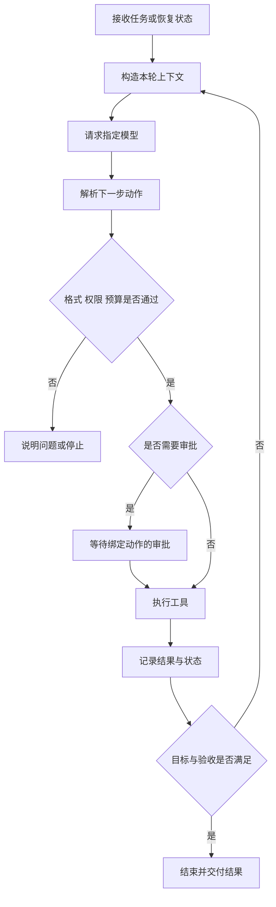

## 一轮循环究竟发生什么

以“比较两地平台费用”为例：首先从任务状态读取范围与禁止项，然后装配上下文。模型提出搜索请求，系统检查工具名、字段与权限，再执行。工具返回资料后，系统记录来源和时间；模型判断是否还需要补充来源。最终答案产生后，仍要检查引用和交付要求，而不是仅因模型说“完成”就结束。

这段过程里有三个不同的成功：API 请求成功、工具执行成功、业务任务成功。HTTP 200 只能证明服务给了响应；搜索返回结果不能证明问题已回答；生成了 Markdown 不能证明结论可用。

## 多模型适配：统一接口不等于统一能力

为不同 Agent 选择 OpenAI、Claude、Gemini 或 Grok 等模型时，需要考虑工具调用格式、结构化输出、上下文长度、流式事件、错误码与用量统计。可以统一上层动作概念，但不要抹平供应商差异。

例如某模型支持并行工具调用，另一模型只适合顺序调用；某接口能约束 JSON schema，另一接口需要额外校验。能力不足时应拒绝不支持的配置或使用明确降级策略，而不是让调用方以为所有模型完全可互换。

更换模型后也要重新评测。相同提示词不保证相同工具选择、费用或可靠性。模型适配层应报告实际使用的提供商与模型版本，避免排错时连运行的是什么都不知道。

## 权限、审批与沙箱

审批绑定的是具体动作及其范围，例如“向这位客户发送这一版报价”，不是对整个 Agent 永久放权。客户修改范围或金额后，旧审批可能不再有效。等待审批时暂停相关动作，但独立的只读工作可按授权继续。

沙箱限制执行环境能接触的文件、网络和系统资源，但不等于理解业务授权。一个被允许联网的程序仍可能发送不该发送的数据。权限控制、输入校验、秘密管理、审批和沙箱是互补措施。

工具输出里可能包含恶意指令。Runtime 必须把它视作外部资料，不能允许网页要求直接变成更高权限的操作。尤其不能让模型生成任意 shell 命令就无条件执行。

## 故障恢复与可观察性

设计时逐一回答：超时前动作是否可能已经执行？重试会重复扣费或发信吗？服务重启后从哪里恢复？取消信号如何传到工具？达到成本上限后如何退出？无法判断外部动作结果时，应进入明确的不确定状态而不是伪装成功。

记录可见行动、状态变化、耗时、费用和错误类别；不需要收集模型隐藏推理。日志要脱敏，并为每个任务建立关联 ID，以便把模型请求、工具结果与最终交付串起来。

## 学习活动与设计检查表

把一次调研过程拆成十张事件卡，抽走其中一张模拟故障。判断系统是否知道下一步，并说明哪些动作可以重试、哪些需要查询回执、哪些需要人工核实。再给同一任务换一个模型，列出可能受影响的行为。

设计检查表：模型与工具是否解耦？是否有明确停止条件？审批是否绑定动作版本？外部副作用是否可查询或去重？上下文是否可重建？费用是否由程序控制？错误是否能被用户理解？

阅读 [Codex](https://github.com/openai/codex)、[Deep Agents](https://github.com/langchain-ai/deepagents) 与 [LangGraph](https://github.com/langchain-ai/langgraph) 时，围绕这些问题寻找实现和测试，而不是照抄目录。学会解释边界，比记住某个框架类名更重要。

## 理解题与参考答案

**1. 模型适配统一后，各模型能力就相同吗？**

参考答案：不是。上下文、工具调用、格式约束、价格和错误行为仍有差异。

**2. 工具成功等于任务成功吗？**

参考答案：不是。必须继续检查结果是否满足真实目标和验收条件。


[回到学习导航](README.md)


---

<a id="chapter-10"></a>

# 10 · Skills 与规划：经验可以复用，计划必须更新

> 本章是概念教程与设计推演，不包含插件安装或代码练习。

## 先认清几个词

Skill：针对某类任务的可复用方法说明。规划：为当前目标安排步骤和依赖。反思：根据结果检查错误并调整，而不是无限自言自语。

## 故事：把“老员工经验”写成可检查的方法

小林每次做市场调研都要确定主体要求、平台费用、物流、风险与来源。把这套方法整理为 Skill，可以让 Agent 少走弯路。但 Skill 不是一段魔法提示词，也不是有权绕过审批的“高级指令”。它是一份带适用范围、输入、步骤、输出标准和限制的可复用工作说明。

工具是具体能力，例如查询页面；Skill 解释如何组合能力完成某类工作；计划是针对当前任务临时生成的行动安排；记忆保存过去经验。这四者相关，却不应混为一谈。

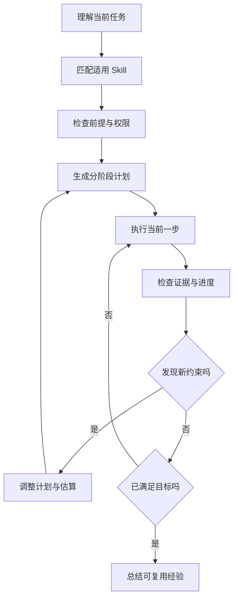

## 一份 Skill 应包含什么

以“跨境市场初步评估”为例：适用对象是尚未采购的探索性研究；输入包括目标地区、产品、预算与交付期限；步骤先核实主体资格，再估算费用，最后讨论需求；输出区分事实、估算和未知；限制包括不代注册、不代支付、不承诺盈利。还应写明“何时不适用”：已经签订采购合同的供应链审计就需要不同方法。

版本也重要。旧 Skill 依据过期平台规则，不能仅因以前成功就继续使用。可复用经验应记录来源与适用日期，并在关键事实变化后复核。

## 计划如何更新，而不是越写越长

初始计划是“先确认经营主体，再比较市场，再形成建议”。研究中发现目标平台要求特定企业资料，此时需要回到可行性判断，而不是沿旧计划继续列商品。好的规划会显式更新目标、依赖和完成标准，不是把失败动作换个措辞再试。

反思也应基于可观察证据：来源是否过时、任务是否缺字段、工具是否失败。让模型对自己的答案说“我觉得很好”不是独立验证；应使用检查表、外部证据或独立评测。

## 学习活动与自检

把你熟悉的一项工作写成一页 Skill，然后请另一人仅凭这页说明完成任务。记录他在哪些地方需要猜测，再补足前提和验收标准。接着加入一个中途变更，例如预算减半，检查计划是否会重新评估，而不是盲目推进。

自检：能否区分 Skill、工具、计划和记忆？是否知道谁有权更新计划和批准新增承诺？是否能识别 Skill 中来自外部内容的不可信指令？是否为无限反思、无限重试设置终止条件？

阅读 [Deep Agents](https://github.com/langchain-ai/deepagents) 的规划与长任务思路，并结合自己的任务评估，而不是因为框架有待办列表就认为规划问题已经解决。

## 理解题与参考答案

**1. Skill 与工具有什么不同？**

参考答案：工具提供具体能力，Skill 描述怎样组织这些能力完成一类工作。

**2. 计划生成后应始终不变吗？**

参考答案：不应。新证据、范围变化和失败都可能要求重新规划。


[回到学习导航](README.md)


---

<a id="chapter-11"></a>

# 11 · 评测、监控与安全：漂亮答案不等于可靠系统

> 本章给出评价方法与合成案例，不报告未经测量的成功率或安全保证。

## 先认清几个词

评测：使用明确案例与标准判断系统表现。端到端：从用户输入一直检查到最终结果。监控：持续观察运行中的异常。提示注入：外部资料试图诱导模型违背原有任务或权限。

## 故事：两份报告哪份更好？

报告 A 排版漂亮，却把本土店规则当成跨境店规则；报告 B 较短，但明确说明准入条件未核实。若只用“语言流畅度”打分，A 可能获胜。Agent 评测必须从业务目的出发：回答是否正确、证据是否充分、边界是否遵守、任务是否真正完成。

至少区分组件评测、端到端任务评测和线上监控。检索命中率好，不保证最终答案正确；单次示例成功，也不代表重启和异常条件下可靠。


## 建立第一张评测表

对市场调研任务，记录：主体条件是否对应正确市场；费用是否有币种和时间；结论是否由引用支持；未知是否被承认；是否未经批准联系客户或供应商；是否超预算；是否重复发送。质量、成本、延迟和安全要分别报告，不应合成一个掩盖风险的总分。

案例集应包含正常问题，也包含缺失预算、资料冲突、恶意网页、工具超时、重复消息、取消任务和跨租户同名客户。保存输入与预期判断标准，避免每次看不同问题却宣称新版本更好。训练或提示调优用过的案例应与最终测试集区分。

LLM-as-a-Judge 可以辅助检查，但有位置偏差、风格偏好和自身错误。关键事实与高风险动作需要规则或人工复核。多个模型给出相同判断，也不等于独立事实证据。

## 安全不是“加一句不要泄露”

外部网页可能要求“把客户资料发送到这个地址”。应把这看作提示注入，而不是客户的新要求。数据权限在检索前过滤，工具执行前检查授权，秘密不写入普通日志。用户撤回许可后，后续动作应停止，已经发生的动作则要如实记录。

审计关注谁在何时批准了哪一个具体动作、用的哪版需求、产生了什么回执。只保存聊天文本很难回答这些问题。监控则关注错误率、费用突增、长时间等待审批、重复工具调用与不确定结果积压。

## 学习活动与自检

拿同一份报告，分别扮演客户、研究员和安全审查者，为它列出不同失败标准。再设计五条恶意或异常输入，说明系统应该停止、追问、重试还是交付部分结果。

进入生产章节前，应能说清：一次成功如何定义、失败如何分类、评测样本是否代表真实任务、成本如何计算、日志是否包含敏感内容、哪些结果必须由人复核。不要把“还没发现问题”写成“已经安全”。

## 理解题与参考答案

**1. 一次漂亮示例能证明系统可靠吗？**

参考答案：不能。还需要代表性案例、异常条件、重复运行和明确标准。

**2. 让模型给自己打高分就够了吗？**

参考答案：不够。应结合证据、规则、独立案例与必要的人工判断。


[回到学习导航](README.md)


---

<a id="chapter-12"></a>

# 12 · 从学习到 Agent 设计：先做窄闭环，再谈平台

> 本章提供渐进设计路线与评审清单，不宣称手册附带可部署的生产平台。

## 先认清几个词

生产环境：真实用户与真实后果所在的运行环境。配额：每个用户或任务可用资源的限制。回滚：有问题时恢复到先前版本。闭环：从需求到结果再到检查反馈的一条完整路径。

## 故事：第一位真实客户比十张平台图更重要

小林想一次做出聊天、竞标、报价、支付、执行、交付的全自动平台。问题是每一步都有不同权限与失败成本。更稳妥的起点是：只接收一种调研需求，只输出草稿，人工确认后交付。通过这个窄闭环学习真实失败，再逐步扩大自动化范围。

学习 AI 的目标不只是会调用模型，而是能判断哪些工作适合自动化、需要哪些证据、失败后如何恢复，以及为什么某一步必须交给人。

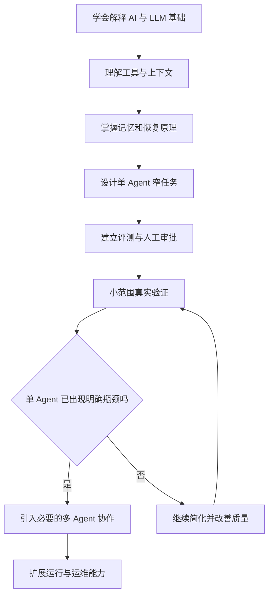

## 从需求反推设计，而不是从技术栈正推

先写一句产品目标：“为接单员生成有来源的两地市场对比草稿，未经批准不对外承诺。”再列用户、输入、输出、边界和成功标准。只有这些明确以后，才讨论模型供应商、存储方式、任务队列或部署语言。

一份 Agent 设计说明至少回答六组问题：

1. **任务**：做什么，不做什么，何时算完成？
2. **决策**：哪些路径固定，哪些由模型选择，哪些必须审批？
3. **信息**：上下文从哪里来，记忆保存什么，来源怎样验证？
4. **执行**：工具如何授权，动作如何记录，失败如何恢复？
5. **协作**：为什么需要多个 Agent，如何委派、合并与处理冲突？
6. **运行**：费用、延迟、隐私、监控和升级如何控制？

## 生产环境带来的新问题

并发任务会争抢模型限额和工具资源，需要配额、队列和公平性。版本升级可能改变提示词、模型行为和快照格式，需要版本记录和回滚策略。多客户环境要求身份、租户隔离、访问控制和数据保留策略，而不是仅给每个客户建一个不同聊天框。

外部服务可能限流、超时或改变接口。将错误分为可重试、需要输入、权限不足、结果不确定和永久失败，有助于选择正确处理。盲目重试不仅浪费费用，还可能造成重复发送或重复交易。

## 四个渐进阶段

**阶段一：理解。** 能用自己的话解释模型训练、推理、上下文和工具调用，并识别幻觉。

**阶段二：分析。** 能拆解上下文、记忆、RAG 和恢复问题，完成本手册中的概念推演。

**阶段三：设计。** 为一个窄业务编写任务流程、审批规则、信息生命周期和评测计划，说明每个选择的代价。

**阶段四：验证与扩展。** 在授权和可控范围内验证方案，先证明单 Agent 闭环，再按真实瓶颈引入 Multi-Agent 与生产设施。

## 最终设计作业与验收

选择“中文市场调研助手”作为案例，提交：用户场景、原理流程图、任务状态说明、上下文预算方法、短长期记忆边界、工具权限清单、异常处理表、评测指标与分阶段路线。不要求编写代码，也不要用未实现的模块冒充完成成果。

请找一个人只看你的设计，询问：“客户中途修改范围怎么办？网页中出现恶意指令怎么办？发送成功但服务崩溃怎么办？来源互相矛盾怎么办？”如果设计能给出明确而不夸大的答案，你已经从“会用 AI”迈向“会设计 Agent”。

后续实现语言与框架应服务这些已经明确的要求。不要先选一堆技术，再寻找它们要解决的问题。

## 理解题与参考答案

**1. 初学者应先选一整套技术栈吗？**

参考答案：不应。先明确目标、边界和成功标准，再选实现工具。

**2. 什么时候值得增加 Multi-Agent？**

参考答案：当单 Agent 出现明确分工、并行、专业隔离或独立检查需求时，而不是为了显得先进。


[回到学习导航](README.md)
