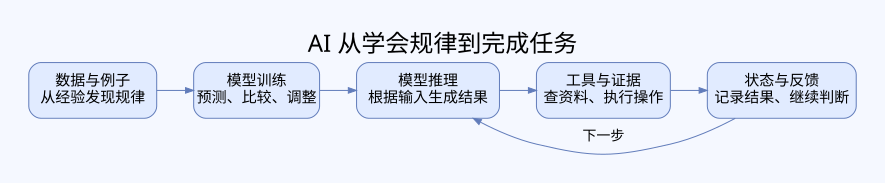

# 从零认识 AI，再到 AI Agent 设计

**给新手的中文图解学习手册。先读懂原理，再看清过程，最后能设计一个可靠的 Agent。**

你不需要先会 Rust，也不需要 API Key。本手册没有离线编程练习，不要求安装框架。我们用小林调查供应商的故事，把抽象概念拆成可以看懂的步骤。

## 开始阅读

👉 **[打开完整手册](HANDBOOK.md)** · [第一次怎么读](READING-GUIDE.md) · [新手词典](GLOSSARY.md) · [按用途整理的学习资料](SOURCES.md) · [验证与范围](VALIDATION.md)

### 学习顺序

| 阶段 | 阅读内容 | 最先解决的疑问 |
|---|---|---|
| 零基础 | [00 AI 学习地图](HANDBOOK.md#chapter-00) | AI、机器学习、神经网络、LLM 到底是什么？ |
| 入门应用 | [01 模型与 Agent](HANDBOOK.md#chapter-01)、[02 工作流](HANDBOOK.md#chapter-02)、[07 工具与检索](HANDBOOK.md#chapter-07) | 会聊天为什么不等于会办事？ |
| 进阶原理 | [03 上下文](HANDBOOK.md#chapter-03)、[04 压缩](HANDBOOK.md#chapter-04)、[05 短期记忆](HANDBOOK.md#chapter-05)、[06 长期记忆](HANDBOOK.md#chapter-06) | 为什么它会忘，怎样让它可靠地记住？ |
| 高级设计 | [08 多 Agent](HANDBOOK.md#chapter-08)、[09 Runtime](HANDBOOK.md#chapter-09)、[10 技能与规划](HANDBOOK.md#chapter-10) | 多个助手怎样分工、等待、恢复？ |
| 可靠运行 | [11 评测与安全](HANDBOOK.md#chapter-11)、[12 生产设计](HANDBOOK.md#chapter-12) | 怎样知道系统真的可靠，而不是碰巧答对？ |

## 不是背名词，是理解一件事怎样发生

每章按“发生了什么问题 → 用生活类比理解 → 看流程图 → 走一遍例子 → 识别误区 → 检查理解”展开。图主要展示信息、决策和状态的变化，不把架构框图当成解释。

- 第一遍：只读故事、图和例子；陌生词停下来查本章定义。
- 第二遍：遮住下一步，猜系统应该怎么处理，再对照解释。
- 第三遍：看源码阅读入口，理解框架怎样把这些原则落实，不必一次看完整个仓库。

**建议节奏：**初学者每次 30–45 分钟，学一个过程即可。这里没有硬性的“12 周掌握 AI”承诺。以能向别人解释、能推演失败场景为进度标准。

## 本版提供什么

- 1 篇 AI 基础到高级设计的导航教程 + 12 章 Agent 原理教程。
- 原理流程图、日常类比、连续案例与理解检查。
- 已核验身份与许可证状态的开源资料索引，标明不明确或未核实项。
- 高级章节讨论设计取舍，不要求 Rust 练习，也不宣称已经实现商业平台。

本版不是完整数学教材，也不是模型训练实战课程。AI 基础先建立直觉和正确概念，重点逐步过渡到 Agent 设计；需要更深数学和训练内容时，沿资料索引继续学习。

## 文件说明

- `HANDBOOK.md`：可直接在 GitHub 阅读的完整正文，目录可跳转。
- `learning-flow.svg`：静态原理图，GitHub 可直接显示；正文含 Mermaid 原理流程图。
- `SOURCES.md`、`sources.json`：资料说明和结构化核验记录。
- `VALIDATION.md`：完成与未完成边界。

案例人物、供应商和价格均为虚构教学材料，不是市场调研结论。源码仅链接，未复制上游课程或实现。原创内容暂未授予开源许可证，公开再分发前应由仓库所有者决定许可。
