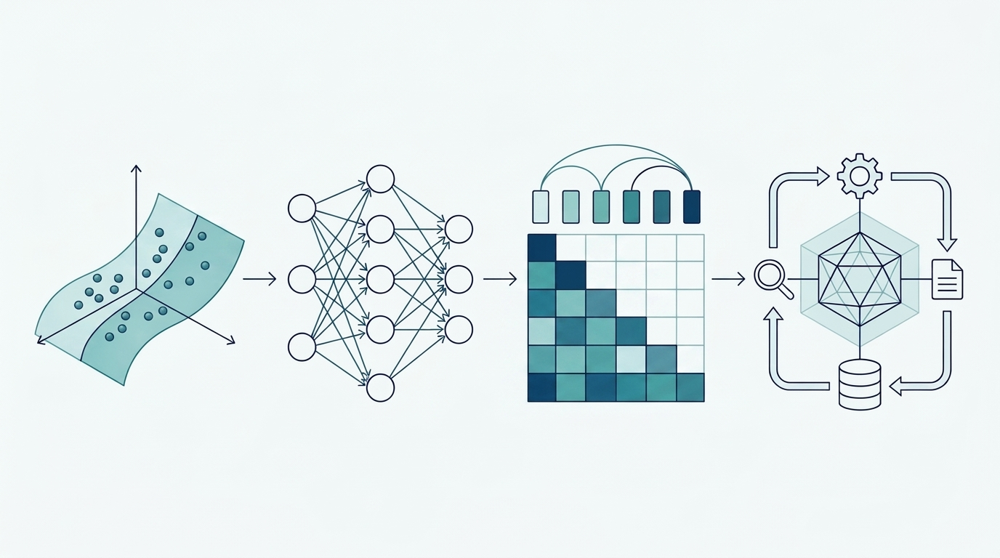
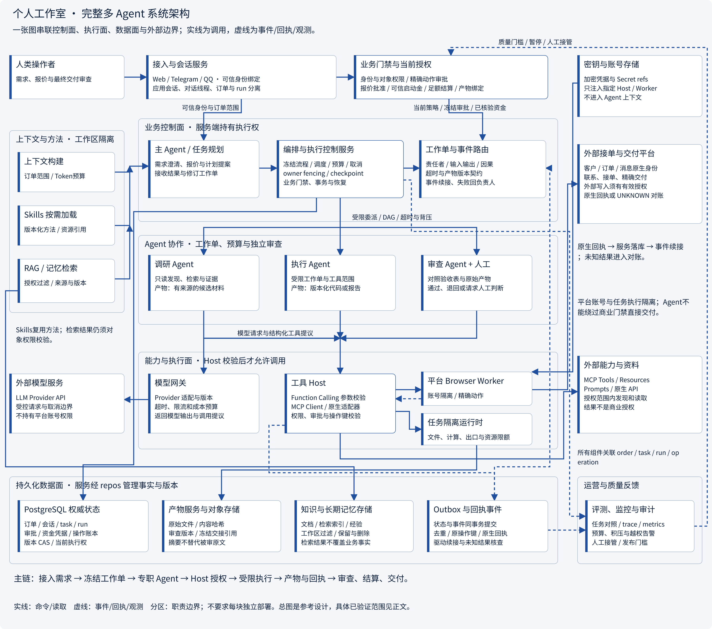

# AI 学习手册：从模型原理到 Agent 架构

从零理解 AI 的学习仓库。沿着**数据与数学 → 机器学习与神经网络 → 大语言模型 → 应用工程 → Agent 系统 → 架构设计**学习，用数值例子、配图、流程图和失败推演建立可以迁移的理解。



## 开始学习

[Function Calling 两讲](docs/zh/tools/fc01.md) · [MCP 六讲](docs/zh/mcp/mcp01.md) · [Skills 六讲](docs/zh/skills/skill01.md) · **[学习地图](docs/zh/index.md)** · [完整课程目录](HANDBOOK.md) · [阅读方法](READING-GUIDE.md) · [四个离线实验](docs/zh/projects/02-labs.md) · [参考课程](docs/zh/resources.md) · [词典](GLOSSARY.md)

正文可直接在仓库阅读；配套文档站提供固定分层导航、页内目录、标题检索、课程进度和中英文切换。中英文都有图解主线，中文另有完整推导，英文补充笔记为精简版。阅读不需要 API Key。

## 递进课程

| 阶段 | 内容 | 设计或学习产物 |
|---|---|---|
| 1 入门 · 模型原理 | 数学、机器学习、神经网络、语言模型、注意力和适配 | 手算机制与数据实验设计 |
| 2 进阶 · Agent 原理与应用 | 应用、Agent基础、上下文、函数调用、MCP、Skills、状态记忆 | 逐项理解契约、方法、能力和状态边界 |
| 3 高级 · Agent 架构设计 | 任务职责、拓扑通信、会话、共享状态、权限、审批、调度恢复、评测运营、部署装配 | 每个维度的设计契约、失败路径、选型依据与代码 |
| 4 综合实践与资料 | 个人工作室接单到交付架构与离线机制实验 | 完整设计、正常/故障轨迹与验收依据 |

## 完整系统架构图



总图把需求入口、业务门禁、Agent协作、工具与模型、隔离Worker、持久状态及评测监控连接起来。点击图片可查看3600像素宽原图；[架构装配](docs/zh/agent/12.md)与[个人工作室项目](docs/zh/projects/personal-studio.md)分别解释整体装配和具体业务设计。

高级篇不是几个总览标题：任务划分、消息协议、状态冲突、并发背压、故障补偿、协作收益和部署容量分别展开；会话、权限、审批各有独立章节。原Skills总览已合并，规划保留在技能组合与任务设计中。编号由同一课程清单生成，正文、导航、目录一致。

每课按问题、机制图、主流方案及内部步骤、失败恢复、参考代码、自检展开。案例人物、价格和供应商均为虚构，训练只提供代码。

## 原理与实验

配图按用途选择：场景和示例照片使用PNG/JPEG，真实界面使用截图，高级架构、部署与协作设计输出宽2400像素的高清PNG；公式、矩阵及计算原理保留SVG。架构图由绘图源码生成，场景插画不会代替精确的连接关系。所有图在正文直接显示，不依赖Mermaid服务。

进阶篇讲控制流、上下文、函数调用、MCP、Skills和状态记忆；高级篇按任务、协作、会话、状态一致性、权限、审批、执行恢复、评测运营和部署装配逐项设计。Function Calling 两讲明确模型提议与执行边界；Skills 六讲提供实际技能包、按需加载、可信绑定、产物组合与回归方法。MCP 六讲：Host/Client/Server、Tools/Resources/Prompts、当前与旧版协议、传输与认证、真实 SDK、Host 接入。图分别解释计算或状态机制、方案选择、内部步骤与失败路径，网页中可点击看大图。

[配套代码说明](docs/zh/projects/03-code-guide.md)解释依赖与验证范围。[代码示例](examples/)包含自动求导、MLP、因果 Decoder、LoRA、RRF、ReAct、规划与反思、Checkpoint、记忆、并发、审批和分层装配。另有完整分类训练代码，**只提供实现，不执行实际训练**。PyTorch/scikit-learn 示例做语法和静态检查；标准库机制另有测试，不将其结果当作模型效果证明。

四个可选实验只用 Python 标准库，分别观察梯度更新、因果注意力、授权检索评价和崩溃后的幂等恢复：

```sh
python3 -m labs.gradient
python3 -m labs.attention
python3 -m labs.retrieval
python3 -m labs.recovery
python3 -m unittest discover -s tests -v
```

这是机制实验与架构课程。它没有预训练大模型，也没有实现真实采购平台；模型训练的进一步实战可沿参考课程继续。

## 本地阅读站

```sh
docker compose up --build -d
```

内容、图片和样式变化会自动重新构建，刷新页面即可阅读新内容。运行端口为 32140，绑定所有网络接口。访问地址由会话提供，不写入文档。

也可以使用 Python 3.11 或更新版本单独构建静态站。先安装 Noto Sans CJK 字体（Debian/Ubuntu 包为 `fonts-noto-cjk`），或通过 `HANDBOOK_FONT_FILE` 指定兼容的 CJK 字体文件；PNG 导出需要该字体，Docker 与 CI 已配置。然后执行：

```sh
python3 -m venv .venv
.venv/bin/pip install -r requirements.txt
.venv/bin/python scripts/build_site.py
.venv/bin/python scripts/check_site.py
.venv/bin/python scripts/check_docs.py
```

生成的静态产物位于 `_site`，可交给普通静态文件服务器。构建依赖包含Python Markdown与resvg_py。可选 MCP、Skills 与工作流 SDK 依赖独立于构建依赖；模型代码依赖及验证范围见配套代码说明。浏览器运行时不加载外部脚本或字体。

## 目录结构

```text
docs/                 中英文课程正文与补充笔记
site/                 课程清单、逐课内容、语言资源与阅读站界面
assets/illustrations/ 场景图片与概念插画
assets/screenshots/   真实页面截图
assets/diagrams/      按阶段、专题、课程和语言组织的图
scripts/diagrams/     绘图源与公共 SVG 画布
scripts/              构建、校验与本地预览入口
examples/             配套参考实现与技能包
labs/                 四个标准库实验
tests/                机制与契约检查
references/           上游资料元数据
_site/                自动生成的阅读站，不纳入版本管理
```

图片的生成方式与维护边界见[视觉资产说明](assets/README.md)。课程图按课就近管理；根目录不放散落 SVG。生成图保留在仓库供 Markdown 直接显示，站点构建会清理过期输出。

## 参考与贡献

教学组织参考 D2L、Neural Networks: Zero to Hero、LLM Cookbook 和 Hello-Agents，机制说明参考原始论文与官方资料；[参考课程](docs/zh/resources.md)说明具体借鉴和阅读作业。讲解、数值例子和矢量图独立编写，不复制第三方课程全文。

补充内容请遵守[贡献要求](CONTRIBUTING.md)。原创内容的公开再分发许可仍由仓库所有者决定；本次不代为选择许可证。上游课程、代码、权重和图片各自的许可不自动相同。
