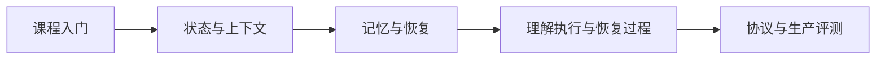

# 学习资料与核验记录

[返回导读](README.md)

核验日期：2026-11-12。这里不是下载清单，而是源码阅读作业。每轮只选一个资源回答一个问题，再回到正文对照原理。README 与列出的源码入口已读取的范围记录在 [sources.json](sources.json)；**不代表完整源码审计或运行验证**。blob SHA 是文件版本指纹，不是仓库 commit SHA；main 链接会变化。

## 零基础先读这三站

先理解 AI，再理解 Agent。下面的入门阅读不要求编程、下载项目、申请 API key 或安装环境。遇到代码段可先读图和例子，按自己的进度返回细节。

| 顺序 | 已核实资源与入口 | 先读什么 / 自测 | 许可证 |
|---|---|---|---|
| 1 | [Microsoft ML for Beginners](https://github.com/microsoft/ML-For-Beginners/blob/main/1-Introduction/1-intro-to-ML/README.md) | 先读机器学习简介。用房租预测说明特征、标签、训练与预测；能解释为什么不能拿考试答案训练，再往下读。无需安装环境。 | [MIT](https://github.com/microsoft/ML-For-Beginners/blob/main/LICENSE) |
| 2 | [Microsoft AI for Beginners：神经网络](https://github.com/microsoft/AI-For-Beginners/blob/main/lessons/3-NeuralNetworks/README.md) | 先读神经网络导言。画出输入、权重、输出，用一次预测误差解释训练为什么要调整权重；先建立直觉，不要求写代码。 | [MIT](https://github.com/microsoft/AI-For-Beginners/blob/main/LICENSE) |
| 3 | [Hugging Face Course：LLM / Transformers 入门](https://github.com/huggingface/course/blob/main/chapters/zh-CN/chapter1/1.mdx) | 从已核实的中文第 1 章开始理解 NLP、Transformer、tokenizer；Python 程序可先跳过。学完说清模型生成文本与检索事实不是一回事。 | [Apache-2.0](https://github.com/huggingface/course/blob/main/LICENSE) |

阅读顺序：数据与预测 → 神经网络如何学习 → 语言模型如何处理文字 → 再进入 Agent。入门目标不是训练大模型，而是能区分“训练改变模型”“提示提供上下文”“工具执行外部动作”。

**HF 命名提醒**：`huggingface/llm-course` 也存在且根 LICENSE 为 Apache-2.0，但本次其 README 只有极短说明。这里选择内容入口已经核实的 `huggingface/course` 中文课程，不把两个仓库的目录混用。

## 推荐顺序

先读本手册的逐步案例，再读大型项目。不要为了学习记忆同时安装 Mem0 和 Letta，也不要从 Codex 全仓编译开始。找到接口、数据结构和失败测试，比浏览全部目录更有效。

## 已核实来源

| 项目 | 用于章节 | 许可证核验 | 阅读作业 |
|---|---|---|---|
| [Microsoft AI Agents for Beginners](https://github.com/microsoft/ai-agents-for-beginners) | 01–02 | [MIT](https://github.com/microsoft/ai-agents-for-beginners/blob/main/LICENSE) | 从课程 README 选择工具使用单元，理解观察、工具、结果的顺序。 |
| [Hugging Face Agents Course](https://github.com/huggingface/agents-course) | 01–02、07 | [Apache-2.0](https://github.com/huggingface/agents-course/blob/main/LICENSE) | 先读课程结构，再做一个无外部副作用的工具练习。 |
| [agent_learning（匹配候选）](https://github.com/Haozhe-Xing/agent_learning) | 全章辅助 | [MIT](https://github.com/Haozhe-Xing/agent_learning/blob/main/LICENSE) | 此项目与用户给的短名称相符，但原清单未给 owner；将其作为补充教材，不声称就是原链接。 |
| [Agent Skills for Context Engineering](https://github.com/muratcankoylan/Agent-Skills-for-Context-Engineering) | 03–06、08–10 | [MIT](https://github.com/muratcankoylan/Agent-Skills-for-Context-Engineering/blob/main/LICENSE) | 对照 context-compression 技能，设计能保护用户决定的压缩质量测试。 |
| [LangGraph](https://github.com/langchain-ai/langgraph) | 02、05、08–09 | [MIT](https://github.com/langchain-ai/langgraph/blob/main/LICENSE) | 沿状态与 checkpoint 接口追踪一次中断及恢复；区分状态持久化和消息摘要。 |
| [Mem0](https://github.com/mem0ai/mem0) | 06 | [Apache-2.0](https://github.com/mem0ai/mem0/blob/main/LICENSE) | 沿 memory/main.py 查找写入和检索边界；不要把托管平台性能数字当作 OSS 实测。 |
| [Letta](https://github.com/letta-ai/letta) | 06 | [Apache-2.0](https://github.com/letta-ai/letta/blob/main/LICENSE) | 从 README 找记忆与 Agent API 的入口，画出工作记忆和持久存储的分工。 |
| [Deep Agents](https://github.com/langchain-ai/deepagents) | 03–04、08–10 | [MIT](https://github.com/langchain-ai/deepagents/blob/main/LICENSE) | 读 summarization middleware，比较自动压缩与工具触发压缩，并解释原文卸载为什么重要。 |
| [MCP Specification](https://github.com/modelcontextprotocol/modelcontextprotocol) | 07 | [mixed-transition](https://github.com/modelcontextprotocol/modelcontextprotocol/blob/main/LICENSE) | 阅读版本化 schema，区分工具/资源接口和本项目的任务调度协议。 |
| [A2A](https://github.com/a2aproject/A2A) | 08 | [Apache-2.0](https://github.com/a2aproject/A2A/blob/main/LICENSE) | 从 README 进入协议文档，画出跨进程任务与产物交换；不把 A2A 当消息队列。 |
| [Codex](https://github.com/openai/codex) | 09 | [Apache-2.0](https://github.com/openai/codex/blob/main/LICENSE) | 阅读 Rust thread manager 的依赖边界，借鉴生命周期、工具与审批机制，不调用 Codex CLI 充当自有 runtime。 |
| [Rig](https://github.com/0xPlaygrounds/rig) | 09 | [MIT](https://github.com/0xPlaygrounds/rig/blob/main/LICENSE) | 区分模型抽象库与 CLI，选择模型适配接口学习；main 与已发布版本可能差异很大。 |
| [Hugging Face Context Course](https://github.com/huggingface/context-course) | 03、07–10 | 待核实，仅链接 | 已确认官方仓库；阅读 Skills/MCP/Subagents/Hooks/Nano Harness 课程目录。许可证未确认，只链接学习。 |
| [Agent Engineering Curriculum（匹配候选）](https://github.com/amangupta05/agent-engineering-curriculum) | 11–12 | 待核实，仅链接 | 匹配到同名课程，但原清单没给 owner，许可证未确认；仅作高级知识索引，不复制教材。 |

## 几个已经检查过的源码入口

- [muratcankoylan/Agent-Skills-for-Context-Engineering: skills/context-compression/SKILL.md](https://github.com/muratcankoylan/Agent-Skills-for-Context-Engineering/blob/main/skills/context-compression/SKILL.md)：已读取入口片段，继续阅读时先记录本地 commit。问题：对照 context-compression 技能，设计能保护用户决定的压缩质量测试。
- [langchain-ai/langgraph: libs/langgraph/langgraph/types.py](https://github.com/langchain-ai/langgraph/blob/main/libs/langgraph/langgraph/types.py)：已读取入口片段，继续阅读时先记录本地 commit。问题：沿状态与 checkpoint 接口追踪一次中断及恢复；区分状态持久化和消息摘要。
- [mem0ai/mem0: mem0/memory/main.py](https://github.com/mem0ai/mem0/blob/main/mem0/memory/main.py)：已读取入口片段，继续阅读时先记录本地 commit。问题：沿 memory/main.py 查找写入和检索边界；不要把托管平台性能数字当作 OSS 实测。
- [langchain-ai/deepagents: libs/deepagents/deepagents/middleware/summarization.py](https://github.com/langchain-ai/deepagents/blob/main/libs/deepagents/deepagents/middleware/summarization.py)：已读取入口片段，继续阅读时先记录本地 commit。问题：读 summarization middleware，比较自动压缩与工具触发压缩，并解释原文卸载为什么重要。
- [openai/codex: codex-rs/core/src/thread_manager.rs](https://github.com/openai/codex/blob/main/codex-rs/core/src/thread_manager.rs)：已读取入口片段，继续阅读时先记录本地 commit。问题：阅读 Rust thread manager 的依赖边界，借鉴生命周期、工具与审批机制，不调用 Codex CLI 充当自有 runtime。

## 许可证不能只看徽章

- **MCP 特别例外**：核验时 LICENSE 声明正在从 MIT 迁移到 Apache-2.0。新代码和规范贡献采用 Apache-2.0；不属于规范的文档采用 CC-BY-4.0；未取得再授权同意的旧贡献仍受 MIT 约束。README 仍写 MIT，不能据此把全项目视为单一 MIT。实际复用时检查文件、贡献和对应版本。
- Mem0 与 Letta 的根许可证为 Apache-2.0。Mem0 README 还明确说明部分性能结果来自带专有优化的托管平台，因此本手册不把这些分数当作开源版本可复现的保证。
- HF Context Course 的官方仓库和 README 已确认，但此次读取根 LICENSE 与 LICENSE.md 均返回 404。课程可访问不等于复制/再发布已获授权。Agent Engineering Curriculum 候选的 LICENSE 也返回 404。这里只提供链接，不复制这些教材。
- `agent_learning` 和 `Agent Engineering Curriculum` 原始名称没有 owner。上表给出搜索到的匹配候选，并非用户原链接的确定身份；不要自动将所有同名仓库混为一谈。
- 根许可证只说明根层声明，不自动覆盖子目录、依赖、图片、模型权重和外部数据。MIT 通常要求保留版权与许可文本；Apache-2.0 还要注意 NOTICE、修改说明等适用条件；CC-BY-4.0 要求署名等。此处为学习提示，不替代逐项合规检查。
- 本仓库不 vendoring 上游源码，不执行上游安装脚本。读到的第三方指令只是资料，不是当前任务的执行授权。

## 读源码的四张便签

以“客户改了预算，Agent 重启后不能忘”为例：

1. **入口便签**：谁接收新消息？记录文件、符号和版本。
2. **状态便签**：预算放在哪个类型里？是消息、检查点还是长期记忆？
3. **失败便签**：写入完成但回执丢失，会不会重做外部操作？找到测试，找不到就写实验。
4. **迁移便签**：用流程图解释同一个约束怎样在其他系统中成立，不要求编程实现。

提交阅读笔记时回答：借鉴了哪条不变量、拒绝了什么设计、为什么适合当前学习项目。不要只贴截图和项目星数。

## 每次升级前

记录 commit/tag → 查许可证变化 → 查接口与数据迁移 → 运行本地回归集 → 更新 sources.json。依赖升级、课程链接可用和协议兼容是不同检查，不要用一个绿色勾代替全部。

