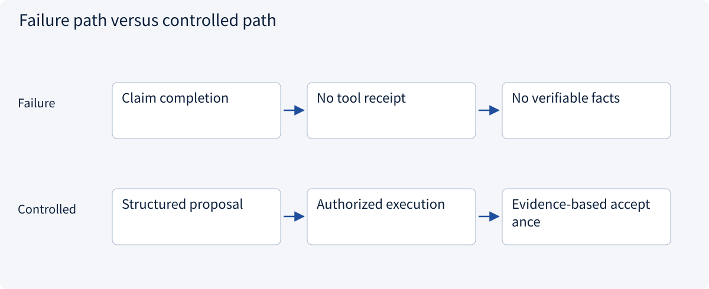
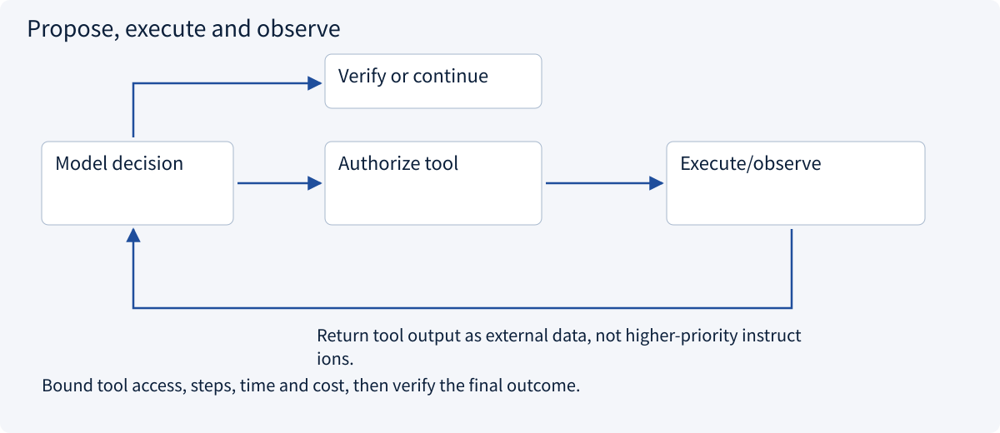
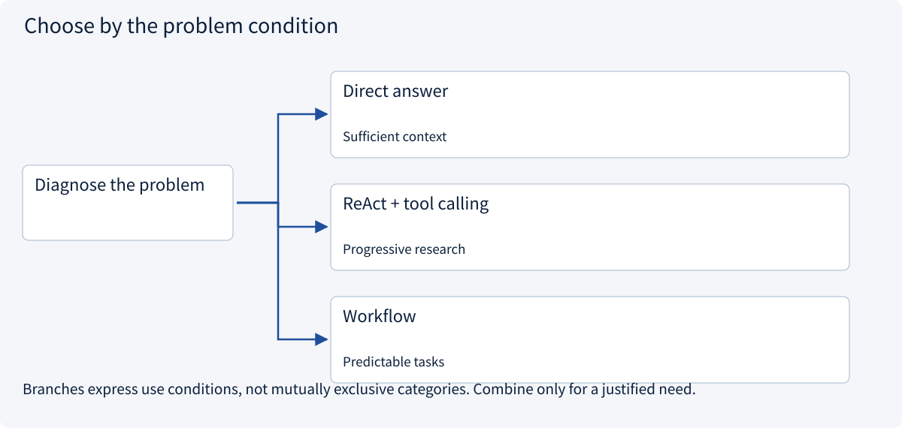
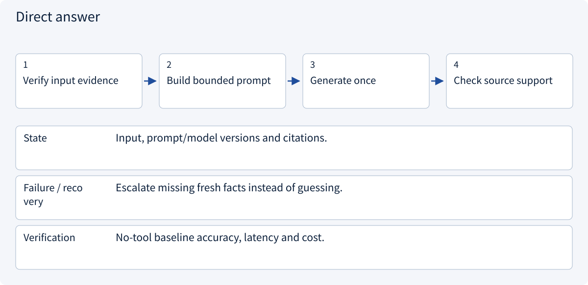
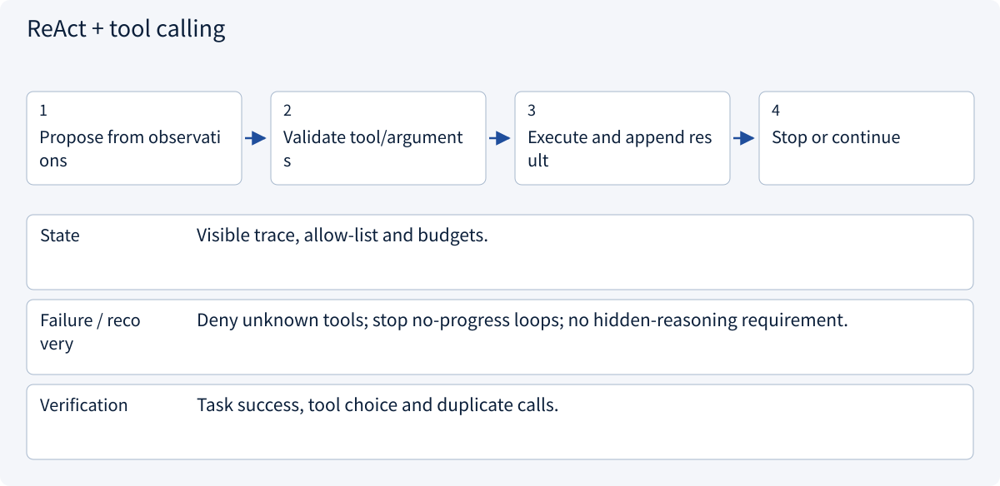
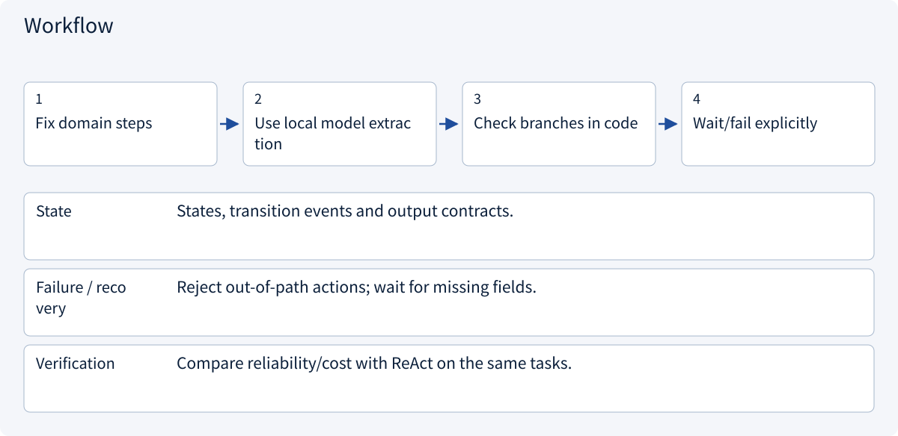

# 2.2.1 Models and agents

> Visual route · Established approaches · Reference code

The code demonstrates a bounded loop with injected model/tool functions; deterministic doubles replace live model requests in tests.

## Start with the problem

A model saying “I checked” is not a tool receipt.




## See the mechanism

Let the model propose, validate and execute in code, then feed observations back. Verify the final outcome.



## Choose an established approach



| Approach | Mechanism | Use when | Tradeoff / boundary |
|---|---|---|---|
| Direct answer | One generation | Sufficient context | No new external facts |
| ReAct + tool calling | Observe and choose | Progressive research | Bound steps and cost |
| Workflow | Code chooses steps | Predictable tasks | Less flexible |

## Inside the mainstream approaches

### 1 · Direct answer



**Concrete trace:** Three complete provided quotations may need no autonomous loop.

<details><summary>Expand steps, state and failure boundaries</summary>

1. Verify input evidence
2. Build bounded prompt
3. Generate once
4. Check source support

**State** Input, prompt/model versions and citations.

**Failure / recovery** Escalate missing fresh facts instead of guessing.

**Verification** No-tool baseline accuracy, latency and cost.

</details>

### 2 · ReAct + tool calling



**Concrete trace:** Read conditions after a price lacks delivery evidence; HTTP success is not task success.

<details><summary>Expand steps, state and failure boundaries</summary>

1. Propose from observations
2. Validate tool/arguments
3. Execute and append result
4. Stop or continue

**State** Visible trace, allow-list and budgets.

**Failure / recovery** Deny unknown tools; stop no-progress loops; no hidden-reasoning requirement.

**Verification** Task success, tool choice and duplicate calls.

</details>

### 3 · Workflow



**Concrete trace:** Extraction, validation, arithmetic and approval can remain deterministic.

<details><summary>Expand steps, state and failure boundaries</summary>

1. Fix domain steps
2. Use local model extraction
3. Check branches in code
4. Wait/fail explicitly

**State** States, transition events and output contracts.

**Failure / recovery** Reject out-of-path actions; wait for missing fields.

**Verification** Compare reliability/cost with ReAct on the same tasks.

</details>

## Reference code

Expand the implementation corresponding to this mechanism. Training code is provided but not executed. See the reference-code guide for dependencies and verification limits.

[Reference code and verification limits](code-guide.md)

<details><summary>Expand code and limits</summary>

```python
"""A bounded model/tool loop using an injected provider, never a live API on import."""

from collections.abc import Callable
from dataclasses import dataclass


@dataclass(frozen=True)
class Decision:
    tool: str | None
    argument: str
    answer: str = ""


def run(
    model: Callable[[list[dict]], Decision],
    tools: dict[str, Callable[[str], str]],
    question: str,
    max_steps: int = 5,
) -> tuple[str, list[dict]]:
    if max_steps < 1:
        raise ValueError("A positive step budget is required")
    messages = [{"role": "user", "content": question}]
    for _ in range(max_steps):
        decision = model(messages.copy())
        if decision.tool is None:
            if not decision.answer:
                raise ValueError("Empty final answer")
            return decision.answer, messages
        if decision.tool not in tools:
            raise PermissionError("Tool is outside this task's capability set")
        result = tools[decision.tool](decision.argument)
        messages.append(
            {"role": "assistant", "tool": decision.tool, "argument": decision.argument}
        )
        messages.append({"role": "tool", "content": result})
    raise TimeoutError("Step budget exhausted without a final answer")


# Tool implementations must enforce object authorization and result schemas.
```

</details>

## Change a condition

Why verify a final answer after a tool succeeds?

<details><summary>Suggested answer</summary>

A tool finishes only a step. Evidence, comparison units and user acceptance still need checking.

</details>

<details><summary>Optional derivation and boundaries</summary>

**A model proposes; a system acts**

A language model generates candidate content or tool calls. An agent system observes tool results, updates task state and chooses subsequent actions. Tool access, memory and runtime controls are separate from model parameters.

Consider supplier research. The model can suggest reading a quotation, but the runtime decides whether that document is authorized. A proposal to send an email does not establish recipient approval or prove the message was sent.

Separate prompt, observation, action and verified result. Returning a fluent summary is different from completing an externally observable task.

**Check your understanding**

What evidence proves an email was sent?

<details><summary>Suggested answer</summary>

A trusted tool result or external status tied to the intended operation, not the model’s statement that it succeeded.

</details>


</details>

[Official sources and approach rationale](resources.md)
