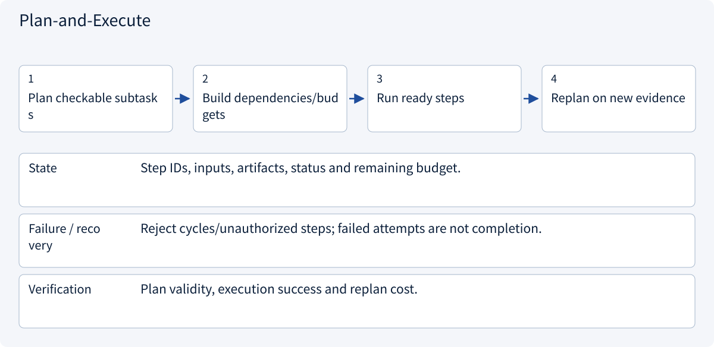
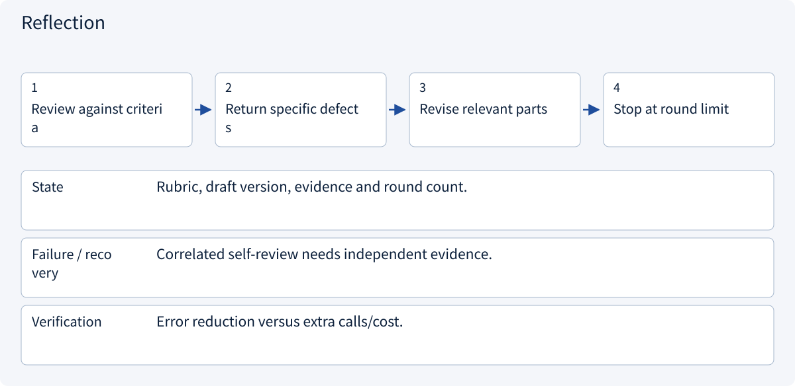

# 2.2.2 Agent control flow: workflows and dynamic loops

> Visual route · Established approaches · Reference code

## Start with the problem

Where should planning and review sit when task paths vary?


## See the mechanism

Use fixed control for stable paths, routing for classes, planning for dependencies and bounded review for revisions.


## Choose an established approach


| Approach | Mechanism | Use when | Tradeoff / boundary |
|---|---|---|---|
| Router | Select a specialized path | Clear task classes | Misrouting propagates |
| Plan-and-Execute | Decompose and execute | Dependent subtasks | Validate the plan too |
| Reflection | Revise from feedback | Checkable artifacts | Self-review is not evidence |

## Inside the mainstream approaches

### 1 · Router


**Concrete trace:** Fixed extraction and open research take different paths.

### 2 · Plan-and-Execute



**Concrete trace:** Price comparison waits for compatible specifications and tax basis.

### 3 · Reflection



**Concrete trace:** Useful feedback identifies missing delivery evidence, not just writing style.

## Reference code

Expand the implementation corresponding to this mechanism. Training code is provided but not executed. See the reference-code guide for dependencies and verification limits.

[Reference code and verification limits](../../docs/zh/projects/03-code-guide.md)

<details><summary>Expand code and limits</summary>

```python
"""A teaching comparison: Plan-and-Execute and bounded Reflection."""

from collections.abc import Callable


def plan_and_execute(
    question: str,
    planner: Callable[[str], list[str]],
    execute: Callable[[str], str],
    max_tasks: int = 5,
) -> list[str]:
    tasks = planner(question)
    if not tasks or len(tasks) > max_tasks:
        raise ValueError("Invalid or over-budget plan")
    return [execute(task) for task in tasks]


def reflect(
    draft: str,
    review: Callable[[str], tuple[bool, str]],
    revise: Callable[[str, str], str],
    rounds: int = 2,
) -> str:
    for _ in range(rounds):
        accepted, feedback = review(draft)
        if accepted:
            return draft
        draft = revise(draft, feedback)
    accepted, _ = review(draft)
    if not accepted:
        raise ValueError("Review budget exhausted")
    return draft


# Model-generated tasks still need authorization; a reviewer is not factual proof.
```

</details>

## Change a condition

Should an agent force an old plan through missing quotations?

<details><summary>Suggested answer</summary>

No. Replan or wait for evidence within authority and budget.

</details>

<details><summary>Optional derivation and boundaries</summary>

**Choose a workflow before adding autonomy**

A fixed workflow follows predefined transitions. An agent selects steps dynamically from observations. A mixed design can retain a deterministic outer process while allowing bounded model choices inside a step.

Use routing for task classes, parallel branches for independent work and a coordinator when subtasks depend on discovered structure. Each additional branch adds latency, cost, state and failure handling.

Write states and transition conditions before choosing a framework. Missing information should move a task into a waiting state rather than cause an unlimited loop.

**Check your understanding**

Should a stable form-filling process start with ten agents?

<details><summary>Suggested answer</summary>

No. Establish the simplest workflow baseline and introduce dynamic decisions only where their benefit is measurable.

</details>


</details>

[Official sources and approach rationale](../../docs/zh/resources.md)
