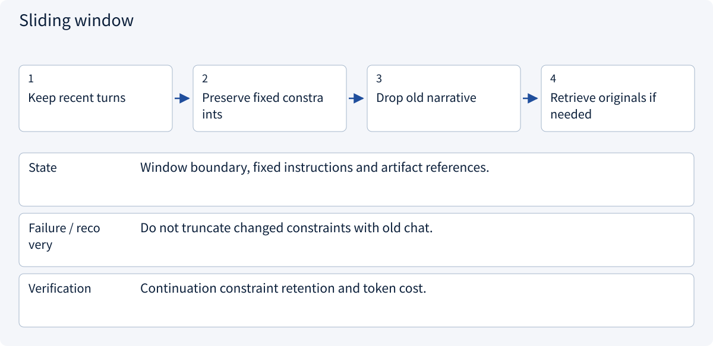

# 2.3.1 Context engineering

> Visual route · Established approaches · Reference code

The code packs context using caller-supplied costs. Actual token counts should come from the target model tokenizer.

## Start with the problem

Why do large windows still miss constraints?


## See the mechanism

Treat context as a budget: protect trusted instructions, select relevant evidence and reserve space for tool results and output.


## Choose an established approach


| Approach | Mechanism | Use when | Tradeoff / boundary |
|---|---|---|---|
| Sliding window | Recent messages | Short local dialogue | Loses early constraints |
| Retrieved context | Select evidence | Large histories/docs | Recall can fail |
| Layered budget/artifacts | Protect constraints and link large outputs | Long tasks | Preserve retrievable originals |

## Inside the mainstream approaches

### 1 · Sliding window



**Concrete trace:** A changed budget belongs in task state, not only recent conversation.

<details><summary>Expand steps, state and failure boundaries</summary>

1. Keep recent turns
2. Preserve fixed constraints
3. Drop old narrative
4. Retrieve originals if needed

**State** Window boundary, fixed instructions and artifact references.

**Failure / recovery** Do not truncate changed constraints with old chat.

**Verification** Continuation constraint retention and token cost.

</details>

### 2 · Retrieved context


**Concrete trace:** Retrieve delivery and quantity conditions rather than entire attachments.

<details><summary>Expand steps, state and failure boundaries</summary>

1. Form decision query
2. Retrieve scoped history/docs
3. Select relevant chunks
4. Attach cited context

**State** Query, candidate IDs and authorized versions.

**Failure / recovery** Mark missing evidence; similarity never overrides instructions.

**Verification** Relevant evidence coverage and context cost.

</details>

### 3 · Layered budget/artifacts


**Concrete trace:** Database state and external artifacts stay separate from model context.

<details><summary>Expand steps, state and failure boundaries</summary>

1. Reserve output/tools
2. Place trusted goal/rules
3. Pack prioritized evidence
4. Externalize large artifacts

**State** Layer budgets, artifact index and protected fields.

**Failure / recovery** Reduce the task if mandatory content cannot fit.

**Verification** Cost, accuracy and constraint violations on fixed tasks.

</details>

## Reference code

Expand the implementation corresponding to this mechanism. Training code is provided but not executed. See the reference-code guide for dependencies and verification limits.

[Reference code and verification limits](code-guide.md)

<details><summary>Expand code and limits</summary>

```python
"""Pack context using the target tokenizer's count, not a character estimate."""

from collections.abc import Callable
from dataclasses import dataclass


@dataclass(frozen=True)
class ContextPart:
    text: str
    priority: int
    required: bool = False


def pack(
    parts: list[ContextPart],
    window: int,
    output_reserve: int,
    count_tokens: Callable[[str], int],
) -> list[str]:
    budget = window - output_reserve
    if output_reserve < 0 or budget < 0:
        raise ValueError("Invalid context budget")
    selected = [part.text for part in parts if part.required]
    # The counter must include actual separators/chat-template overhead.
    if count_tokens("\n".join(selected)) > budget:
        raise ValueError(
            "Required instructions do not fit; stop instead of deleting them"
        )
    for part in sorted((p for p in parts if not p.required), key=lambda p: -p.priority):
        proposal = selected + [part.text]
        if count_tokens("\n".join(proposal)) <= budget:
            selected = proposal
    return selected
```

</details>

## Change a condition

Should required constraints be silently dropped to fit?

<details><summary>Suggested answer</summary>

No. Stop and revise the budget or task rather than silently changing authority.

</details>

<details><summary>Optional derivation and boundaries</summary>

**Build the context for the current decision**

Context is the input assembled for one model call: instructions, task facts, recent observations, evidence and available tool contracts. It is not the entire persistent history.

Reserve space for output and tool results. Prioritize authoritative constraints and relevant evidence; move bulky artifacts outside the active context while keeping stable references. More text can introduce conflicts and distract from conditions.

Cache reuse and access isolation are different requirements. Shared prefixes must not expose private task data.

**Check your understanding**

What should remain when context is reduced?

<details><summary>Suggested answer</summary>

Current goal, explicit constraints, authoritative decisions, unresolved questions and evidence references needed for the next step.

</details>


</details>

[Official sources and approach rationale](resources.md)
