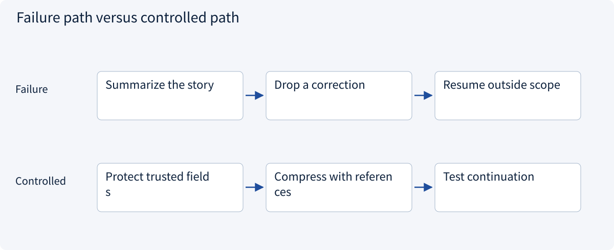
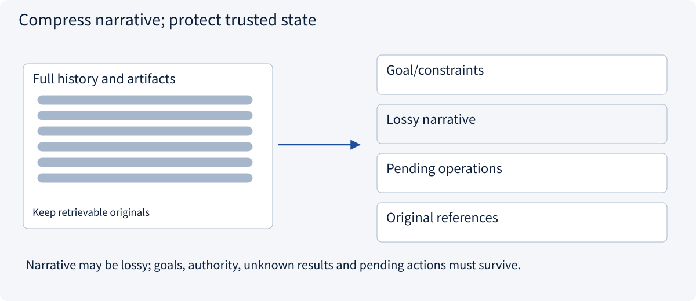
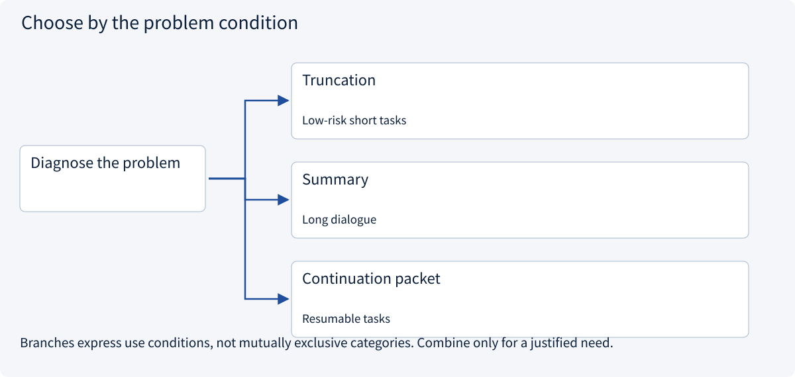
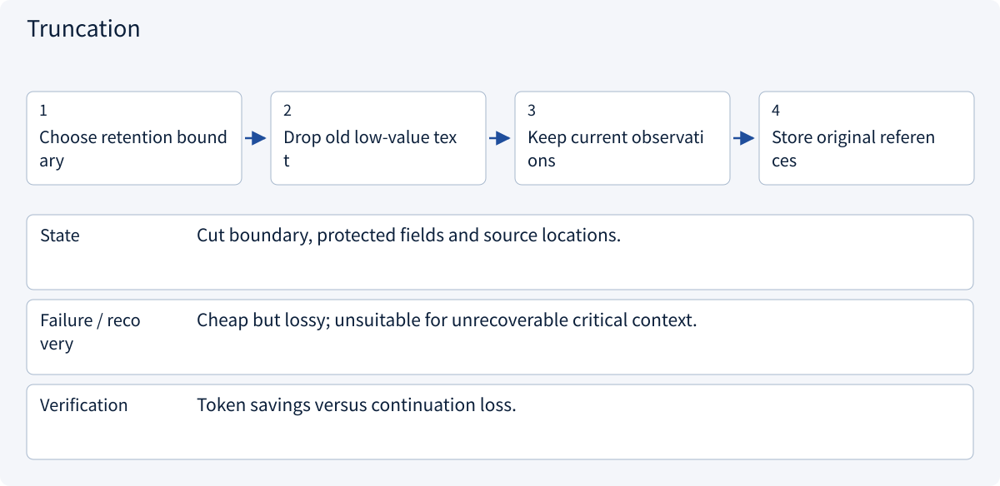
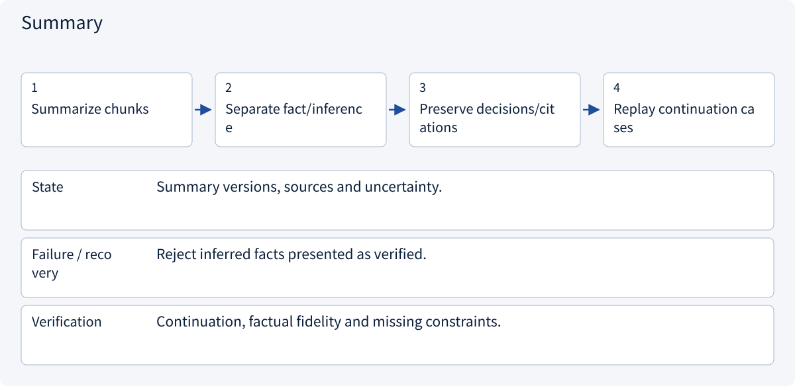
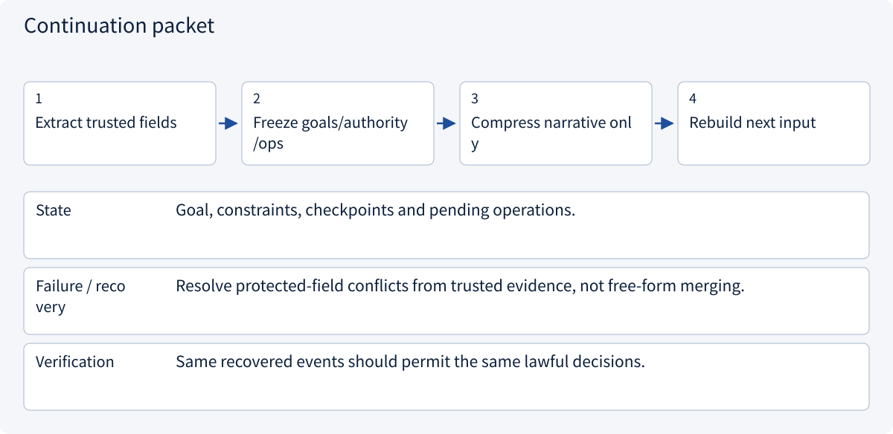

# 2.3.2 Context compaction

> Visual route · Established approaches · Reference code

The code demonstrates structured continuation, trusted-field retention and recovery checks. Summary quality and compression benefits require separate evaluation.

## Start with the problem

Compaction loses a changed budget or an unresolved operation.




## See the mechanism

Separate protected trusted fields from lossy narrative. Preserve provenance and uncertainty, then test continuation.



## Choose an established approach



| Approach | Mechanism | Use when | Tradeoff / boundary |
|---|---|---|---|
| Truncation | Drop old messages | Low-risk short tasks | Irrecoverable loss |
| Summary | Compress narrative | Long dialogue | Can mix fact and inference |
| Continuation packet | Protect goal/state/references | Resumable tasks | Still needs originals |

## Inside the mainstream approaches

### 1 · Truncation



**Concrete trace:** Old chat can leave; pending effects cannot disappear.

<details><summary>Expand steps, state and failure boundaries</summary>

1. Choose retention boundary
2. Drop old low-value text
3. Keep current observations
4. Store original references

**State** Cut boundary, protected fields and source locations.

**Failure / recovery** Cheap but lossy; unsuitable for unrecoverable critical context.

**Verification** Token savings versus continuation loss.

</details>

### 2 · Summary



**Concrete trace:** Changing unknown shipping into free shipping fails compaction.

<details><summary>Expand steps, state and failure boundaries</summary>

1. Summarize chunks
2. Separate fact/inference
3. Preserve decisions/citations
4. Replay continuation cases

**State** Summary versions, sources and uncertainty.

**Failure / recovery** Reject inferred facts presented as verified.

**Verification** Continuation, factual fidelity and missing constraints.

</details>

### 3 · Continuation packet



**Concrete trace:** Preserve operation_id and UNKNOWN to prevent duplicate effects.

<details><summary>Expand steps, state and failure boundaries</summary>

1. Extract trusted fields
2. Freeze goals/authority/ops
3. Compress narrative only
4. Rebuild next input

**State** Goal, constraints, checkpoints and pending operations.

**Failure / recovery** Resolve protected-field conflicts from trusted evidence, not free-form merging.

**Verification** Same recovered events should permit the same lawful decisions.

</details>

## Reference code

Expand the implementation corresponding to this mechanism. Training code is provided but not executed. See the reference-code guide for dependencies and verification limits.

[Reference code and verification limits](code-guide.md)

<details><summary>Expand code and limits</summary>

```python
"""Protected task facts survive a lossy history summary."""

from dataclasses import dataclass


@dataclass(frozen=True)
class Continuation:
    goal: str
    constraints: tuple[str, ...]
    verified_sources: tuple[str, ...]
    pending_operations: tuple[str, ...]
    summary: str


def compact(previous: Continuation, candidate_summary: str) -> Continuation:
    # A summarizer can compress narrative, but cannot rewrite trusted fields.
    return Continuation(
        previous.goal,
        previous.constraints,
        previous.verified_sources,
        previous.pending_operations,
        candidate_summary,
    )


# Keep original artifacts elsewhere. This packet does not grant tool permission.
```

</details>

## Change a condition

What if “unknown outcome” becomes “not executed” in a summary?

<details><summary>Suggested answer</summary>

A resumed agent may duplicate an already committed action. Preserve uncertainty explicitly.

</details>

<details><summary>Optional derivation and boundaries</summary>

**Compaction must preserve what continuation needs**

Compaction transforms a long working history into a smaller continuation package. It is lossy unless every original detail remains available elsewhere.

Preserve goals, constraints, user corrections, pending actions, verified facts and source references. Keep uncertainty visible. A summary should not promote an inference into an authorized decision.

Evaluate compaction by continuing the task after it, especially around changed budgets, rejected plans and incomplete tool calls. Comparing length alone does not measure usefulness.

**Check your understanding**

A summary drops the user’s maximum budget. Is it acceptable because it is shorter?

<details><summary>Suggested answer</summary>

No. It removed a task invariant and can cause a wrong action. Protect constraints explicitly and test continuation.

</details>


</details>

[Official sources and approach rationale](resources.md)
