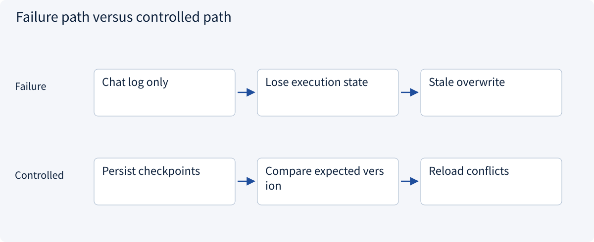
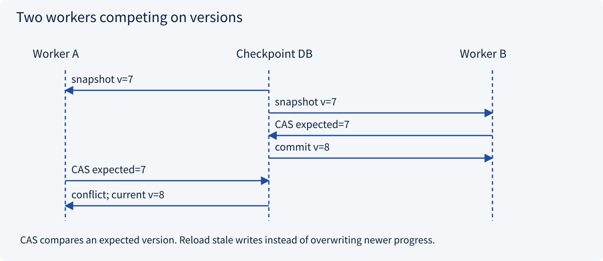
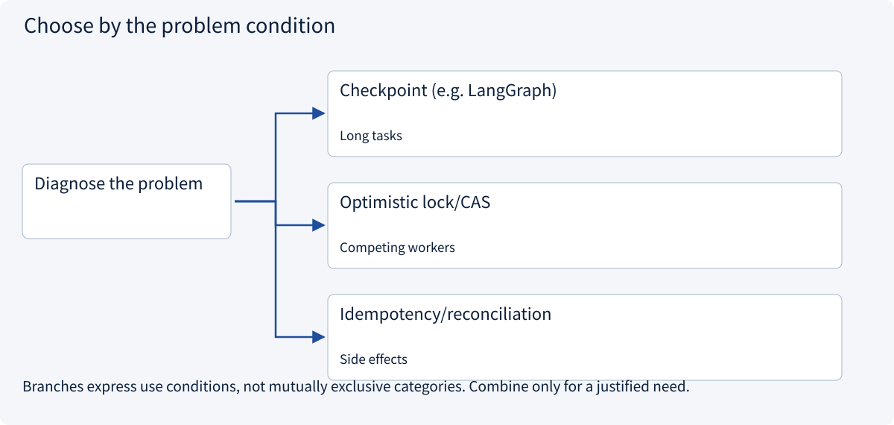
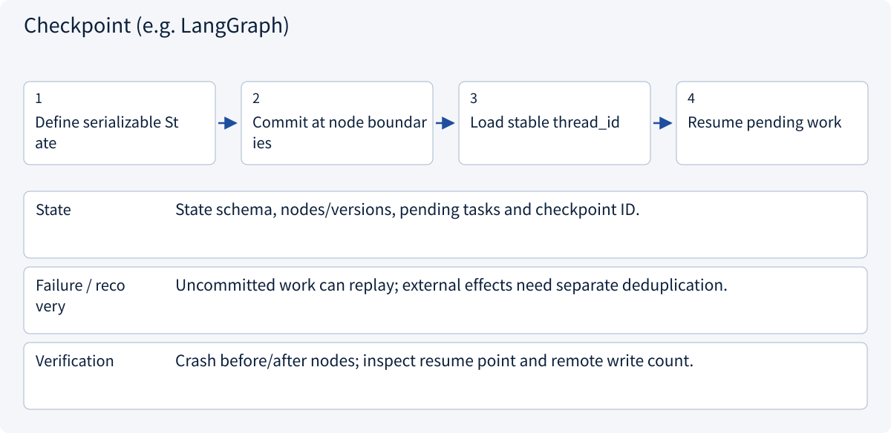
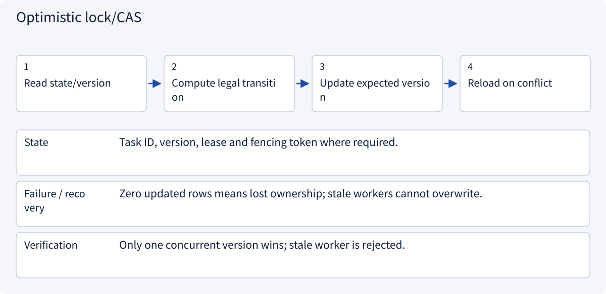
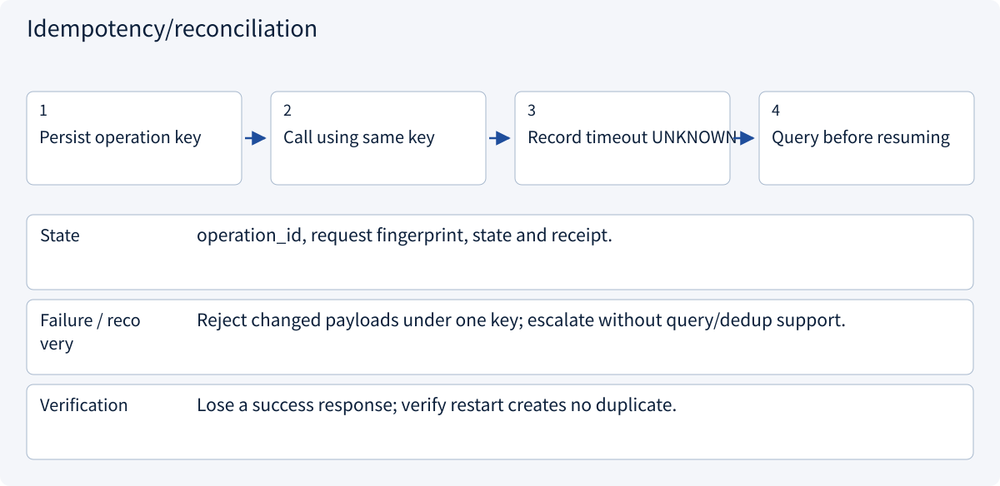

# 2.7.1 Checkpoints and short-term state

> Visual route · Established approaches · Reference code

## Start with the problem

How can tasks resume without workers overwriting newer progress?




## See the mechanism

Persist tenant/task-scoped checkpoints and compare versions. External effects require separate reconciliation.



## Choose an established approach



| Approach | Mechanism | Use when | Tradeoff / boundary |
|---|---|---|---|
| Checkpoint (e.g. LangGraph) | Persist resumable state | Long tasks | Not external-effect proof |
| Optimistic lock/CAS | Version-conditioned updates | Competing workers | Handle reload/retry |
| Idempotency/reconciliation | Identify one external operation | Side effects | Remote support required |

## Inside the mainstream approaches

### 1 · Checkpoint (e.g. LangGraph)



**Concrete trace:** Reuse saved quotations; recompute an incomplete comparison.

### 2 · Optimistic lock/CAS



**Concrete trace:** Two workers read v7; one writes v8 and the other reloads.

### 3 · Idempotency/reconciliation



**Concrete trace:** Find draft-42 by original key after a timed-out creation.

## Reference code

Expand the implementation corresponding to this mechanism. Training code is provided but not executed. See the reference-code guide for dependencies and verification limits.

[Reference code and verification limits](../../docs/zh/projects/03-code-guide.md)

<details><summary>Expand code and limits</summary>

```python
"""Versioned checkpoint repository. Caller supplies an initialized connection."""

import json
import sqlite3
from pathlib import Path


def initialize(connection: sqlite3.Connection) -> None:
    connection.executescript(Path(__file__).with_suffix(".sql").read_text())


def save(
    connection: sqlite3.Connection,
    tenant: str,
    task: str,
    expected_version: int,
    payload: dict,
) -> int:
    encoded = json.dumps(payload, sort_keys=True)
    with connection:
        if expected_version == 0:
            connection.execute(
                "INSERT INTO checkpoints VALUES (?, ?, 1, ?)", (tenant, task, encoded)
            )
        else:
            changed = connection.execute(
                "UPDATE checkpoints SET version=version+1,payload=? WHERE tenant=? AND task=? AND version=?",
                (encoded, tenant, task, expected_version),
            ).rowcount
            if changed != 1:
                raise RuntimeError("Checkpoint version conflict")
    return expected_version + 1


# Saving state does not prove an external operation did or did not execute.
```

</details>

## Change a condition

Does a checkpoint guarantee one email?

<details><summary>Suggested answer</summary>

No. An unknown receipt requires external query/idempotency or manual reconciliation.

</details>

<details><summary>Optional derivation and boundaries</summary>

**Persist task state for recovery**

A checkpoint is a durable record of task progress, not merely a chat summary. It should retain versioned state, pending operations and references to completed results.

After a crash, distinguish an operation not yet attempted from one whose external result is unknown. Retrying the latter can duplicate a side effect. Use an operation key and external status checks where supported.

Concurrent workers need version checks or equivalent coordination. A cancellation request cannot erase a remote action that already committed.

**Check your understanding**

Can a local checkpoint alone guarantee exactly-once external execution?

<details><summary>Suggested answer</summary>

No. External idempotency, queryability or reconciliation is also needed.

</details>


</details>

[Official sources and approach rationale](../../docs/zh/resources.md)
