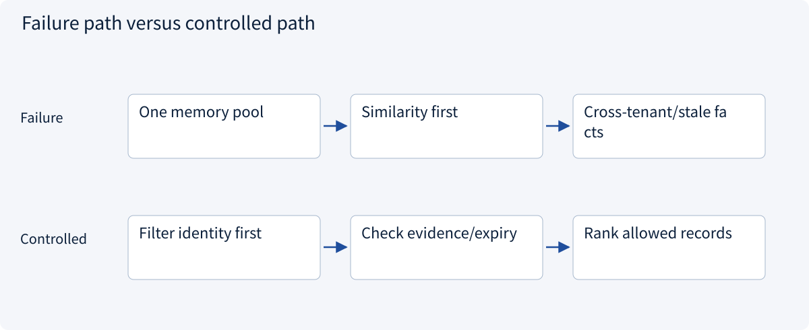
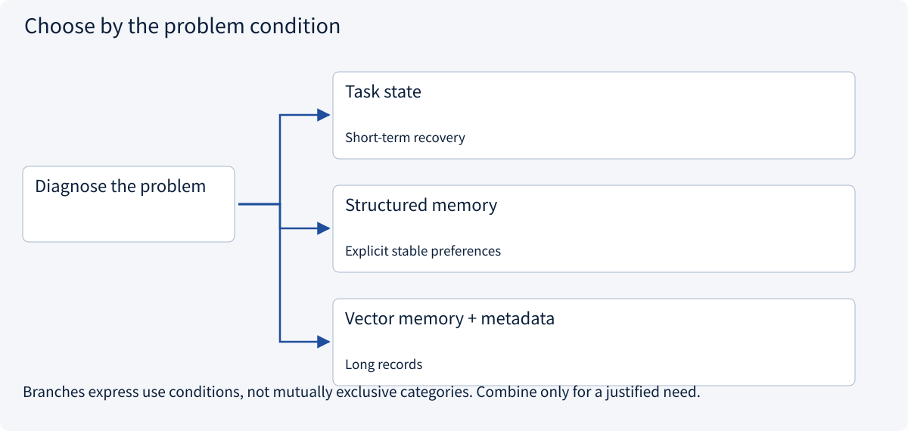
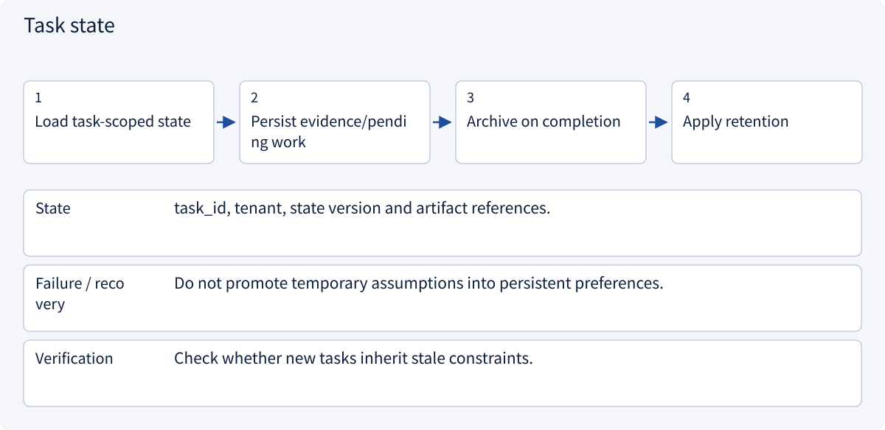

# 2.7.2 Long-term memory

> Visual route · Established approaches · Reference code

## Start with the problem

Memory treats guesses as facts or retrieves another user’s records.



## See the mechanism

Store scope, provenance, verification and expiry. Filter access before similarity ranking.


## Choose an established approach



| Approach | Mechanism | Use when | Tradeoff / boundary |
|---|---|---|---|
| Task state | Current progress | Short-term recovery | Not permanent preference |
| Structured memory | Versioned facts and sources | Explicit stable preferences | Resolve conflicts |
| Vector memory + metadata | Semantic recall with scope | Long records | Similarity is not current truth |

## Inside the mainstream approaches

### 1 · Task state



**Concrete trace:** A budget of 1000 for one task is not a permanent preference.

### 2 · Structured memory


**Concrete trace:** A changed invoice name supersedes the historical name with an audit trail.

### 3 · Vector memory + metadata


**Concrete trace:** Exclude other customers before retrieving purchasing preferences.

## Reference code

Expand the implementation corresponding to this mechanism. Training code is provided but not executed. See the reference-code guide for dependencies and verification limits.

[Reference code and verification limits](../../docs/zh/projects/03-code-guide.md)

<details><summary>Expand code and limits</summary>

```python
"""Explicit scope and provenance before ranking any stored preference."""

from dataclasses import dataclass


@dataclass(frozen=True)
class Memory:
    tenant: str
    user: str
    claim: str
    source: str
    verified: bool
    expires_at: int


def recall(records: list[Memory], tenant: str, user: str, now: int) -> list[Memory]:
    return [
        record
        for record in records
        if record.tenant == tenant
        and record.user == user
        and record.verified
        and record.expires_at > now
    ]


# A remembered fact remains evidence, not an instruction overriding the current user.
```

</details>

## Change a condition

What wins over an old remembered preference?

<details><summary>Suggested answer</summary>

The current explicit request. Supersede or reverify the old record instead of overriding new authority.

</details>

<details><summary>Optional derivation and boundaries</summary>

**Store useful facts with provenance and scope**

Long-term memory retains reusable facts beyond one task. A record needs identity, scope, evidence, confidence or verification status, timestamps and a way to revise or delete it.

A past purchase of the cheapest item does not establish a permanent preference for price over quality. Separate explicit preferences from inferred behavior. New explicit instructions can supersede old conclusions.

Filter memory by tenant and user authority before exposing content to a model. Similarity does not grant access, and a memory hit is not automatically current.

**Check your understanding**

What should happen when a remembered preference conflicts with a new explicit request?

<details><summary>Suggested answer</summary>

Follow the current request, preserve the conflict’s provenance and update or supersede the old record according to the memory policy.

</details>


</details>

[Official sources and approach rationale](../../docs/zh/resources.md)
