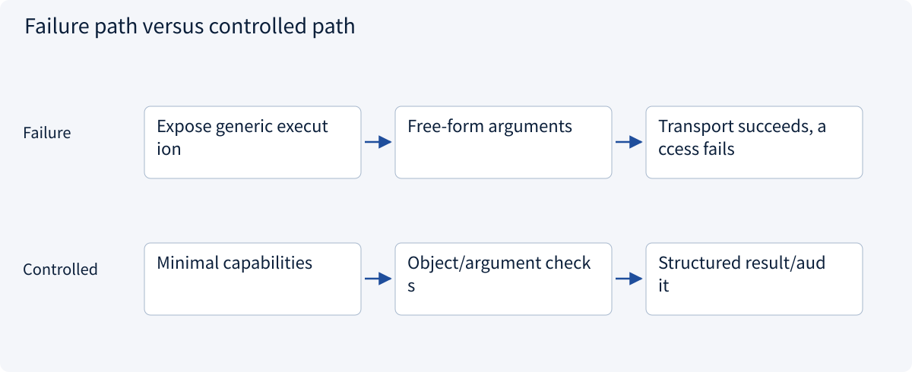
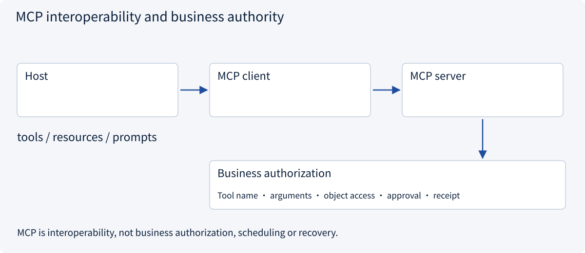
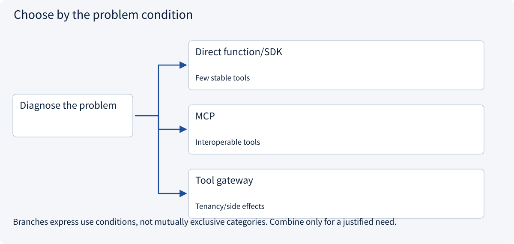
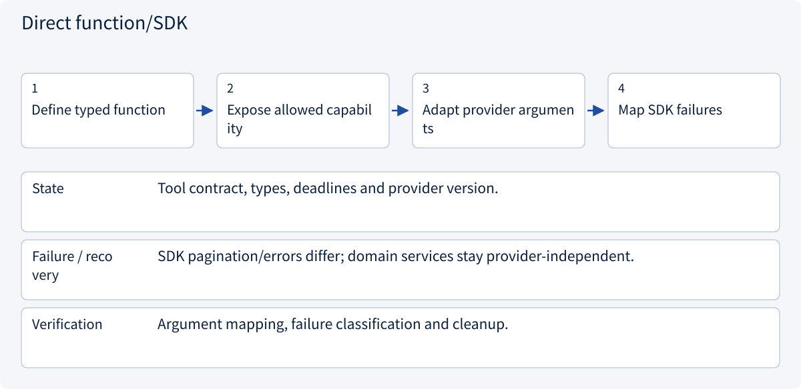
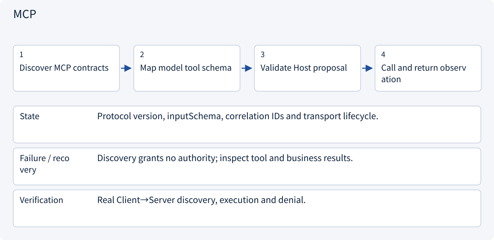
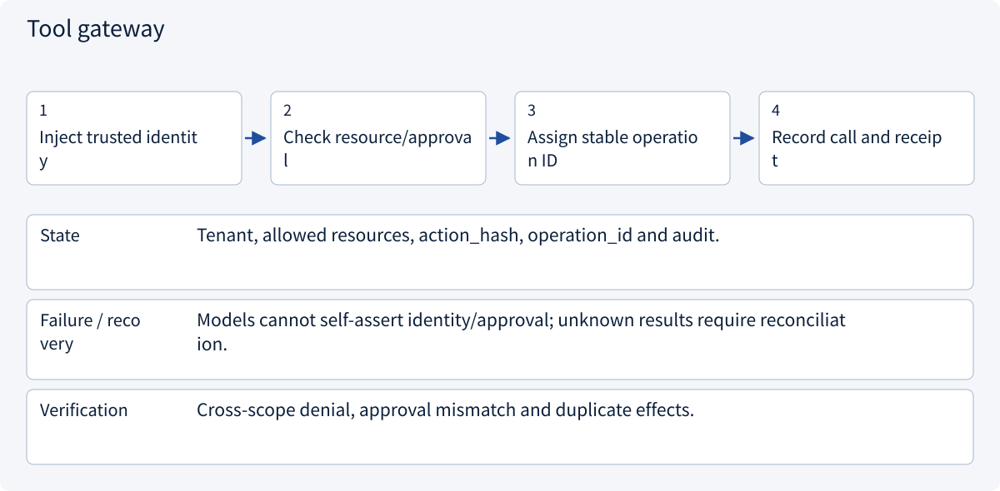

# 2.4.1 Tool gateway: model proposals to controlled execution

> Visual route · Established approaches · Reference code

## Start with the problem

Why can schema-valid proposals still be unauthorized? Who enforces checks for direct functions and MCP?



## See the mechanism

The protocol discovers and invokes capabilities. A gateway validates names, arguments, object access and side effects.



## Choose an established approach



| Approach | Mechanism | Use when | Tradeoff / boundary |
|---|---|---|---|
| Direct function/SDK | Explicit local contract | Few stable tools | Separate integrations |
| MCP | Capability discovery/invocation | Interoperable tools | Not business authorization |
| Tool gateway | Central policy checks | Tenancy/side effects | Maintain object-level rules |

## Inside the mainstream approaches

### 1 · Direct function/SDK



**Concrete trace:** A single stable quotation API may fit direct SDK integration.

### 2 · MCP



**Concrete trace:** A well-formed read_quote(B) still fails server-side scope authorization.

### 3 · Tool gateway



**Concrete trace:** Changing A to B invalidates approval of the original action.

## Reference code

Expand the implementation corresponding to this mechanism. Training code is provided but not executed. See the reference-code guide for dependencies and verification limits.

[Reference code and verification limits](../../docs/zh/projects/03-code-guide.md)

<details><summary>Expand code and limits</summary>

```python
"""Protocol transport is separate from business authorization."""

from collections.abc import Callable
from dataclasses import dataclass


@dataclass(frozen=True)
class ToolRequest:
    name: str
    document_id: str


def read_tool(
    request: ToolRequest,
    authorized_documents: set[str],
    readers: dict[str, Callable[[str], str]],
) -> str:
    if request.name not in readers:
        raise PermissionError("Tool is not available")
    if request.document_id not in authorized_documents:
        raise PermissionError("Document is not authorized")
    return readers[request.name](request.document_id)


# An MCP adapter can translate calls into ToolRequest, but cannot skip this check.
```

</details>

## MCP: six lessons from protocol to integration

[MCP deep dive](mcp01.md): architecture → primitives → requests/versioning → transport/auth → real server/client → Host adapter. The official SDK 2.3.0 is checked using an in-memory Client/Server without an LLM.


## Distinguish model-side and capability-side interfaces

[Function Calling mechanics](fc01.md) · [Function Calling / MCP](fc02.md): model proposals and Host execution first, then explicit adaptation between the two contracts. Each can operate without the other.


## Change a condition

Does returned text requesting data exfiltration gain authority?

<details><summary>Suggested answer</summary>

No. Tool output is external data, not a new trusted user instruction.

</details>

<details><summary>Optional derivation and boundaries</summary>

**Tools expose capabilities; retrieval exposes evidence**

Tools require explicit contracts, authorization, timeouts and error semantics. Retrieval returns candidate evidence, not permission to act and not a guarantee of correctness.

MCP provides a protocol boundary for exposing capabilities and context. It does not replace application authorization, task scheduling or durable recovery. Treat remote descriptions and returned documents as untrusted inputs.

A complete answer needs source support, relevant conditions and correct handling of missing information. A successful tool transport does not imply that the business task succeeded.

**Check your understanding**

Does adopting a tool protocol make every exposed action safe?

<details><summary>Suggested answer</summary>

No. The application still validates identity, object access, arguments, approval and side-effect handling.

</details>


</details>

[Official sources and approach rationale](../../docs/zh/resources.md)
