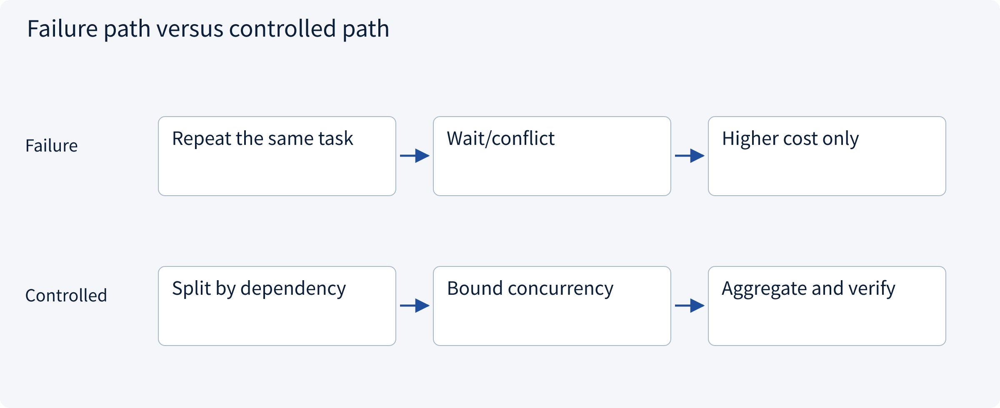
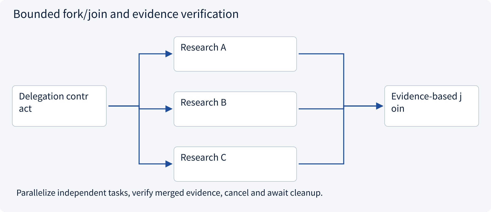
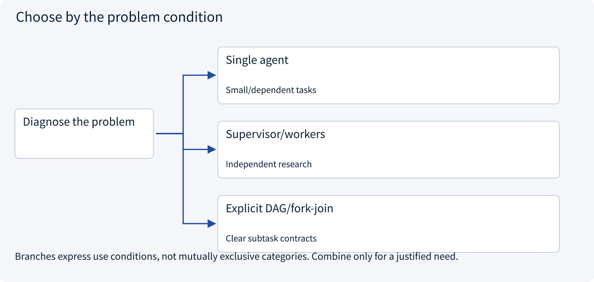
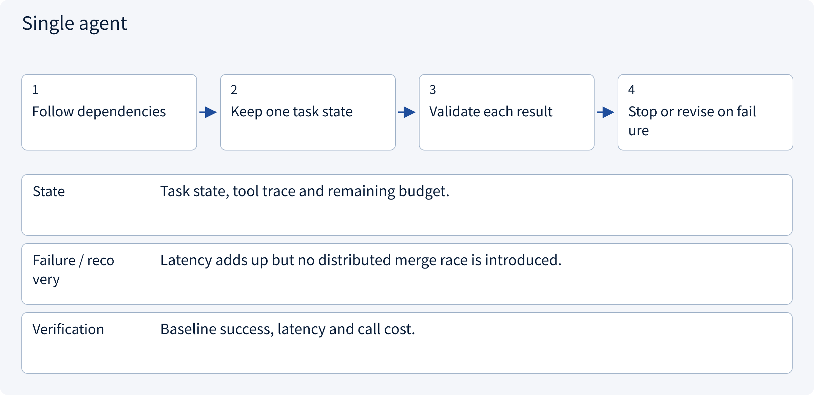
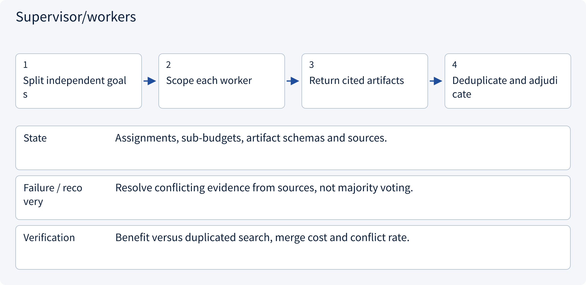
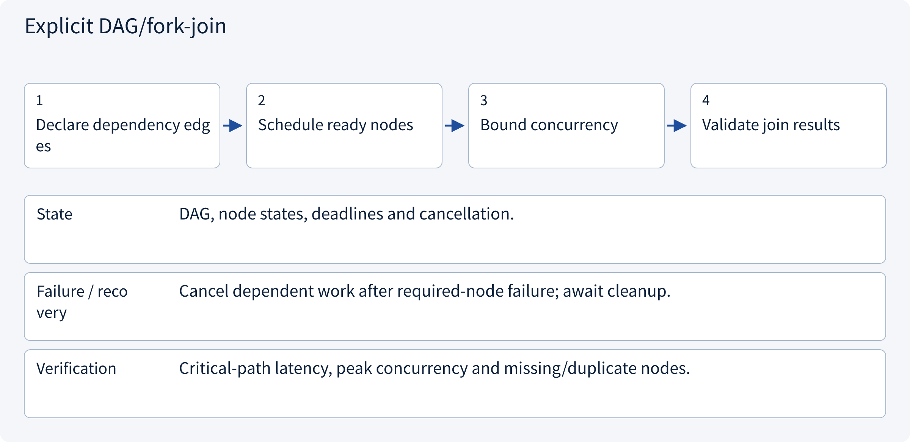

# 3.2.1 Collaboration topology: sequence, supervisor and DAG

> Visual route · Established approaches · Reference code

The code implements bounded in-process read-only concurrency. Distributed supervision, persistent handoff and full DAG scheduling require the dedicated design mechanisms.

## Start with the problem

More agents increase cost and conflict instead of helping.




## See the mechanism

Parallelize independent deliverables only; preserve dependencies, validate evidence and bound concurrency/deadlines.



## Choose an established approach



| Approach | Mechanism | Use when | Tradeoff / boundary |
|---|---|---|---|
| Single agent | One context | Small/dependent tasks | Serial latency |
| Supervisor/workers | Central delegation/join | Independent research | Merge bottleneck/cost |
| Explicit DAG/fork-join | Schedule dependencies | Clear subtask contracts | Propagate failure/cancellation |

## Inside the mainstream approaches

### 1 · Single agent



**Concrete trace:** Compute totals only after collecting quotations.

<details><summary>Expand steps, state and failure boundaries</summary>

1. Follow dependencies
2. Keep one task state
3. Validate each result
4. Stop or revise on failure

**State** Task state, tool trace and remaining budget.

**Failure / recovery** Latency adds up but no distributed merge race is introduced.

**Verification** Baseline success, latency and call cost.

</details>

### 2 · Supervisor/workers



**Concrete trace:** Research markets independently with timestamped source-backed quotations.

<details><summary>Expand steps, state and failure boundaries</summary>

1. Split independent goals
2. Scope each worker
3. Return cited artifacts
4. Deduplicate and adjudicate

**State** Assignments, sub-budgets, artifact schemas and sources.

**Failure / recovery** Resolve conflicting evidence from sources, not majority voting.

**Verification** Benefit versus duplicated search, merge cost and conflict rate.

</details>

### 3 · Explicit DAG/fork-join



**Concrete trace:** Fetch A/B concurrently; comparison C waits for both.

<details><summary>Expand steps, state and failure boundaries</summary>

1. Declare dependency edges
2. Schedule ready nodes
3. Bound concurrency
4. Validate join results

**State** DAG, node states, deadlines and cancellation.

**Failure / recovery** Cancel dependent work after required-node failure; await cleanup.

**Verification** Critical-path latency, peak concurrency and missing/duplicate nodes.

</details>

## Reference code

Expand the implementation corresponding to this mechanism. Training code is provided but not executed. See the reference-code guide for dependencies and verification limits.

[Reference code and verification limits](code-guide.md)

<details><summary>Expand code and limits</summary>

```python
"""Bounded fork/join with cancellation cleanup; independent read-only tasks only."""

import asyncio
from collections.abc import Awaitable, Callable


async def gather_research(
    tasks: list[Callable[[], Awaitable[str]]], concurrency: int = 3, seconds: float = 10
) -> list[str]:
    if concurrency < 1 or seconds <= 0:
        raise ValueError("Positive limits required")
    semaphore = asyncio.Semaphore(concurrency)

    async def limited(task):
        async with semaphore:
            return await task()

    workers = [asyncio.create_task(limited(task)) for task in tasks]
    try:
        async with asyncio.timeout(seconds):
            return await asyncio.gather(*workers)
    finally:
        for worker in workers:
            if not worker.done():
                worker.cancel()
        await asyncio.gather(*workers, return_exceptions=True)


# Cancellation cannot undo an external action already committed by a worker.
```

</details>

## Change a condition

Do three agreeing agents prove a claim?

<details><summary>Suggested answer</summary>

No. Correlated errors and shared sources require independent verification.

</details>

<details><summary>Optional derivation and boundaries</summary>

**Delegate independent deliverables**

Multiple agents help when tasks are separable and results can be checked. They add communication overhead, shared-state conflicts and correlated errors.

A delegation contract specifies goal, inputs, permissions, budget, output format, acceptance criteria and termination. The coordinator tracks dependencies, handles timeouts and resolves conflicts using evidence rather than a vote alone.

Tool protocols, agent-to-agent protocols and message transports solve different boundaries. A messaging system does not decide task meaning or authorize an action.

**Check your understanding**

Three agents repeat the same claim. Does that prove it?

<details><summary>Suggested answer</summary>

No. They may share the same flawed source or model behavior. Inspect independent evidence and the verification method.

</details>


</details>

[Official sources and approach rationale](resources.md)
