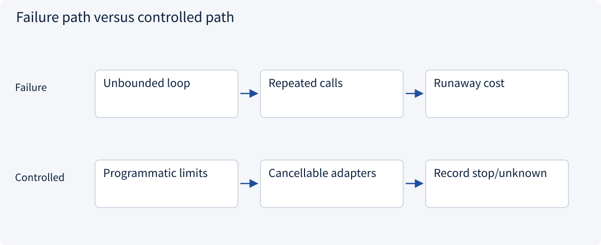
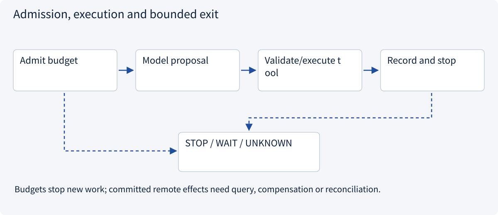
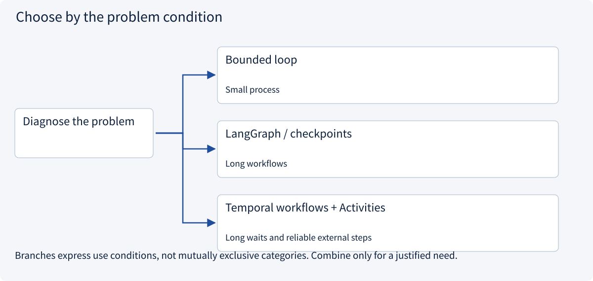
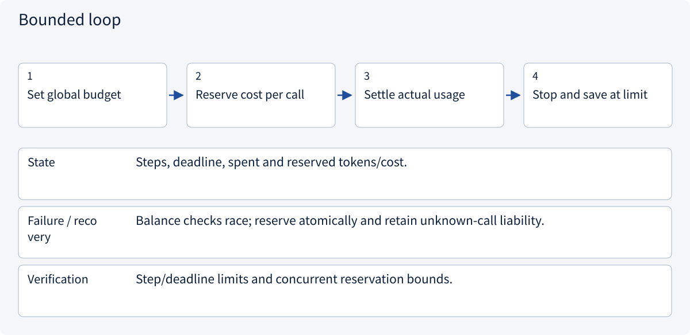
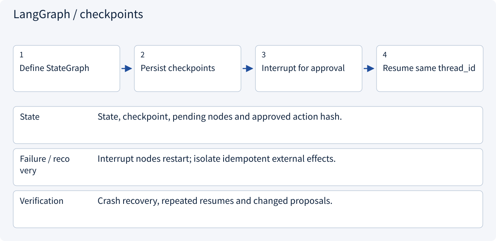
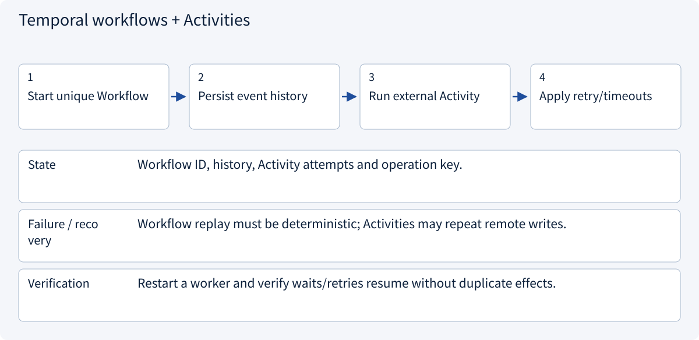
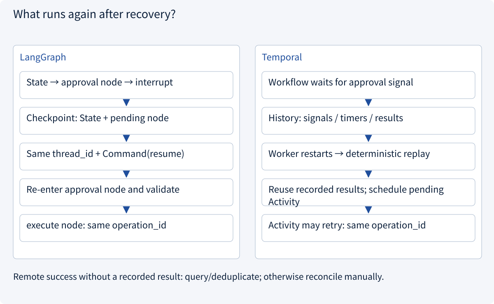

# 3.7.1 Runtime and harness

> Visual route · Established approaches · Reference code

## Start with the problem

An agent loops, overspends or leaves tools running after cancellation.



## See the mechanism

Runtime enforces steps, deadlines, cost and state. Reserve before calls, reconcile receipts and retain unknown outcomes.



## Choose an established approach



| Approach | Mechanism | Use when | Tradeoff / boundary |
|---|---|---|---|
| Bounded loop | Steps/time/cost caps | Small process | Own recovery logic |
| LangGraph / checkpoints | State/checkpoints/interrupts | Long workflows | Version and state management |
| Temporal workflows + Activities | History recovers orchestration; Activities perform/retry effects | Long waits and reliable external steps | Service operations, deterministic replay and external idempotency |

## Inside the mainstream approaches

### 1 · Bounded loop



**Concrete trace:** With funds for one call, two workers cannot both reserve it.

### 2 · LangGraph / checkpoints



**Concrete trace:** Approval replay creates nothing; execution uses stable operation_id.

### 3 · Temporal workflows + Activities



**Concrete trace:** Continue after next-day approval without holding an HTTP request open.

## Trace concrete data and failure boundaries



## Reference code

Expand the implementation corresponding to this mechanism. Training code is provided but not executed. See the reference-code guide for dependencies and verification limits.

[Reference code and verification limits](../../docs/zh/projects/03-code-guide.md)

<details><summary>Expand code and limits</summary>

```python
"""Admission checks stop new work; they cannot retroactively undo a remote call."""

from dataclasses import dataclass
from time import monotonic


@dataclass
class Budget:
    remaining_steps: int
    remaining_units: int
    deadline: float

    def reserve(self, upper_bound_units: int) -> None:
        if upper_bound_units < 0:
            raise ValueError("Reservation cannot be negative")
        if monotonic() >= self.deadline or self.remaining_steps <= 0:
            raise TimeoutError("Runtime budget exhausted")
        if upper_bound_units > self.remaining_units:
            raise ValueError("Cost reservation exceeds budget")
        self.remaining_steps -= 1
        self.remaining_units -= upper_bound_units


# Use a conservative call bound, then reconcile usage. Deadline checks need cancellable adapters.
```

</details>

## Three recovery mechanisms for the same crash

**Scenario:** Research is complete, approval arrives tomorrow, and a remote draft is created but its success response is lost. Recovery must resume without creating another draft.

| Dimension | LangGraph + persistent Checkpointer | Temporal Workflow + Activity | Database + Outbox + queue |
|---|---|---|---|
| Persisted data | Graph state, checkpoints and pending work | Workflow event history and Activity results/retries | Custom tasks, approval, operations, Outbox and leases |
| Recovery | Load the checkpoint for the same thread_id | Deterministically replay history, then schedule unfinished work | Read pending records and claim with version checks |
| Repeated work | Unfinished nodes; interrupted nodes re-enter | Workflow replay and potentially retried Activities | Unacknowledged messages and worker operations |
| Approval | Trusted application resumes an interrupt | Trusted application sends signal/update; wait state persists | Transactional approval state and pending event |
| External deduplication | Business adapter and remote system | Business adapter and remote system | Business adapter and remote system |
| Ownership | Depends on chosen storage/deployment; thread_id is not a lock | Service schedules tasks; external effects still need deduplication | Implement CAS, leases and fencing; expiry does not stop an old worker |
| Best fit | Graph-based Agents and human interrupts | Long waits and reliable Activity scheduling | Existing database/queue infrastructure with custom state-machine ownership |

### Remote success before local receipt persistence

1. Persist `operation_id=op-42` and the payload fingerprint before sending.
2. The remote service creates `draft-42`, but the response is lost. Local state is **UNKNOWN**, not proof of failure.
3. Query by `op-42` and store the receipt. A deduplicating service can also return the same result for the **same key and payload**.
4. Without remote deduplication or query support, require manual reconciliation. Retrying with a new key may create a second draft.

A request ID correlates one RPC reply; an operation ID identifies a business effect across restarts. Recoverable orchestration cannot invent exactly-once guarantees for a remote system.

### LangGraph interrupts need a separate effect node

Resuming an interrupt re-enters its node; code preceding the interrupt can run again. Keep approval validation in that node and place draft creation in a separate, idempotent node. InMemorySaver demonstrates semantics only; cross-process recovery requires a durable checkpointer, state migrations and an explicit concurrency policy.

### Temporal separates Workflow from Activity

Workflow history restores conditions, timers and recorded Activity results, so Workflow code must replay deterministically. Put network requests and database writes in Activities. start_to_close_timeout bounds one attempt; schedule_to_close_timeout bounds the complete scheduling/retry window. Permission failures are not transient network errors. Long Activities additionally need heartbeat/cancellation design; the short reference below does not implement them.

References: [LangGraph persistence](https://docs.langchain.com/oss/python/langgraph/persistence), [interrupts](https://docs.langchain.com/oss/python/langgraph/interrupts), [Temporal Python retries](https://docs.temporal.io/develop/python/best-practices/error-handling).


### LangGraph: approval interrupt and separate execution

Framework reference; in-memory checks demonstrate interrupts, while cross-process recovery needs a persistent checkpointer.

<details><summary>Expand code and limits</summary>

```python
"""LangGraph reference: separate proposal, approval and side-effect nodes.

Supply a durable checkpointer and an idempotent domain adapter in production.
This file is supplied as reference code; no model call or graph starts on import.
"""

from typing import TypedDict

from .approval import action_hash


class TaskState(TypedDict):
    operation_id: str
    proposal: dict
    approved: bool
    receipt: str


def build_graph(checkpointer, create_draft):
    from langgraph.graph import END, START, StateGraph
    from langgraph.types import interrupt

    def approval(state: TaskState) -> dict:
        fingerprint = action_hash(state["proposal"])
        reply = interrupt({"action_hash": fingerprint, "proposal": state["proposal"]})
        # A trusted API must authorize the approver before it issues Command(resume=...).
        if (
            not isinstance(reply, dict)
            or reply.get("action_hash") != fingerprint
            or not reply.get("approved")
        ):
            raise PermissionError("Approval is absent or applies to a different action")
        return {"approved": True}

    def execute(state: TaskState) -> dict:
        if not state.get("approved"):
            raise PermissionError("No approved action")
        receipt = create_draft(state["operation_id"], state["proposal"])
        # The external adapter must deduplicate/query this operation_id.
        # Do not wrap arbitrary side effects in the approval node: it may restart.
        return {"receipt": receipt}

    graph = StateGraph(TaskState)
    graph.add_node("approval", approval)
    graph.add_node("execute", execute)
    graph.add_edge(START, "approval")
    graph.add_edge("approval", "execute")
    graph.add_edge("execute", END)
    return graph.compile(checkpointer=checkpointer)


# Invoke using a stable thread_id; resume with Command(resume=...) on that thread.
# InMemorySaver is for process-local examples, not cross-process crash recovery.
```

</details>

### Temporal: durable waits and Activity retries

Framework reference; no Temporal service/Worker is started and no remote Activity runs.

<details><summary>Expand code and limits</summary>

```python
"""Temporal reference: durable approval wait and retried activity.

Reference only; no worker is started. Boundary authorization belongs in the API.
The activity backend must enforce idempotency for a stable operation_id.
"""

from dataclasses import dataclass
from datetime import timedelta

from temporalio import activity, workflow
from temporalio.common import RetryPolicy


@dataclass(frozen=True)
class DraftRequest:
    operation_id: str
    action_hash: str
    proposal_json: str


class DraftActivities:
    def __init__(self, backend):
        self.backend = backend

    @activity.defn(name="create_draft")
    async def create_draft(self, request: DraftRequest) -> str:
        return await self.backend.create_or_get(
            request.operation_id, request.proposal_json
        )


@workflow.defn
class ApprovedDraftWorkflow:
    def __init__(self):
        self.approved_hash = ""

    @workflow.signal
    def approve(self, action_hash: str) -> None:
        # Only a trusted, authenticated application should send approval signals.
        self.approved_hash = action_hash

    @workflow.run
    async def run(self, request: DraftRequest) -> str:
        await workflow.wait_condition(
            lambda: self.approved_hash == request.action_hash, timeout=timedelta(days=1)
        )
        return await workflow.execute_activity(
            "create_draft",
            request,
            start_to_close_timeout=timedelta(seconds=30),
            schedule_to_close_timeout=timedelta(minutes=5),
            retry_policy=RetryPolicy(
                maximum_attempts=5,
                non_retryable_error_types=["PermissionError", "ValueError"],
            ),
        )


# Replayed workflow history is not a guarantee of exactly-once remote writes.
# Register ApprovedDraftWorkflow and DraftActivities(backend).create_draft on a Worker.
```

</details>

## Change a condition

Does a deadline check prove a remote effect was cancelled?

<details><summary>Suggested answer</summary>

No. It limits new work; committed effects may require query or compensation.

</details>

<details><summary>Optional derivation and boundaries</summary>

**Runtime enforces lifecycle and authority**

The runtime assembles context, calls the model, validates proposed actions, invokes tools and persists observations. A harness adds the interfaces and feedback used to operate and evaluate that loop.

Bound iteration count, wall time and cost. Preserve cancellation and resource cleanup paths. Model adapters should expose capability differences rather than pretending all models support identical outputs.

Approval, isolation and logging are application mechanisms. A prompt asking a model to behave safely cannot replace them.

**Check your understanding**

Who decides whether a proposed tool call executes?

<details><summary>Suggested answer</summary>

The runtime and business authorization rules, not the language model alone.

</details>


</details>

[Official sources and approach rationale](../../docs/zh/resources.md)
