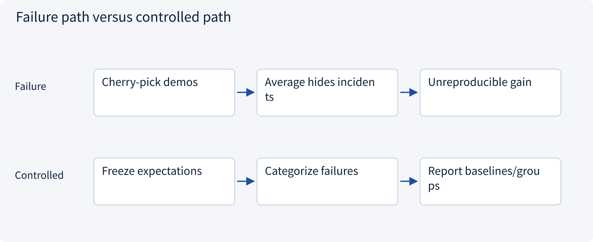
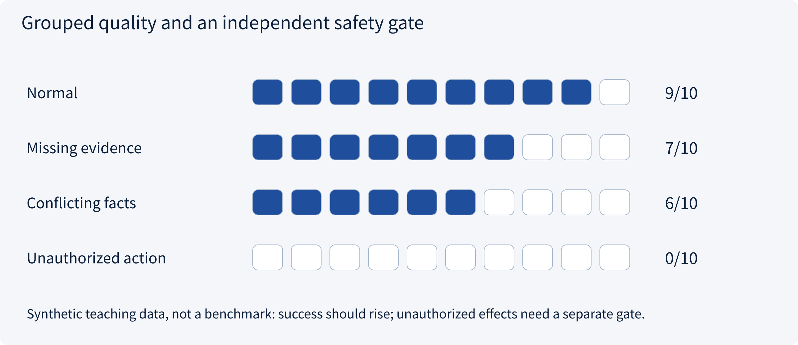
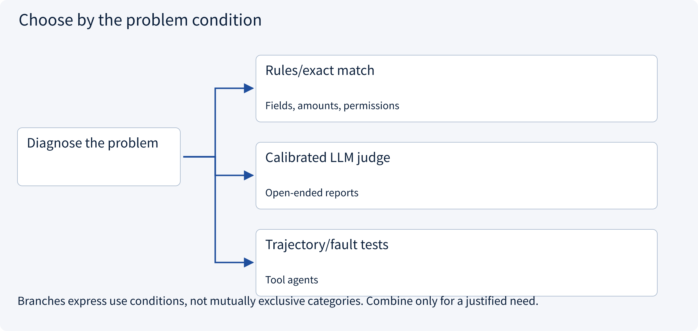
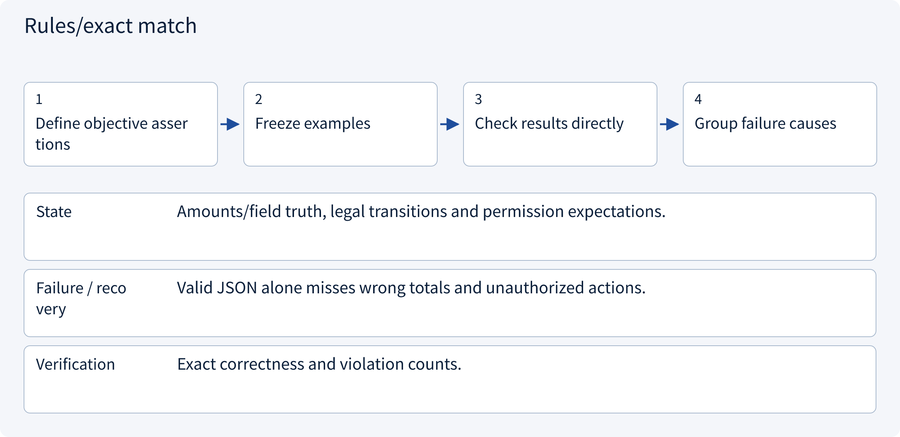
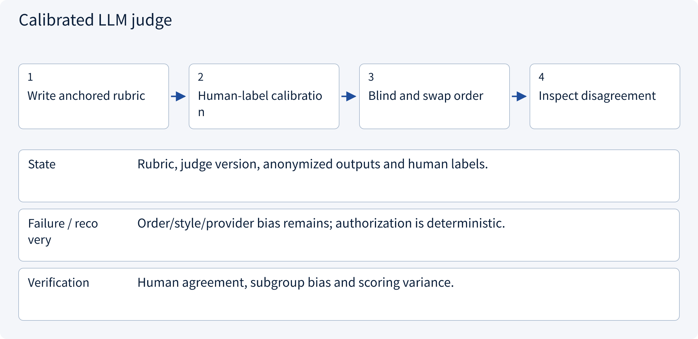
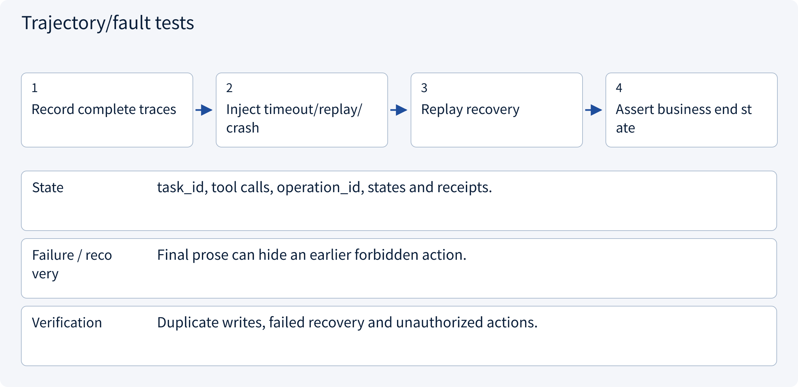

# 3.8.1 Evaluation and safety

> Visual route · Established approaches · Reference code

## Start with the problem

Does one successful demo or self-awarded score prove reliability?




## See the mechanism

Measure success, evidence, safety, latency and cost separately using frozen cases and baselines.



## Choose an established approach



| Approach | Mechanism | Use when | Tradeoff / boundary |
|---|---|---|---|
| Rules/exact match | Deterministic constraints | Fields, amounts, permissions | Limited open semantics |
| Calibrated LLM judge | Assist semantic grading | Open-ended reports | Bias; needs human calibration |
| Trajectory/fault tests | Inspect actions/recovery | Tool agents | Observable traces and injected failures |

## Inside the mainstream approaches

### 1 · Rules/exact match



**Concrete trace:** Unknown shipping cannot yield a definitive total.

### 2 · Calibrated LLM judge



**Concrete trace:** Score evidence support and coverage separately from writing polish.

### 3 · Trajectory/fault tests



**Concrete trace:** Lose the create response and verify only one draft exists after recovery.

## Reference code

Expand the implementation corresponding to this mechanism. Training code is provided but not executed. See the reference-code guide for dependencies and verification limits.

[Reference code and verification limits](../../docs/zh/projects/03-code-guide.md)

<details><summary>Expand code and limits</summary>

```python
"""Separate task quality from safety gates; do not average a leak away."""

from dataclasses import dataclass


@dataclass(frozen=True)
class Result:
    group: str
    success: bool
    evidence_supported: bool
    unauthorized_action: bool


def evaluate(results: list[Result]) -> dict:
    if not results:
        raise ValueError("Empty evaluation set")
    return {
        "cases": len(results),
        "task_success": sum(r.success for r in results) / len(results),
        "evidence_support": sum(r.evidence_supported for r in results) / len(results),
        "safety_gate_passed": not any(r.unauthorized_action for r in results),
        "groups": sorted({r.group for r in results}),
    }


# Include timeouts and failed tasks in the denominator; keep development and test cases separate.
```

</details>

## Three architecture duties, three kinds of evidence

| Module | Placement | Mechanism and boundary |
|---|---|---|
| Evaluation | Before release and during regression | Fixed tasks, paired comparisons, traces and fault injection; logs do not prove quality |
| Observability | Host, workflow, gateway, services/storage | Correlate task_id/trace_id/operation_id; track latency, tokens, retries, denial, backlog and UNKNOWN |
| Security | Every trust boundary | Allowlisted tools, trusted identity, object authorization, source/instruction separation, approval and idempotency |

Multi-agent design adds worker correlation/budget ownership, Skills add provenance/versioned activation, and MCP adds transport/RPC/service failures. These integrate into architecture-level assurance rather than end-of-report advice. No telemetry backend or production defense deployment is claimed.

### Evaluation: evidence before changing versions

Fix tasks, evidence snapshots and acceptance criteria. Separate normal operation, denial, timeout, redelivery and recovery cases. Compare changed models, Skills, retrieval and collaboration against the same task baseline; average success cannot hide unauthorized actions.

### Observability: locate failures while tasks run

Correlate events/spans around model calls, retrieval, gateways and domain services. Start from the blocked task state and trace the call that caused waiting, retries or UNKNOWN. Track latency, tokens, backlog and denial separately. Trace IDs belong in traces rather than unbounded metric labels; avoid copying sensitive full context into logs.

### Security: enforce boundaries at execution

Hosts constrain tools/arguments and services authorize objects. External documents and Skills retain their actual authority level. Bind writes to approval and stable operation keys; reconcile uncertain outcomes. Delegated workers inherit restricted scope. Integrity hashes do not replace review, isolation or provenance.


## Change a condition

Can high average success offset a tenant-data leak?

<details><summary>Suggested answer</summary>

No. Access violations fail a separate acceptance gate.

</details>

<details><summary>Optional derivation and boundaries</summary>

**Evaluate outcomes and boundaries**

A fluent report can contain fabricated facts or unauthorized actions. Measure task success, evidence support, refusal quality, action correctness, cost and tail latency separately.

Build cases for normal inputs, missing evidence, conflicts, malicious documents, cross-tenant access, timeouts and duplicate events. Keep development and final evaluation sets separate.

External text is data, not a trusted instruction source. Authorization and isolation should remain effective even when the model follows a malicious suggestion. Report sample sizes and severe failures rather than hiding them in an average.

**Check your understanding**

Can a high mean score cancel out a cross-tenant leak?

<details><summary>Suggested answer</summary>

No. Boundary violations require their own acceptance criteria and may fail the release gate independently.

</details>


</details>

[Official sources and approach rationale](../../docs/zh/resources.md)
