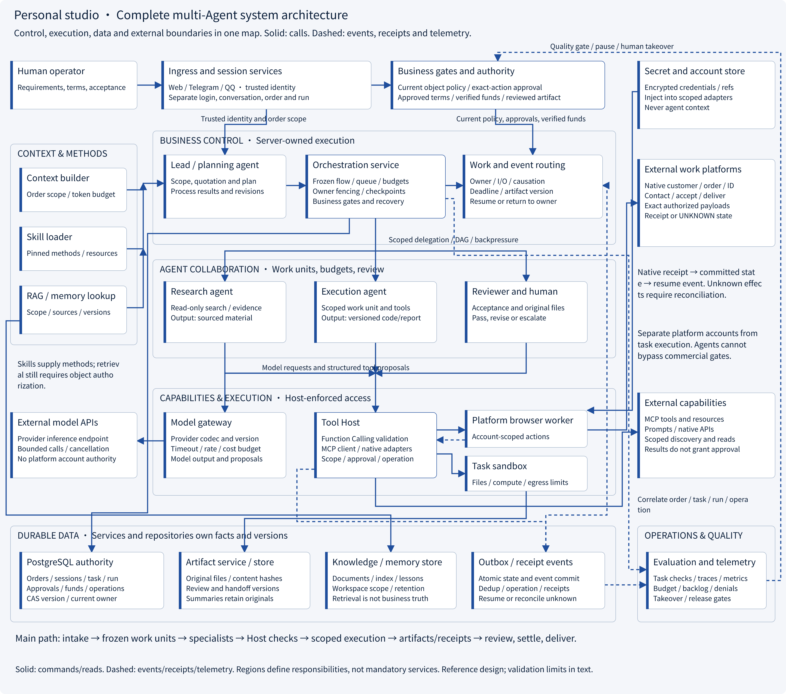
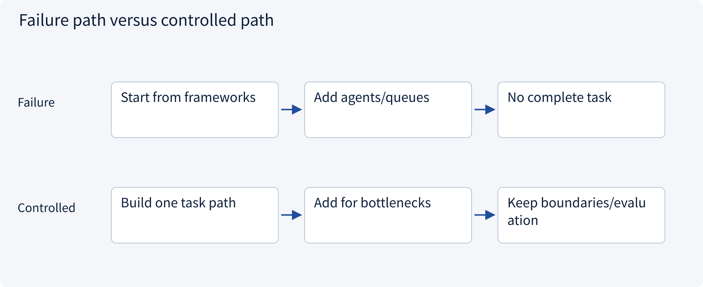
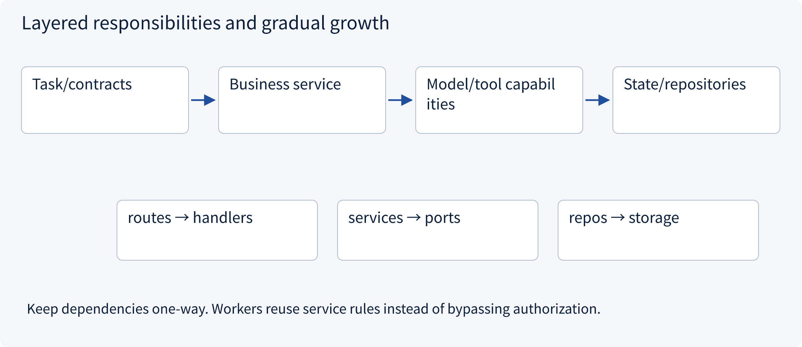
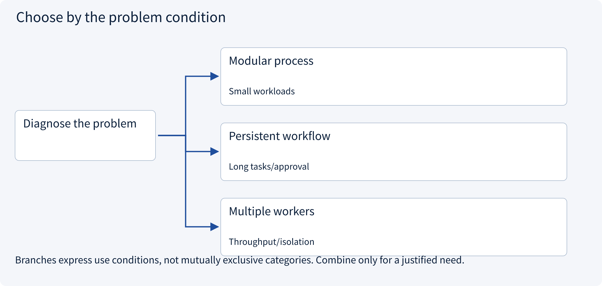
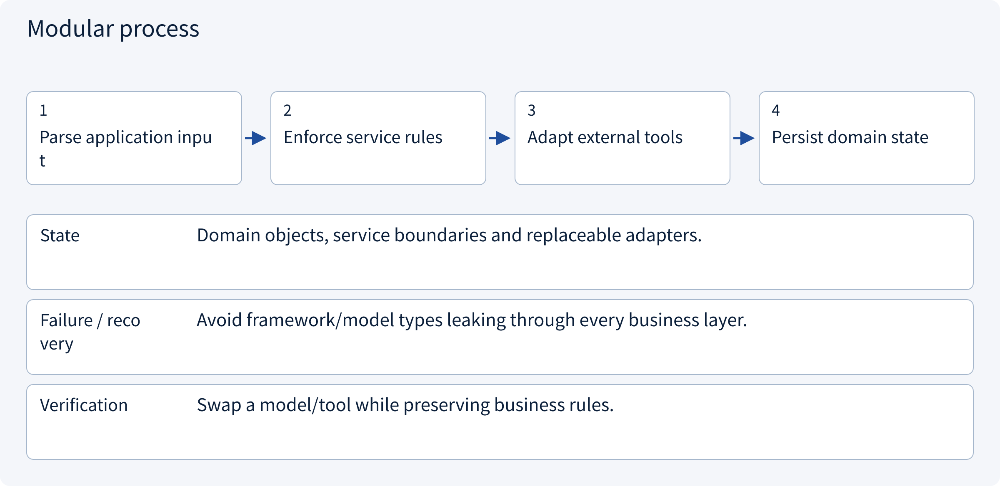
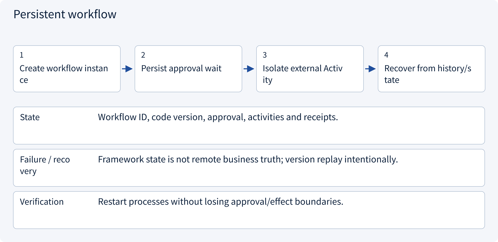
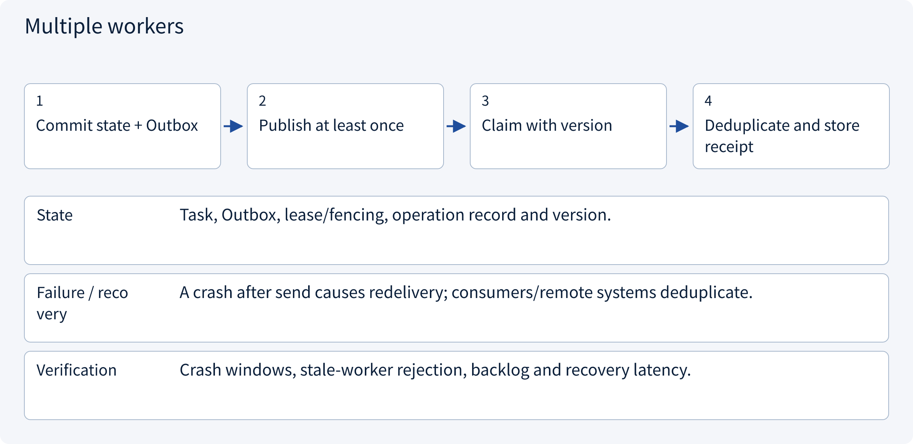

# 3.9.2 Layered architecture assembly and integration acceptance

> Visual route · Established approaches · Reference code

The complete diagram is a reference architecture. The code demonstrates layered in-process read-only quotation composition; the depicted services, queues and isolation facilities are not all deployed.

## Complete architecture: ingress to delivery and operational feedback



Complete reference design, 3600px wide; click to enlarge. Follow intake → orchestration → agents → Host → workers/external systems → artifacts/receipts → review/delivery. Then inspect authority, context, durable state and operational support. Boxes express responsibilities, not mandatory microservices or a claim that ForgePilot deploys every component.

## Start with the problem

How should a useful assistant grow into an advanced architecture?




## See the mechanism

Start from one task. Add components for demonstrated state, recovery, concurrency and isolation requirements.



## Choose an established approach



| Approach | Mechanism | Use when | Tradeoff / boundary |
|---|---|---|---|
| Modular process | Separate business/capabilities/storage | Small workloads | Shared failure domain |
| Persistent workflow | State and recovery | Long tasks/approval | Migration/replay design |
| Multiple workers | Queues, leases, idempotency | Throughput/isolation | Operational consistency cost |

## Inside the mainstream approaches

### 1 · Modular process



**Concrete trace:** Direct SDK and MCP use the same quotation authorization.

<details><summary>Expand steps, state and failure boundaries</summary>

1. Parse application input
2. Enforce service rules
3. Adapt external tools
4. Persist domain state

**State** Domain objects, service boundaries and replaceable adapters.

**Failure / recovery** Avoid framework/model types leaking through every business layer.

**Verification** Swap a model/tool while preserving business rules.

</details>

### 2 · Persistent workflow



**Concrete trace:** Resume next-day approval from verified research evidence.

<details><summary>Expand steps, state and failure boundaries</summary>

1. Create workflow instance
2. Persist approval wait
3. Isolate external Activity
4. Recover from history/state

**State** Workflow ID, code version, approval, activities and receipts.

**Failure / recovery** Framework state is not remote business truth; version replay intentionally.

**Verification** Restart processes without losing approval/effect boundaries.

</details>

### 3 · Multiple workers



**Concrete trace:** Publisher retries still reference the same draft operation key.

<details><summary>Expand steps, state and failure boundaries</summary>

1. Commit state + Outbox
2. Publish at least once
3. Claim with version
4. Deduplicate and store receipt

**State** Task, Outbox, lease/fencing, operation record and version.

**Failure / recovery** A crash after send causes redelivery; consumers/remote systems deduplicate.

**Verification** Crash windows, stale-worker rejection, backlog and recovery latency.

</details>

## Reference code

Expand the implementation corresponding to this mechanism. Training code is provided but not executed. See the reference-code guide for dependencies and verification limits.

[Reference code and verification limits](code-guide.md)

<details><summary>Expand code and limits</summary>

```python
"""Compose one-way layers. No server is started; no purchase is performed."""

from .architecture.domain import Identity, Task
from .architecture.handlers import ReportHandler, Request
from .architecture.repos import TaskRepository
from .architecture.routes import dispatch
from .architecture.services import ReportService


def example_request(tenant: str = "A") -> dict:
    repository = TaskRepository([Task("task-1", "A", 1000, 180)])
    service = ReportService(repository)
    handler = ReportHandler(service)
    request = Request(Identity("user-1", frozenset({"A"})), tenant, "task-1")
    return dispatch("GET", "/reports/subtotal", request, handler)


# Protocol router only calls the handler. Handler maps errors; service owns
# authorization/calculation; repository owns scoped data access.
# The response is a subtotal, not a total including unknown tax or shipping.
```

</details>

## Change a condition

When is a queue more useful than another agent?

<details><summary>Suggested answer</summary>

When the problem is asynchronous ownership, concurrency or recovery, not an additional reasoning role.

</details>

<details><summary>Optional derivation and boundaries</summary>

**Design a narrow complete loop first**

Start with one task, one measurable deliverable and a limited set of tools. Specify inputs, authority, state, evidence and completion before building a platform.

Production adds tenancy, concurrent updates, retries, deployment changes, observability and cost controls. Each component should answer a concrete requirement and have a defined failure owner.

The personal studio project applies these dimensions to discovery, quotation, verified funds, isolated execution and exact delivery. Its architecture and local contracts distinguish design recommendations from verified production integration.

**Check your understanding**

When is a design ready for review?

<details><summary>Suggested answer</summary>

When a reviewer can trace a normal request and failures through authorization, state transitions, external effects and verified completion.

</details>


</details>

[Official sources and approach rationale](resources.md)
