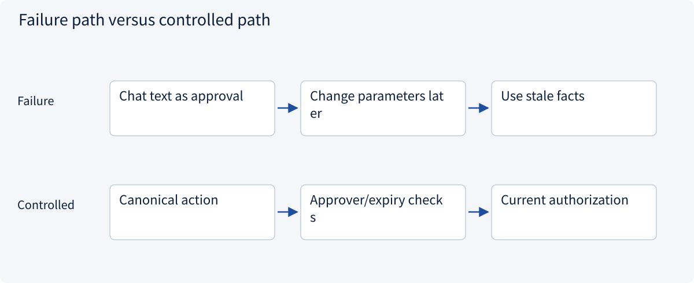
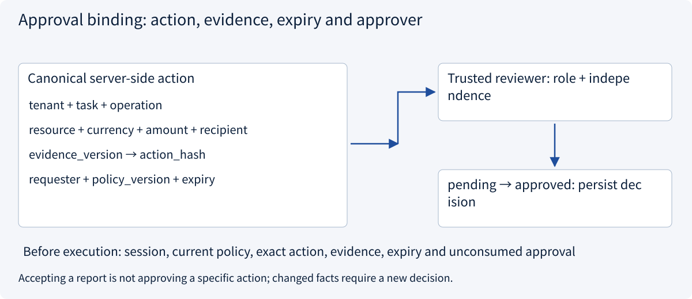
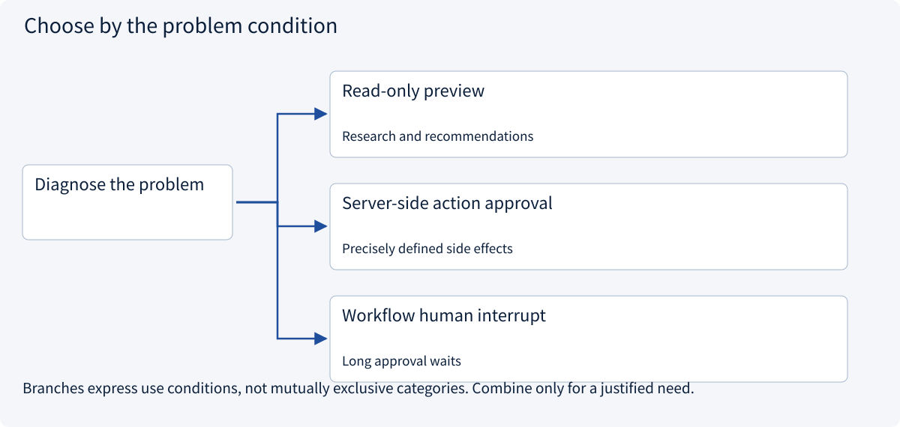
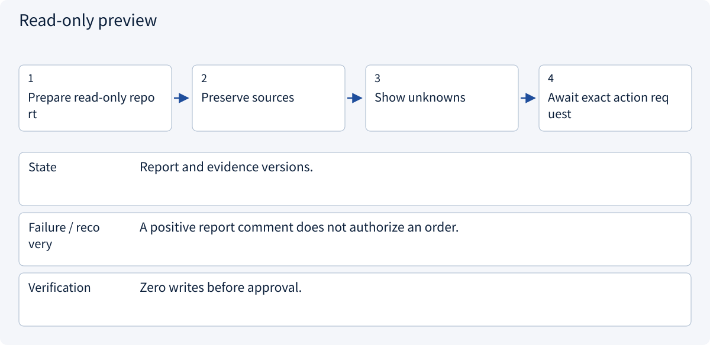
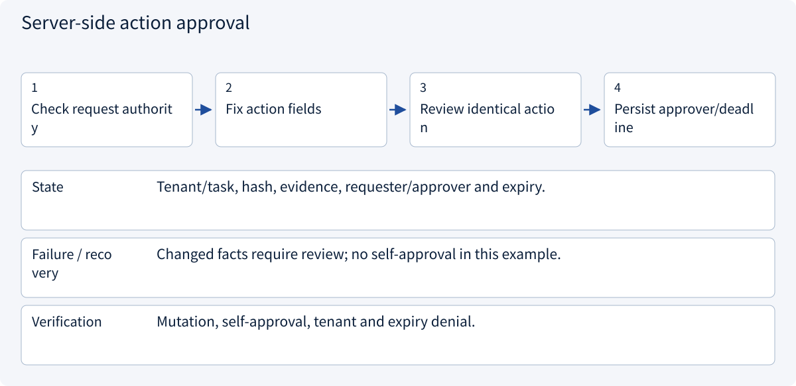
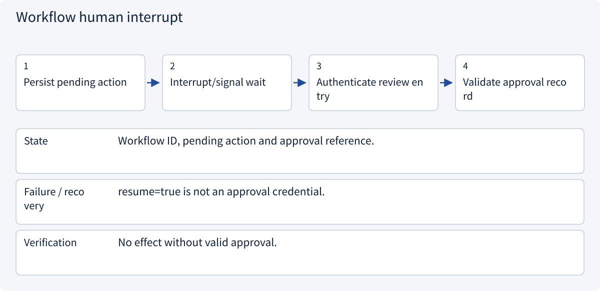

# 3.6.1 Approval binding: action, evidence, expiry and approver

> Visual route · Established approaches · Reference code

Local reference: trusted identity injection and SQLite transactions, without a login server or remote writes.

## Start with the problem

Why cannot an old “yes” approve a changed amount or recipient?



## See the mechanism

Approval is a server-side record bound to canonical action, evidence, tenant, task, requester, approver, expiry and policy version, not model-generated approved=true.



## Choose an established approach



| Approach | Mechanism | Use when | Tradeoff / boundary |
|---|---|---|---|
| Read-only preview | Show evidence without writing | Research and recommendations | Preview acceptance is not action approval |
| Server-side action approval | Bind exact action and approver | Precisely defined side effects | Canonicalization, independence and expiry |
| Workflow human interrupt | Durably wait then resume | Long approval waits | Pause does not authenticate reviewer |

## Inside the mainstream approaches

### 1 · Read-only preview



**Concrete trace:** Liking the comparison does not approve an amount/recipient.

### 2 · Server-side action approval



**Concrete trace:** 25000 cents to supplier-a is not approval for supplier-b.

### 3 · Workflow human interrupt



**Concrete trace:** LangGraph/Temporal resume execution; service validates authority.

## Reference code

Expand the implementation corresponding to this mechanism. Training code is provided but not executed. See the reference-code guide for dependencies and verification limits.

[Reference code and verification limits](../../docs/zh/projects/03-code-guide.md)

<details><summary>Expand code and limits</summary>

```python
"""Prepare an approved action through routes → handler → service → repository."""

from .governance.approvals import ApprovalService
from .governance.handlers import ApprovalHandler
from .governance.repos import GovernanceRepository
from .governance.routes import claim_entry


def claim_approved(
    connection, request: dict, identity, session_id: str, now: int
) -> dict:
    service = ApprovalService(GovernanceRepository(connection))
    return claim_entry(ApprovalHandler(service), request, identity, session_id, now)


# Never trust approved=true in a model message. Approval rows are server-side records.
# The action hash includes tenant/task, operation, object, amount, recipient and evidence version.
# Claiming prepares work; it does not prove a remote action occurred exactly once.
```

</details>

## Required design artifact

Canonical action fields, reviewer eligibility/independence, expiry and invalidation rules.

The reference implements application sessions and pending draft preparation, not OIDC, cookies or credential issuance. Local RBAC+ABAC does not deploy OPA/Cedar/OpenFGA. Membership changes increment one global policy epoch, conservatively invalidating approvals; production can version facts more narrowly.

Consumption prepares a pending local operation, not a remote write. Workers recheck current revocation/policy before fresh effects and query existing UNKNOWN outcomes. Session expiry does not erase tasks or issued effects.

References: [Official 1](https://cheatsheetseries.owasp.org/cheatsheets/Transaction_Authorization_Cheat_Sheet.html), [Official 2](https://docs.langchain.com/oss/python/langgraph/interrupts).


### Server-side approval and consumption

Local architecture reference without live external effects.

<details><summary>Expand code and limits</summary>

```python
import json

from .domain import Action, Principal
from .policies import ROLE_ACTIONS, PolicyService
from .repos import GovernanceRepository
from .sessions import SessionService


class ApprovalService:
    def __init__(self, repository: GovernanceRepository):
        self.repository = repository
        self.sessions = SessionService(repository)
        self.policy = PolicyService(repository)

    def request(
        self,
        identity: Principal,
        session_id: str,
        action: Action,
        approval_id: str,
        now: int,
        lifetime: int = 300,
    ) -> None:
        if lifetime <= 0:
            raise ValueError("Invalid approval lifetime")
        with self.repository.transaction():
            context = self.sessions.context(identity, session_id, now)
            decision = self.policy.decide(context, action)
            if not decision.allowed:
                raise PermissionError(decision.reason)
            self.repository.request_approval(
                approval_id, context, action, now + lifetime, decision.policy_version
            )

    def current_approval(self, approval_id: str, tenant: str, now: int) -> dict:
        row = self.repository.get("approvals", "approval_id", approval_id)
        if (
            row["tenant"] != tenant
            or row["expires_at"] <= now
            or row["policy_version"] != self.repository.policy_version()
        ):
            raise PermissionError("Approval scope, expiry or policy version changed")
        action = Action(**json.loads(row["action_json"]))
        if action.fingerprint() != row["action_hash"]:
            raise PermissionError("Approval payload changed")
        return row

    def approve(
        self, identity: Principal, session_id: str, approval_id: str, now: int
    ) -> None:
        with self.repository.transaction():
            context = self.sessions.context(identity, session_id, now)
            member = self.repository.member(context.subject, context.tenant)
            if "approve_draft" not in ROLE_ACTIONS.get(member["role"], set()):
                raise PermissionError("No reviewer role")
            row = self.current_approval(approval_id, context.tenant, now)
            if row["requester"] == context.subject:
                raise PermissionError("Independent approver required")
            self.repository.approve(approval_id, context.subject)

    def claim(
        self,
        identity: Principal,
        session_id: str,
        approval_id: str,
        action: Action,
        operation_id: str,
        now: int,
    ) -> None:
        with self.repository.transaction():
            context = self.sessions.context(identity, session_id, now)
            row = self.current_approval(approval_id, context.tenant, now)
            decision = self.policy.decide(context, action)
            if (
                row["requester"] != context.subject
                or not decision.allowed
                or action.fingerprint() != row["action_hash"]
            ):
                raise PermissionError(
                    "Requester, current permission or exact action mismatch"
                )
            # Consumption and pending operation are atomic; uniqueness rejects replay.
            self.repository.claim(row, action, operation_id)
        # This only prepares a durable pending operation. Workers must check revocation/
        # execution policy again before a NEW remote effect; unknown effects need lookup.

    def revoke(
        self, identity: Principal, session_id: str, approval_id: str, now: int
    ) -> None:
        with self.repository.transaction():
            context = self.sessions.context(identity, session_id, now)
            row = self.repository.get("approvals", "approval_id", approval_id)
            if row["tenant"] != context.tenant or context.subject not in {
                row["requester"],
                row["approver"],
            }:
                raise PermissionError("Cannot revoke this approval")
            self.repository.revoke_approval(approval_id)

    def operation(
        self, identity: Principal, session_id: str, operation_id: str, now: int
    ) -> dict:
        with self.repository.transaction():
            context = self.sessions.context(identity, session_id, now)
            row = self.repository.get("operations", "operation_id", operation_id)
            self.sessions.task(context, row["task_id"])
            return {
                "operation_id": operation_id,
                "state": row["state"],
                "action_hash": row["action_hash"],
            }
```

</details>

### Action request boundary

Local architecture reference without live external effects.

<details><summary>Expand code and limits</summary>

```python
from .approvals import ApprovalService
from .domain import Action, Principal


class ApprovalHandler:
    def __init__(self, service: ApprovalService):
        self.service = service

    def claim(
        self, request: dict, identity: Principal, session_id: str, now: int
    ) -> dict:
        if set(request) != {"approval_id", "operation_id", "action"}:
            raise ValueError("Invalid claim envelope")
        if any(
            not isinstance(request[key], str) or not request[key]
            for key in ["approval_id", "operation_id"]
        ):
            raise ValueError("Expected nonempty identifiers")
        if not isinstance(request["action"], dict):
            raise TypeError("Expected an action object")
        action = Action(**request["action"])
        self.service.claim(
            identity,
            session_id,
            request["approval_id"],
            action,
            request["operation_id"],
            now,
        )
        return {"operation_id": request["operation_id"], "state": "pending"}
```

</details>

### Trusted entry assembly

Local architecture reference without live external effects.

<details><summary>Expand code and limits</summary>

```python
from .domain import Principal
from .handlers import ApprovalHandler


def claim_entry(
    handler: ApprovalHandler,
    request: dict,
    identity: Principal,
    session_id: str,
    now: int,
) -> dict:
    """Trusted middleware injects identity/session/time; a model supplies only proposal data."""
    return handler.claim(request, identity, session_id, now)
```

</details>

## Change a condition

Must approval bind yesterday’s browser session ID?

<details><summary>Suggested answer</summary>

Not necessarily: bind actor/task/action and reauthenticate/re-authorize the new session.

</details>

[Official sources and approach rationale](../../docs/zh/resources.md)
