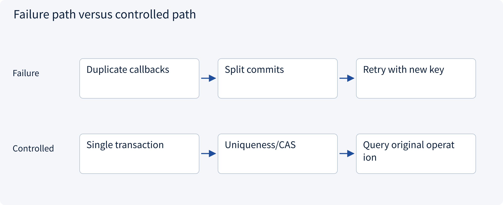
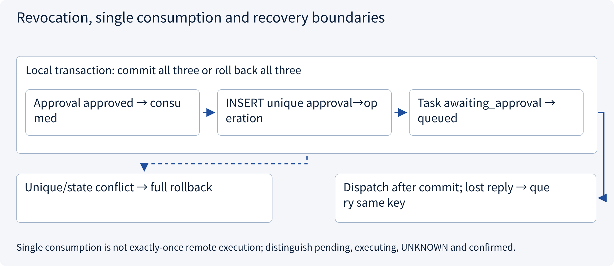
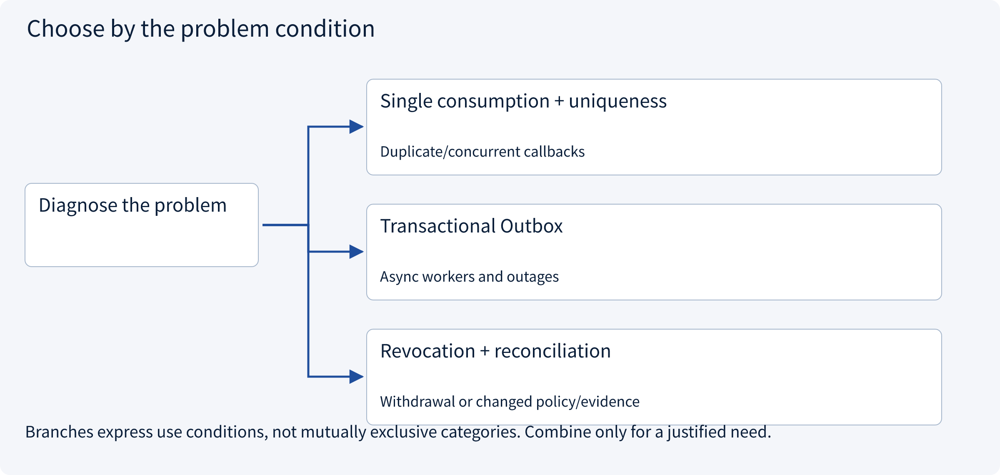
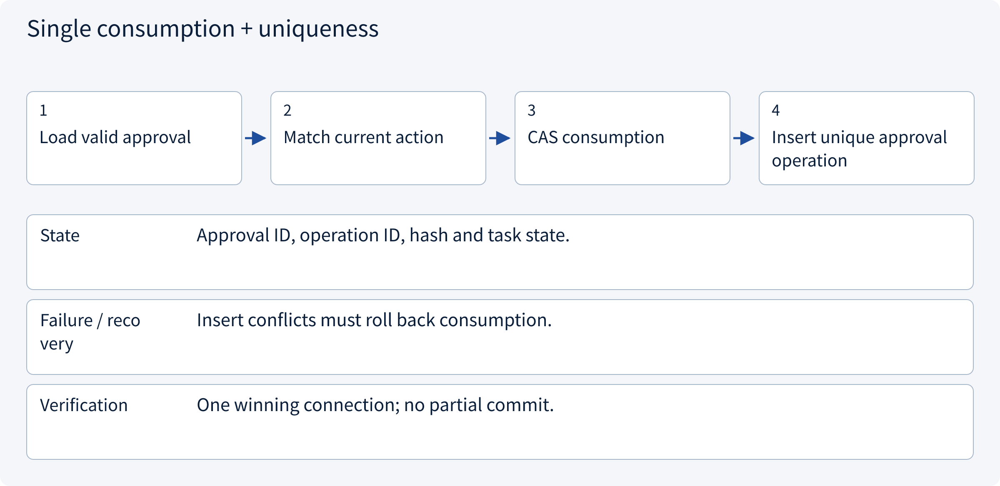
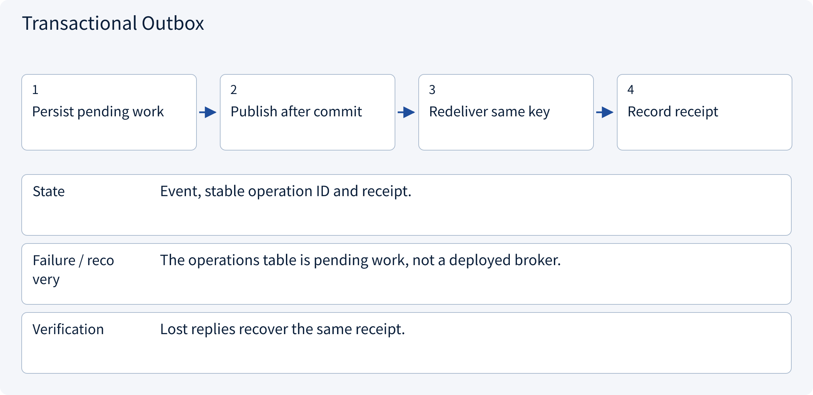
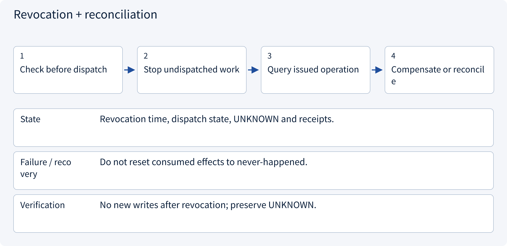

# 3.6.2 Revocation, single consumption and recovery boundaries

> Visual route · Established approaches · Reference code

Local reference: trusted identity injection and SQLite transactions, without a login server or remote writes.

## Start with the problem

How do concurrent callbacks and crashes avoid duplicate effects or consumed approvals without work?




## See the mechanism

Commit approval consumption, task transition and pending operation atomically. Uniqueness prevents multiple operations per approval. Queueing, effects and receipts are distinct; reconcile unknown outcomes.



## Choose an established approach



| Approach | Mechanism | Use when | Tradeoff / boundary |
|---|---|---|---|
| Single consumption + uniqueness | Consume and insert operation atomically | Duplicate/concurrent callbacks | Not exactly-once remote execution |
| Transactional Outbox | Persist work then publish at least once | Async workers and outages | Deduplicate delivery/effects |
| Revocation + reconciliation | Block fresh actions; inspect issued ones | Withdrawal or changed policy/evidence | Revocation cannot undo history |

## Inside the mainstream approaches

### 1 · Single consumption + uniqueness



**Concrete trace:** Two workers claim approval-a; only one prepares work.

<details><summary>Expand steps, state and failure boundaries</summary>

1. Load valid approval
2. Match current action
3. CAS consumption
4. Insert unique approval operation

**State** Approval ID, operation ID, hash and task state.

**Failure / recovery** Insert conflicts must roll back consumption.

**Verification** One winning connection; no partial commit.

</details>

### 2 · Transactional Outbox



**Concrete trace:** Pending does not mean the remote draft exists.

<details><summary>Expand steps, state and failure boundaries</summary>

1. Persist pending work
2. Publish after commit
3. Redeliver same key
4. Record receipt

**State** Event, stable operation ID and receipt.

**Failure / recovery** The operations table is pending work, not a deployed broker.

**Verification** Lost replies recover the same receipt.

</details>

### 3 · Revocation + reconciliation



**Concrete trace:** Find the old operation after a lost success reply rather than asserting cancellation.

<details><summary>Expand steps, state and failure boundaries</summary>

1. Check before dispatch
2. Stop undispatched work
3. Query issued operation
4. Compensate or reconcile

**State** Revocation time, dispatch state, UNKNOWN and receipts.

**Failure / recovery** Do not reset consumed effects to never-happened.

**Verification** No new writes after revocation; preserve UNKNOWN.

</details>

## Reference code

Expand the implementation corresponding to this mechanism. Training code is provided but not executed. See the reference-code guide for dependencies and verification limits.

[Reference code and verification limits](code-guide.md)

<details><summary>Expand code and limits</summary>

```python
"""A repeated callback reads the existing operation; it does not mint a new write."""

from .governance.approvals import ApprovalService
from .governance.domain import Principal
from .governance.repos import GovernanceRepository


def inspect_operation(
    connection, actor: Principal, session_id: str, operation_id: str, now: int
) -> dict:
    return ApprovalService(GovernanceRepository(connection)).operation(
        actor, session_id, operation_id, now
    )


# pending means durable work was prepared, not that the remote effect happened.
# Resume adapters query uncertain remote outcomes by the SAME operation_id.
# Revocation after dispatch cannot retroactively undo a remote effect.
```

</details>

## Required design artifact

Consumption/pending-operation transaction, duplicate callbacks, revocation and UNKNOWN reconciliation.

The reference implements application sessions and pending draft preparation, not OIDC, cookies or credential issuance. Local RBAC+ABAC does not deploy OPA/Cedar/OpenFGA. Membership changes increment one global policy epoch, conservatively invalidating approvals; production can version facts more narrowly.

Consumption prepares a pending local operation, not a remote write. Workers recheck current revocation/policy before fresh effects and query existing UNKNOWN outcomes. Session expiry does not erase tasks or issued effects.

References: [AWS Transactional Outbox](https://docs.aws.amazon.com/prescriptive-guidance/latest/cloud-design-patterns/transactional-outbox.html).


### Transaction, CAS and unique constraints

Local architecture reference without live external effects.

<details><summary>Expand code and limits</summary>

```python
"""Explicit transaction and narrow persistence operations; no network in transactions."""

import sqlite3
from contextlib import contextmanager
from pathlib import Path


class GovernanceRepository:
    def __init__(self, connection: sqlite3.Connection):
        self.connection = connection
        connection.row_factory = sqlite3.Row
        connection.execute("PRAGMA foreign_keys=ON")

    def initialize(self) -> None:
        self.connection.executescript(
            Path(__file__).with_name("schema.sql").read_text()
        )

    @contextmanager
    def transaction(self):
        self.connection.execute("BEGIN IMMEDIATE")
        try:
            yield
            self.connection.commit()
        except BaseException:
            self.connection.rollback()
            raise

    def get(self, table: str, key: str, value: str) -> dict:
        # Identifiers are a closed internal set, never caller-supplied SQL fragments.
        if (table, key) not in {
            ("sessions", "session_id"),
            ("tasks", "task_id"),
            ("approvals", "approval_id"),
            ("operations", "operation_id"),
        }:
            raise ValueError("Unsupported lookup")
        row = self.connection.execute(
            f"SELECT * FROM {table} WHERE {key}=?", (value,)
        ).fetchone()
        if row is None:
            raise LookupError("Record not found")
        return dict(row)

    def member(self, subject: str, tenant: str) -> dict | None:
        row = self.connection.execute(
            "SELECT * FROM members WHERE subject=? AND tenant=?", (subject, tenant)
        ).fetchone()
        return dict(row) if row else None

    def policy_version(self) -> int:
        return self.connection.execute(
            "SELECT version FROM policy_epoch WHERE singleton=1"
        ).fetchone()[0]

    def set_member(self, subject: str, tenant: str, role: str, limit: int) -> None:
        with self.transaction():
            self.connection.execute(
                "INSERT INTO members VALUES(?,?,?,?) ON CONFLICT(subject,tenant) DO UPDATE SET role=excluded.role,limit_cents=excluded.limit_cents",
                (subject, tenant, role, limit),
            )
            self.connection.execute(
                "UPDATE policy_epoch SET version=version+1 WHERE singleton=1"
            )

    def create_session(
        self, session_id: str, subject: str, tenant: str, expires: int
    ) -> None:
        self.connection.execute(
            "INSERT INTO sessions(session_id,subject,tenant,expires_at) VALUES(?,?,?,?)",
            (session_id, subject, tenant, expires),
        )

    def revoke_session(self, session_id: str) -> None:
        self.connection.execute(
            "UPDATE sessions SET revoked=1 WHERE session_id=?", (session_id,)
        )

    def create_task(
        self, task_id: str, tenant: str, owner: str, conversation: str, resource: str
    ) -> None:
        self.connection.execute(
            "INSERT INTO tasks(task_id,tenant,owner,conversation_id,resource_id,state) VALUES(?,?,?,?,?,'paused')",
            (task_id, tenant, owner, conversation, resource),
        )

    def resume(
        self, task: dict, session_id: str, run_id: str, expected_version: int
    ) -> None:
        changed = self.connection.execute(
            "UPDATE tasks SET state='running',version=version+1 WHERE task_id=? AND version=? AND state='paused'",
            (task["task_id"], expected_version),
        ).rowcount
        if changed != 1:
            raise RuntimeError("Task already claimed or stale version")
        self.connection.execute(
            "INSERT INTO runs VALUES(?,?,?,?)",
            (run_id, task["task_id"], session_id, expected_version + 1),
        )

    def request_approval(
        self, approval_id: str, context, action, expires: int, epoch: int
    ) -> None:
        changed = self.connection.execute(
            "UPDATE tasks SET state='awaiting_approval',version=version+1 WHERE task_id=? AND state='paused'",
            (action.task_id,),
        ).rowcount
        if changed != 1:
            raise RuntimeError("Task not ready for approval")
        self.connection.execute(
            "INSERT INTO approvals VALUES(?,?,?,?,NULL,?,?,?,?,'pending')",
            (
                approval_id,
                action.task_id,
                context.tenant,
                context.subject,
                action.payload(),
                action.fingerprint(),
                epoch,
                expires,
            ),
        )

    def approve(self, approval_id: str, approver: str) -> None:
        changed = self.connection.execute(
            "UPDATE approvals SET status='approved',approver=? WHERE approval_id=? AND status='pending'",
            (approver, approval_id),
        ).rowcount
        if changed != 1:
            raise RuntimeError("Approval is no longer pending")

    def revoke_approval(self, approval_id: str) -> None:
        changed = self.connection.execute(
            "UPDATE approvals SET status='revoked' WHERE approval_id=? AND status IN ('pending','approved')",
            (approval_id,),
        ).rowcount
        if changed != 1:
            raise RuntimeError(
                "Approval already consumed or revoked; inspect operation"
            )
        self.connection.execute(
            "UPDATE tasks SET state='paused',version=version+1 WHERE task_id=(SELECT task_id FROM approvals WHERE approval_id=?) AND state='awaiting_approval'",
            (approval_id,),
        )

    def claim(self, approval: dict, action, operation_id: str) -> None:
        changed = self.connection.execute(
            "UPDATE approvals SET status='consumed' WHERE approval_id=? AND status='approved'",
            (approval["approval_id"],),
        ).rowcount
        if changed != 1:
            raise RuntimeError("Approval already consumed or not approved")
        self.connection.execute(
            "INSERT INTO operations(operation_id,approval_id,task_id,tenant,action_json,action_hash) VALUES(?,?,?,?,?,?)",
            (
                operation_id,
                approval["approval_id"],
                action.task_id,
                action.tenant,
                action.payload(),
                action.fingerprint(),
            ),
        )
        changed = self.connection.execute(
            "UPDATE tasks SET state='queued',version=version+1 WHERE task_id=? AND state='awaiting_approval'",
            (action.task_id,),
        ).rowcount
        if changed != 1:
            raise RuntimeError("Task state no longer permits execution")
```

</details>

### Persistence constraints

<details><summary>Expand code and limits</summary>

```sql
PRAGMA foreign_keys=ON;
CREATE TABLE policy_epoch (singleton INTEGER PRIMARY KEY CHECK(singleton=1), version INTEGER NOT NULL);
INSERT INTO policy_epoch VALUES(1,1);
CREATE TABLE members (
    subject TEXT NOT NULL, tenant TEXT NOT NULL, role TEXT NOT NULL, limit_cents INTEGER NOT NULL,
    PRIMARY KEY(subject,tenant)
);
CREATE TABLE sessions (
    session_id TEXT PRIMARY KEY, subject TEXT NOT NULL, tenant TEXT NOT NULL,
    expires_at INTEGER NOT NULL, revoked INTEGER NOT NULL DEFAULT 0
);
CREATE TABLE tasks (
    task_id TEXT PRIMARY KEY, tenant TEXT NOT NULL, owner TEXT NOT NULL,
    conversation_id TEXT NOT NULL, resource_id TEXT NOT NULL, evidence_version INTEGER NOT NULL DEFAULT 1,
    state TEXT NOT NULL CHECK(state IN ('paused','running','awaiting_approval','queued')),
    version INTEGER NOT NULL DEFAULT 1
);
CREATE TABLE runs (
    run_id TEXT PRIMARY KEY, task_id TEXT NOT NULL REFERENCES tasks(task_id),
    session_id TEXT NOT NULL REFERENCES sessions(session_id), task_version INTEGER NOT NULL
);
CREATE TABLE approvals (
    approval_id TEXT PRIMARY KEY, task_id TEXT NOT NULL REFERENCES tasks(task_id),
    tenant TEXT NOT NULL, requester TEXT NOT NULL, approver TEXT,
    action_json TEXT NOT NULL, action_hash TEXT NOT NULL, policy_version INTEGER NOT NULL,
    expires_at INTEGER NOT NULL,
    status TEXT NOT NULL CHECK(status IN ('pending','approved','consumed','revoked'))
);
CREATE TABLE operations (
    operation_id TEXT PRIMARY KEY, approval_id TEXT NOT NULL UNIQUE REFERENCES approvals(approval_id),
    task_id TEXT NOT NULL REFERENCES tasks(task_id), tenant TEXT NOT NULL,
    action_json TEXT NOT NULL, action_hash TEXT NOT NULL, state TEXT NOT NULL DEFAULT 'pending'
);
```

</details>

## Change a condition

Does single-use approval guarantee one remote effect?

<details><summary>Suggested answer</summary>

No. Stable operation keys and remote deduplication/reconciliation remain necessary.

</details>

[Official sources and approach rationale](resources.md)
