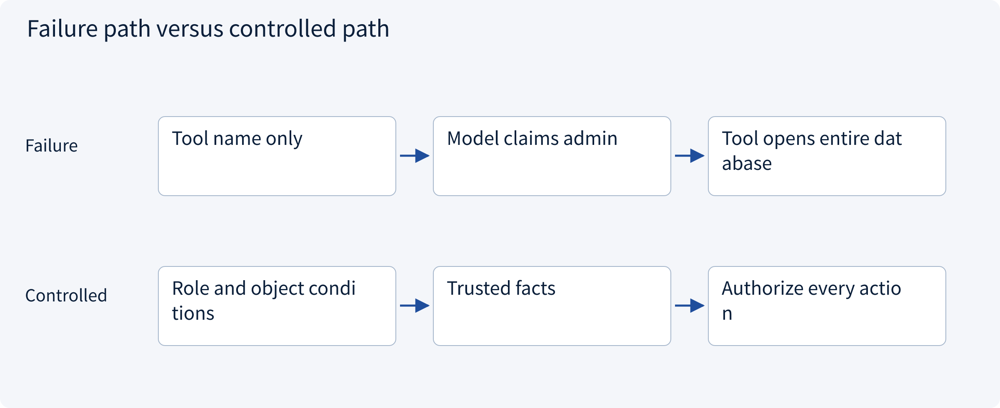
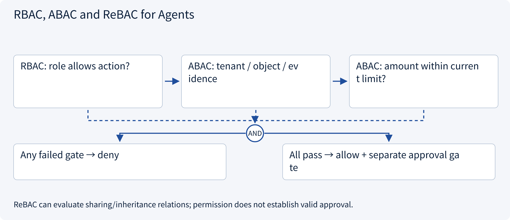
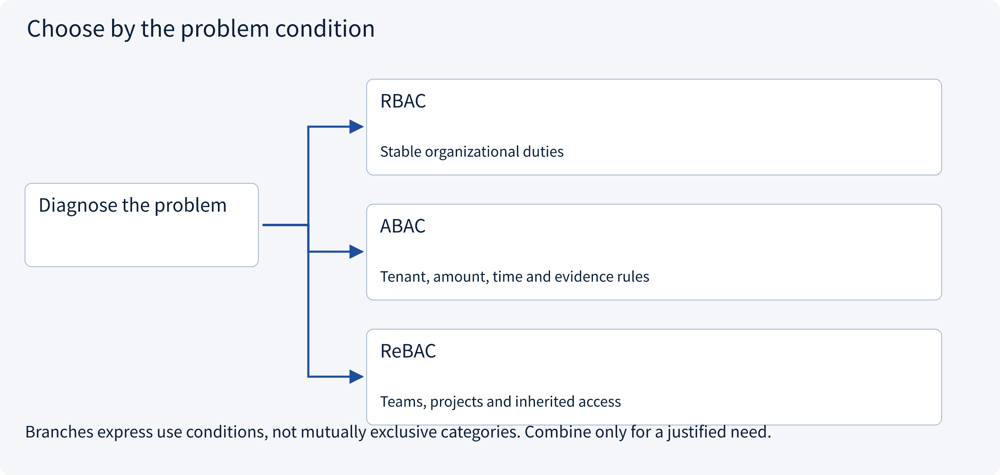
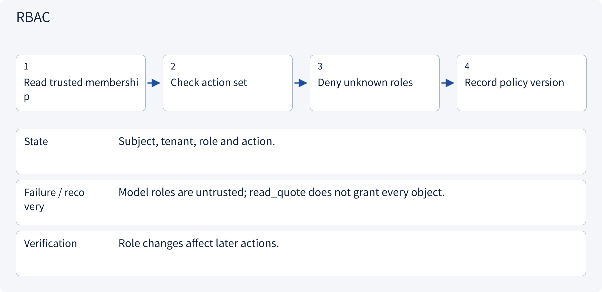
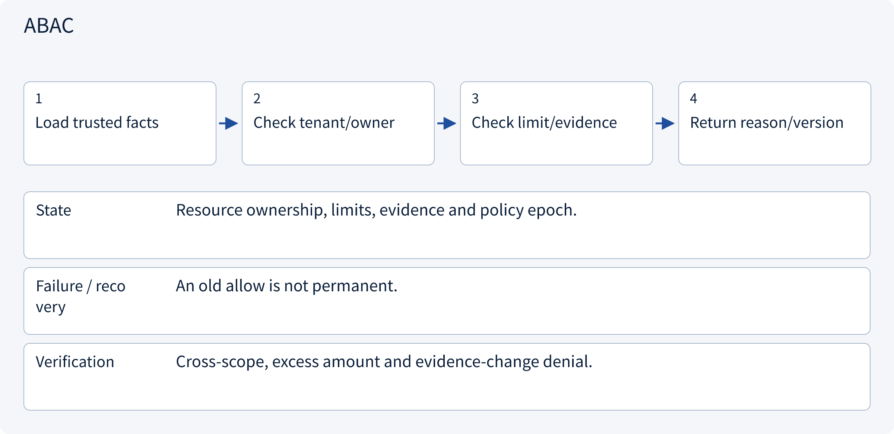
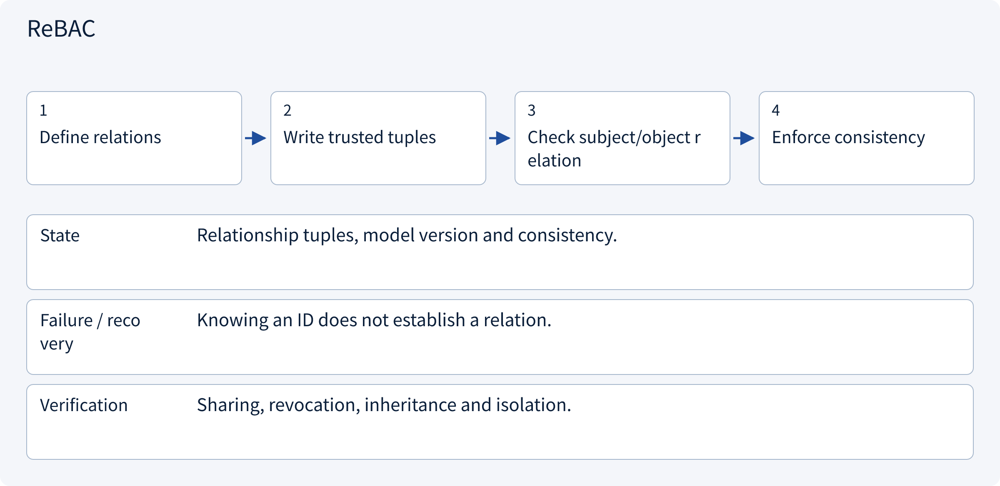

# 3.5.1 RBAC, ABAC and ReBAC for Agents

> Visual route · Established approaches · Reference code

Local reference: trusted identity injection and SQLite transactions, without a login server or remote writes.

## Start with the problem

Why does a tool allowlist still leak objects? How does login differ from permission for this exact action?




## See the mechanism

Authorize trusted principal/action/resource/context. RBAC maps roles, ABAC checks attributes, ReBAC models relationships. Default deny; never accept model-asserted authority.



## Choose an established approach



| Approach | Mechanism | Use when | Tradeoff / boundary |
|---|---|---|---|
| RBAC | Map roles to actions | Stable organizational duties | Role explosion and object scope |
| ABAC | Evaluate object/context attributes | Tenant, amount, time and evidence rules | Attribute provenance/freshness |
| ReBAC | Authorize through resource relations | Teams, projects and inherited access | Consistency, revocation and graph modeling |

## Inside the mainstream approaches

### 1 · RBAC



**Concrete trace:** Operators propose drafts; reviewers approve them.

<details><summary>Expand steps, state and failure boundaries</summary>

1. Read trusted membership
2. Check action set
3. Deny unknown roles
4. Record policy version

**State** Subject, tenant, role and action.

**Failure / recovery** Model roles are untrusted; read_quote does not grant every object.

**Verification** Role changes affect later actions.

</details>

### 2 · ABAC



**Concrete trace:** A role allowing drafts still rejects excessive amounts.

<details><summary>Expand steps, state and failure boundaries</summary>

1. Load trusted facts
2. Check tenant/owner
3. Check limit/evidence
4. Return reason/version

**State** Resource ownership, limits, evidence and policy epoch.

**Failure / recovery** An old allow is not permanent.

**Verification** Cross-scope, excess amount and evidence-change denial.

</details>

### 3 · ReBAC



**Concrete trace:** OpenFGA can model project membership to quotation viewer access.

<details><summary>Expand steps, state and failure boundaries</summary>

1. Define relations
2. Write trusted tuples
3. Check subject/object relation
4. Enforce consistency

**State** Relationship tuples, model version and consistency.

**Failure / recovery** Knowing an ID does not establish a relation.

**Verification** Sharing, revocation, inheritance and isolation.

</details>

## Reference code

Expand the implementation corresponding to this mechanism. Training code is provided but not executed. See the reference-code guide for dependencies and verification limits.

[Reference code and verification limits](code-guide.md)

<details><summary>Expand code and limits</summary>

```python
"""Current policy evaluation and non-amplifying worker delegation."""

from .governance.policies import PolicyService


def narrow_worker(
    parent: frozenset[tuple[str, str]], requested: frozenset[tuple[str, str]]
):
    return PolicyService.delegated_scope(parent, requested)


# Evaluate subject + action + resource + trusted context; retain the policy version/reason.
# This is a small local reference; it does not install or benchmark OPA/Cedar/OpenFGA.
```

</details>

## Required design artifact

Principal/action/object model, default deny, trusted attributes/relations and policy version.

The reference implements application sessions and pending draft preparation, not OIDC, cookies or credential issuance. Local RBAC+ABAC does not deploy OPA/Cedar/OpenFGA. Membership changes increment one global policy epoch, conservatively invalidating approvals; production can version facts more narrowly.

Consumption prepares a pending local operation, not a remote write. Workers recheck current revocation/policy before fresh effects and query existing UNKNOWN outcomes. Session expiry does not erase tasks or issued effects.

References: [Cedar Authorization](https://docs.cedarpolicy.com/auth/authorization.html), [OpenFGA Authorization Concepts](https://openfga.dev/docs/authorization-concepts).


### Local role/attribute policy

Local architecture reference without live external effects.

<details><summary>Expand code and limits</summary>

```python
"""A small RBAC+ABAC example, not a reimplementation of Cedar/OPA/OpenFGA."""

from .domain import Action, Context, Decision
from .repos import GovernanceRepository

ROLE_ACTIONS = {
    "viewer": {"read_quote"},
    "operator": {"read_quote", "create_draft"},
    "reviewer": {"read_quote", "approve_draft"},
    "lead": {"read_quote", "create_draft", "approve_draft"},
}


class PolicyService:
    def __init__(self, repository: GovernanceRepository):
        self.repository = repository

    def decide(self, context: Context, action: Action) -> Decision:
        action.validate()
        epoch = self.repository.policy_version()
        member = self.repository.member(context.subject, context.tenant)
        task = self.repository.get("tasks", "task_id", action.task_id)
        if member is None or action.operation not in ROLE_ACTIONS.get(
            member["role"], set()
        ):
            return Decision(False, False, "role_denied", epoch)
        if (
            action.tenant != context.tenant
            or task["tenant"] != context.tenant
            or task["owner"] != context.subject
        ):
            return Decision(False, False, "object_scope_denied", epoch)
        if (
            action.resource_id != task["resource_id"]
            or action.evidence_version != task["evidence_version"]
        ):
            return Decision(False, False, "resource_or_evidence_changed", epoch)
        if action.amount_cents > member["limit_cents"]:
            return Decision(False, False, "amount_limit_exceeded", epoch)
        return Decision(True, True, "write_requires_approval", epoch)

    @staticmethod
    def delegated_scope(
        parent: frozenset[tuple[str, str]], requested: frozenset[tuple[str, str]]
    ) -> frozenset[tuple[str, str]]:
        if not requested <= parent:
            raise PermissionError("Delegation cannot amplify authority")
        return requested


# Policy decisions expire with their policy/resource facts. Never cache by subject alone.
```

</details>

## Change a condition

Must RBAC, ABAC and ReBAC be exclusive?

<details><summary>Suggested answer</summary>

No. Coarse role gates can combine with attributes/relations based on the domain.

</details>

[Official sources and approach rationale](resources.md)
