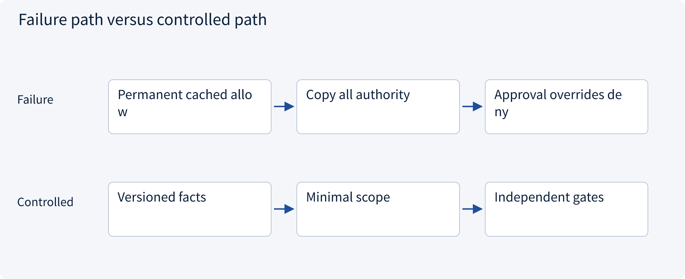
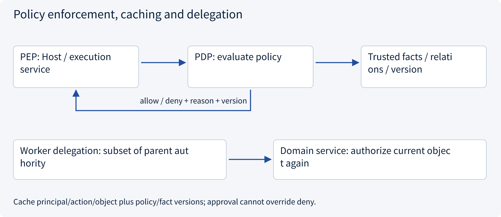
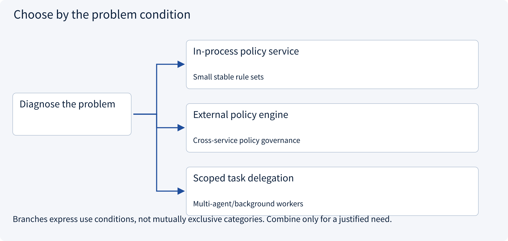
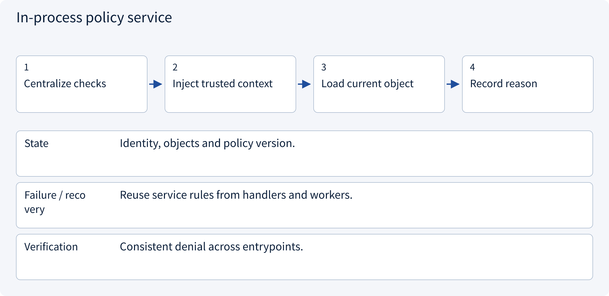
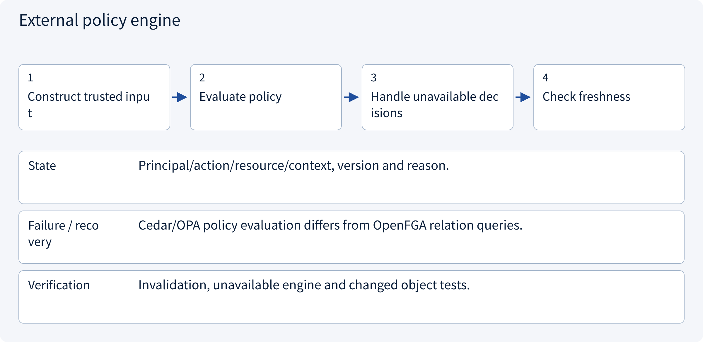
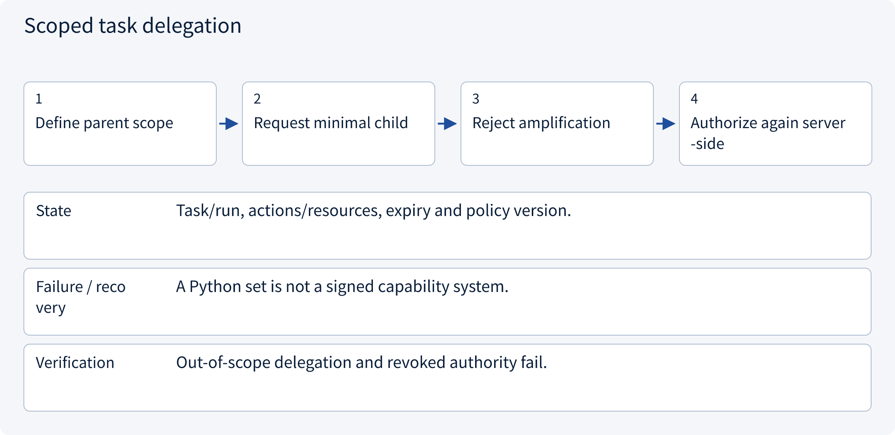

# 3.5.2 Policy enforcement, caching and delegation

> Visual route · Established approaches · Reference code

Local reference: trusted identity injection and SQLite transactions, without a login server or remote writes.

## Start with the problem

Can a service trust one allow forever? Should child workers inherit all parent credentials?




## See the mechanism

Enforce current facts at execution. Cache by principal/action/object plus policy/fact versions. Delegation narrows scope; approval cannot convert deny into allow.



## Choose an established approach



| Approach | Mechanism | Use when | Tradeoff / boundary |
|---|---|---|---|
| In-process policy service | Evaluate local role/attribute rules | Small stable rule sets | Distributed rules become hard to audit |
| External policy engine | PDP decides; application PEP enforces | Cross-service policy governance | Network/cache/consistency/failure choices |
| Scoped task delegation | Require child scope subset | Multi-agent/background workers | Audience, expiry, revocation and audit |

## Inside the mainstream approaches

### 1 · In-process policy service



**Concrete trace:** Role downgrade blocks a new run in an existing session.

### 2 · External policy engine



**Concrete trace:** Do not cache allow by user ID alone.

### 3 · Scoped task delegation



**Concrete trace:** A quote-a reader cannot request quote-b or draft creation.

## Reference code

Expand the implementation corresponding to this mechanism. Training code is provided but not executed. See the reference-code guide for dependencies and verification limits.

[Reference code and verification limits](../../docs/zh/projects/03-code-guide.md)

<details><summary>Expand code and limits</summary>

```python
"""Evaluate current facts, not a model-supplied role or cached allow flag."""

from .governance.domain import Action, Principal
from .governance.policies import PolicyService
from .governance.repos import GovernanceRepository
from .governance.sessions import SessionService


def decide_action(
    connection, actor: Principal, session_id: str, action: Action, now: int
):
    repository = GovernanceRepository(connection)
    with repository.transaction():
        context = SessionService(repository).context(actor, session_id, now)
        return PolicyService(repository).decide(context, action)


# allowed=true only answers the current policy check. needs_approval remains a separate gate.
```

</details>

## Required design artifact

PEP/PDP placement, invalidation keys, unavailable decisions, delegation and audit correlation.

The reference implements application sessions and pending draft preparation, not OIDC, cookies or credential issuance. Local RBAC+ABAC does not deploy OPA/Cedar/OpenFGA. Membership changes increment one global policy epoch, conservatively invalidating approvals; production can version facts more narrowly.

Consumption prepares a pending local operation, not a remote write. Workers recheck current revocation/policy before fresh effects and query existing UNKNOWN outcomes. Session expiry does not erase tasks or issued effects.

References: [Official 1](https://www.openpolicyagent.org/docs/policy-language), [Official 2](https://openfga.dev/docs/authorization-concepts).


## Change a condition

Can human approval override a policy deny?

<details><summary>Suggested answer</summary>

No. Approval supplements permission; it cannot bypass hard resource/tenant/amount constraints.

</details>

[Official sources and approach rationale](../../docs/zh/resources.md)
