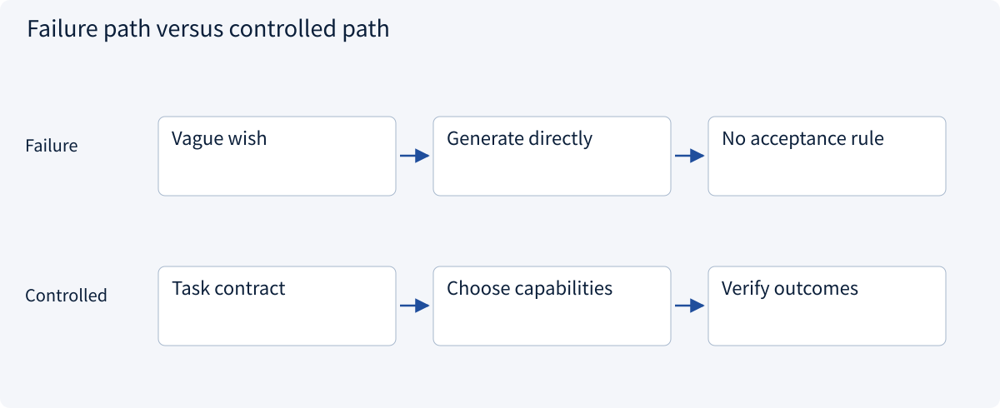
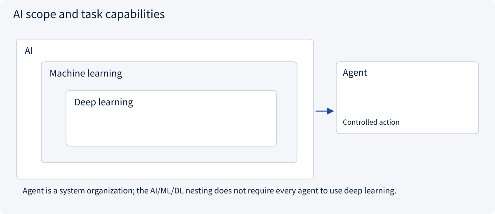
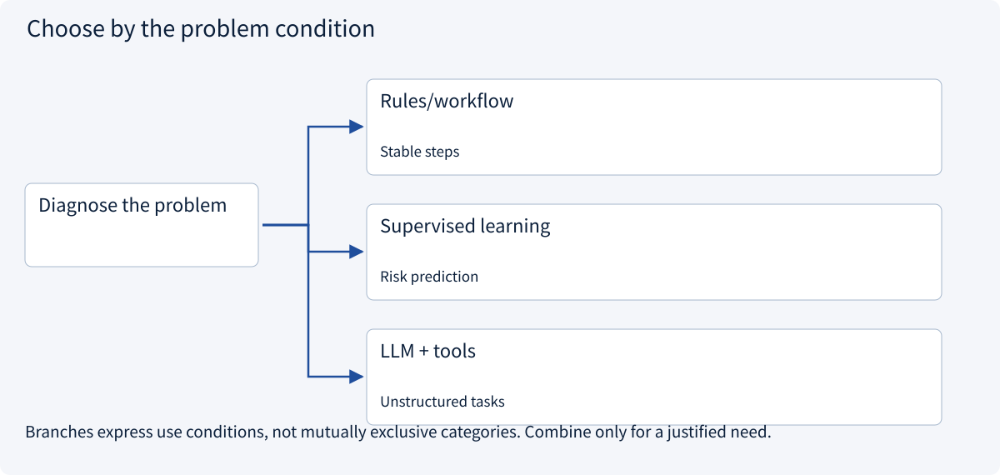
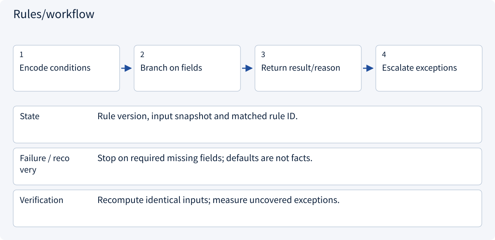
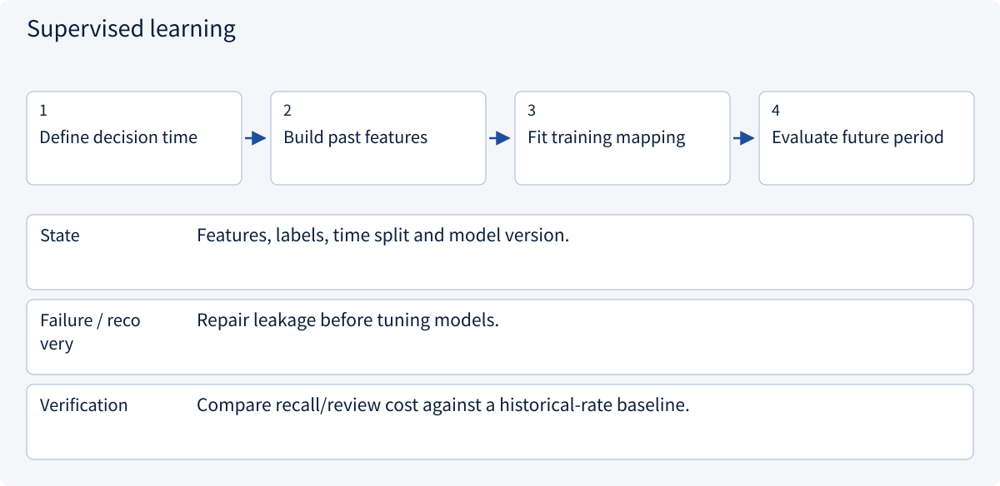
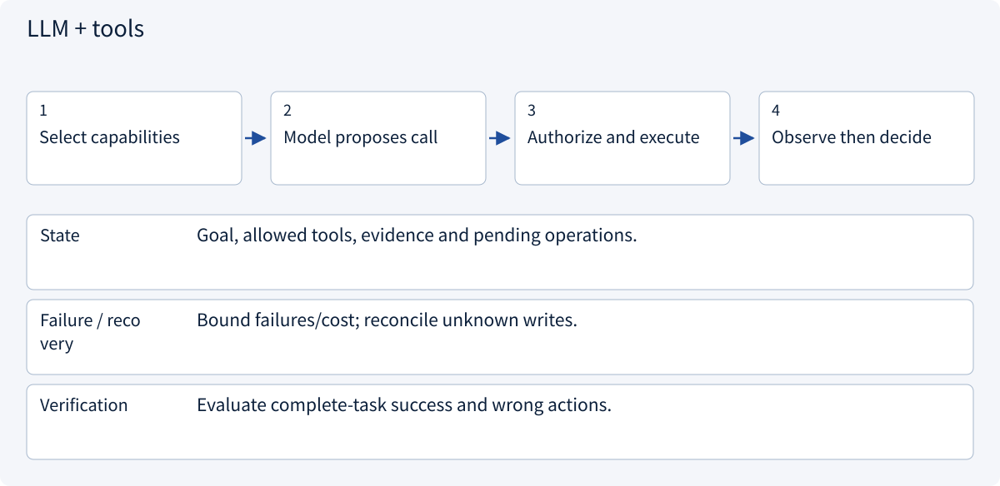

# 1.1 Frame an AI problem

> Visual route · Established approaches · Reference code

The code checks task constraints and integer cost budgets; acceptance criteria, approval and training belong to separate modules.

## Start with the problem

Can one model handle prediction, document reading and external actions?




## See the mechanism

Define inputs, outputs and authority before choosing a model. A prediction score is not execution permission.



## Choose an established approach



| Approach | Mechanism | Use when | Tradeoff / boundary |
|---|---|---|---|
| Rules/workflow | Explicit conditions | Stable steps | Exceptions need maintenance |
| Supervised learning | Fit labeled examples | Risk prediction | Labels and held-out evaluation |
| LLM + tools | Interpret and propose | Unstructured tasks | Authorization and stopping rules |

## Inside the mainstream approaches

### 1 · Rules/workflow



**Concrete trace:** Deterministically compare totals; missing shipping keeps the total unknown.

<details><summary>Expand steps, state and failure boundaries</summary>

1. Encode conditions
2. Branch on fields
3. Return result/reason
4. Escalate exceptions

**State** Rule version, input snapshot and matched rule ID.

**Failure / recovery** Stop on required missing fields; defaults are not facts.

**Verification** Recompute identical inputs; measure uncovered exceptions.

</details>

### 2 · Supervised learning



**Concrete trace:** Predict from records available before an order, not its eventual shipping date.

<details><summary>Expand steps, state and failure boundaries</summary>

1. Define decision time
2. Build past features
3. Fit training mapping
4. Evaluate future period

**State** Features, labels, time split and model version.

**Failure / recovery** Repair leakage before tuning models.

**Verification** Compare recall/review cost against a historical-rate baseline.

</details>

### 3 · LLM + tools



**Concrete trace:** Use a model for quotation text, code for amounts and separate approval for ordering.

<details><summary>Expand steps, state and failure boundaries</summary>

1. Select capabilities
2. Model proposes call
3. Authorize and execute
4. Observe then decide

**State** Goal, allowed tools, evidence and pending operations.

**Failure / recovery** Bound failures/cost; reconcile unknown writes.

**Verification** Evaluate complete-task success and wrong actions.

</details>

## Reference code

Expand the implementation corresponding to this mechanism. Training code is provided but not executed. See the reference-code guide for dependencies and verification limits.

[Reference code and verification limits](code-guide.md)

<details><summary>Expand code and limits</summary>

```python
"""A task contract keeps predictions separate from external actions."""

from dataclasses import dataclass


@dataclass(frozen=True)
class ResearchTask:
    quantity: int
    budget_cents: int
    evidence_ids: tuple[str, ...]
    may_create_draft: bool = False

    def validate(self) -> None:
        if self.quantity <= 0 or self.budget_cents <= 0:
            raise ValueError("Quantity and budget must be positive")
        if not self.evidence_ids:
            raise ValueError("Evidence is required before comparing quotations")


def affordable(unit_cents: int, shipping_cents: int, task: ResearchTask) -> bool:
    task.validate()
    if unit_cents < 0 or shipping_cents < 0:
        raise ValueError("Missing costs must not be silently replaced with zero")
    return unit_cents * task.quantity + shipping_cents <= task.budget_cents
```

</details>

## Change a condition

Why do price comparison and order creation need different acceptance rules?

<details><summary>Suggested answer</summary>

Comparison needs evidence and consistent units; creation also needs authority, approval and a verifiable receipt.

</details>

<details><summary>Optional derivation and boundaries</summary>

**Start with a measurable task**

Artificial intelligence includes learning, search, reasoning and planning. Machine learning fits behavior from data; deep learning learns representations with multilayer networks. Generative AI describes a kind of output, while an agent describes an interaction loop. These are different classification axes.

“Help with procurement” combines several problems. Predicting late delivery is supervised learning; reading a quotation can use a language model; comparing amounts should use deterministic arithmetic; placing an order requires authority and durable execution state.

Define the input available at decision time, the output, forbidden actions and acceptance criteria. A simple historical late-delivery rate is a useful baseline. Training changes parameters, context changes the current input, and a tool can change the environment.

**Check your understanding**

Does a tool loop automatically train the model?

<details><summary>Suggested answer</summary>

No. Inference-time orchestration does not by itself update model parameters or constitute reinforcement learning.

</details>


</details>

[Official sources and approach rationale](resources.md)
