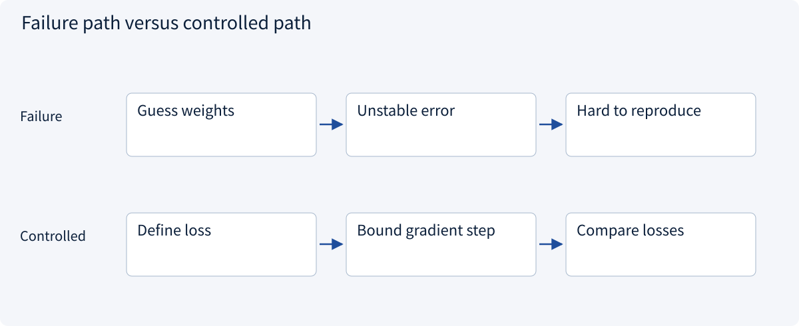
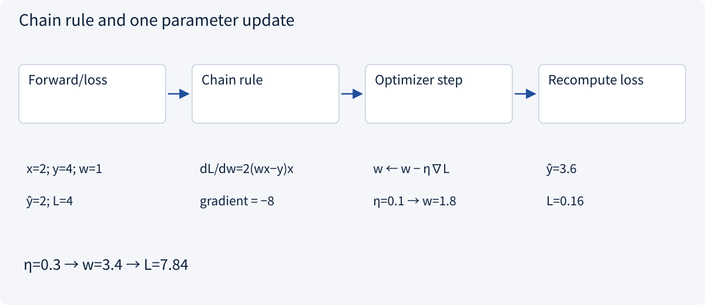
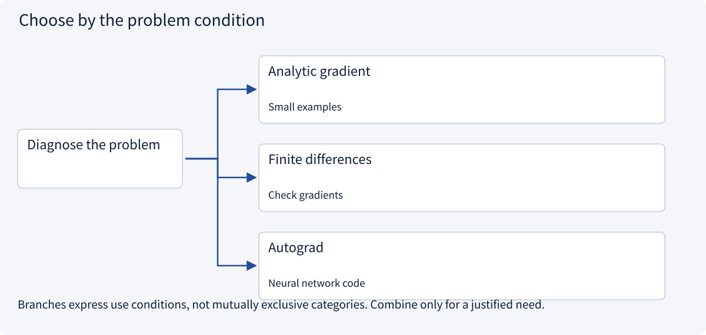
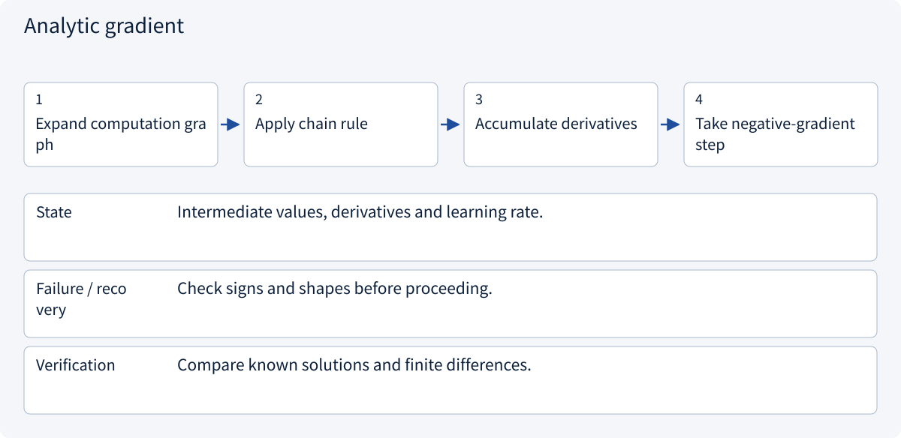
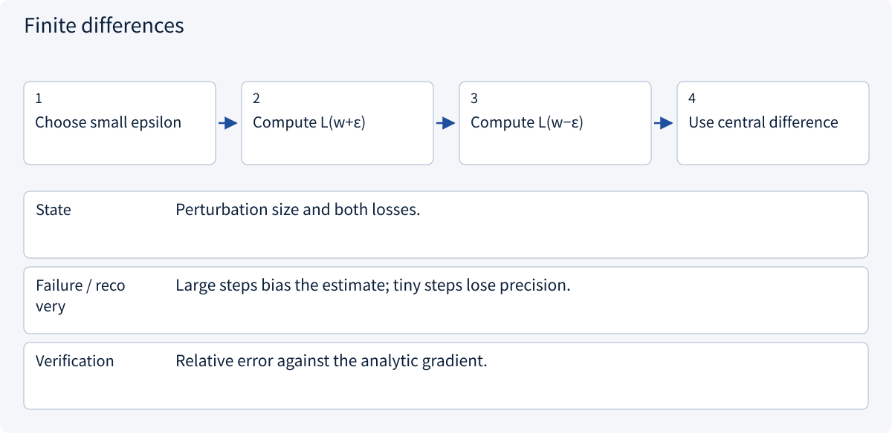
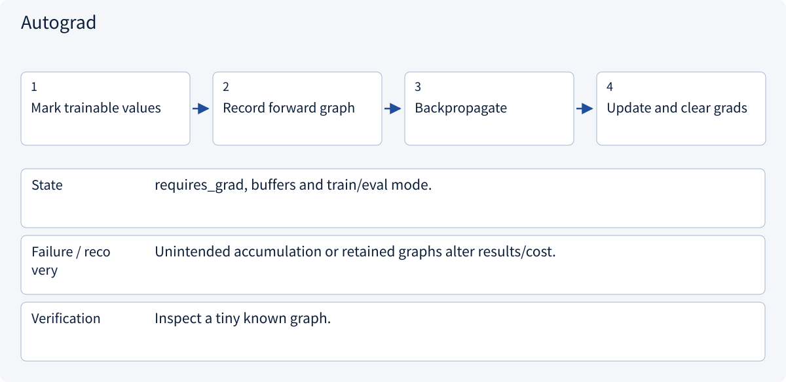

# 1.2 Vectors, probability and gradients

> Visual route · Established approaches · Reference code

## Start with the problem

The prediction is wrong; which parameter should change and in which direction?



## See the mechanism

The chain rule computes local sensitivity. An optimizer follows the negative gradient; autograd does not choose good data or a good step size.



## Choose an established approach



| Approach | Mechanism | Use when | Tradeoff / boundary |
|---|---|---|---|
| Analytic gradient | Apply the chain rule | Small examples | Easy to omit terms |
| Finite differences | Perturb parameters | Check gradients | Expensive and approximate |
| Autograd | Differentiate a graph | Neural network code | Manage accumulation and graph lifetime |

## Inside the mainstream approaches

### 1 · Analytic gradient



**Concrete trace:** At x=2,y=4,w=1 the gradient is -8; rate .1 gives w=1.8.

### 2 · Finite differences



**Concrete trace:** Compare the centered difference with -8.

### 3 · Autograd



**Concrete trace:** Reference values: weight 1.8, loss before 4, after .16; training is not executed.

## Reference code

Expand the implementation corresponding to this mechanism. Training code is provided but not executed. See the reference-code guide for dependencies and verification limits.

[Reference code and verification limits](../../docs/zh/projects/03-code-guide.md)

<details><summary>Expand code and limits</summary>

```python
"""Reference training step; not executed during documentation checks."""


def gradient_step() -> dict[str, float]:
    import torch

    weight = torch.tensor(1.0, requires_grad=True)
    prediction = weight * 2
    loss = (prediction - 4).square()
    loss.backward()  # derivative: -8
    with torch.no_grad():
        weight -= 0.1 * weight.grad  # reference result: 1.8
        updated_loss = (weight * 2 - 4).square()
    weight.grad = None  # do not carry a stale gradient
    return {
        "weight": weight.detach().item(),
        "loss_before": loss.detach().item(),
        "loss_after": updated_loss.item(),
    }
```

</details>

## Change a condition

Why can learning rate 0.3 increase the loss?

<details><summary>Suggested answer</summary>

A local descent direction does not justify any step size. Here loss becomes 7.84 rather than 0.16.

</details>

<details><summary>Optional derivation and boundaries</summary>

**Track units, shapes and intermediate values**

A feature vector x=[3,5], weights w=[0.2,0.01] and bias b=2 give a linear prediction of 2.65. The meaning of each weight depends on feature units. If X has shape (8,3) and W has shape (3,2), XW has shape (8,2).

Conditional probability is directional. If 8 of 20 rainy orders are late and 16 orders are late overall, P(late|rain)=0.4, while P(rain|late)=0.5.

For x=2, y=4, prediction wx and loss (wx-y)^2, the gradient at w=1 is -8. With learning rate 0.1, the new weight is 1.8 and loss falls from 4 to 0.16. With rate 0.3, loss rises to 7.84. A gradient is a local direction, not a guarantee that any step size works.

**Check your understanding**

Why fit normalization on training data only?

<details><summary>Suggested answer</summary>

Using the test distribution to choose preprocessing leaks information into the experiment and weakens independent evaluation.

</details>


</details>

[Official sources and approach rationale](../../docs/zh/resources.md)
