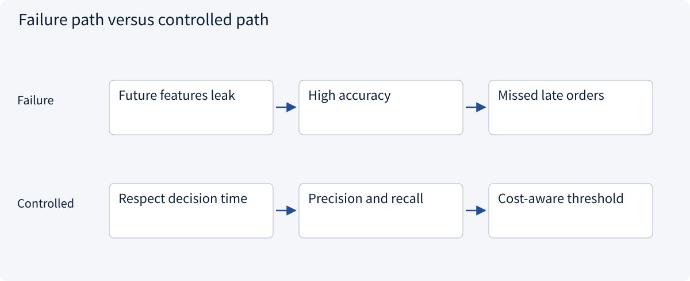
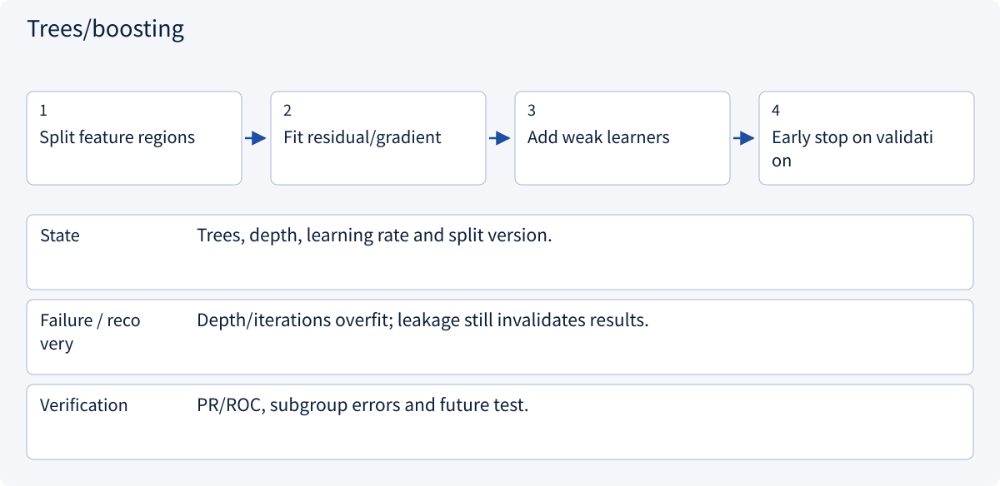

# 1.3 Design a trustworthy ML experiment

> Visual route · Established approaches · Reference code

The code supplies a time-split scaling/logistic-regression pipeline. Tree models, threshold tuning and production drift monitoring are design alternatives.

## Start with the problem

High accuracy still misses late orders, and test data may leak the future.




## See the mechanism

Split by decision time and entity. Choose thresholds under false-alarm costs and review capacity, not accuracy alone.


## Choose an established approach


| Approach | Mechanism | Use when | Tradeoff / boundary |
|---|---|---|---|
| Logistic regression | Linear score | Tabular baseline | Limited nonlinear interactions |
| Trees/boosting | Splits and ensembles | Nonlinear tabular data | Still vulnerable to leakage |
| Time/group split | Isolate future/entities | Deployment-like evaluation | Must match use conditions |

## Inside the mainstream approaches

### 1 · Logistic regression


**Concrete trace:** With capacity for ten reviews, compare the ten highest-risk orders.

<details><summary>Expand steps, state and failure boundaries</summary>

1. Fit train-only scaling
2. Compute linear logit
3. Map to risk score
4. Select cost-aware threshold

**State** Scaling statistics, weights, threshold and calibration.

**Failure / recovery** Diagnose validation groups; never tune on final test.

**Verification** Recall at equal human-review volume.

</details>

### 2 · Trees/boosting



**Concrete trace:** Trees model interactions between quantity and region.

<details><summary>Expand steps, state and failure boundaries</summary>

1. Split feature regions
2. Fit residual/gradient
3. Add weak learners
4. Early stop on validation

**State** Trees, depth, learning rate and split version.

**Failure / recovery** Depth/iterations overfit; leakage still invalidates results.

**Verification** PR/ROC, subgroup errors and future test.

</details>

### 3 · Time/group split


**Concrete trace:** Hold suppliers out as whole groups when targeting unseen suppliers.

<details><summary>Expand steps, state and failure boundaries</summary>

1. Group deployment entities
2. Split by decision time
3. Fit preprocessing on train
4. Seal final test

**State** Entity IDs, time boundaries and dedup rules.

**Failure / recovery** Regroup when one order appears in multiple sets.

**Verification** Audit entity overlap and future features.

</details>

## Reference code

Expand the implementation corresponding to this mechanism. Training code is provided but not executed. See the reference-code guide for dependencies and verification limits.

[Reference code and verification limits](code-guide.md)

<details><summary>Expand code and limits</summary>

```python
"""Time-ordered model selection. Reference only: no training on import."""


def fit_time_split(features, labels, split: int):
    from sklearn.linear_model import LogisticRegression
    from sklearn.metrics import precision_score, recall_score
    from sklearn.pipeline import make_pipeline
    from sklearn.preprocessing import StandardScaler

    if not 0 < split < len(features):
        raise ValueError("Nonempty past and future partitions required")
    # features and labels must already be ordered by prediction time.
    model = make_pipeline(StandardScaler(), LogisticRegression(max_iter=500))
    model.fit(features[:split], labels[:split])
    predictions = model.predict(features[split:])
    return model, {
        "precision": precision_score(labels[split:], predictions, zero_division=0),
        "recall": recall_score(labels[split:], predictions, zero_division=0),
    }


# The future partition is validation here. Reserve a third, untouched test period.
```

</details>

## Change a condition

Does accuracy replace recall for TP=15, FP=10, FN=5, TN=70?

<details><summary>Suggested answer</summary>

No: accuracy is 85%, recall 75%, precision 60%. They answer different questions.

</details>

<details><summary>Optional derivation and boundaries</summary>

**Separate learning, selection and final evaluation**

Only use features available when a prediction is made. An order’s eventual shipping date leaks the answer when predicting delay at order time. Group related documents and use a time split when that matches deployment.

In a 100-order example, TP=15, FP=10, FN=5 and TN=70. Precision is 60%, recall is 75%, accuracy is 85% and F1 is about 66.7%. Always predicting “on time” already gives 80% accuracy but zero recall.

Training data fits parameters, validation data selects models and thresholds, and a held-out test set evaluates the final choice. Compare under the same review budget and report subgroup errors. A small score increase may reflect sampling noise rather than improvement.

**Check your understanding**

A new model gains two accuracy points. Is that enough to deploy?

<details><summary>Suggested answer</summary>

No. Check leakage, temporal generalization, recall at the same workload, error costs and uncertainty before deciding.

</details>


</details>

[Official sources and approach rationale](resources.md)
