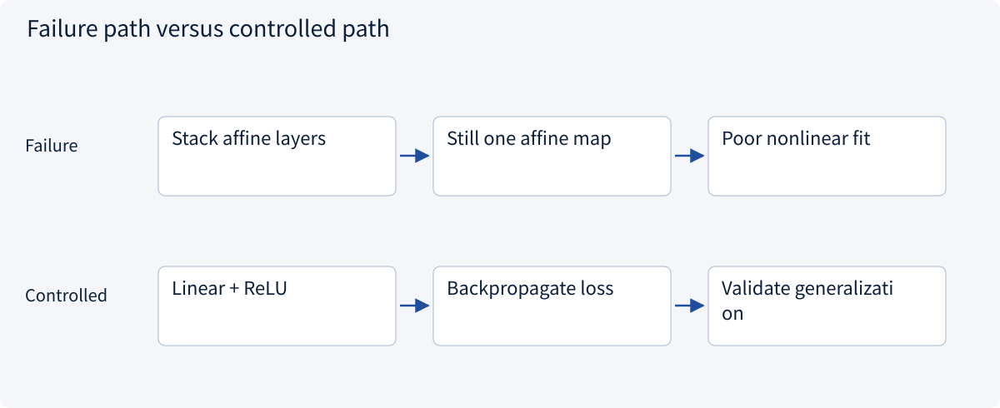
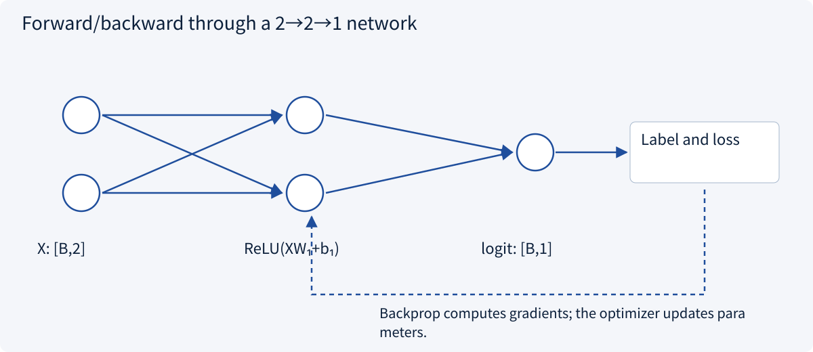
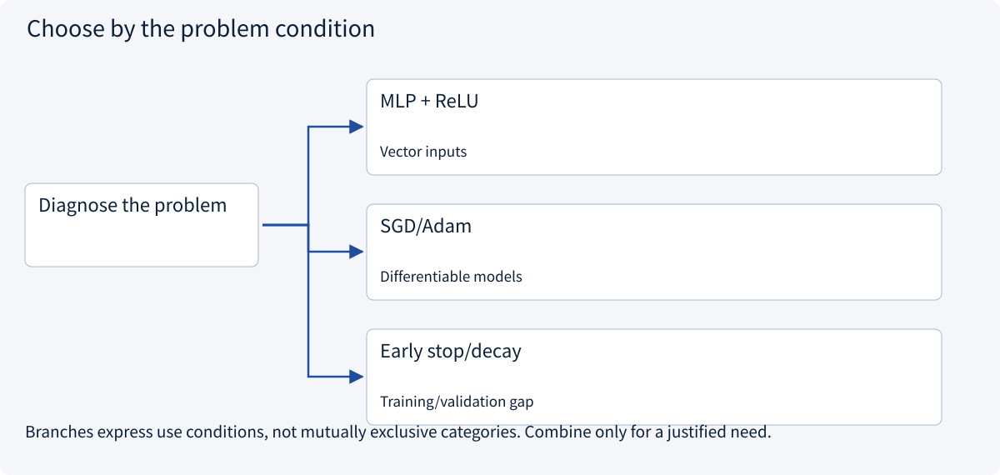
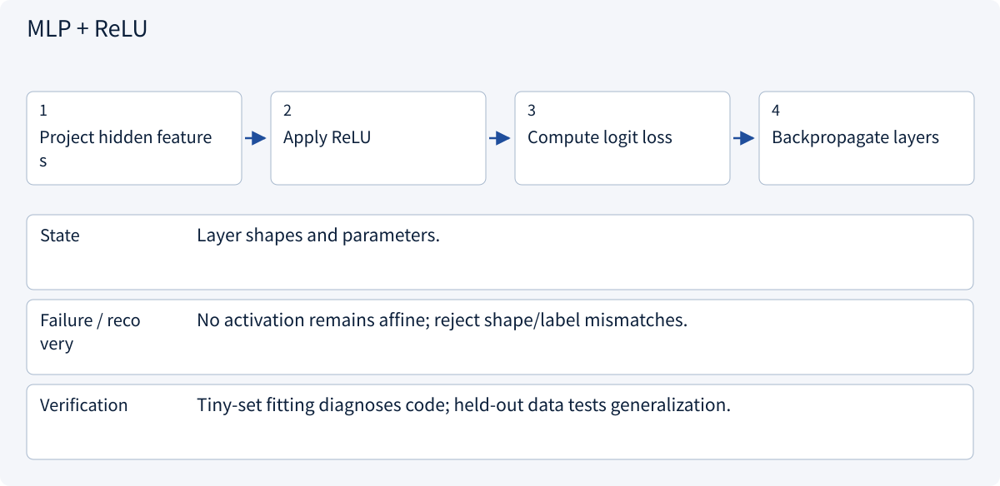
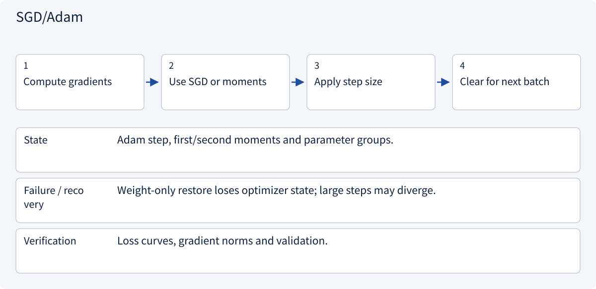
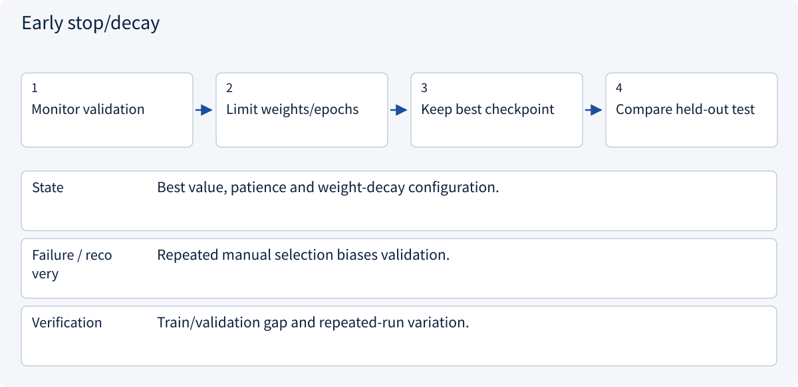

# 1.4 Neural networks and backpropagation

> Visual route · Established approaches · Reference code

## Start with the problem

Stacking linear layers does not solve nonlinear relationships.




## See the mechanism

Insert nonlinear activation between affine layers. The diagram and reference code both use a 2→2→1 network.



## Choose an established approach



| Approach | Mechanism | Use when | Tradeoff / boundary |
|---|---|---|---|
| MLP + ReLU | Nonlinear combinations | Vector inputs | Overfitting and parameters |
| SGD/Adam | Gradient-based updates | Differentiable models | Learning-rate selection |
| Early stop/decay | Control complexity | Training/validation gap | Cannot fix wrong labels |

## Inside the mainstream approaches

### 1 · MLP + ReLU



**Concrete trace:** Both the diagram and code use 2→2→1.

### 2 · SGD/Adam



**Concrete trace:** Adam adjusts update statistics, not label correctness.

### 3 · Early stop/decay



**Concrete trace:** Choose the best validation checkpoint rather than always the last epoch.

## Reference code

Expand the implementation corresponding to this mechanism. Training code is provided but not executed. See the reference-code guide for dependencies and verification limits.

[Reference code and verification limits](../../docs/zh/projects/03-code-guide.md)

<details><summary>Expand code and limits</summary>

```python
"""2 -> 2 -> 1 MLP: this shape also appears in the lesson diagram."""


def build_model():
    from torch import nn

    return nn.Sequential(nn.Linear(2, 2), nn.ReLU(), nn.Linear(2, 1))


def train_batch(model, optimizer, inputs, labels):
    from torch.nn import functional as F

    model.train()
    optimizer.zero_grad(set_to_none=True)
    logits = model(inputs).squeeze(-1)
    loss = F.binary_cross_entropy_with_logits(logits, labels.float())
    loss.backward()
    optimizer.step()
    return loss.detach()


# Supply inputs [batch,2], labels [batch]. This function is reference code only.
```

</details>

## Change a condition

Why do two affine layers without activation remain affine?

<details><summary>Suggested answer</summary>

Their matrices and biases can be combined into one transformation.

</details>

<details><summary>Optional derivation and boundaries</summary>

**Nonlinearity and optimization have different jobs**

Two affine layers without an activation collapse into a single affine transformation. Activations such as ReLU allow nonlinear relationships. The forward pass computes predictions and loss; backpropagation computes derivatives; the optimizer updates parameters.

With x=[1,2], an identity first layer and output weights [1,-1], the logit is -1 and sigmoid probability is about 0.269. For label 1 the binary cross-entropy is about 1.313. For label 0 it is about 0.313.

A training batch normally clears old gradients, computes loss, backpropagates and updates weights. Gradient accumulation must be intentional. Validation disables training-specific behavior such as dropout and does not update parameters. Fitting a tiny clean batch is a debugging check, not evidence of generalization.

**Check your understanding**

How many parameters are in a 3→4→2 network with biases?

<details><summary>Suggested answer</summary>

The first layer has 3×4+4=16 and the second 4×2+2=10, for 26 total.

</details>


</details>

[Official sources and approach rationale](../../docs/zh/resources.md)
