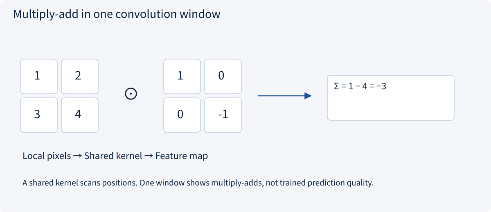
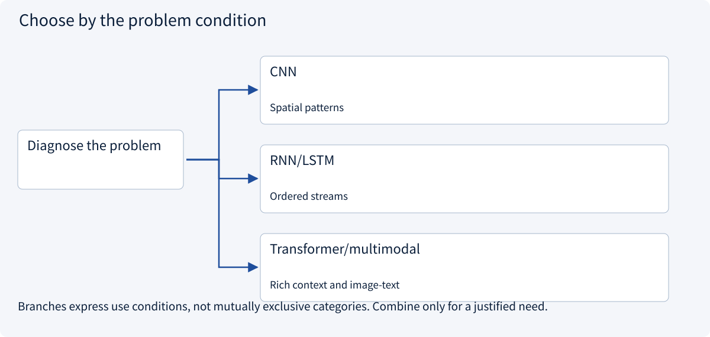
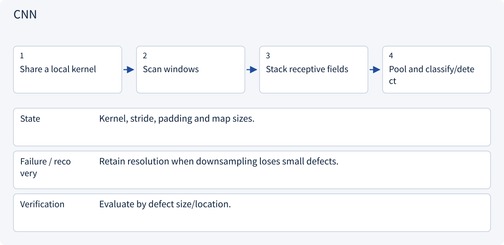
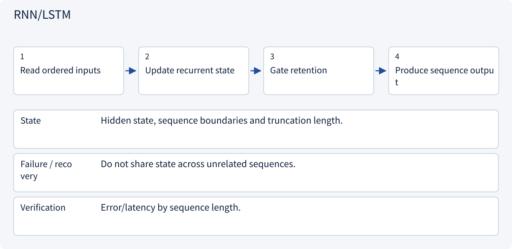
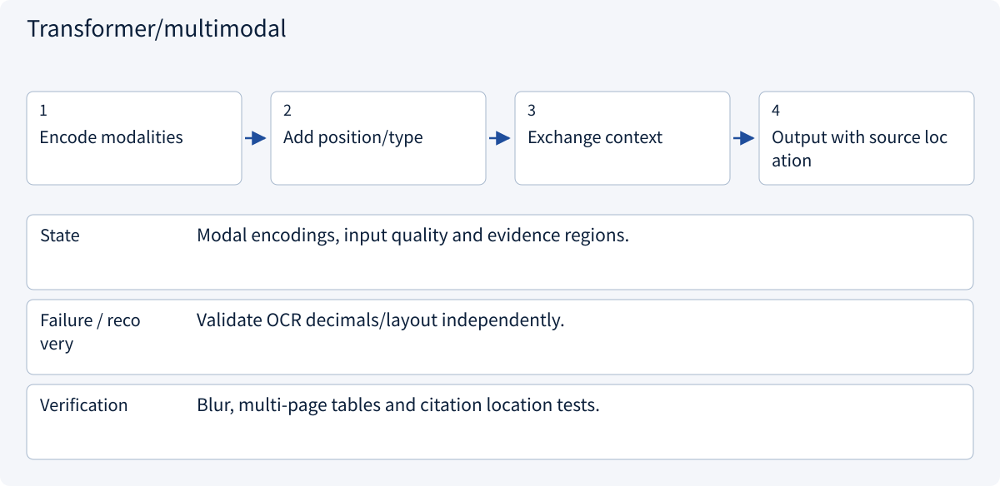

# 1.5 Images, sequences and generative models

> Visual route · Established approaches · Reference code

## Start with the problem

Images, sequences and text have different structure.


AI-generated example photograph for discussing position, edges, texture and lighting; not a collected dataset or model prediction. What information disappears if pixels are shuffled?

## See the mechanism

Choose an inductive bias: convolution for locality, recurrence for ordered state, attention for position-wise interaction.



## Choose an established approach



| Approach | Mechanism | Use when | Tradeoff / boundary |
|---|---|---|---|
| CNN | Shared local kernels | Spatial patterns | Downsampling loses detail |
| RNN/LSTM | Recurrent state | Ordered streams | Serial and long-range limits |
| Transformer/multimodal | Position interactions | Rich context and image-text | Input quality and compute |

## Inside the mainstream approaches

### 1 · CNN



**Concrete trace:** One 2×2 multiply-add gives -3; useful predictions still need training.

### 2 · RNN/LSTM



**Concrete trace:** Streaming sensors can maintain an incremental state.

### 3 · Transformer/multimodal



**Concrete trace:** Check a recognized 1.80 against the original image and units.

## Reference code

Expand the implementation corresponding to this mechanism. Training code is provided but not executed. See the reference-code guide for dependencies and verification limits.

[Reference code and verification limits](../../docs/zh/projects/03-code-guide.md)

<details><summary>Expand code and limits</summary>

```python
"""A CNN inference block. No datasets, training or downloads are started."""


def build_classifier():
    from torch import nn

    return nn.Sequential(
        nn.Conv2d(1, 8, kernel_size=3, padding=1),
        nn.ReLU(),
        nn.AdaptiveAvgPool2d(1),
        nn.Flatten(),
        nn.Linear(8, 2),
    )


# Input [batch,1,height,width] -> feature map -> [batch,8] -> two logits.
# Randomly initialized weights demonstrate shapes, not useful predictions.
```

</details>

## Change a condition

Should a larger model be the first fix for a misread decimal point?

<details><summary>Suggested answer</summary>

Inspect the image and extraction, preserve source locations and validate amounts first.

</details>

<details><summary>Optional derivation and boundaries</summary>

**Use the structure of the data**

Convolutions share local filters across an image. This uses locality and translation-related structure while reducing parameter count. Pooling and stride reduce spatial resolution but can lose small details.

Recurrent networks propagate hidden state through time. Attention exchanges information among positions and needs position information to represent order. Parallel computation over known training positions does not remove the sequential dependency of autoregressive generation.

Diffusion models learn a denoising-related objective and generate through repeated updates from noise. Multimodal inputs still introduce recognition errors. A quotation image with “1.80” misread as “180” can produce valid JSON and a wrong business answer. Preserve evidence locations and validate critical quantities.

**Check your understanding**

Should an OCR error be fixed only by changing the prompt?

<details><summary>Suggested answer</summary>

No. Inspect input quality and extraction, preserve the source region, validate numeric ranges and request review when ambiguity remains.

</details>


</details>

[Official sources and approach rationale](../../docs/zh/resources.md)
