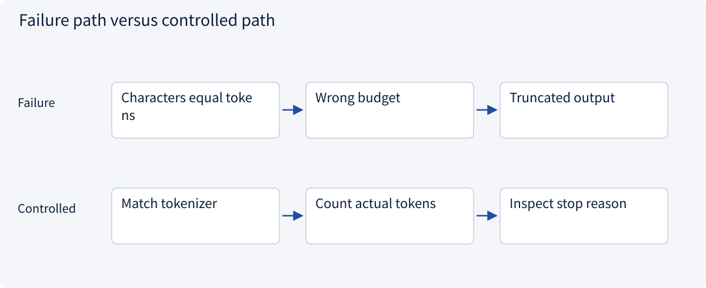
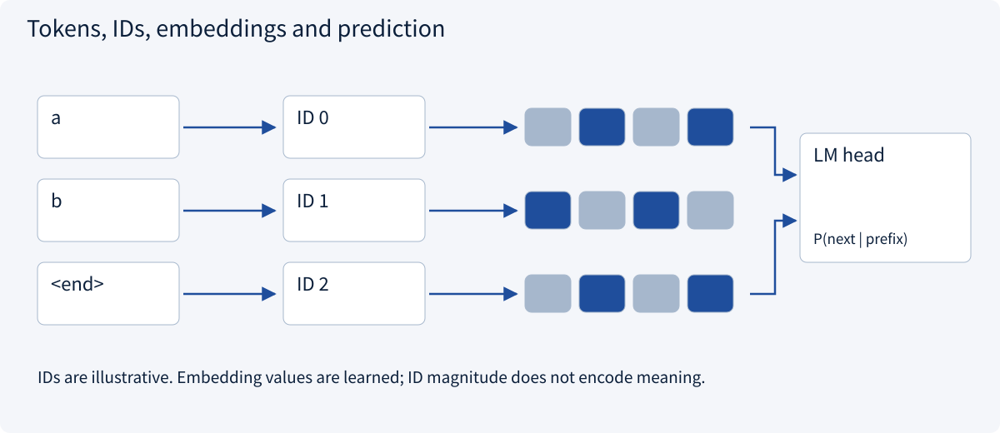
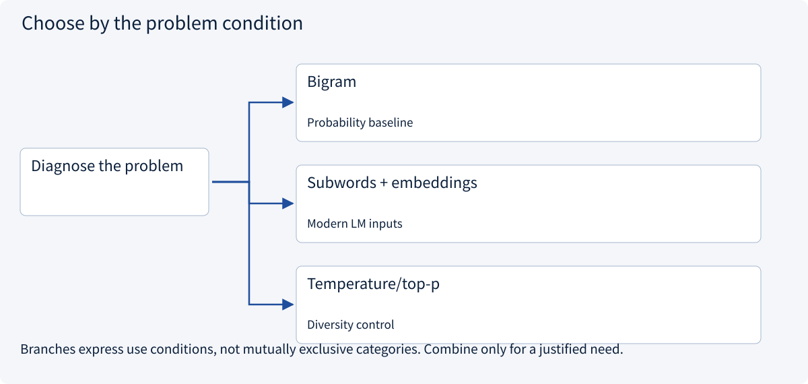
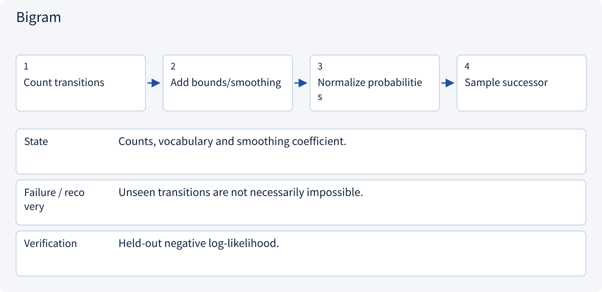
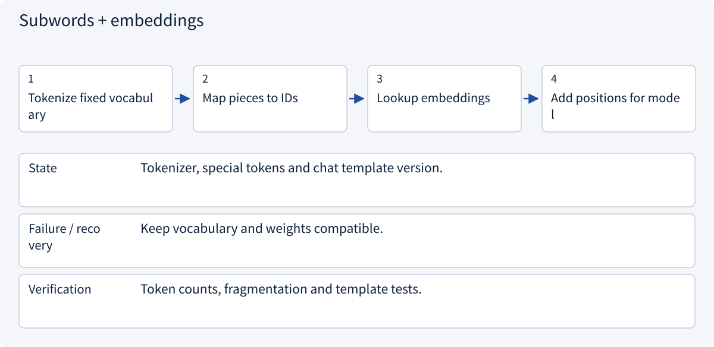
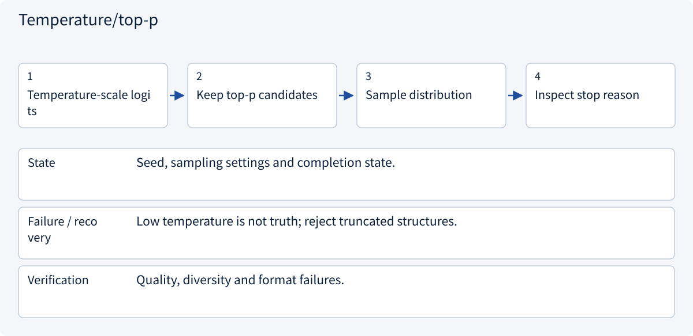

# 1.6 Tokens and language modeling

> Visual route · Established approaches · Reference code

## Start with the problem

How does text become next-token probabilities, and why can fluent output be wrong?



## See the mechanism

Encode pieces as IDs, look up embeddings, predict from the prefix, then append the selected token.



## Choose an established approach



| Approach | Mechanism | Use when | Tradeoff / boundary |
|---|---|---|---|
| Bigram | Adjacent transition counts | Probability baseline | One-symbol context |
| Subwords + embeddings | IDs to learned vectors | Modern LM inputs | Match vocabulary/template |
| Temperature/top-p | Change sampling | Diversity control | No truth guarantee |

## Inside the mainstream approaches

### 1 · Bigram



**Concrete trace:** aba/abb probabilities depend on boundary/smoothing choices; code includes both.

### 2 · Subwords + embeddings



**Concrete trace:** ID magnitude does not define semantic distance.

### 3 · Temperature/top-p



**Concrete trace:** A length-limited half-object is not a complete answer.

## Reference code

Expand the implementation corresponding to this mechanism. Training code is provided but not executed. See the reference-code guide for dependencies and verification limits.

[Reference code and verification limits](../../docs/zh/projects/03-code-guide.md)

<details><summary>Expand code and limits</summary>

```python
"""Count a character bigram with explicit sentence boundaries and smoothing."""

from collections import Counter, defaultdict
from itertools import pairwise


def transition_probabilities(words: list[str], alpha: float = 1.0):
    if alpha <= 0:
        raise ValueError("Positive smoothing required")
    counts = defaultdict(Counter)
    for word in words:
        sequence = ["<start>", *word, "<end>"]
        for left, right in pairwise(sequence):
            counts[left][right] += 1
    vocabulary = sorted({token for row in counts.values() for token in row})
    return {
        left: {
            right: (row[right] + alpha) / (sum(row.values()) + alpha * len(vocabulary))
            for right in vocabulary
        }
        for left, row in counts.items()
    }
```

</details>

## Change a condition

Does supplying a new quotation permanently update model parameters?

<details><summary>Suggested answer</summary>

Not during ordinary inference. It changes context, not the trained parameters.

</details>

<details><summary>Optional derivation and boundaries</summary>

**Predict the next token from a prefix**

In the tiny corpus “aba” and “abb”, ignoring sentence boundaries, a→b occurs twice, b→a once and b→b once. Therefore P(b|a)=1 and P(a|b)=P(b|b)=0.5. A bigram sees only one previous symbol.

A tokenizer maps text pieces to IDs; an embedding table maps IDs to trainable vectors. A token is not necessarily a character or word. Tokenization and chat templates must match the model.

Autoregressive sequence probability is the product of next-token conditional probabilities. Training commonly uses true prefixes, while generation consumes its own earlier output. Temperature changes the sampling distribution, not the truth of a claim. Stop reasons distinguish completion from truncation.

**Check your understanding**

If average negative log-likelihood is ln(2), what is perplexity?

<details><summary>Suggested answer</summary>

It is 2. Compare perplexity only under compatible tokenization, datasets and loss masking.

</details>


</details>

[Official sources and approach rationale](../../docs/zh/resources.md)
