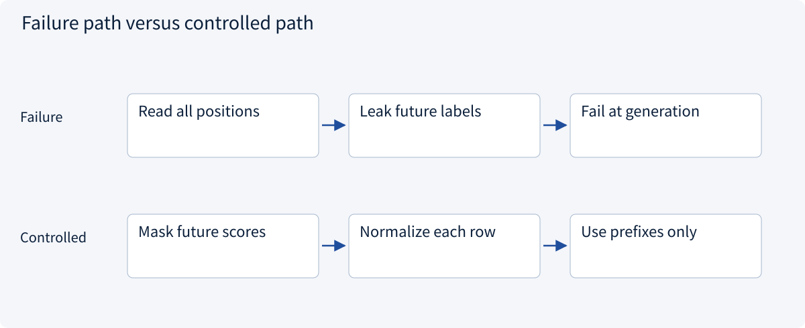
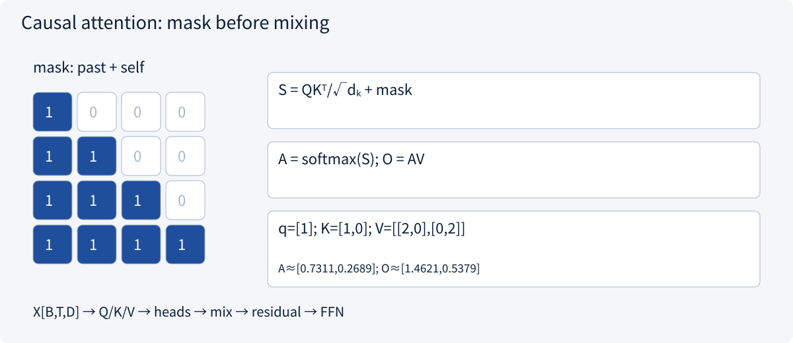
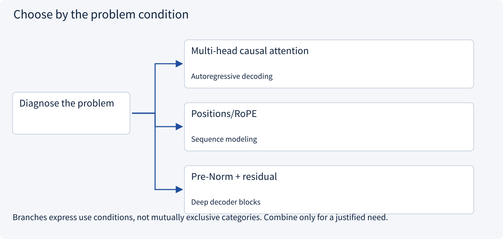
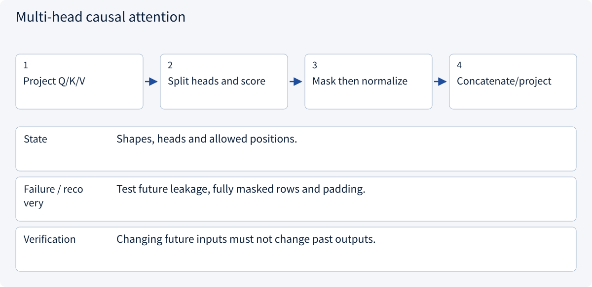
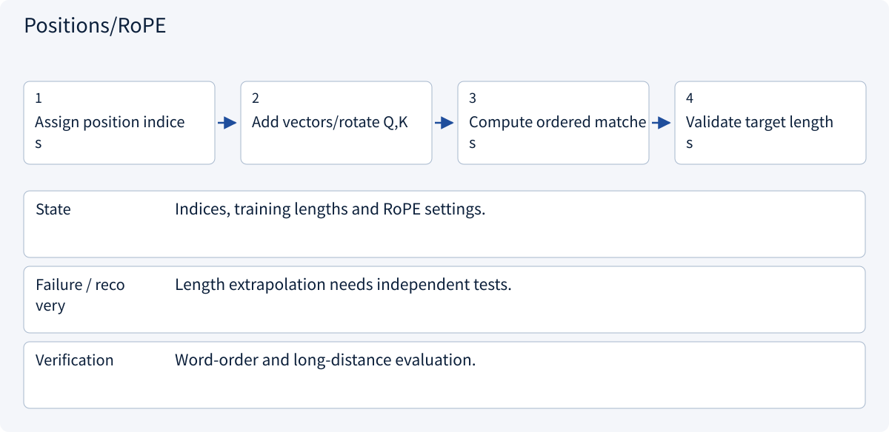
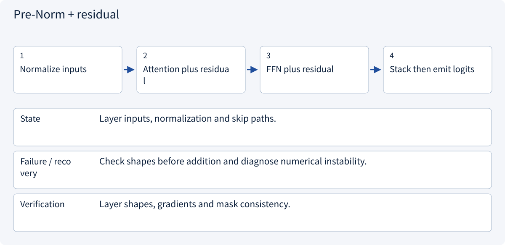
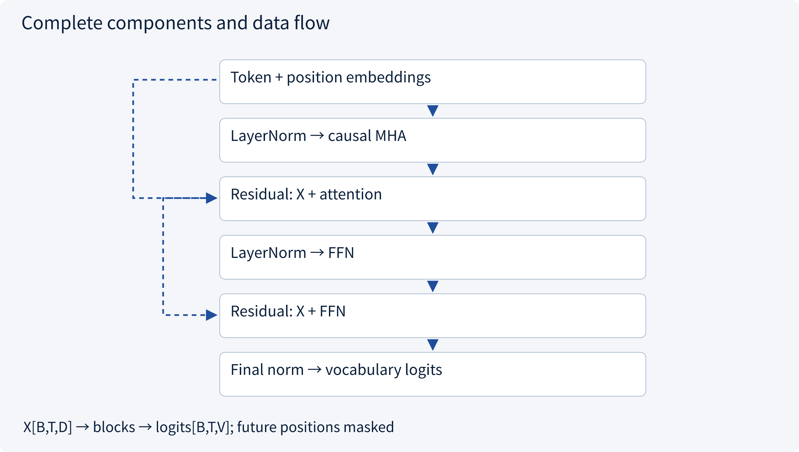
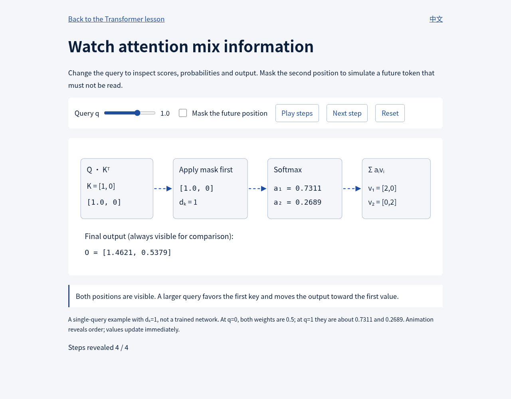

# 1.7 Attention and the Transformer

> Visual route · Established approaches · Reference code

The code implements one causal decoder block. A complete language model also needs tokenization, position information, a vocabulary head and training/inference assembly.

## Start with the problem

How can a token use context without reading the future?




## See the mechanism

Q/K compute scores, a causal mask hides future positions, and normalized weights mix V. Heads, residuals and FFNs form a block.



## Choose an established approach



| Approach | Mechanism | Use when | Tradeoff / boundary |
|---|---|---|---|
| Multi-head causal attention | Mix projected past values | Autoregressive decoding | Correct masks and shapes |
| Positions/RoPE | Represent order | Sequence modeling | Validate length extrapolation |
| Pre-Norm + residual | Preserve information | Deep decoder blocks | Still needs sound optimization |

## Inside the mainstream approaches

### 1 · Multi-head causal attention



**Concrete trace:** Two-position weights .731/.269 become 1/0 after masking.

<details><summary>Expand steps, state and failure boundaries</summary>

1. Project Q/K/V
2. Split heads and score
3. Mask then normalize
4. Concatenate/project

**State** Shapes, heads and allowed positions.

**Failure / recovery** Test future leakage, fully masked rows and padding.

**Verification** Changing future inputs must not change past outputs.

</details>

### 2 · Positions/RoPE



**Concrete trace:** An unordered bag of token embeddings cannot preserve word order by itself.

<details><summary>Expand steps, state and failure boundaries</summary>

1. Assign position indices
2. Add vectors/rotate Q,K
3. Compute ordered matches
4. Validate target lengths

**State** Indices, training lengths and RoPE settings.

**Failure / recovery** Length extrapolation needs independent tests.

**Verification** Word-order and long-distance evaluation.

</details>

### 3 · Pre-Norm + residual



**Concrete trace:** The block keeps [B,T,D]; embedding and vocabulary head are outside it.

<details><summary>Expand steps, state and failure boundaries</summary>

1. Normalize inputs
2. Attention plus residual
3. FFN plus residual
4. Stack then emit logits

**State** Layer inputs, normalization and skip paths.

**Failure / recovery** Check shapes before addition and diagnose numerical instability.

**Verification** Layer shapes, gradients and mask consistency.

</details>

## Connect the complete architecture



## Reference code

Expand the implementation corresponding to this mechanism. Training code is provided but not executed. See the reference-code guide for dependencies and verification limits.

[Reference code and verification limits](code-guide.md)

<details><summary>Expand code and limits</summary>

```python
"""Complete causal block; forward reference, no training on import."""


def build_decoder_block(width: int = 64, heads: int = 4):
    import torch
    from torch import nn

    if width % heads:
        raise ValueError("width must be divisible by heads")

    class DecoderBlock(nn.Module):
        def __init__(self):
            super().__init__()
            self.norm1 = nn.LayerNorm(width)
            self.attention = nn.MultiheadAttention(
                width, heads, dropout=0, batch_first=True
            )
            self.norm2 = nn.LayerNorm(width)
            self.ffn = nn.Sequential(
                nn.Linear(width, 4 * width), nn.GELU(), nn.Linear(4 * width, width)
            )

        def forward(self, x):
            length = x.shape[1]  # x: [batch,time,width]
            mask = torch.ones(length, length, device=x.device, dtype=torch.bool).triu(1)
            normalized = self.norm1(x)
            mixed, _ = self.attention(
                normalized, normalized, normalized, attn_mask=mask, need_weights=False
            )
            x = x + mixed
            return x + self.ffn(self.norm2(x))

    return DecoderBlock()


# Add token+position embeddings before this block and a vocabulary head after it.
# This is a block, not a pretrained language model or a KV-cached decoder.
```

</details>

[Open the query and causal-mask demonstration](../../site/demos/attention.html)

## Inspect the calculation in the actual interface



Captured from the local interactive demo after reset and three step clicks: output [1.4621, 0.5379]. This is a fixed numeric example, not a trained-model result; open the demo to change Query and Mask.

## Change a condition

Why is clearing future probabilities after softmax not equivalent?

<details><summary>Suggested answer</summary>

Future scores already changed the denominator. Mask scores before normalization.

</details>

<details><summary>Optional derivation and boundaries</summary>

**Compute a small attention example**

For one head, Q=XWq, K=XWk and V=XWv. Scores are QKᵀ/√d_k; apply the mask before row-wise softmax, then multiply the weights by V. With T positions, the score matrix has shape (T,T).

Take q=[1], keys [1] and [0], and values [2,0] and [0,2]. With d_k=1, weights are approximately [0.731,0.269] and the result is [1.462,0.538]. If the second position is in the future, masking changes the result to [2,0].

Multi-head attention mixes several projected representations. Feed-forward blocks transform each position; residual connections and normalization support optimization. Unmasked full self-attention without positional information is permutation-equivariant. A fixed causal mask introduces order constraints, so this statement does not extend directly to arbitrary permutations of a causally masked input. Position methods encode order. The original Transformer is encoder–decoder; causal decoder models are one family of variants.

**Check your understanding**

[Open the interactive attention demonstration](../../site/demos/attention.html) to change the query and mask the future position. No model request is made.

Is masking probabilities after softmax equivalent to masking scores before it?

<details><summary>Suggested answer</summary>

Not without a correct renormalization. Future scores already contributed to the denominator. Fully masked rows also need explicit handling.

</details>


</details>

[Official sources and approach rationale](resources.md)
