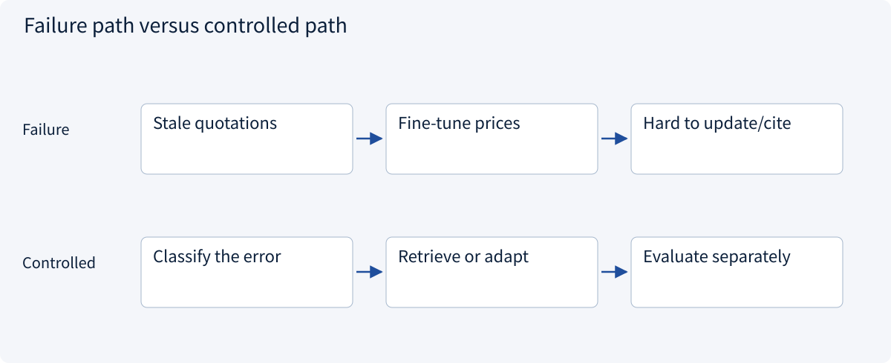
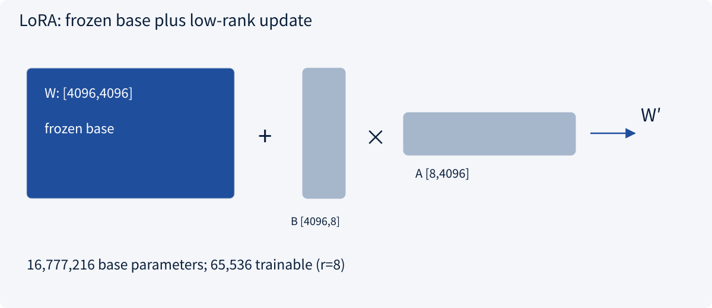
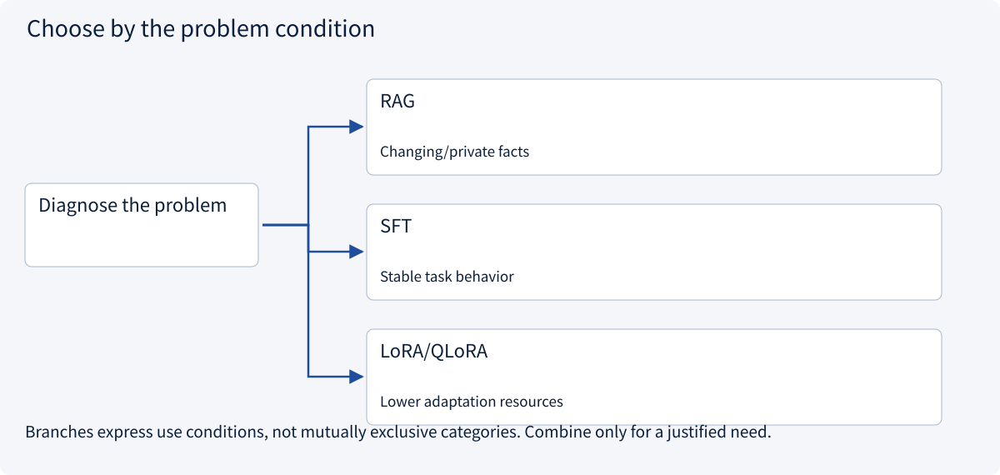
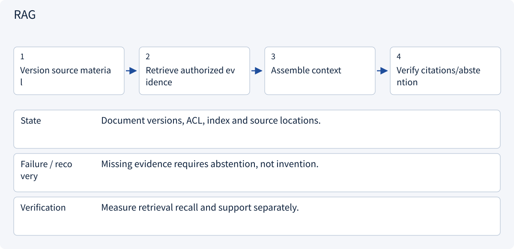
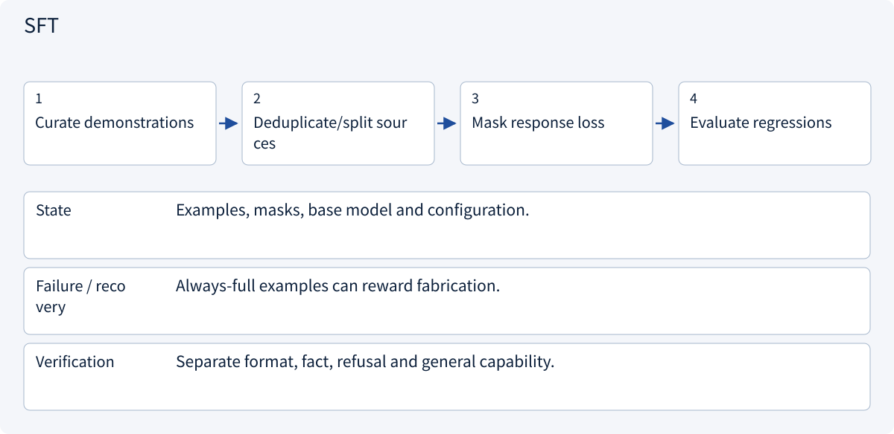
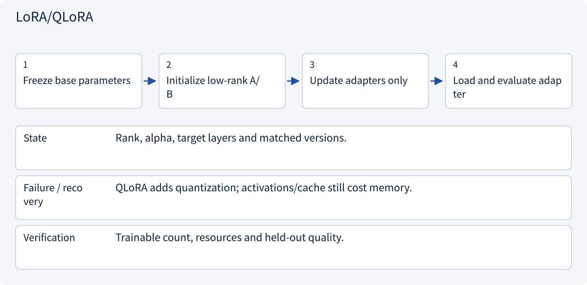

# 1.8 Pretraining, SFT and LoRA

> Visual route · Established approaches · Reference code

The code implements one LoRA layer with frozen base weights. SFT, QLoRA, RLHF and DPO are design comparisons, without an end-to-end training pipeline.

## Start with the problem

When should you use prompting, RAG, SFT or LoRA?




## See the mechanism

Retrieve changing facts; adapt stable behavior. LoRA freezes W and learns BA. It is an update method, not a separate task objective.



## Choose an established approach



| Approach | Mechanism | Use when | Tradeoff / boundary |
|---|---|---|---|
| RAG | Inject evidence at request time | Changing/private facts | Retrieval and access control |
| SFT | Learn demonstrations | Stable task behavior | Bias and regressions |
| LoRA/QLoRA | Low-rank adaptation, optionally quantized base | Lower adaptation resources | Base and activations still cost memory |

## Inside the mainstream approaches

### 1 · RAG



**Concrete trace:** Update an index for changing prices rather than repeatedly fine-tuning them.

<details><summary>Expand steps, state and failure boundaries</summary>

1. Version source material
2. Retrieve authorized evidence
3. Assemble context
4. Verify citations/abstention

**State** Document versions, ACL, index and source locations.

**Failure / recovery** Missing evidence requires abstention, not invention.

**Verification** Measure retrieval recall and support separately.

</details>

### 2 · SFT



**Concrete trace:** Include nulls and conflicts in stable extraction demonstrations.

<details><summary>Expand steps, state and failure boundaries</summary>

1. Curate demonstrations
2. Deduplicate/split sources
3. Mask response loss
4. Evaluate regressions

**State** Examples, masks, base model and configuration.

**Failure / recovery** Always-full examples can reward fabrication.

**Verification** Separate format, fact, refusal and general capability.

</details>

### 3 · LoRA/QLoRA



**Concrete trace:** At rank 8 a 4096-square layer adds 65,536 parameters; output uses scaled BA.

<details><summary>Expand steps, state and failure boundaries</summary>

1. Freeze base parameters
2. Initialize low-rank A/B
3. Update adapters only
4. Load and evaluate adapter

**State** Rank, alpha, target layers and matched versions.

**Failure / recovery** QLoRA adds quantization; activations/cache still cost memory.

**Verification** Trainable count, resources and held-out quality.

</details>

## Reference code

Expand the implementation corresponding to this mechanism. Training code is provided but not executed. See the reference-code guide for dependencies and verification limits.

[Reference code and verification limits](code-guide.md)

<details><summary>Expand code and limits</summary>

```python
"""LoRA reference layer with the base frozen. No weights are downloaded."""


def attach_lora(base, rank: int = 8, alpha: float = 16):
    import torch
    from torch import nn

    if rank < 1:
        raise ValueError("rank must be positive")

    class LoRALinear(nn.Module):
        def __init__(self):
            super().__init__()
            self.base = base.requires_grad_(False)
            self.a = nn.Parameter(
                torch.empty(
                    rank,
                    base.in_features,
                    device=base.weight.device,
                    dtype=base.weight.dtype,
                )
            )
            self.b = nn.Parameter(
                torch.zeros(
                    base.out_features,
                    rank,
                    device=base.weight.device,
                    dtype=base.weight.dtype,
                )
            )
            nn.init.kaiming_uniform_(self.a, a=5**0.5)
            self.scale = alpha / rank

        def forward(self, x):
            return self.base(x) + (x @ self.a.T @ self.b.T) * self.scale

    return LoRALinear()


# B starts at zero, so the initial adapted output equals the base output.
```

</details>

## Change a condition

Must you choose either SFT or LoRA?

<details><summary>Suggested answer</summary>

No. SFT is an objective/data setup; LoRA is a parameter-update method. They can be combined.

</details>

<details><summary>Optional derivation and boundaries</summary>

**Match the adaptation method to the error**

Pretraining builds broad predictive representations. Supervised fine-tuning uses instruction and response demonstrations. Preference optimization uses comparative signals; better preference scores do not guarantee factual accuracy.

LoRA freezes a base matrix W and learns an update BA. For W shaped (d_out,d_in), rank r uses r(d_in+d_out) trainable parameters. A 4096×4096 matrix has about 16.8 million parameters, while rank 8 uses 65,536. Activations, base weights and optimizer state still need memory.

Quantization changes numeric representation; LoRA changes the trainable parameter subspace. Use retrieval for frequently changing facts. Before fine-tuning, establish a prompt baseline, deduplicate data by source, retain independent evaluation and check regressions.

**Check your understanding**

JSON validity improves but factual accuracy falls. Should the model ship?

<details><summary>Suggested answer</summary>

Evaluate those dimensions separately. If factual errors violate acceptance criteria, format improvement is not sufficient.

</details>


</details>

[Official sources and approach rationale](resources.md)
