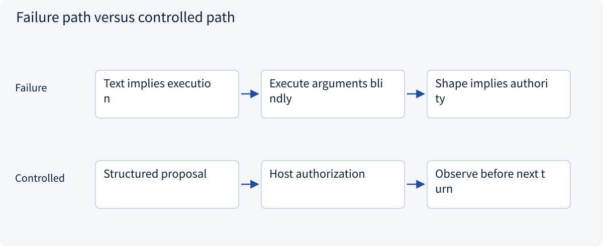
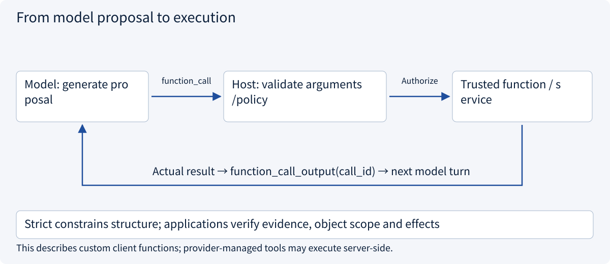
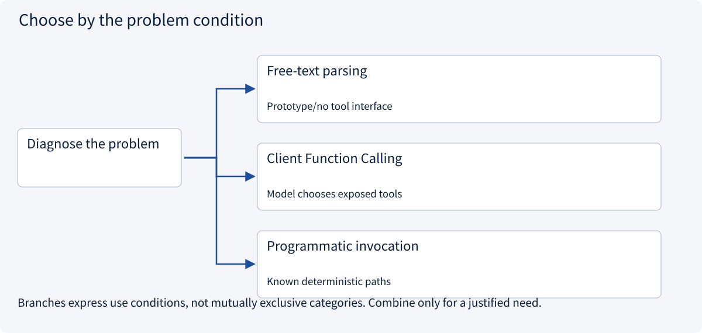
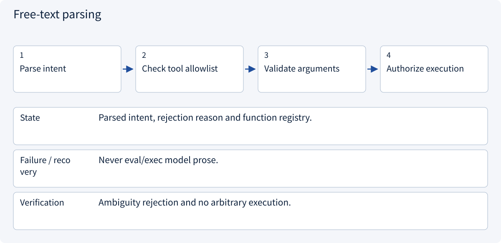
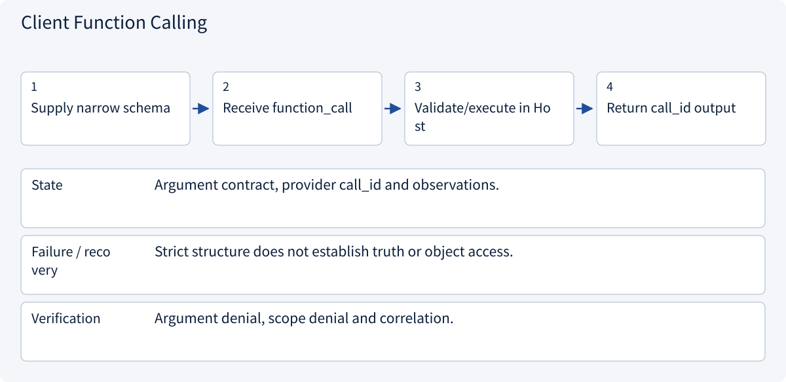
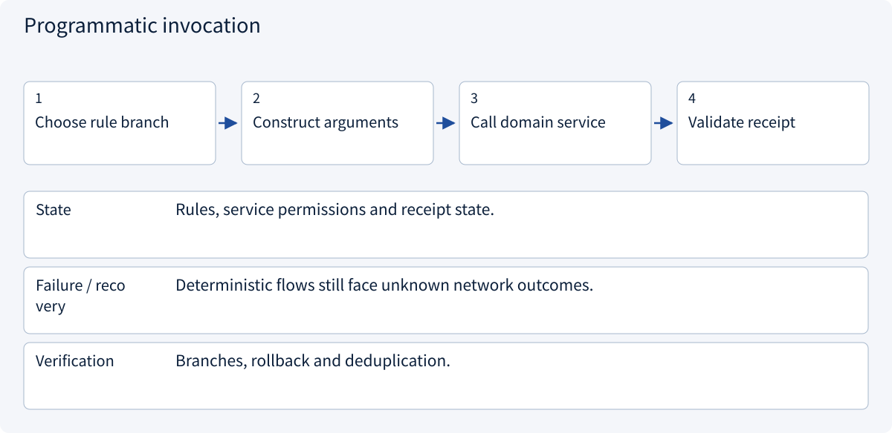

# 2.4.2 From model proposal to execution

> Visual route · Established approaches · Reference code

Model-side examples use Responses custom client-function shapes; no model request is sent.

## Start with the problem

Why has no function run after a model emits its name and JSON arguments? Does strict=true establish authority?




## See the mechanism

Custom client Function Calling supplies schemas and model proposals. The application validates, authorizes, executes and returns observations under the original call_id. Provider-managed tools may execute on the provider and are a separate case.



## Choose an established approach



| Approach | Mechanism | Use when | Tradeoff / boundary |
|---|---|---|---|
| Free-text parsing | Extract intent from prose | Prototype/no tool interface | Ambiguous; not a reliable execution contract |
| Client Function Calling | Schema plus application execution | Model chooses exposed tools | Handle refusals, zero/multiple calls and errors |
| Programmatic invocation | Business rules choose the function | Known deterministic paths | Avoid needless model rounds |

## Inside the mainstream approaches

### 1 · Free-text parsing



**Concrete trace:** A sentence claiming creation is not a remote receipt.

<details><summary>Expand steps, state and failure boundaries</summary>

1. Parse intent
2. Check tool allowlist
3. Validate arguments
4. Authorize execution

**State** Parsed intent, rejection reason and function registry.

**Failure / recovery** Never eval/exec model prose.

**Verification** Ambiguity rejection and no arbitrary execution.

</details>

### 2 · Client Function Calling



**Concrete trace:** A real quotation arrives only after Host execution.

<details><summary>Expand steps, state and failure boundaries</summary>

1. Supply narrow schema
2. Receive function_call
3. Validate/execute in Host
4. Return call_id output

**State** Argument contract, provider call_id and observations.

**Failure / recovery** Strict structure does not establish truth or object access.

**Verification** Argument denial, scope denial and correlation.

</details>

### 3 · Programmatic invocation



**Concrete trace:** Reading a known ID need not ask a model to choose the action.

<details><summary>Expand steps, state and failure boundaries</summary>

1. Choose rule branch
2. Construct arguments
3. Call domain service
4. Validate receipt

**State** Rules, service permissions and receipt state.

**Failure / recovery** Deterministic flows still face unknown network outcomes.

**Verification** Branches, rollback and deduplication.

</details>

## Reference code

Expand the implementation corresponding to this mechanism. Training code is provided but not executed. See the reference-code guide for dependencies and verification limits.

[Reference code and verification limits](code-guide.md)

<details><summary>Expand code and limits</summary>

```python
"""OpenAI Responses client-function shape, without a model request or credentials.

This adapter deliberately supports only the read_quote contract. It is not a
universal JSON Schema translator. Schema-valid arguments still need authorization.
"""

import json


def quotation_tool() -> dict:
    return {
        "type": "function",
        "name": "read_quote",
        "description": "Read an authorized quote.",
        "strict": True,
        "parameters": {
            "type": "object",
            "properties": {"quote_id": {"type": "string"}},
            "required": ["quote_id"],
            "additionalProperties": False,
        },
    }


def parse_proposal(item: dict) -> tuple[str, dict]:
    if item.get("type") != "function_call" or item.get("name") != "read_quote":
        raise ValueError("Unsupported client-function proposal")
    call_id = item.get("call_id")
    if not isinstance(call_id, str) or not call_id:
        raise ValueError("Missing provider call correlation ID")
    arguments = json.loads(item["arguments"])
    if (
        not isinstance(arguments, dict)
        or set(arguments) != {"quote_id"}
        or not isinstance(arguments["quote_id"], str)
    ):
        raise ValueError("Invalid read_quote arguments")
    return call_id, arguments


async def handle_proposal(item: dict, execute) -> dict:
    call_id, arguments = parse_proposal(item)
    result = await execute(
        "read_quote", arguments
    )  # Host gateway, not arbitrary getattr/exec.
    return {
        "type": "function_call_output",
        "call_id": call_id,
        "output": json.dumps(result, ensure_ascii=False, allow_nan=False),
    }


# Return this tool output alongside required conversation/reasoning items for the next turn.
# This example handles one client function; provider-managed tools may execute server-side.
```

</details>

## One custom client-tool round

An ordinary function call enters program execution. Model Function Calling in this example produces a proposal; the actual function runs only when the Host dispatches it.

Expose schemas, receive text/refusal or zero/multiple proposals, validate each permitted proposal, then return actual results under the original call_id for the next turn. Never execute a default tool when no proposal exists or fabricate successful receipts.

The example uses Responses function_call/function_call_output shapes. Chat Completions and other providers have different tool messages. This narrow read_quote adapter is not universal schema conversion, complete streaming aggregation, concurrent scheduling or a paid model integration.

Strict structure does not establish object access, supported facts or completed business effects. Complete and validate streamed arguments before execution; partial JSON must not trigger writes.


References: [OpenAI Function Calling](https://developers.openai.com/api/docs/guides/function-calling), [Anthropic Tool Use](https://platform.claude.com/docs/en/agents-and-tools/tool-use/overview)。


## Change a condition

Can schema-valid read_quote(B) run when the task allows only A?

<details><summary>Suggested answer</summary>

No. Schema checks shape; policy checks tool/object access. call_id correlates observations, not approval or idempotency.

</details>

[Official sources and approach rationale](resources.md)
