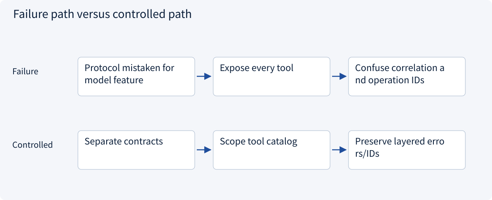
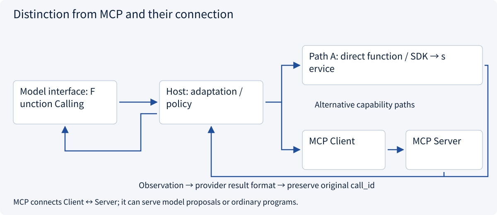
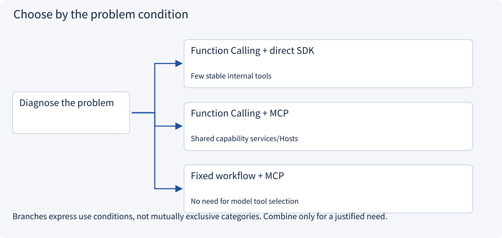
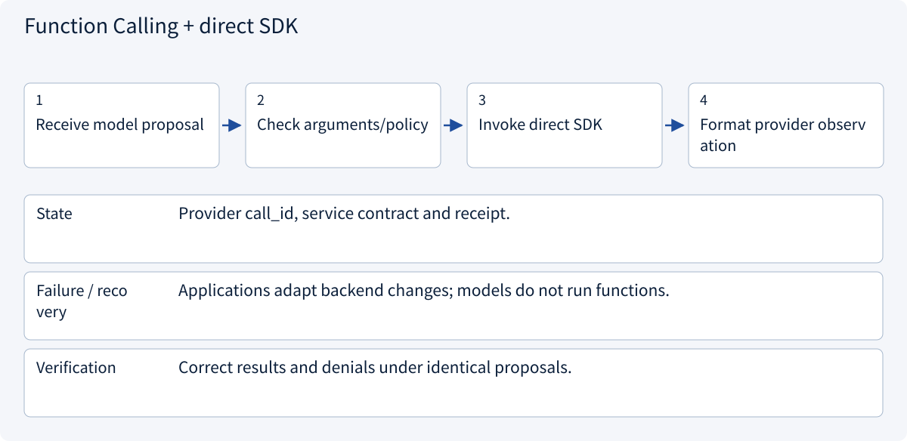
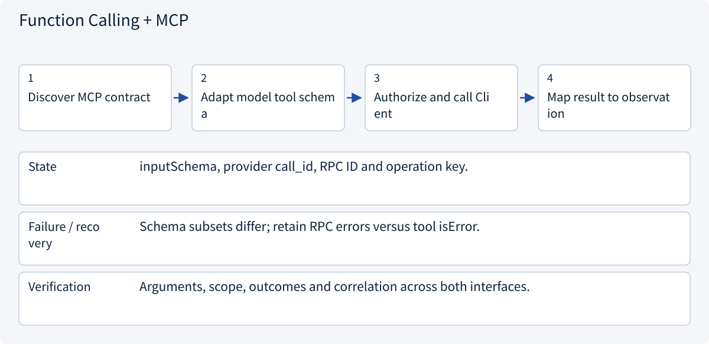
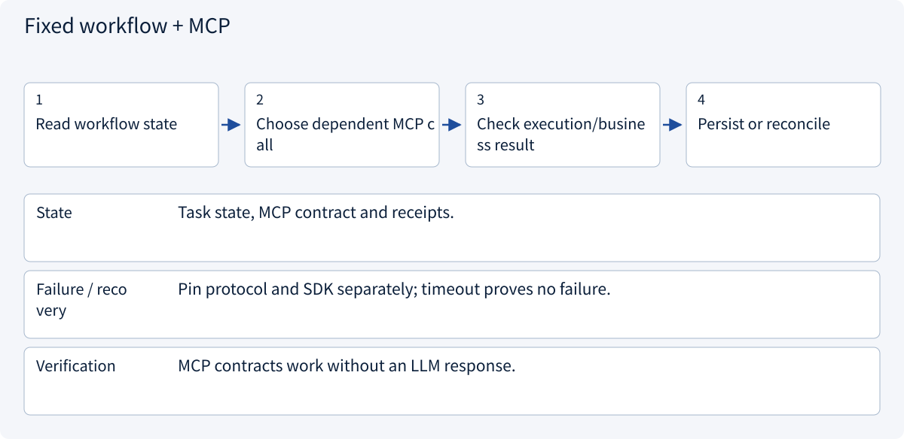

# 2.4.3 Distinction from MCP and their connection

> Visual route · Established approaches · Reference code

Model-side examples use Responses custom client-function shapes; no model request is sent.

## Start with the problem

Both appear to “call tools”; why are Function Calling and MCP not alternatives? Can inputSchema be passed through unchanged?




## See the mechanism

Function Calling connects model and application; MCP connects application Client and capability Server. The Host adapts schemas, enforces policy and maps results. One proposal can use a direct SDK or MCP.



## Choose an established approach



| Approach | Mechanism | Use when | Tradeoff / boundary |
|---|---|---|---|
| Function Calling + direct SDK | Dispatch proposal to trusted local adapter | Few stable internal tools | Maintain backend adapters |
| Function Calling + MCP | Host uses Client to reach Server | Shared capability services/Hosts | Transport, authorization and adaptation |
| Fixed workflow + MCP | Program decides which RPC to call | No need for model tool selection | MCP does not require Function Calling |

## Inside the mainstream approaches

### 1 · Function Calling + direct SDK



**Concrete trace:** One domain service can support both direct SDK and MCP adapters.

### 2 · Function Calling + MCP



**Concrete trace:** A read_quote(A) proposal becomes tools/call; keep the original call_id.

### 3 · Fixed workflow + MCP



**Concrete trace:** Client(server) needs no Function Calling generation.

## Reference code

Expand the implementation corresponding to this mechanism. Training code is provided but not executed. See the reference-code guide for dependencies and verification limits.

[Reference code and verification limits](../../docs/zh/projects/03-code-guide.md)

<details><summary>Expand code and limits</summary>

```python
"""Both interfaces in one chain: provider function proposal → Host → MCP → observation."""

from .function_calling import handle_proposal, parse_proposal
from .mcp_host_bridge import call_authorized, check_quote_access
from .mcp_server_example import build_server


async def resolve_via_mcp(item: dict) -> dict:
    from mcp import Client

    _, arguments = parse_proposal(item)
    check_quote_access(
        "read_quote", arguments, frozenset({"read_quote"}), frozenset({"A"})
    )
    async with Client(build_server()) as client:

        async def execute(name, arguments):
            # Trusted task scope is injected by the application, never taken from item.
            return await call_authorized(
                client, name, arguments, frozenset({"read_quote"}), frozenset({"A"})
            )

        return await handle_proposal(item, execute)


# Provider call_id correlates model tool output; MCP request id correlates one RPC.
# Neither is the operation_id required to deduplicate an external business write.
```

</details>

## Two interfaces at different layers

| Dimension | Client Function Calling | MCP |
|---|---|---|
| Endpoints | Model provider interface ↔ Host | MCP Client ↔ Server |
| Content | Tool schemas, proposals, model observations | Capability discovery, RPC, tools/resources/prompts |
| Execution | Host dispatches direct SDK or MCP | Server invokes domain services |
| Requires the other? | No; direct local functions work | No; an ordinary program can call MCP |
| Authority | Host/domain authorization | Authentication plus object authorization |

Combined sequence: MCP list_tools → filtered/adapted model schema → function_call → Host policy → tools/call → domain service → provider observation under the original call_id. The Server need not know the originating model.

Provider call_id correlates model observations; JSON-RPC id correlates one MCP request; operation_id identifies one business effect across retries. The first two do not establish idempotency.

Real MCP is used with a fixed synthetic model proposal. Direct SDK execution needs no MCP, and fixed workflows can use MCP without model Function Calling. Schema constraints, errors and versions require explicit adaptation at the Host.


References: [Official 1](https://developers.openai.com/api/docs/guides/function-calling), [Official 2](https://modelcontextprotocol.io/docs/2026-07-28/learn/architecture)。


### Model-side contract and proposal checks

Host reference with fixed inputs/injected adapters, without a model request.

<details><summary>Expand code and limits</summary>

```python
"""OpenAI Responses client-function shape, without a model request or credentials.

This adapter deliberately supports only the read_quote contract. It is not a
universal JSON Schema translator. Schema-valid arguments still need authorization.
"""

import json


def quotation_tool() -> dict:
    return {
        "type": "function",
        "name": "read_quote",
        "description": "Read an authorized quote.",
        "strict": True,
        "parameters": {
            "type": "object",
            "properties": {"quote_id": {"type": "string"}},
            "required": ["quote_id"],
            "additionalProperties": False,
        },
    }


def parse_proposal(item: dict) -> tuple[str, dict]:
    if item.get("type") != "function_call" or item.get("name") != "read_quote":
        raise ValueError("Unsupported client-function proposal")
    call_id = item.get("call_id")
    if not isinstance(call_id, str) or not call_id:
        raise ValueError("Missing provider call correlation ID")
    arguments = json.loads(item["arguments"])
    if (
        not isinstance(arguments, dict)
        or set(arguments) != {"quote_id"}
        or not isinstance(arguments["quote_id"], str)
    ):
        raise ValueError("Invalid read_quote arguments")
    return call_id, arguments


async def handle_proposal(item: dict, execute) -> dict:
    call_id, arguments = parse_proposal(item)
    result = await execute(
        "read_quote", arguments
    )  # Host gateway, not arbitrary getattr/exec.
    return {
        "type": "function_call_output",
        "call_id": call_id,
        "output": json.dumps(result, ensure_ascii=False, allow_nan=False),
    }


# Return this tool output alongside required conversation/reasoning items for the next turn.
# This example handles one client function; provider-managed tools may execute server-side.
```

</details>

### Host-to-MCP scope validation

Host reference with fixed inputs/injected adapters, without a model request.

<details><summary>Expand code and limits</summary>

```python
"""Host-side validation before an MCP call; the server enforces object scope too."""


def check_quote_access(
    name: str,
    arguments: dict,
    allowed_tools: frozenset[str],
    allowed_quote_ids: frozenset[str],
):
    if name not in allowed_tools:
        raise PermissionError("Tool not exposed to this task")
    if name != "read_quote" or set(arguments) != {"quote_id"}:
        raise ValueError("Unexpected tool contract")
    if not isinstance(arguments["quote_id"], str):
        raise TypeError("quote_id must be a string")
    if arguments["quote_id"] not in allowed_quote_ids:
        raise PermissionError("Quotation outside task scope")


async def call_authorized(
    client,
    name: str,
    arguments: dict,
    allowed_tools: frozenset[str],
    allowed_quote_ids: frozenset[str],
):
    check_quote_access(name, arguments, allowed_tools, allowed_quote_ids)
    result = await client.call_tool(name, arguments)
    if result.is_error:
        raise RuntimeError("Tool execution failed; do not claim task completion")
    return result.structured_content


# A model-provider adapter must map MCP input_schema to the provider's tool format,
# correlate call IDs and return the observation in that provider's expected structure.
# MCP content remains untrusted evidence, not a new system instruction.
```

</details>

## Change a condition

Can Function Calling work without MCP, and MCP without a model?

<details><summary>Suggested answer</summary>

Yes. Local functions can execute model proposals; ordinary programs can use MCP. The reference runs real MCP without a model request.

</details>

[Official sources and approach rationale](../../docs/zh/resources.md)
