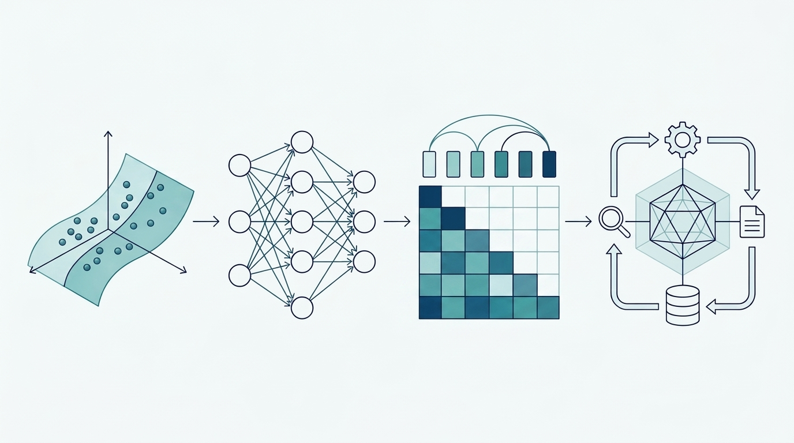

# Learning map: from models to multi-Agent architecture

Learn mechanisms, then design around task boundaries, contracts, state, authority and recovery. Training code is supplied without running training.

## Learning stages

- **1 Introductory · model mechanics** · [1.1 Frame an AI problem](f01.md)

- **2 Intermediate · Agent concepts and applications** · [2.1.1 Prompts and output contracts](l01.md)

- **3 Advanced · Agent architecture** · [3.1.1 Task decomposition, Agent responsibilities and artifact ownership](ma01.md)

- **4 Projects and resources** · [4.1 Personal studio: multi-Agent architecture from leads to delivery](studio.md)

## Dimensions of multi-Agent design

| Module | Design decision |

|---|---|

| [3.1.1 Task decomposition, Agent responsibilities and artifact ownership](ma01.md) | Acceptance, split rationale, owners and artifact contracts |

| [3.2.1 Collaboration topology: sequence, supervisor and DAG](a08.md) | Control topology, routing, envelopes, causation and handoff |

| [3.3.1 Sessions, conversations, tasks and runs](session01.md) | Identity/session/task/run lifetimes and resumption |

| [3.4.1 Shared state, artifact versions and conflict resolution](ma03.md) | Artifact versions, ownership, CAS and conflict handling |

| [3.5.1 RBAC, ABAC and ReBAC for Agents](auth01.md) | Principal, action, object, policy facts and scoped delegation |

| [3.6.1 Approval binding: action, evidence, expiry and approver](approval01.md) | Exact-action approval, invalidation, consumption and receipts |

| [3.7.1 Runtime and harness](a09.md) | DAGs, concurrency/budget, backpressure, recovery and compensation |

| [3.8.1 Evaluation and safety](a11.md) | Whole-task comparisons, tracing, alerts, safety and release gates |

| [3.9.1 Deployment boundaries, capacity, isolation and technology choice](ma07.md) | Isolation boundaries, capacity, scaling and assembly |

## Intermediate concepts versus advanced design

Agent foundations, context, Function Calling, MCP, Skills and memory belong to the intermediate stage. Advanced design combines them. Function Calling expresses proposals, MCP connects capabilities and Skills package methods.

[2.4.3 Distinction from MCP and their connection](fc02.md) · [2.6.1 Methods, prompts, tools and workflows](skill01.md) · [4.3 Reference code and verification limits](code-guide.md)

## Check understanding

Change tenant, amount, evidence version or failure timing; identify the rejecting boundary, retained state and recovery path. Produce concrete contracts and tradeoffs, not framework names alone.
