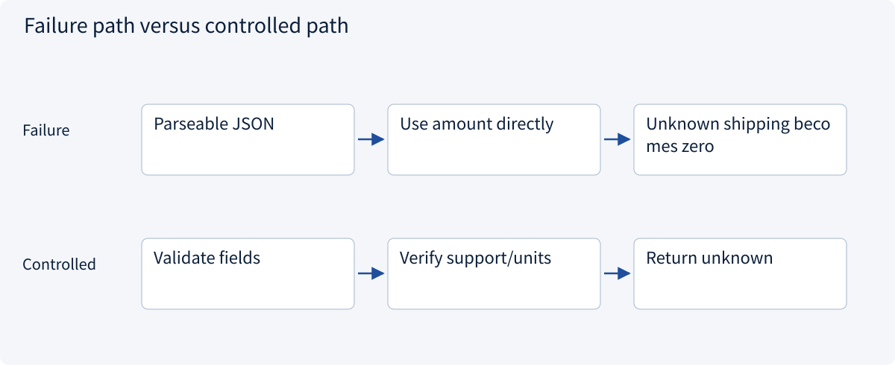
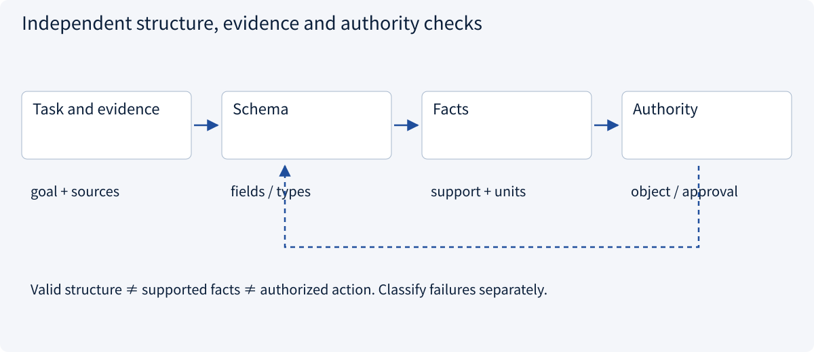
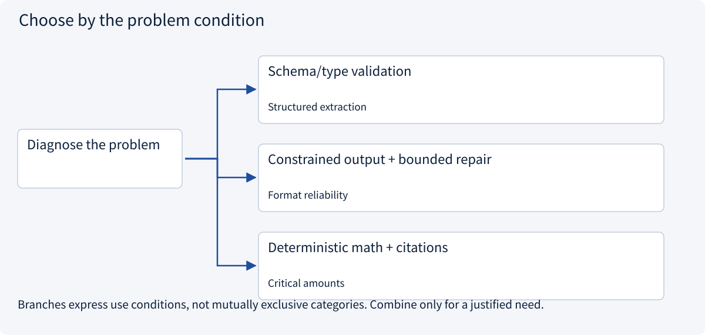
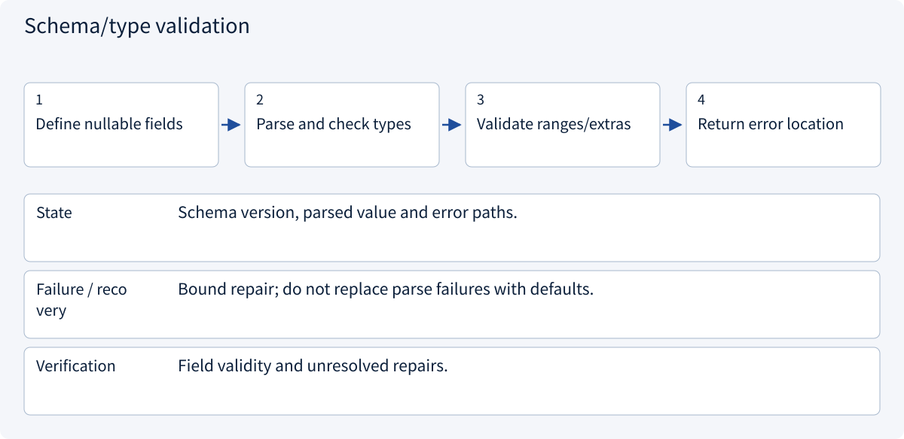
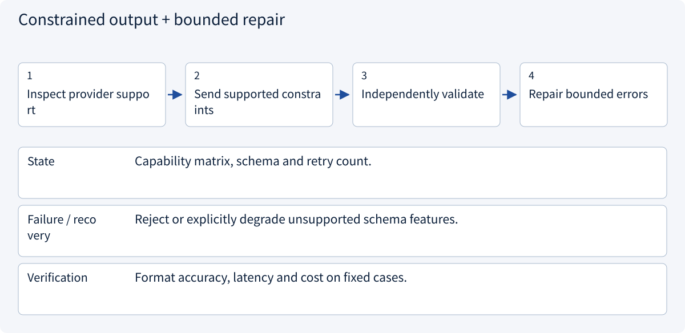
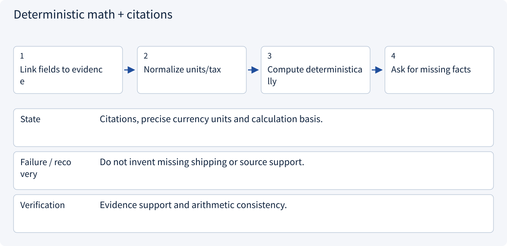

# 2.1.1 Prompts and output contracts

> Visual route · Established approaches · Reference code

The code checks quotation fields and caller-supplied evidence IDs, withholding totals when shipping is unknown. Full schema parsing and factual evidence verification remain separate.

## Start with the problem

Why can valid JSON still contain a false amount?




## See the mechanism

Validate structure, factual support and action authority independently. A schema is not evidence.



## Choose an established approach



| Approach | Mechanism | Use when | Tradeoff / boundary |
|---|---|---|---|
| Schema/type validation | Check fields and ranges | Structured extraction | No factual guarantee |
| Constrained output + bounded repair | Limit syntax and repair errors | Format reliability | Provider-dependent capabilities |
| Deterministic math + citations | Calculate and verify | Critical amounts | Missing facts stay unknown |

## Inside the mainstream approaches

### 1 · Schema/type validation



**Concrete trace:** Unknown shipping may be null; a nonnumeric amount fails.

<details><summary>Expand steps, state and failure boundaries</summary>

1. Define nullable fields
2. Parse and check types
3. Validate ranges/extras
4. Return error location

**State** Schema version, parsed value and error paths.

**Failure / recovery** Bound repair; do not replace parse failures with defaults.

**Verification** Field validity and unresolved repairs.

</details>

### 2 · Constrained output + bounded repair



**Concrete trace:** Valid JSON does not prove that a price came from the source.

<details><summary>Expand steps, state and failure boundaries</summary>

1. Inspect provider support
2. Send supported constraints
3. Independently validate
4. Repair bounded errors

**State** Capability matrix, schema and retry count.

**Failure / recovery** Reject or explicitly degrade unsupported schema features.

**Verification** Format accuracy, latency and cost on fixed cases.

</details>

### 3 · Deterministic math + citations



**Concrete trace:** 1000×180 cents is a subtotal, not a total including unknown shipping.

<details><summary>Expand steps, state and failure boundaries</summary>

1. Link fields to evidence
2. Normalize units/tax
3. Compute deterministically
4. Ask for missing facts

**State** Citations, precise currency units and calculation basis.

**Failure / recovery** Do not invent missing shipping or source support.

**Verification** Evidence support and arithmetic consistency.

</details>

## Reference code

Expand the implementation corresponding to this mechanism. Training code is provided but not executed. See the reference-code guide for dependencies and verification limits.

[Reference code and verification limits](code-guide.md)

<details><summary>Expand code and limits</summary>

```python
"""Structure and evidence support are independent checks."""

from dataclasses import dataclass


@dataclass(frozen=True)
class Quotation:
    unit_cents: int
    shipping_cents: int | None
    source_id: str


def total_or_unknown(
    quote: Quotation, quantity: int, allowed_sources: set[str]
) -> int | None:
    if quantity <= 0 or quote.unit_cents < 0:
        raise ValueError("Invalid amount or quantity")
    if quote.source_id not in allowed_sources:
        raise PermissionError("Unknown or unauthorized evidence")
    if quote.shipping_cents is None:
        return None
    if quote.shipping_cents < 0:
        raise ValueError("Shipping must be nonnegative")
    return quote.unit_cents * quantity + quote.shipping_cents


# A real application also verifies that the source supports the extracted fields.
```

</details>

## Change a condition

Can “shipping extra” produce a total including shipping?

<details><summary>Suggested answer</summary>

No. Keep the subtotal, mark shipping and total unknown, and request evidence when permitted.

</details>

<details><summary>Optional derivation and boundaries</summary>

**Treat output as a proposal with a contract**

Specify the task, evidence boundary, comparison units, output schema, handling of unknowns and allowed actions. Examples should include missing and conflicting information, not only perfect success cases.

Parsing JSON is only structural validation. A plausible amount can still lack evidence. Validate units, ranges and supporting source locations separately. For monetary arithmetic use a precise representation rather than trusting generated calculations.

A tool contract defines arguments, results, errors, authorization, timeout and side effects. Runtime checks the proposed call against the allowed tools and object permissions before execution. Invalid structure may justify a bounded repair attempt; absent evidence cannot be repaired by inventing facts.

**Check your understanding**

A quotation says “shipping extra” but the model returns a total including shipping. What should happen?

<details><summary>Suggested answer</summary>

Keep the subtotal with its evidence, mark shipping and total as unknown, and request more information if permitted.

</details>


</details>

[Official sources and approach rationale](resources.md)
