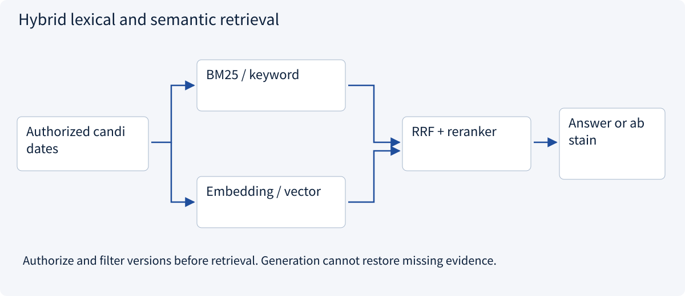
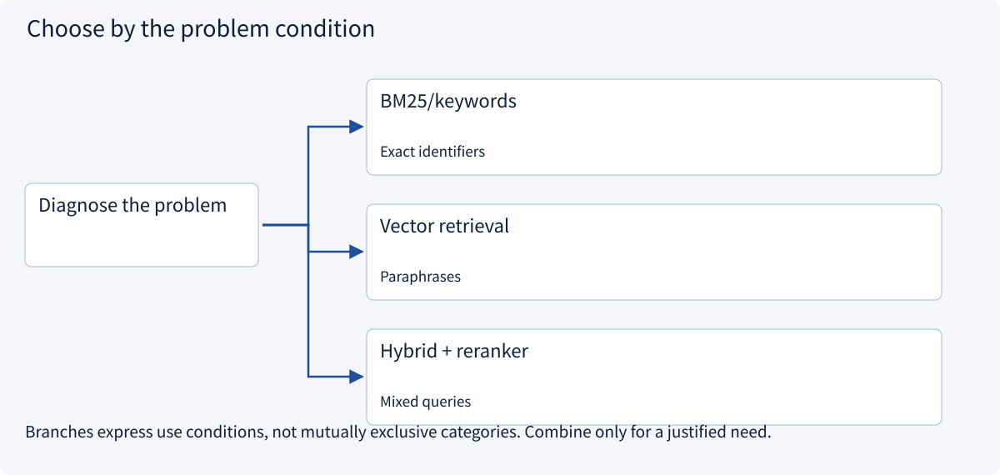
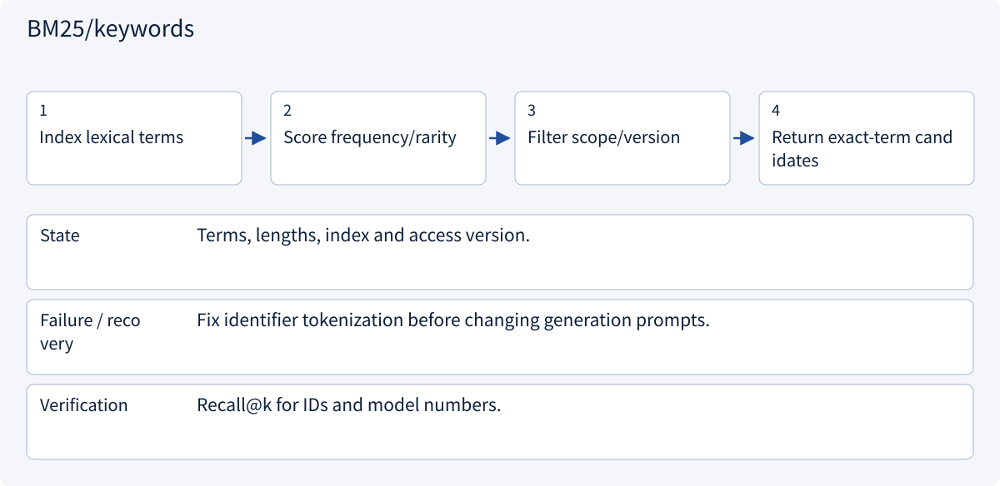
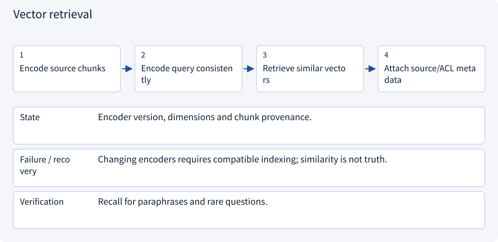
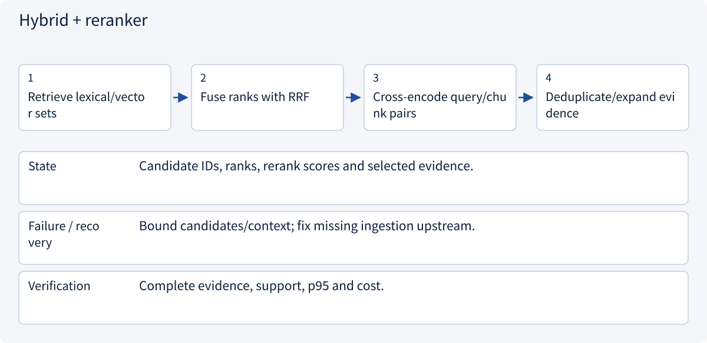
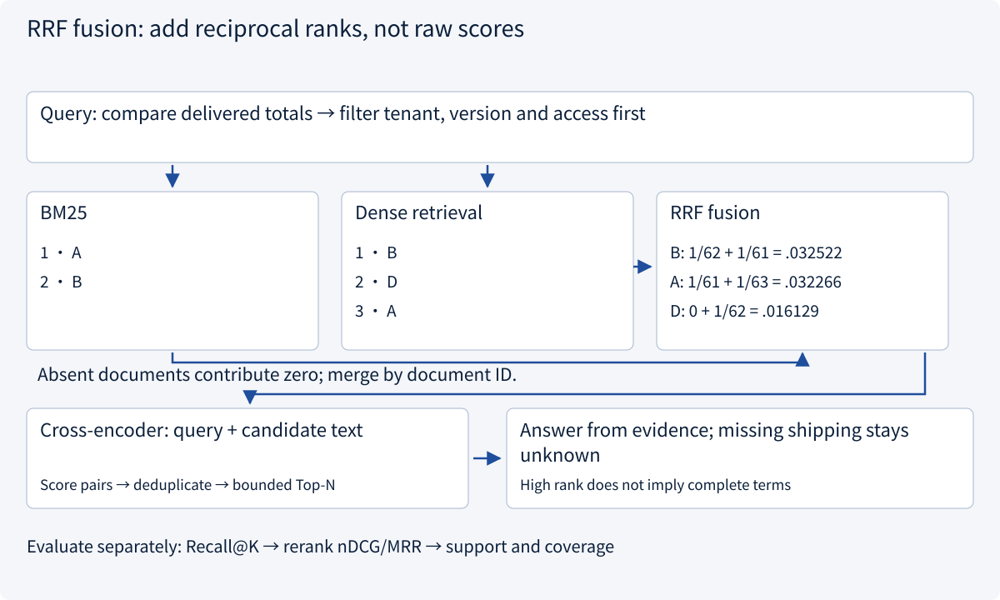

# 2.1.2 Retrieval-augmented generation

> Visual route · Established approaches · Reference code

## Start with the problem

Vector search misses identifiers, conditions or the latest version.


AI-generated editorial illustration: retrieved candidates still need source, version and applicability checks. The pictured pages are not actual cited evidence.

## See the mechanism

Combine lexical and semantic candidates, fuse rankings, rerank, then verify source support and version.



## Choose an established approach



| Approach | Mechanism | Use when | Tradeoff / boundary |
|---|---|---|---|
| BM25/keywords | Match terms/IDs | Exact identifiers | Weak on paraphrases |
| Vector retrieval | Semantic proximity | Paraphrases | Similarity is not support |
| Hybrid + reranker | Fuse then refine candidates | Mixed queries | Cannot restore missing ingestion |

## Inside the mainstream approaches

### 1 · BM25/keywords



**Concrete trace:** Exact product identifiers benefit from lexical matching.

### 2 · Vector retrieval



**Concrete trace:** Delivery-time paraphrases may match semantically.

### 3 · Hybrid + reranker



**Concrete trace:** Retrieve both a price and its >500-unit exception before committing to delivery.

## Trace concrete data and failure boundaries



## Reference code

Expand the implementation corresponding to this mechanism. Training code is provided but not executed. See the reference-code guide for dependencies and verification limits.

[Reference code and verification limits](../../docs/zh/projects/03-code-guide.md)

<details><summary>Expand code and limits</summary>

```python
"""RRF combines rankings, not incompatible raw similarity scales."""

from collections import defaultdict
from collections.abc import Sequence


def reciprocal_rank_fusion(
    rankings: Sequence[Sequence[str]], allowed_ids: set[str], k: int = 60
) -> list[tuple[str, float]]:
    if k <= 0:
        raise ValueError("k must be positive")
    scores = defaultdict(float)
    for ranking in rankings:
        seen = set()
        for rank, document_id in enumerate(ranking, 1):
            if document_id not in allowed_ids or document_id in seen:
                continue
            scores[document_id] += 1 / (k + rank)
            seen.add(document_id)
    return sorted(scores.items(), key=lambda item: (-item[1], item[0]))


# Inputs should come from authorized BM25/vector retrieval. No embedding model is hidden here.
```

</details>

## Why rerank after hybrid retrieval?

BM25 uses an inverted index with term-frequency saturation, rare-term weighting and document-length normalization. It preserves exact identifiers; repair analyzers/fields when tokenization breaks a model number. Dense retrieval separately encodes queries and passages into a compatible space. Changing embedding models requires reindexing rather than comparing new queries with old vectors.

RRF adds `1/(k + rank)` per document; an absent document contributes zero. `k=60` is a smoothing constant, not a candidate count. Candidate windows and final Top-N are separate parameters. Rank fusion avoids adding incompatible raw scores but cannot establish that a passage contains complete terms.

A cross-encoder jointly scores each query/passage pair, spending more computation on a bounded candidate set. Retrieval seeks coverage; reranking distinguishes relevance. Neither can recover a shipping clause absent from all candidates.

| Observed failure | Diagnosis | Remedy |
|---|---|---|
| Relevant clause absent | Ingestion, chunking, analyzer, embedding version, filters | Repair recall/indexing; measure Recall@K |
| Relevant candidate ranked too low | Pair relevance and duplicates | Rerank a bounded set; deduplicate |
| High-ranked evidence lacks conditions | Nearby limits, table headers, footnotes | Preserve structure and expand bounded parent context |
| Complete evidence but invented answer | Citation alignment and unknown-value rules | Validate claims against evidence rather than tuning retrieval |

Apply scope filters in both retrieval paths and recheck document access before reading text. The ranking diagram is synthetic arithmetic; no embedding or reranker model is run.

References: [Elasticsearch RRF](https://www.elastic.co/docs/reference/elasticsearch/rest-apis/reciprocal-rank-fusion), [semantic reranking](https://www.elastic.co/docs/solutions/search/ranking/semantic-reranking).


## Change a condition

If price is retrieved but a quantity condition is not, where should debugging start?

<details><summary>Suggested answer</summary>

Start with ingestion/chunking and retrieval completeness, not only the answer prompt.

</details>

<details><summary>Optional derivation and boundaries</summary>

**Evaluate ingestion, retrieval and generation separately**

Ingestion parses documents, preserves tables and conditions, chunks by semantic boundaries, and records source identity, version, location and access control. Updates and deletions must invalidate stale chunks and caches.

Keyword retrieval helps exact identifiers; embeddings help semantic variation. Hybrid retrieval and reranking may improve candidates. Similarity is not factual support, and reranking cannot recover evidence never retrieved.

For a 1,000-unit request, “standard delivery 7 days” and “over 500 units requires confirmation” are both necessary. Retrieving only the first gives 50% evidence recall when two chunks are required, but the strict complete-evidence criterion is false. Unauthorized content must never reach the model or a shared cache.

**Check your understanding**

Why can increasing top-k harm answers?

<details><summary>Suggested answer</summary>

Additional duplicate, stale or conflicting evidence consumes context and obscures conditions. Measure final answer quality as well as retrieval recall.

</details>


</details>

[Official sources and approach rationale](../../docs/zh/resources.md)
