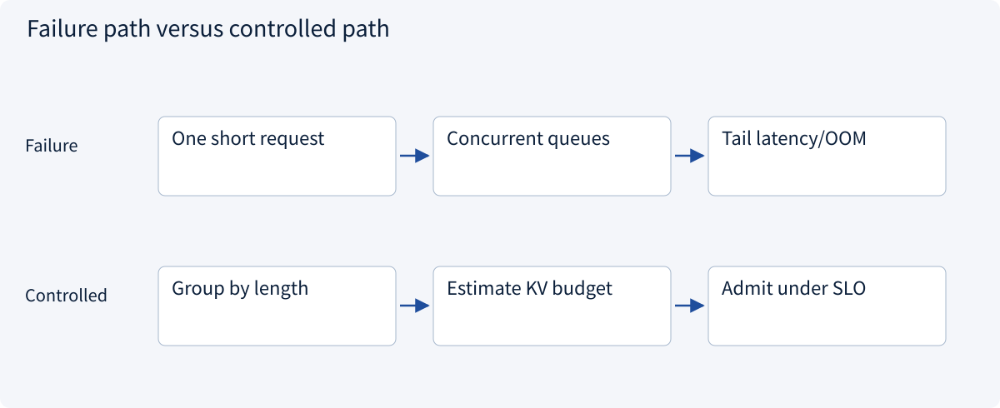
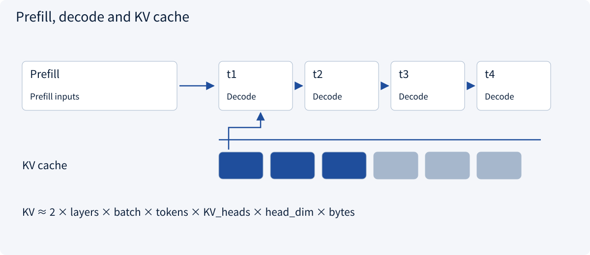
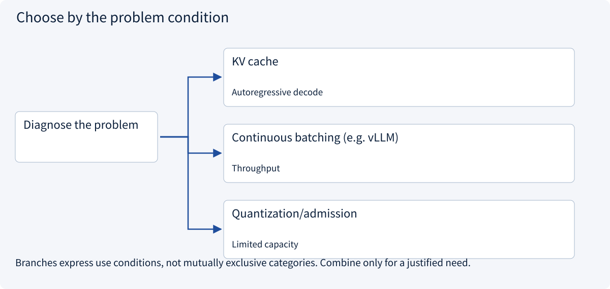
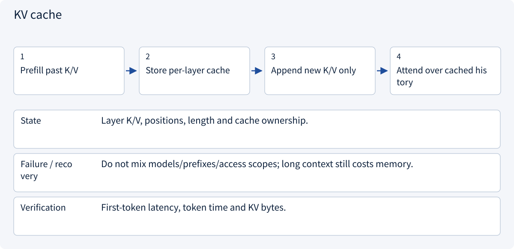
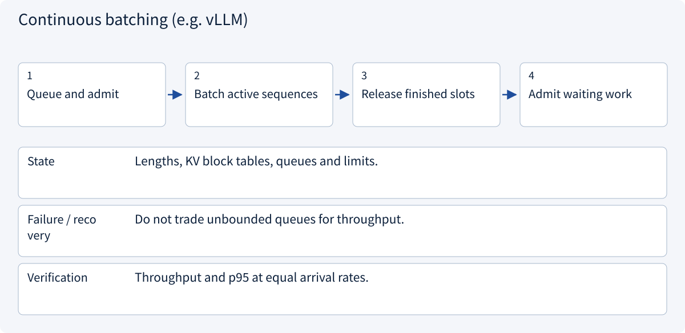
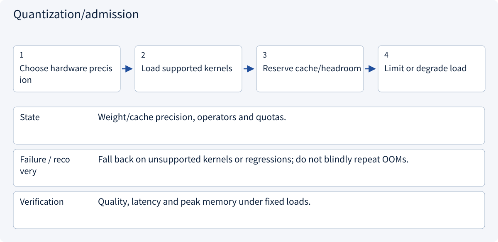

# 2.1.3 Inference, memory and evaluation

> Visual route · Established approaches · Reference code

## Start with the problem

Long prompts, outputs and concurrency exhaust memory or latency budgets.




## See the mechanism

Measure prefill, decode and queues separately. KV caching, batching and quantization involve workload-specific tradeoffs.



## Choose an established approach



| Approach | Mechanism | Use when | Tradeoff / boundary |
|---|---|---|---|
| KV cache | Reuse past keys/values | Autoregressive decode | Memory grows with load |
| Continuous batching (e.g. vLLM) | Mix request lifetimes | Throughput | Queues may worsen latency |
| Quantization/admission | Reduce precision or load | Limited capacity | Hardware and quality tradeoffs |

## Inside the mainstream approaches

### 1 · KV cache



**Concrete trace:** The stated 32-layer example needs about 512 MiB of KV, excluding other memory.

### 2 · Continuous batching (e.g. vLLM)



**Concrete trace:** vLLM-style scheduling/cache management still needs workload SLO tests.

### 3 · Quantization/admission



**Concrete trace:** Fitting weights alone does not establish long-context concurrency capacity.

## Reference code

Expand the implementation corresponding to this mechanism. Training code is provided but not executed. See the reference-code guide for dependencies and verification limits.

[Reference code and verification limits](../../docs/zh/projects/03-code-guide.md)

<details><summary>Expand code and limits</summary>

```python
"""Estimate a conventional MHA/GQA KV cache, excluding other allocations."""


def kv_bytes(
    layers: int,
    batch: int,
    length: int,
    kv_heads: int,
    head_dim: int,
    element_bytes: int = 2,
) -> int:
    dimensions = (layers, batch, length, kv_heads, head_dim, element_bytes)
    if any(value <= 0 for value in dimensions):
        raise ValueError("All dimensions must be positive")
    return 2 * layers * batch * length * kv_heads * head_dim * element_bytes


def admits_request(used_bytes: int, request_bytes: int, capacity_bytes: int) -> bool:
    if min(used_bytes, request_bytes, capacity_bytes) < 0:
        raise ValueError("Budgets cannot be negative")
    return used_bytes + request_bytes <= capacity_bytes


# Different architectures and cache quantization change this estimate.
```

</details>

## Change a condition

Is more throughput with worse p95 first-token latency a success?

<details><summary>Suggested answer</summary>

Only if it meets the workload SLO. Interactive latency and offline throughput are separate objectives.

</details>

<details><summary>Optional derivation and boundaries</summary>

**Measure the workload, not just tokens per second**

Prefill processes the known prefix; decode generates new tokens using cached keys and values. KV cache saves recomputation but consumes memory and is not long-term knowledge.

A common estimate is 2×layers×batch×length×KV_heads×head_dim×bytes. For 32 layers, batch 1, length 4096, 8 KV heads, head dimension 128 and 2-byte elements, this is about 512 MiB, excluding other allocations. Different architectures change the estimate.

Compare hosted and self-managed inference using real data boundaries, quality, version control, cost and operational capacity. Record input/output length, arrival rate, concurrency, time to first token, end-to-end p95 latency and failures. Larger batches can improve throughput while making interactive requests wait longer.

**Check your understanding**

Is higher throughput with worse p95 first-token latency always a win?

<details><summary>Suggested answer</summary>

No. Interactive and offline workloads have different acceptance criteria. Compare under the same load and length distribution.

</details>


</details>

[Official sources and approach rationale](../../docs/zh/resources.md)
