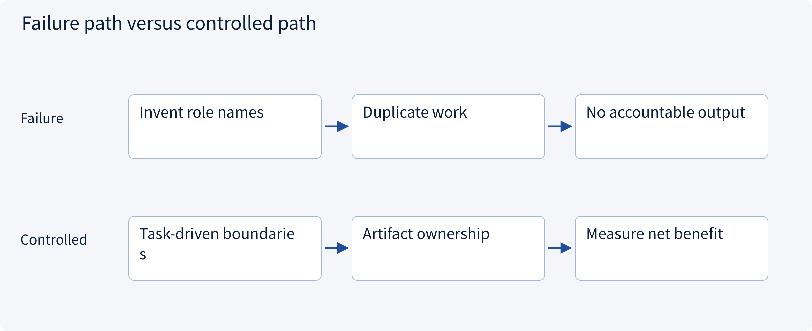
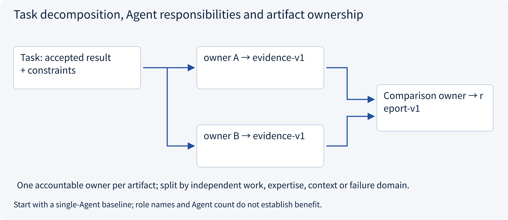
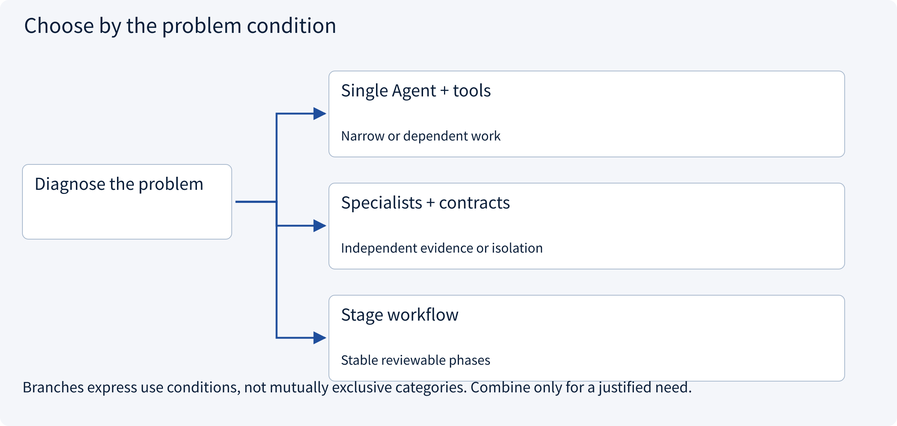
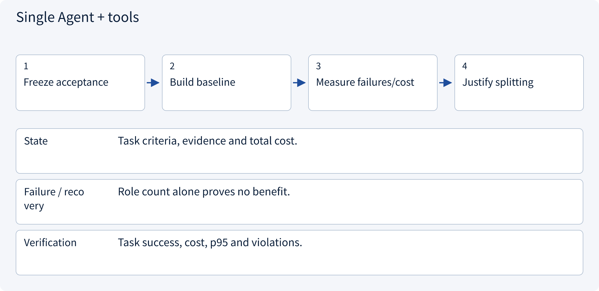
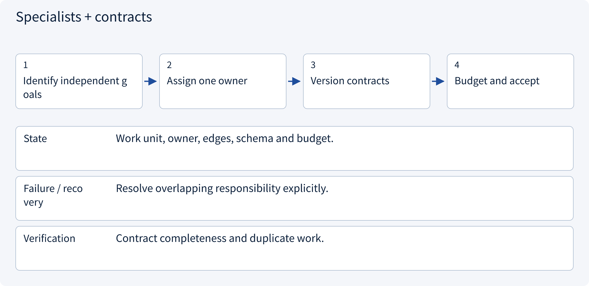
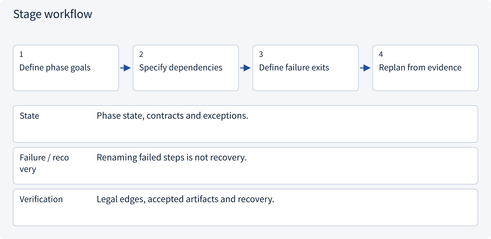

# 3.1.1 Task decomposition, Agent responsibilities and artifact ownership

> Visual route · Established approaches · Reference code

Design reference and local contracts; no model training or measured collaboration uplift.

## Start with the problem

Why split a task a single Agent can already solve? Are role names an architecture?




## See the mechanism

Start from task acceptance and a single-Agent baseline. Split independent work, expertise, context or failure boundaries with accountable owners and artifact contracts.



## Choose an established approach



| Approach | Mechanism | Use when | Tradeoff / boundary |
|---|---|---|---|
| Single Agent + tools | One task context and controlled tools | Narrow or dependent work | Sequential latency/context pressure |
| Specialists + contracts | Divide expertise/input boundaries | Independent evidence or isolation | Handoff and merge costs |
| Stage workflow | Accept stage artifacts before progress | Stable reviewable phases | Not every reasoning choice is fixed |

## Inside the mainstream approaches

### 1 · Single Agent + tools



**Concrete trace:** A short quotation does not need three debating roles.

### 2 · Specialists + contracts



**Concrete trace:** Market researchers own evidence; comparer owns normalized comparison.

### 3 · Stage workflow



**Concrete trace:** Research, comparison, approval and draft have different acceptance gates.

## Reference code

Expand the implementation corresponding to this mechanism. Training code is provided but not executed. See the reference-code guide for dependencies and verification limits.

[Reference code and verification limits](../../docs/zh/projects/03-code-guide.md)

<details><summary>Expand code and limits</summary>

```python
"""Validate explicit work ownership and contracts before choosing a topology."""

from dataclasses import dataclass


@dataclass(frozen=True)
class WorkUnit:
    key: str
    owner: str
    input_contract: str
    output_contract: str
    depends_on: tuple[str, ...]
    budget: int


def validate_work(units: list[WorkUnit]) -> list[str]:
    by_key = {unit.key: unit for unit in units}
    if len(by_key) != len(units):
        raise ValueError("Duplicate work unit")
    for unit in units:
        if (
            not all((unit.key, unit.owner, unit.input_contract, unit.output_contract))
            or unit.budget <= 0
        ):
            raise ValueError("Missing ownership, contract or budget")
        if not set(unit.depends_on) <= by_key.keys():
            raise ValueError("Unknown dependency")
    pending, ordered = set(by_key), []
    while pending:
        ready = sorted(
            key for key in pending if set(by_key[key].depends_on) <= set(ordered)
        )
        if not ready:
            raise ValueError("Cyclic work graph")
        ordered.extend(ready)
        pending.difference_update(ready)
    return ordered


# One WorkUnit owner is accountable for an artifact; multiple reviewers do not erase ownership.
# A useful split needs independent evidence/work, not merely more role names in prompts.
```

</details>

## Required design artifact

Task graph, node owners/contracts/budgets/acceptance and why a single Agent is insufficient.

The reference checks local contract properties. Align this artifact with sessions, policy, approval, runtime, state and evaluation; an extra supervisor does not automatically solve all boundaries. No model, broker or production tool is run and no collaboration uplift is claimed.

References: [Official 1](https://www.anthropic.com/research/multi-agent-research-system).


## Change a condition

What must a split justify?

<details><summary>Suggested answer</summary>

Why multiple Agents, which artifacts each owns and how it improves the baseline.

</details>

[Official sources and approach rationale](../../docs/zh/resources.md)
