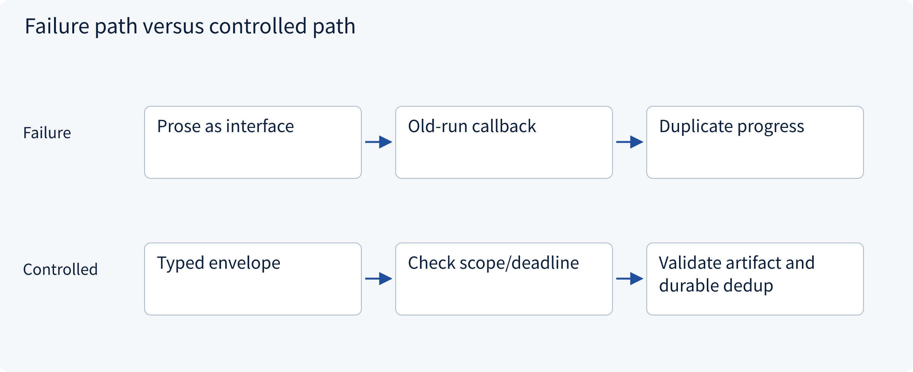
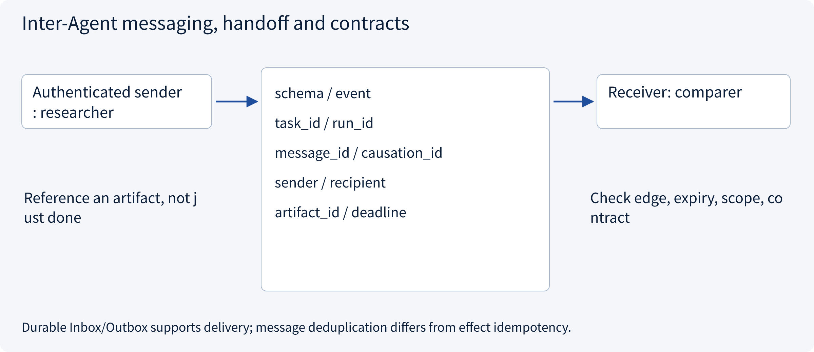
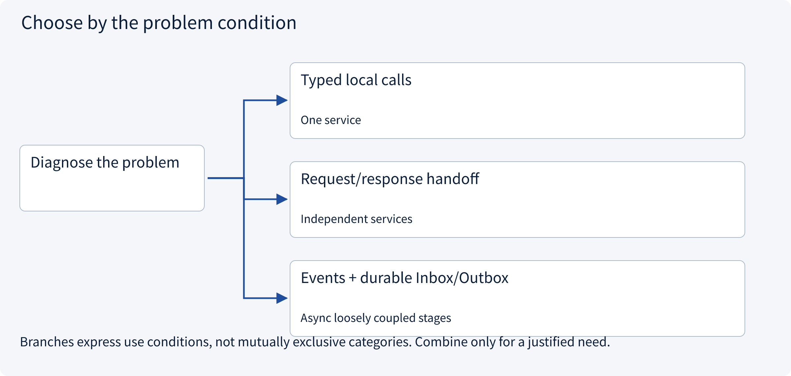
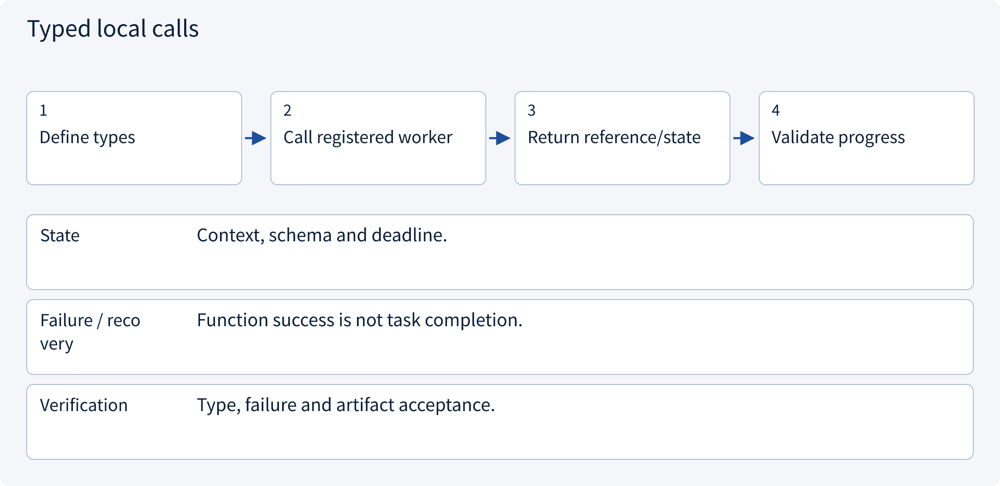
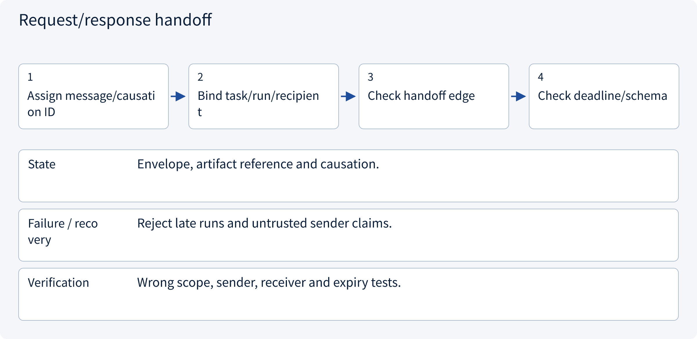
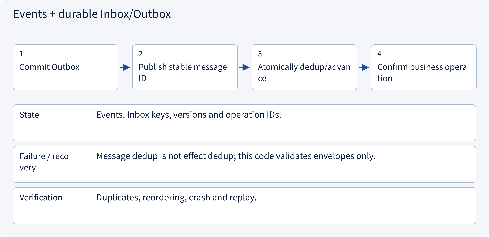

# 3.2.2 Inter-Agent messaging, handoff and contracts

> Visual route · Established approaches · Reference code

Design reference and local contracts; no model training or measured collaboration uplift.

## Start with the problem

How can “done” identify the correct task/run/version, duplicate or late result?




## See the mechanism

Bind messages to task/run, authenticated endpoints, schema, causation, deadline and artifact references. Delivery and business-effect idempotency are separate.



## Choose an established approach



| Approach | Mechanism | Use when | Tradeoff / boundary |
|---|---|---|---|
| Typed local calls | Structured function input/output | One service | Shared process failure |
| Request/response handoff | Explicit recipient/correlation | Independent services | Timeout and unknown results |
| Events + durable Inbox/Outbox | At-least-once with atomic deduplication | Async loosely coupled stages | Ordering, idempotency and backlog |

## Inside the mainstream approaches

### 1 · Typed local calls



**Concrete trace:** Return evidence objects instead of a done sentence.

<details><summary>Expand steps, state and failure boundaries</summary>

1. Define types
2. Call registered worker
3. Return reference/state
4. Validate progress

**State** Context, schema and deadline.

**Failure / recovery** Function success is not task completion.

**Verification** Type, failure and artifact acceptance.

</details>

### 2 · Request/response handoff



**Concrete trace:** run-2 cannot accept a stale run-1 report.

<details><summary>Expand steps, state and failure boundaries</summary>

1. Assign message/causation ID
2. Bind task/run/recipient
3. Check handoff edge
4. Check deadline/schema

**State** Envelope, artifact reference and causation.

**Failure / recovery** Reject late runs and untrusted sender claims.

**Verification** Wrong scope, sender, receiver and expiry tests.

</details>

### 3 · Events + durable Inbox/Outbox



**Concrete trace:** Repeated artifact-ready cannot issue repeated writes.

<details><summary>Expand steps, state and failure boundaries</summary>

1. Commit Outbox
2. Publish stable message ID
3. Atomically dedup/advance
4. Confirm business operation

**State** Events, Inbox keys, versions and operation IDs.

**Failure / recovery** Message dedup is not effect dedup; this code validates envelopes only.

**Verification** Duplicates, reordering, crash and replay.

</details>

## Reference code

Expand the implementation corresponding to this mechanism. Training code is provided but not executed. See the reference-code guide for dependencies and verification limits.

[Reference code and verification limits](code-guide.md)

<details><summary>Expand code and limits</summary>

```python
"""A typed envelope for Host-controlled collaboration, independent of MCP RPC IDs."""

from dataclasses import dataclass


@dataclass(frozen=True)
class Envelope:
    schema: str
    task_id: str
    run_id: str
    message_id: str
    causation_id: str | None
    sender: str
    recipient: str
    artifact_id: str
    deadline: int


def validate_delivery(
    message: Envelope,
    task_id: str,
    run_id: str,
    receiver: str,
    edges: frozenset[tuple[str, str]],
    now: int,
) -> None:
    if (
        message.schema != "artifact-ready-v1"
        or not message.message_id
        or not message.artifact_id
    ):
        raise ValueError("Invalid envelope or artifact contract")
    if (
        message.task_id != task_id
        or message.run_id != run_id
        or message.recipient != receiver
    ):
        raise PermissionError("Message belongs to another task/run/recipient")
    if (message.sender, message.recipient) not in edges:
        raise PermissionError("Undeclared handoff edge")
    if message.deadline <= now:
        raise TimeoutError("Stale handoff")


# The transport injects authenticated sender identity; a model cannot self-assert it.
# A durable inbox must enforce message_id uniqueness together with its state transition.
# message_id, provider call_id, MCP RPC id and business operation_id have different purposes.
```

</details>

## Required design artifact

Allowed handoffs, envelopes, artifacts, error/deadline rules, deduplication and causation.

The reference checks local contract properties. Align this artifact with sessions, policy, approval, runtime, state and evaluation; an extra supervisor does not automatically solve all boundaries. No model, broker or production tool is run and no collaboration uplift is claimed.

References: [LangGraph Workflows and Agents](https://docs.langchain.com/oss/python/langgraph/workflows-agents).


## Change a condition

Does MCP replace all Agent messaging?

<details><summary>Suggested answer</summary>

No. Handoff ownership, causation, artifacts and execution state remain application contracts.

</details>

[Official sources and approach rationale](resources.md)
