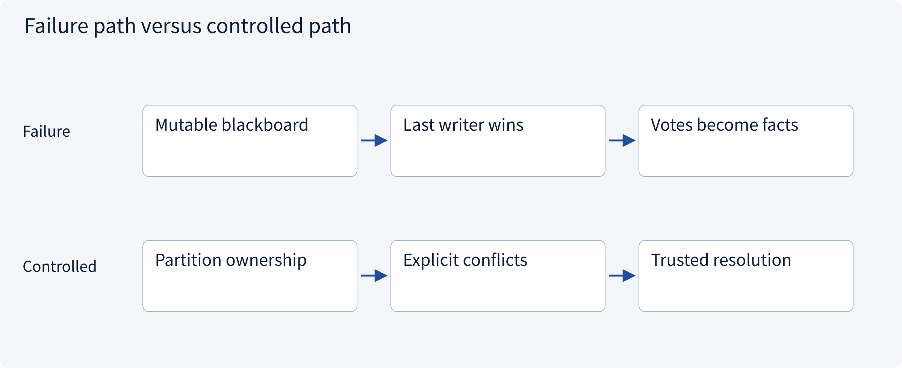
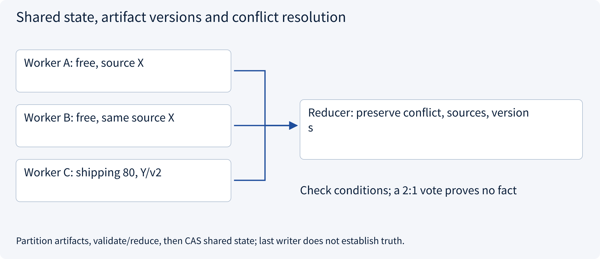
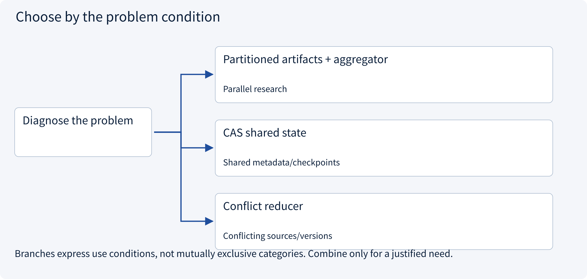
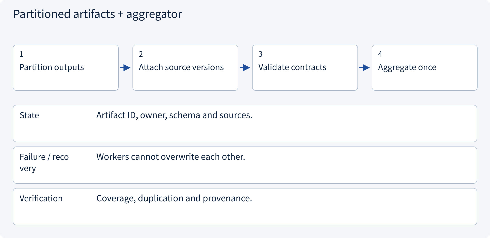
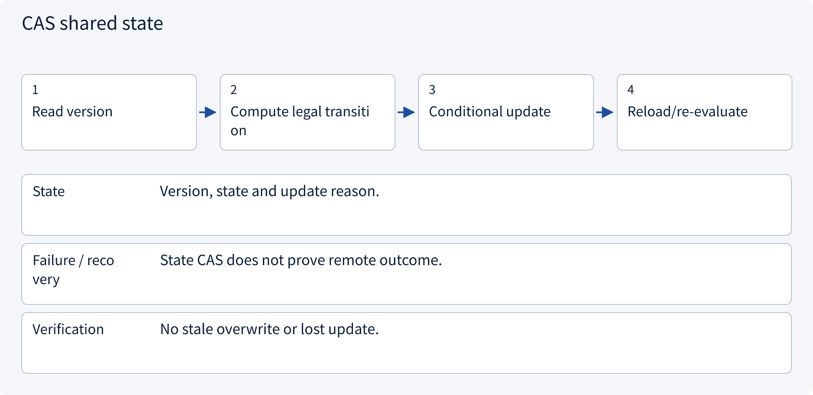
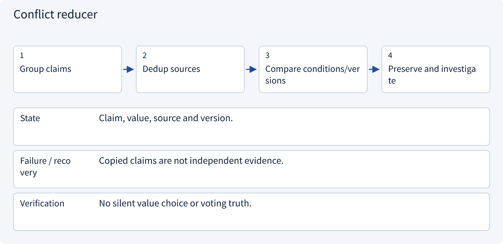

# 3.4.1 Shared state, artifact versions and conflict resolution

> Visual route · Established approaches · Reference code

Design reference and local contracts; no model training or measured collaboration uplift.

## Start with the problem

Why do workers overwrite shared state, and do copied claims count as independent evidence?




## See the mechanism

Partition artifacts by owner and use an explicit reducer. Commit shared state by expected version; resolve factual conflicts from provenance and conditions, not majority votes.



## Choose an established approach



| Approach | Mechanism | Use when | Tradeoff / boundary |
|---|---|---|---|
| Partitioned artifacts + aggregator | Workers own independent results | Parallel research | Aggregator bottleneck |
| CAS shared state | Update only expected version | Shared metadata/checkpoints | Reload on conflict |
| Conflict reducer | Keep conflicting evidence visible | Conflicting sources/versions | May require review |

## Inside the mainstream approaches

### 1 · Partitioned artifacts + aggregator



**Concrete trace:** Separate market reports feed one normalized comparison.

### 2 · CAS shared state



**Concrete trace:** Only one v7 reader commits v8.

### 3 · Conflict reducer



**Concrete trace:** Reconcile free-shipping advert versus an 80-cent contract.

## Reference code

Expand the implementation corresponding to this mechanism. Training code is provided but not executed. See the reference-code guide for dependencies and verification limits.

[Reference code and verification limits](../../docs/zh/projects/03-code-guide.md)

<details><summary>Expand code and limits</summary>

```python
"""Evidence conflicts are explicit; no last-writer-wins or agent-majority truth."""

from dataclasses import dataclass


@dataclass(frozen=True)
class Observation:
    claim: str
    value: str
    source_id: str
    source_version: int
    worker: str


def reconcile(observations: list[Observation]) -> dict:
    claims = {}
    for item in observations:
        if not item.source_id or item.source_version <= 0:
            raise ValueError("Missing provenance")
        claims.setdefault(item.claim, []).append(item)
    accepted, conflicts = {}, {}
    for key, items in claims.items():
        values = {item.value for item in items}
        if len(values) == 1:
            accepted[key] = {
                "value": items[0].value,
                "sources": sorted({x.source_id for x in items}),
            }
        else:
            conflicts[key] = [
                {"value": x.value, "source": x.source_id, "version": x.source_version}
                for x in items
            ]
    return {"accepted": accepted, "conflicts": conflicts, "complete": not conflicts}


# Different versions are not automatically comparable; trusted freshness rules belong in the service.
# Persist worker artifacts separately, then commit the validated reducer result with CAS.
```

</details>

## Required design artifact

State ownership, worker artifact namespaces/versions, reducer policy and conflict escalation.

The reference checks local contract properties. Align this artifact with sessions, policy, approval, runtime, state and evaluation; an extra supervisor does not automatically solve all boundaries. No model, broker or production tool is run and no collaboration uplift is claimed.

References: [Official 1](https://docs.langchain.com/oss/python/langgraph/persistence).


### Version-conditional persistence

Local architecture reference without live external effects.

<details><summary>Expand code and limits</summary>

```python
"""Versioned checkpoint repository. Caller supplies an initialized connection."""

import json
import sqlite3
from pathlib import Path


def initialize(connection: sqlite3.Connection) -> None:
    connection.executescript(Path(__file__).with_suffix(".sql").read_text())


def save(
    connection: sqlite3.Connection,
    tenant: str,
    task: str,
    expected_version: int,
    payload: dict,
) -> int:
    encoded = json.dumps(payload, sort_keys=True)
    with connection:
        if expected_version == 0:
            connection.execute(
                "INSERT INTO checkpoints VALUES (?, ?, 1, ?)", (tenant, task, encoded)
            )
        else:
            changed = connection.execute(
                "UPDATE checkpoints SET version=version+1,payload=? WHERE tenant=? AND task=? AND version=?",
                (encoded, tenant, task, expected_version),
            ).rowcount
            if changed != 1:
                raise RuntimeError("Checkpoint version conflict")
    return expected_version + 1


# Saving state does not prove an external operation did or did not execute.
```

</details>

## Change a condition

Can the latest result overwrite a field?

<details><summary>Suggested answer</summary>

Only with deliberate overwrite semantics; factual or approval-bound fields require explicit resolution.

</details>

[Official sources and approach rationale](../../docs/zh/resources.md)
