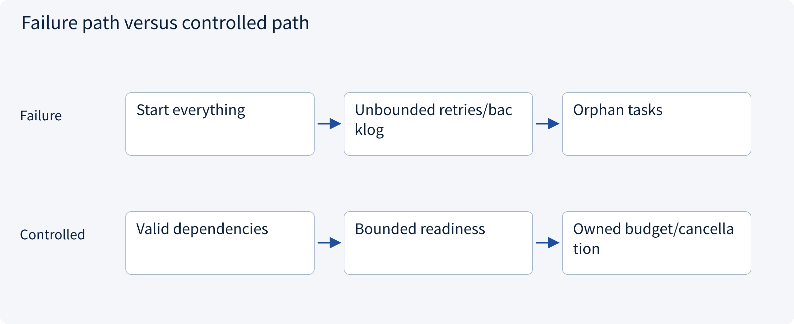
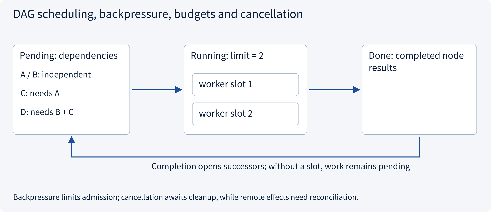
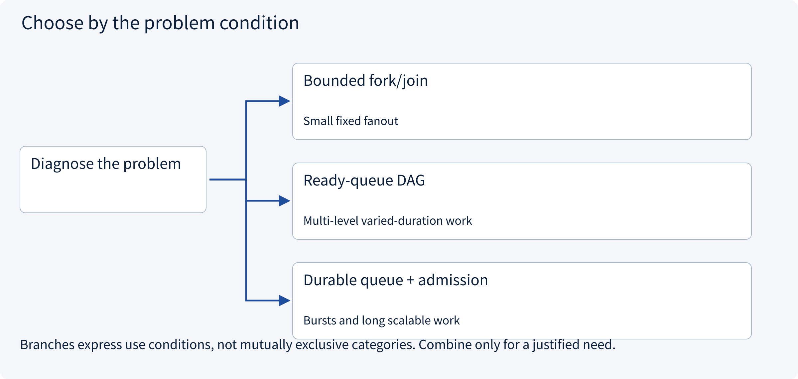
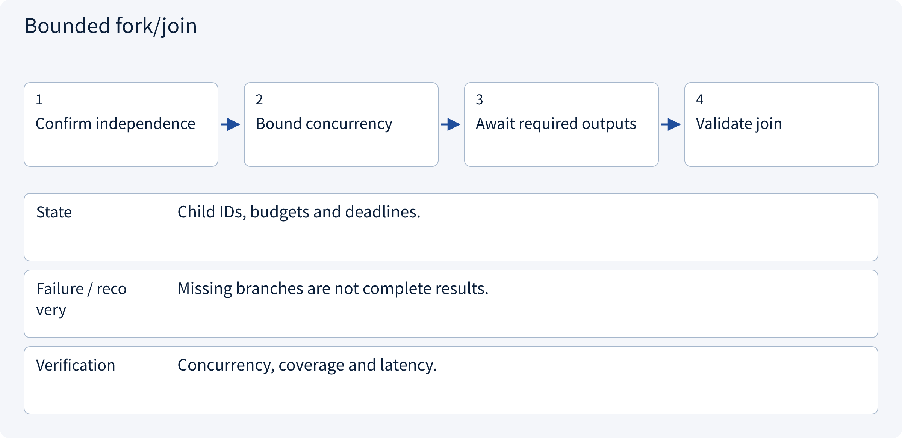
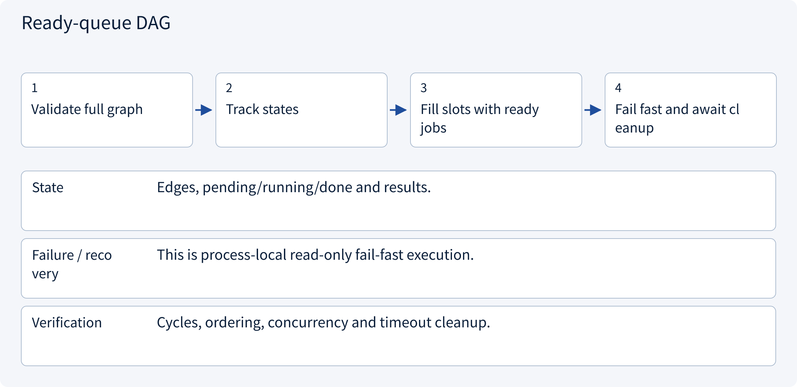
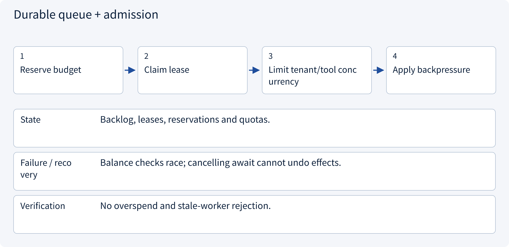

# 3.7.2 DAG scheduling, backpressure, budgets and cancellation

> Visual route · Established approaches · Reference code

Design reference and local contracts; no model training or measured collaboration uplift.

## Start with the problem

Why can more workers be slower/costlier, and how do dependencies, queues and cancellation behave?




## See the mechanism

Schedule ready nodes with bounded concurrency and task-level budgets. Backpressure limits admission; cancellation awaits cleanup but cannot undo a remote write.



## Choose an established approach



| Approach | Mechanism | Use when | Tradeoff / boundary |
|---|---|---|---|
| Bounded fork/join | Parallel independent branches then merge | Small fixed fanout | Slow-branch and failure policy |
| Ready-queue DAG | Open successors when parents finish | Multi-level varied-duration work | Failure propagation/cycle checks |
| Durable queue + admission | Buffer jobs with leases/resource reservations | Bursts and long scalable work | Delivery duplicates and fencing |

## Inside the mainstream approaches

### 1 · Bounded fork/join



**Concrete trace:** Compare only after required quotations arrive.

<details><summary>Expand steps, state and failure boundaries</summary>

1. Confirm independence
2. Bound concurrency
3. Await required outputs
4. Validate join

**State** Child IDs, budgets and deadlines.

**Failure / recovery** Missing branches are not complete results.

**Verification** Concurrency, coverage and latency.

</details>

### 2 · Ready-queue DAG



**Concrete trace:** A branch can advance without unrelated slow work.

<details><summary>Expand steps, state and failure boundaries</summary>

1. Validate full graph
2. Track states
3. Fill slots with ready jobs
4. Fail fast and await cleanup

**State** Edges, pending/running/done and results.

**Failure / recovery** This is process-local read-only fail-fast execution.

**Verification** Cycles, ordering, concurrency and timeout cleanup.

</details>

### 3 · Durable queue + admission



**Concrete trace:** More workers do not increase a saturated tool quota.

<details><summary>Expand steps, state and failure boundaries</summary>

1. Reserve budget
2. Claim lease
3. Limit tenant/tool concurrency
4. Apply backpressure

**State** Backlog, leases, reservations and quotas.

**Failure / recovery** Balance checks race; cancelling await cannot undo effects.

**Verification** No overspend and stale-worker rejection.

</details>

## Reference code

Expand the implementation corresponding to this mechanism. Training code is provided but not executed. See the reference-code guide for dependencies and verification limits.

[Reference code and verification limits](code-guide.md)

<details><summary>Expand code and limits</summary>

```python
"""Bounded read-only DAG runner; first failure cancels and awaits all in-flight work."""

import asyncio
from collections.abc import Awaitable, Callable


async def schedule(
    jobs: dict[str, Callable[[], Awaitable[object]]],
    dependencies: dict[str, set[str]],
    concurrency: int,
    timeout: float,
) -> dict:
    if concurrency <= 0 or timeout <= 0 or set(jobs) != set(dependencies):
        raise ValueError("Invalid runner limits/keys")
    if any(not parents <= jobs.keys() for parents in dependencies.values()):
        raise ValueError("Unknown dependency")
    # Validate the whole DAG before any tool runs, including cycles beside a valid branch.
    visited = set()
    while len(visited) < len(jobs):
        ready = {
            key for key in jobs if key not in visited and dependencies[key] <= visited
        }
        if not ready:
            raise ValueError("Cyclic graph")
        visited.update(ready)
    pending, active, results = set(jobs), {}, {}
    try:
        async with asyncio.timeout(timeout):
            while pending or active:
                ready = sorted(
                    key for key in pending if dependencies[key] <= results.keys()
                )
                for key in ready[: concurrency - len(active)]:
                    task = asyncio.create_task(jobs[key]())
                    active[task] = key
                    pending.remove(key)
                done, _ = await asyncio.wait(
                    active, return_when=asyncio.FIRST_COMPLETED
                )
                for task in done:
                    key = active.pop(task)
                    results[key] = task.result()
    finally:
        # Read each completed exception too; cancellation must not leave orphan tasks.
        for task in active:
            task.cancel()
        await asyncio.gather(*active, return_exceptions=True)
    return results


# This process-local runner is not durable and uses fail-fast whole-task policy.
# Cancelling an await does not undo a remote write; mutating tools require operation reconciliation.
```

</details>

## Required design artifact

Dependency DAG, slots, global budget, quotas, backpressure and cleanup policy.

The reference checks local contract properties. Align this artifact with sessions, policy, approval, runtime, state and evaluation; an extra supervisor does not automatically solve all boundaries. No model, broker or production tool is run and no collaboration uplift is claimed.

References: [LangGraph Workflows and Agents](https://docs.langchain.com/oss/python/langgraph/workflows-agents).


## Change a condition

Do per-Agent budgets guarantee the task budget?

<details><summary>Suggested answer</summary>

No. Aggregate children, retries, merges and concurrent reservations in one task ledger.

</details>

[Official sources and approach rationale](resources.md)
