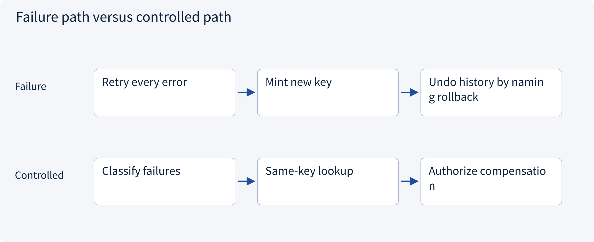
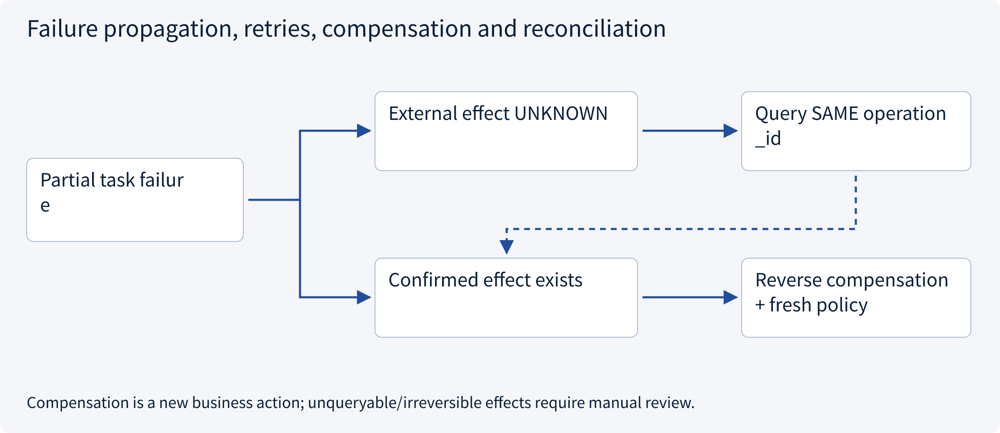
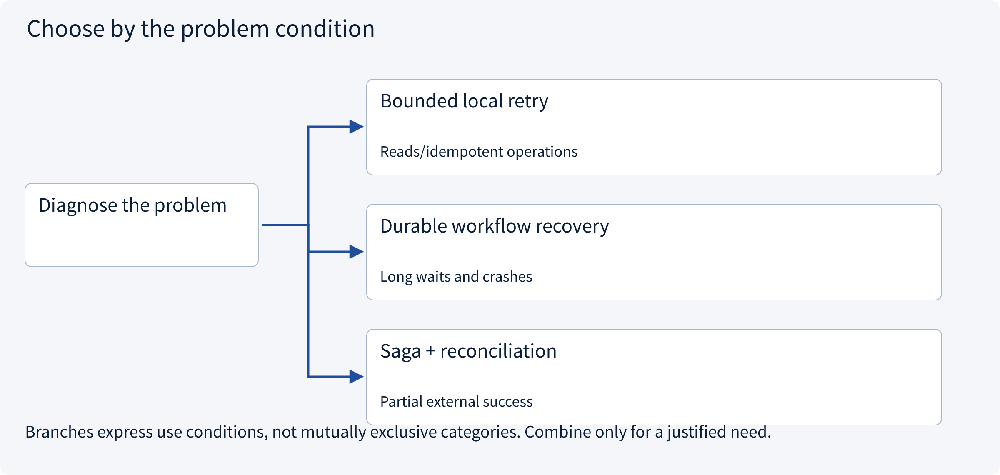
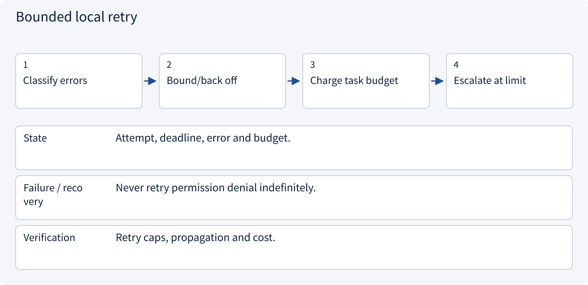
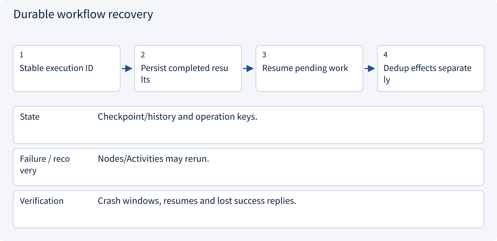
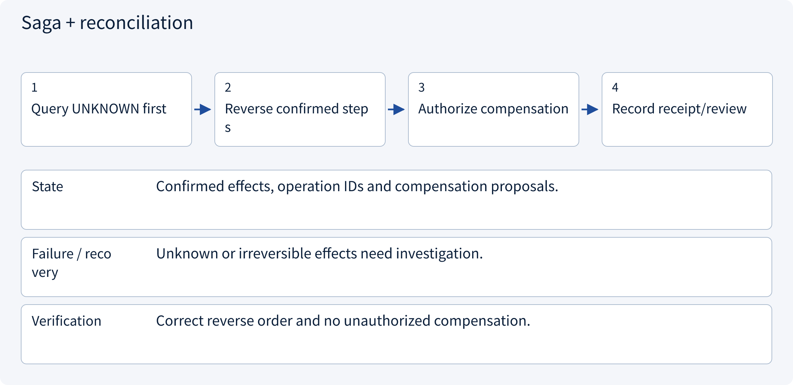

# 3.7.3 Failure propagation, retries, compensation and reconciliation

> Visual route · Established approaches · Reference code

Design reference and local contracts; no model training or measured collaboration uplift.

## Start with the problem

Which work should stop after failure, and can remote successes be rolled back by a local transaction?




## See the mechanism

Distinguish recomputation, safe read retries and unknown writes. Recover orchestration separately from effects; compensation is a new authorized business action.



## Choose an established approach



| Approach | Mechanism | Use when | Tradeoff / boundary |
|---|---|---|---|
| Bounded local retry | Retry transient safe work | Reads/idempotent operations | Amplified load/cost |
| Durable workflow recovery | Restore checkpoint/history | Long waits and crashes | Replay/version semantics |
| Saga + reconciliation | Propose reverse business actions | Partial external success | Compensation can fail and needs authority |

## Inside the mainstream approaches

### 1 · Bounded local retry



**Concrete trace:** 429 may back off; cross-tenant deny will not improve.

<details><summary>Expand steps, state and failure boundaries</summary>

1. Classify errors
2. Bound/back off
3. Charge task budget
4. Escalate at limit

**State** Attempt, deadline, error and budget.

**Failure / recovery** Never retry permission denial indefinitely.

**Verification** Retry caps, propagation and cost.

</details>

### 2 · Durable workflow recovery



**Concrete trace:** Keep the original business operation ID after recovery.

<details><summary>Expand steps, state and failure boundaries</summary>

1. Stable execution ID
2. Persist completed results
3. Resume pending work
4. Dedup effects separately

**State** Checkpoint/history and operation keys.

**Failure / recovery** Nodes/Activities may rerun.

**Verification** Crash windows, resumes and lost success replies.

</details>

### 3 · Saga + reconciliation



**Concrete trace:** Query a draft before proposing deletion.

<details><summary>Expand steps, state and failure boundaries</summary>

1. Query UNKNOWN first
2. Reverse confirmed steps
3. Authorize compensation
4. Record receipt/review

**State** Confirmed effects, operation IDs and compensation proposals.

**Failure / recovery** Unknown or irreversible effects need investigation.

**Verification** Correct reverse order and no unauthorized compensation.

</details>

## Reference code

Expand the implementation corresponding to this mechanism. Training code is provided but not executed. See the reference-code guide for dependencies and verification limits.

[Reference code and verification limits](code-guide.md)

<details><summary>Expand code and limits</summary>

```python
"""Plan recovery from observed receipts; compensation is a NEW authorized action."""

from dataclasses import dataclass


@dataclass(frozen=True)
class StepReceipt:
    step: str
    operation_id: str
    outcome: str  # confirmed, failed or unknown
    compensation: str | None


def recovery_plan(receipts: list[StepReceipt]) -> dict:
    if len({x.operation_id for x in receipts}) != len(receipts):
        raise ValueError("Duplicate operation identity")
    if any(x.outcome not in {"confirmed", "failed", "unknown"} for x in receipts):
        raise ValueError("Invalid outcome")
    unknown = [x.operation_id for x in receipts if x.outcome == "unknown"]
    if unknown:
        return {
            "phase": "reconcile_first",
            "query_operations": unknown,
            "proposals": [],
        }
    proposals = []
    for receipt in reversed(receipts):
        if receipt.outcome != "confirmed":
            continue
        if receipt.compensation is None:
            return {
                "phase": "manual_review",
                "blocked_at": receipt.operation_id,
                "proposals": [],
            }
        proposals.append(
            {"compensates": receipt.operation_id, "action": receipt.compensation}
        )
    return {"phase": "authorize_compensation", "proposals": proposals}


# Proposals are not executed here. Recheck identity, scope and approval for each compensation.
# A Saga coordinates business recovery; it is not a rollback of arbitrary distributed history.
```

</details>

## Required design artifact

Failure taxonomy, safe retry rules, checkpoints, keys, compensation and reconciliation exits.

The reference checks local contract properties. Align this artifact with sessions, policy, approval, runtime, state and evaluation; an extra supervisor does not automatically solve all boundaries. No model, broker or production tool is run and no collaboration uplift is claimed.

References: [AWS Saga Orchestration](https://docs.aws.amazon.com/prescriptive-guidance/latest/cloud-design-patterns/saga-orchestration.html).


## Change a condition

Does calling compensation rollback bypass approval?

<details><summary>Suggested answer</summary>

No. It is a new externally visible action governed by current policy.

</details>

[Official sources and approach rationale](resources.md)
