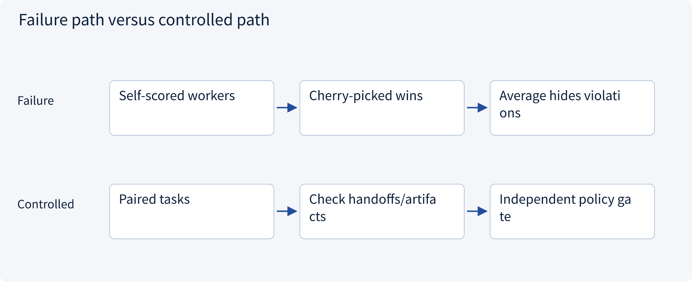
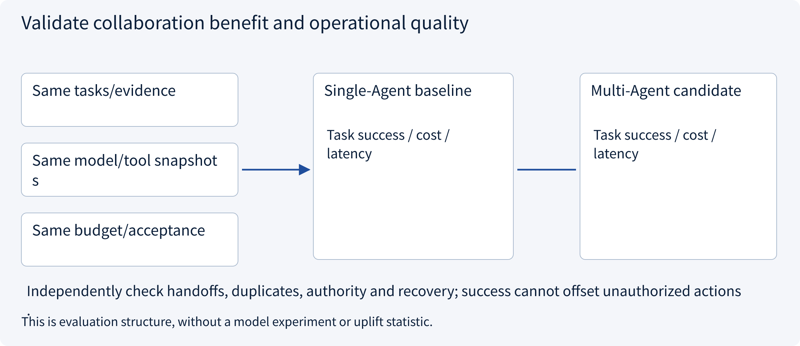
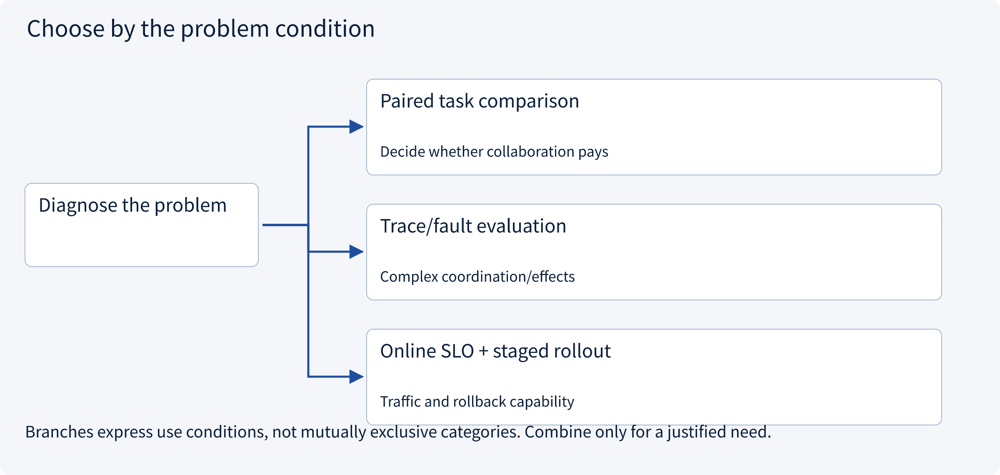
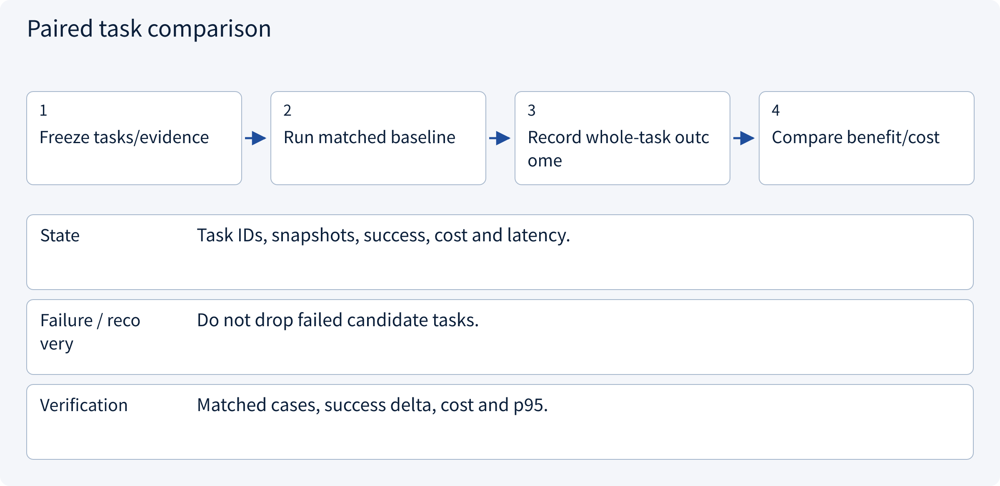
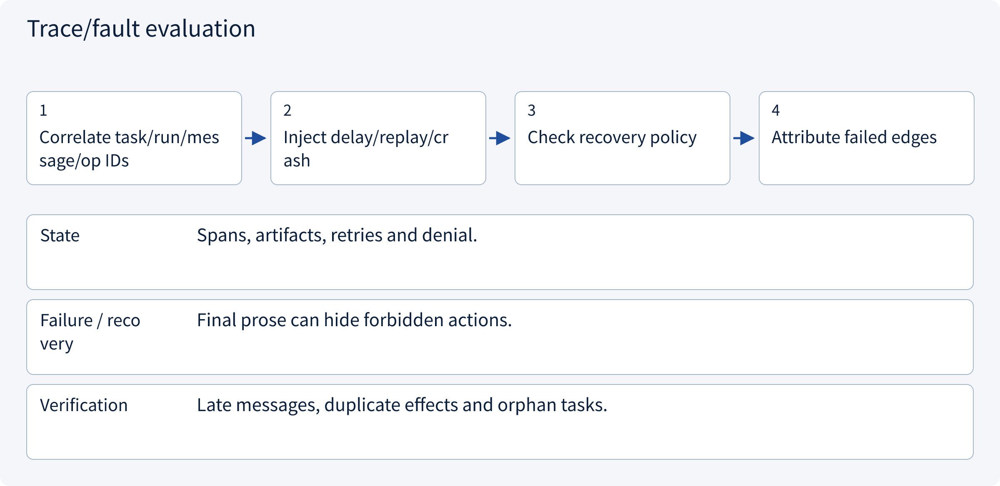
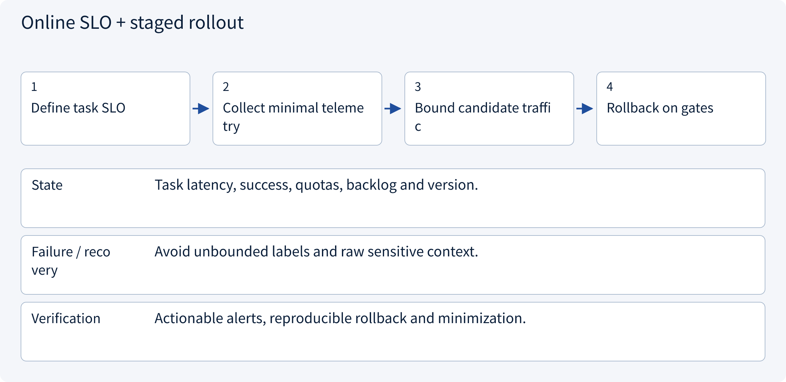

# 3.8.2 Validate collaboration benefit and operational quality

> Visual route · Established approaches · Reference code

Design reference and local contracts; no model training or measured collaboration uplift.

## Start with the problem

Why can every worker say done while the user task fails?




## See the mechanism

Compare whole tasks under matched model/tool/evidence/budget conditions. Measure artifacts, handoffs, effects and cost; trace bottlenecks and gate violations independently.



## Choose an established approach



| Approach | Mechanism | Use when | Tradeoff / boundary |
|---|---|---|---|
| Paired task comparison | Same cases for single/multi-Agent | Decide whether collaboration pays | Sample size/randomness/budget |
| Trace/fault evaluation | Inspect handoffs, state and recovery | Complex coordination/effects | Replayable events/assertions |
| Online SLO + staged rollout | Observe real traces and queues | Traffic and rollback capability | Not a substitute for offline quality |

## Inside the mainstream approaches

### 1 · Paired task comparison



**Concrete trace:** More success can still be unacceptable with violations.

### 2 · Trace/fault evaluation



**Concrete trace:** Missing required evidence fails the task despite claimed completion.

### 3 · Online SLO + staged rollout



**Concrete trace:** Tool quota saturation differs from slow final synthesis.

## Reference code

Expand the implementation corresponding to this mechanism. Training code is provided but not executed. See the reference-code guide for dependencies and verification limits.

[Reference code and verification limits](../../docs/zh/projects/03-code-guide.md)

<details><summary>Expand code and limits</summary>

```python
"""Compare matched task-level trials; operational violations are separate release gates."""

from dataclasses import dataclass
from math import ceil, isfinite


@dataclass(frozen=True)
class Trial:
    task_id: str
    success: bool
    cost: float
    latency: float
    unauthorized_actions: int


def compare(baseline: list[Trial], candidate: list[Trial]) -> dict:
    def index(rows):
        result = {x.task_id: x for x in rows}
        if not rows or len(result) != len(rows):
            raise ValueError("Missing/duplicate trials")
        if any(
            not isfinite(x.cost)
            or not isfinite(x.latency)
            or x.cost < 0
            or x.latency < 0
            or x.unauthorized_actions < 0
            for x in rows
        ):
            raise ValueError("Invalid metrics")
        return result

    old, new = index(baseline), index(candidate)
    if old.keys() != new.keys():
        raise ValueError("Compare identical tasks, not cherry-picked subsets")
    n = len(old)
    latencies = sorted(x.latency for x in candidate)
    return {
        "paired_success_delta": sum(
            int(new[k].success) - int(old[k].success) for k in old
        )
        / n,
        "added_cost": sum(new[k].cost - old[k].cost for k in old),
        "candidate_p95_latency": latencies[ceil(0.95 * n) - 1],
        "unauthorized_actions": sum(x.unauthorized_actions for x in candidate),
        "policy_gate_passed": all(x.unauthorized_actions == 0 for x in candidate),
    }


# Fix model/tool/evidence snapshots, track cost/latency per whole task and report sample size.
# This computes metrics on supplied records; no model experiment or production uplift is claimed.
```

</details>

## Required design artifact

Matched baseline/candidate tasks, trace assertions, fault injection, minimal telemetry and policy gates.

The reference checks local contract properties. Align this artifact with sessions, policy, approval, runtime, state and evaluation; an extra supervisor does not automatically solve all boundaries. No model, broker or production tool is run and no collaboration uplift is claimed.

References: [Official 1](https://opentelemetry.io/docs/concepts/signals/traces/), [Official 2](https://www.anthropic.com/research/multi-agent-research-system).


## Change a condition

Does better worker accuracy establish better system quality?

<details><summary>Suggested answer</summary>

No. Handoffs, evidence merge, budgets, latency and business acceptance also matter.

</details>

[Official sources and approach rationale](../../docs/zh/resources.md)
