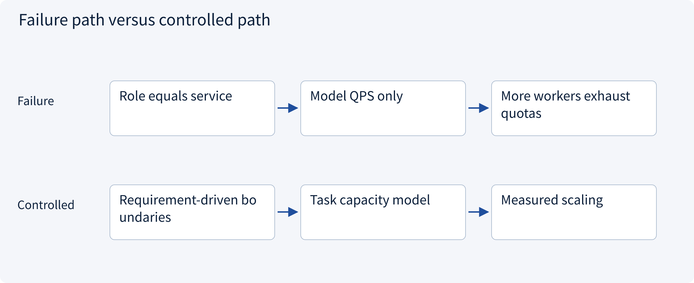
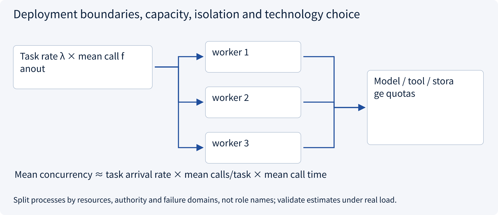
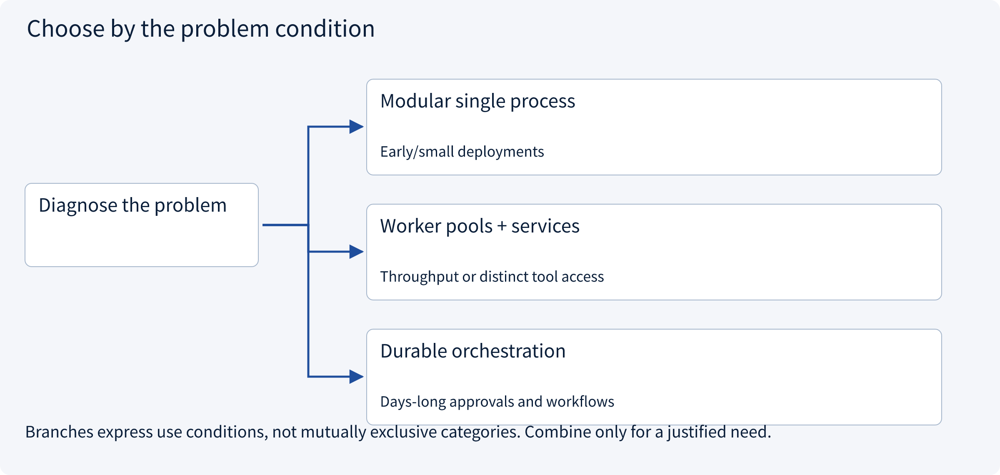
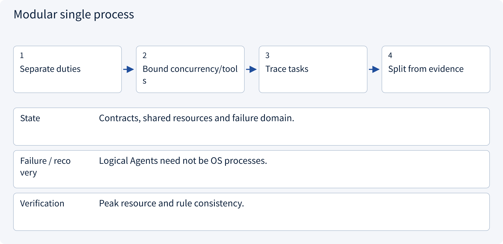
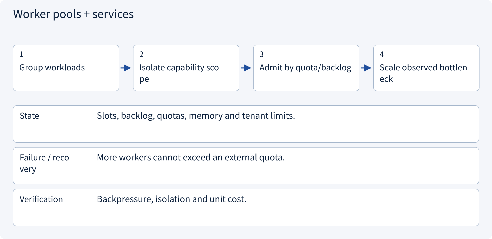
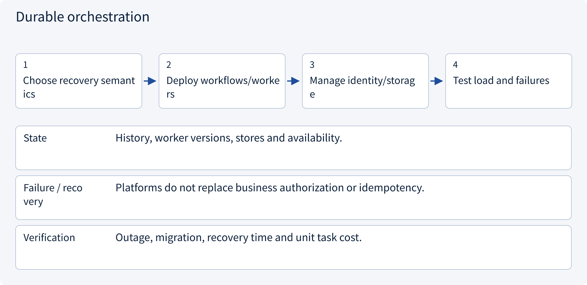

# 3.9.1 Deployment boundaries, capacity, isolation and technology choice

> Visual route · Established approaches · Reference code

Design reference and local contracts; no model training or measured collaboration uplift.

## Start with the problem

Must every Agent be a microservice, and where is the real scaling bottleneck?




## See the mechanism

Choose process boundaries from isolation, resources and independent scaling, not role names. Estimate arrival rate, fanout, mean service time and quotas, then validate under measured load/failure.



## Choose an established approach



| Approach | Mechanism | Use when | Tradeoff / boundary |
|---|---|---|---|
| Modular single process | Typed boundaries and injected adapters | Early/small deployments | Shared failure and scaling |
| Worker pools + services | Resource/permission isolation | Throughput or distinct tool access | Queues, leases and duplicates |
| Durable orchestration | Platform manages long waits/recovery | Days-long approvals and workflows | Platform, history and version governance |

## Inside the mainstream approaches

### 1 · Modular single process



**Concrete trace:** Research and writing can begin as separate work units in one process.

### 2 · Worker pools + services



**Concrete trace:** CPU parsing and remote model calls need different pool policies.

### 3 · Durable orchestration



**Concrete trace:** Use mean time for capacity; test tail latency and bursts separately.

## Reference code

Expand the implementation corresponding to this mechanism. Training code is provided but not executed. See the reference-code guide for dependencies and verification limits.

[Reference code and verification limits](../../docs/zh/projects/03-code-guide.md)

<details><summary>Expand code and limits</summary>

```python
"""A capacity estimate from measured means, not a benchmark or deployment automation."""

from math import ceil, isfinite


def worker_estimate(
    task_rate: float,
    mean_calls_per_task: float,
    mean_call_seconds: float,
    slots_per_worker: int,
    target_utilization: float,
) -> dict:
    values = (task_rate, mean_calls_per_task, mean_call_seconds, target_utilization)
    if (
        any(not isfinite(x) for x in values)
        or min(values[:3]) <= 0
        or type(slots_per_worker) is not int
        or slots_per_worker <= 0
        or not 0 < target_utilization < 1
    ):
        raise ValueError("Invalid capacity inputs")
    mean_concurrency = task_rate * mean_calls_per_task * mean_call_seconds
    workers = ceil(mean_concurrency / (slots_per_worker * target_utilization))
    return {"mean_inflight_calls": mean_concurrency, "estimated_workers": workers}


# Use measured MEAN service time in Little's-law-style estimates, not p95 as if it were a mean.
# Include retries/fanout in calls_per_task; external quotas, burst backlog and memory can dominate.
# Select process/service boundaries from isolation, scaling and ownership requirements.
```

</details>

## Required design artifact

Deployment/trust boundaries, resource capacity/quotas, scaling signals, versions and recovery exercises.

The reference checks local contract properties. Align this artifact with sessions, policy, approval, runtime, state and evaluation; an extra supervisor does not automatically solve all boundaries. No model, broker or production tool is run and no collaboration uplift is claimed.

References: [Official 1](https://www.anthropic.com/research/multi-agent-research-system).


## Change a condition

Can p95 replace mean service time in Little’s law?

<details><summary>Suggested answer</summary>

No. Mean relationships require means and assumptions; tail goals need separate validation.

</details>

[Official sources and approach rationale](../../docs/zh/resources.md)
