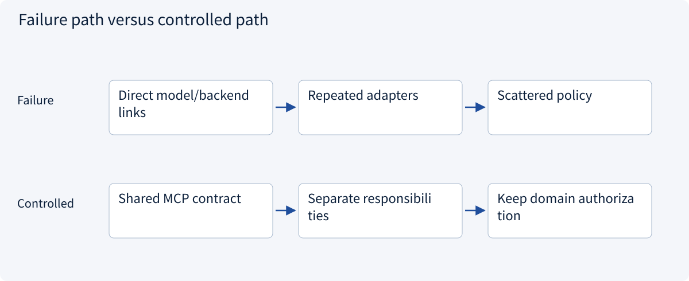
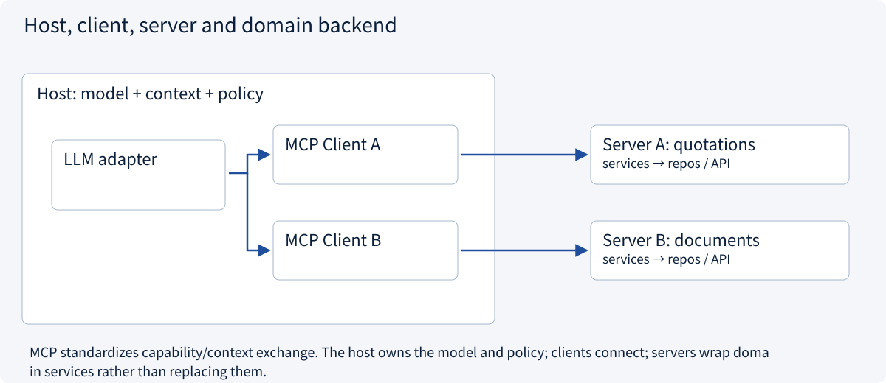
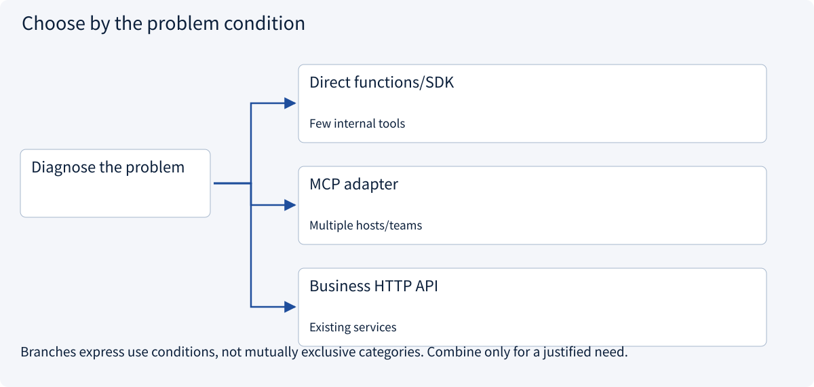

# 2.5.1 Why a protocol? Host, client and server

> Visual route · Established approaches · Reference code

Baseline: MCP 2026-07-28 and official Python SDK 2.3.0; legacy handshakes are labeled separately.

## Start with the problem

Why does every new model/tool pairing require another adapter?



## See the mechanism

MCP standardizes capability/context exchange. The host owns the model and policy; clients connect; servers wrap domain services rather than replacing them.



## Choose an established approach



| Approach | Mechanism | Use when | Tradeoff / boundary |
|---|---|---|---|
| Direct functions/SDK | Local explicit contracts | Few internal tools | Per-interface coupling |
| MCP adapter | Discover/invoke capabilities | Multiple hosts/teams | Version/auth/domain policy remain |
| Business HTTP API | Expose domain services | Existing services | MCP can wrap them |

## Reference code

Expand the implementation corresponding to this mechanism. Training code is provided but not executed. See the reference-code guide for dependencies and verification limits.

[Reference code and verification limits](../../docs/zh/projects/03-code-guide.md)

<details><summary>Expand code and limits</summary>

```python
"""Discover real SDK tool schemas in memory, without a model or a subprocess."""


async def discover_capabilities() -> dict:
    from mcp import Client

    from .mcp_server_example import build_server

    async with Client(build_server()) as client:
        tools = await client.list_tools()
        return {
            "protocol": client.protocol_version,
            "tools": [
                {"name": tool.name, "input_schema": tool.input_schema}
                for tool in tools.tools
            ],
        }


# Host owns the model and policy. Client carries MCP messages. Server exposes capabilities.
```

</details>

## Trace one quotation question

The host selects a task-scoped quotation capability. Its MCP client discovers `read_quote`; a provider adapter converts that schema into the model’s tool format. The model proposes A, the host checks scope, and the client invokes the server. Handlers parse; services authorize; repositories read. The returned 180 cents and unknown shipping become observations, not trusted instructions. Business acceptance remains outside the protocol.

MCP standardizes capability exchange. It does not replace model selection, planning, context management or approval. A server may wrap an existing business HTTP API.


## Change a condition

Has generating read_quote arguments already sent an MCP request?

<details><summary>Suggested answer</summary>

No. The host maps an authorized model proposal to a client request; generation is not execution.

</details>

[Official sources and approach rationale](../../docs/zh/resources.md)
