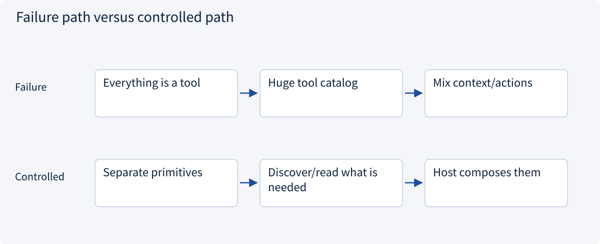
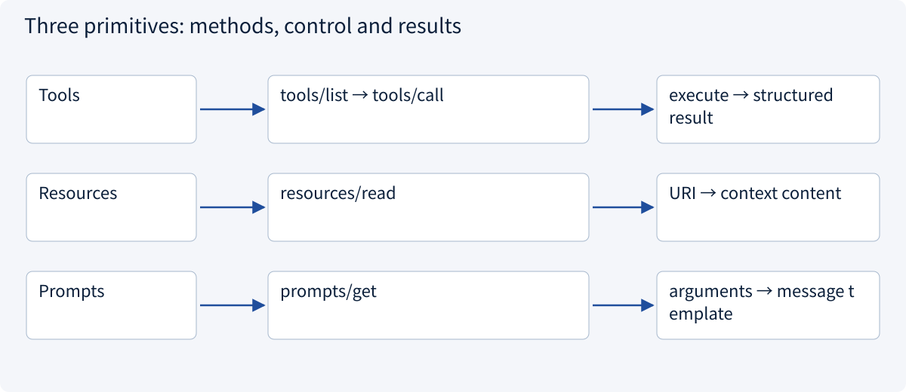
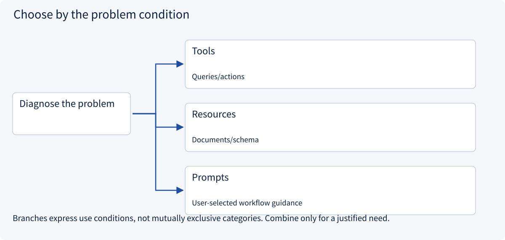

# 2.5.2 Tools, resources and prompts

> Visual route · Established approaches · Reference code

Baseline: MCP 2026-07-28 and official Python SDK 2.3.0; legacy handshakes are labeled separately.

## Start with the problem

Why not expose document context, queries and templates as one generic tool?




## See the mechanism

Tools execute capabilities; resources supply application-selected context; prompts supply selectable message templates. Each has distinct discovery and access rules.



## Choose an established approach



| Approach | Mechanism | Use when | Tradeoff / boundary |
|---|---|---|---|
| Tools | tools/list and tools/call with schemas | Queries/actions | Annotations are not enforcement |
| Resources | Read URI-addressed context | Documents/schema | Templates need separate discovery |
| Prompts | Render parameterized messages | User-selected workflow guidance | Not top-priority instructions or inference |

## Reference code

Expand the implementation corresponding to this mechanism. Training code is provided but not executed. See the reference-code guide for dependencies and verification limits.

[Reference code and verification limits](../../docs/zh/projects/03-code-guide.md)

<details><summary>Expand code and limits</summary>

```python
"""The three server primitives do different work; none needs a model to be tested."""


async def inspect_primitives() -> dict:
    from mcp import Client

    from .mcp_server_example import build_server

    async with Client(build_server()) as client:
        tool = await client.call_tool("read_quote", {"quote_id": "A"})
        resource = await client.read_resource("quote://approved/A")
        prompt = await client.get_prompt("compare_quote", {"quote_id": "A"})
        return {
            "quotation": tool.structured_content,
            "context": [item.text for item in resource.contents],
            "template": [message.content.text for message in prompt.messages],
        }


# tools/call executes a capability; resources/read reads context; prompts/get renders a template.
```

</details>

## Expose one quotation three ways

`read_quote` is an executable query with parameters. `quote://approved/A` is readable context selected by the host. `compare_quote` is a rendered message template selected for use, not a model invocation.

Fixed resources and URI templates have separate listing methods. A URI is an identifier, not necessarily a browser URL. Input/output schemas describe contracts; `content` carries displayable results and `structuredContent` carries program-readable output. SDK 2.x uses attributes such as `input_schema` and `structured_content`; it handles wire aliases. A read-only tool still executes a query, so the distinction is more than write permission.


## Change a condition

Does returning a prompt start an agent?

<details><summary>Suggested answer</summary>

No. The host decides whether to use the messages and invoke a model.

</details>

[Official sources and approach rationale](../../docs/zh/resources.md)
