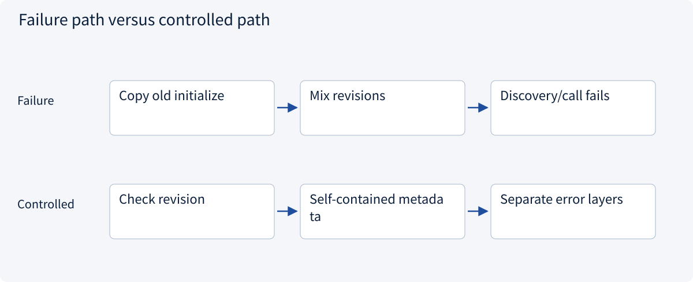
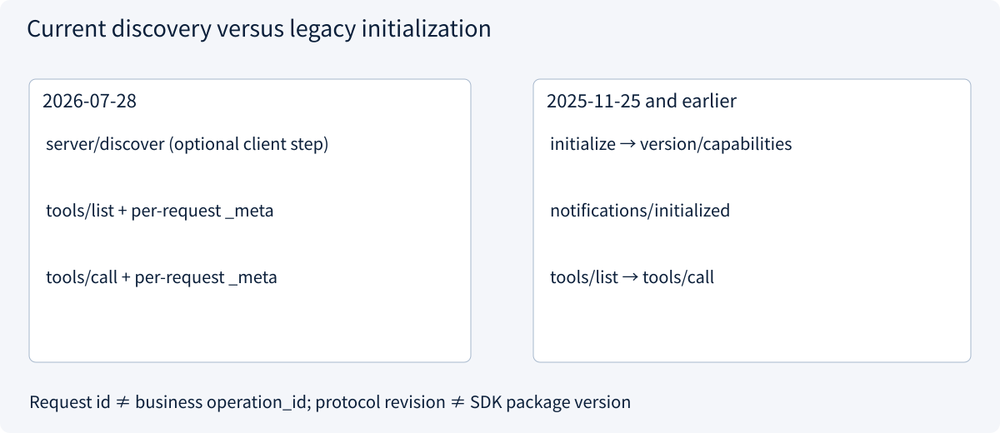
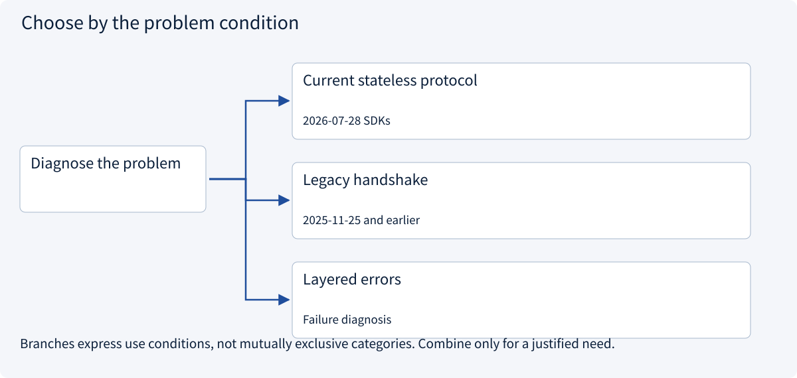

# 2.5.3 Discovery, JSON-RPC and a complete call

> Visual route · Established approaches · Reference code

Baseline: MCP 2026-07-28 and official Python SDK 2.3.0; legacy handshakes are labeled separately.

## Start with the problem

A connection is not proof of compatible versions, schemas or successful execution.




## See the mechanism

Current requests carry version metadata. Discovery is optional for clients; servers implement it. Tool listing and execution follow. Request IDs correlate responses, not durable effects.



## Choose an established approach



| Approach | Mechanism | Use when | Tradeoff / boundary |
|---|---|---|---|
| Current stateless protocol | Per-request version and discovery | 2026-07-28 SDKs | Cache needs invalidation |
| Legacy handshake | initialize then initialized | 2025-11-25 and earlier | Use matching compatibility code |
| Layered errors | RPC error versus result.isError | Failure diagnosis | Success still needs business checks |

## Reference code

Expand the implementation corresponding to this mechanism. Training code is provided but not executed. See the reference-code guide for dependencies and verification limits.

[Reference code and verification limits](../../docs/zh/projects/03-code-guide.md)

<details><summary>Expand code and limits</summary>

```python
"""Wire envelope examples, not a replacement for the official transport/SDK."""

PROTOCOL_VERSION = "2026-07-28"


def request(request_id: int, method: str, params: dict | None = None) -> dict:
    payload = dict(params or {})
    payload["_meta"] = {
        "io.modelcontextprotocol/protocolVersion": PROTOCOL_VERSION,
        "io.modelcontextprotocol/clientInfo": {
            "name": "teaching-client",
            "version": "1",
        },
    }
    return {"jsonrpc": "2.0", "id": request_id, "method": method, "params": payload}


def classify_response(message: dict) -> str:
    if "error" in message:
        return "protocol_error"
    result = message.get("result", {})
    if result.get("isError", False):
        return "tool_execution_error"
    if result.get("resultType") == "input_required":
        return "needs_follow_up"
    return "result_requires_business_validation"


# Request IDs correlate replies; they are not durable idempotency keys.
# 2025-11-25 and earlier used initialize + notifications/initialized instead.
```

</details>

## Current wire shape and failure layers

```json
{"jsonrpc":"2.0","id":3,"method":"tools/call","params":{"name":"read_quote","arguments":{"quote_id":"A"},"_meta":{"io.modelcontextprotocol/protocolVersion":"2026-07-28"}}}
```

The SDK supplies complete serialization/metadata. Discovery is required server functionality, but an optional first step for a client. Separate HTTP/transport failures, JSON-RPC errors, tool `isError`, and business acceptance. Missing delivery evidence is not a protocol error. A request ID correlates a response; it is not a persistent operation key.

Revisions through 2025-11-25 used `initialize`, then the no-ID `notifications/initialized`, then normal operation. Current stateless requests do not require that handshake. Merely changing the date string does not migrate the protocol. JSON-RPC notifications have no request ID and no corresponding reply.


## Change a condition

Is result.isError=true a JSON-RPC error?

<details><summary>Suggested answer</summary>

No. It is tool-execution failure, distinct from request/protocol failure and business acceptance.

</details>

[Official sources and approach rationale](../../docs/zh/resources.md)
