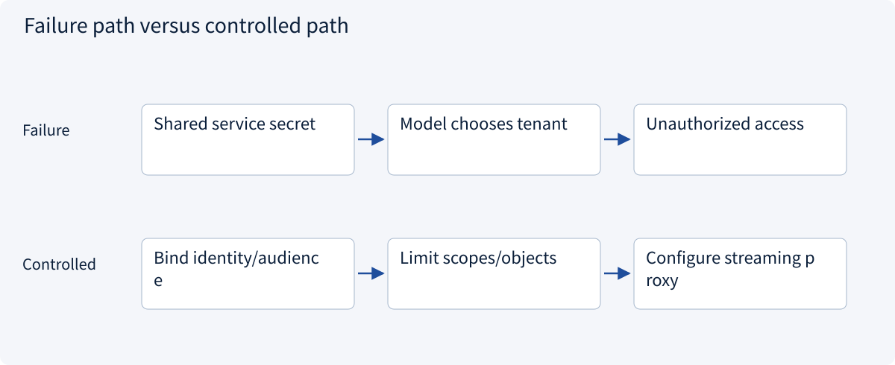
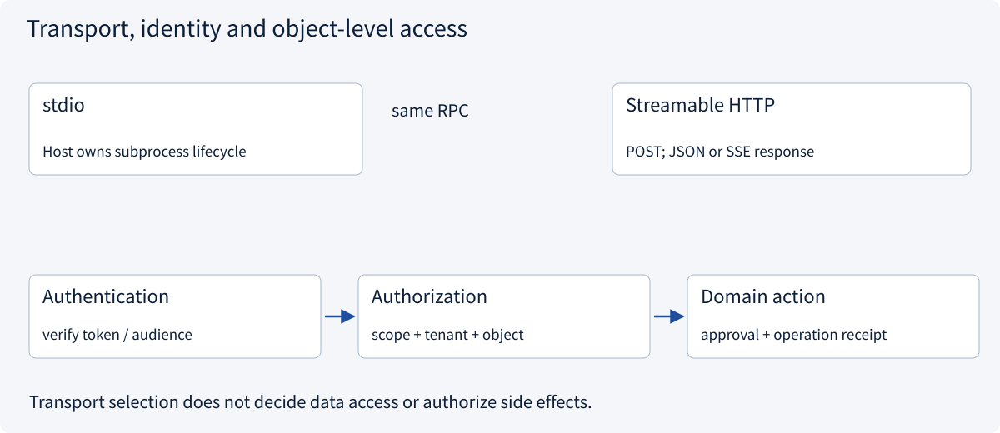
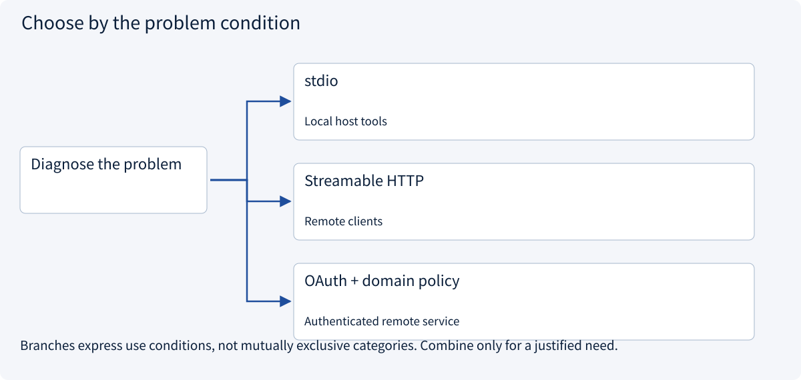

# 2.5.4 Transports and authorization

> Visual route · Established approaches · Reference code

Baseline: MCP 2026-07-28 and official Python SDK 2.3.0; legacy handshakes are labeled separately.

## Start with the problem

Local calls work, but remote clients get auth errors or interrupted streams.




## See the mechanism

Transport carries messages; authentication establishes identity; domain services enforce scope and objects. Streamable HTTP may return JSON or SSE, unlike legacy HTTP+SSE.



## Choose an established approach



| Approach | Mechanism | Use when | Tradeoff / boundary |
|---|---|---|---|
| stdio | SDK-managed subprocess and newline frames | Local host tools | Reserve stdout; close processes |
| Streamable HTTP | Independent HTTP service, optional SSE | Remote clients | TLS, Origin, buffering, timeouts |
| OAuth + domain policy | Audience-bound token then object checks | Authenticated remote service | Scope is not tenant access; no token passthrough |

## Reference code

Expand the implementation corresponding to this mechanism. Training code is provided but not executed. See the reference-code guide for dependencies and verification limits.

[Reference code and verification limits](../../docs/zh/projects/03-code-guide.md)

<details><summary>Expand code and limits</summary>

```python
"""MCP SDK 2.3.0 transport references. No connection starts on import."""


async def list_local_tools() -> list[str]:
    import sys

    from mcp import Client, StdioServerParameters

    # Command and module are trusted Host configuration, never model-generated.
    # The official SDK owns subprocess startup, stream handling and shutdown.
    parameters = StdioServerParameters(
        command=sys.executable, args=["-m", "examples.mcp_server_example"]
    )
    async with Client(parameters) as client:
        result = await client.list_tools()
        return [tool.name for tool in result.tools]


async def list_remote_tools(endpoint: str, access_token: str) -> list[str]:
    import httpx2
    from mcp import Client
    from mcp.client.streamable_http import streamable_http_client

    if not endpoint.startswith("https://"):
        raise ValueError("Use TLS for a remote authenticated endpoint")
    async with httpx2.AsyncClient(
        headers={"Authorization": f"Bearer {access_token}"},
        timeout=httpx2.Timeout(30.0, read=300.0),
    ) as http_client:
        transport = streamable_http_client(endpoint, http_client=http_client)
        async with Client(transport) as client:
            result = await client.list_tools()
            return [tool.name for tool in result.tools]


# Obtain the token via your authorization flow; do not pass an upstream service token through.
# The HTTP server must validate audience/scope and resolve object access from trusted identity.
```

</details>

## Four remote integration boundaries

The stdio host/SDK owns subprocess cleanup; stdout is the message channel and stderr carries logs. Streamable HTTP carries RPC requests and may return JSON or SSE; proxies must handle metadata, authentication and timeouts. It is not the legacy HTTP+SSE endpoint.

For a protected remote service, an OAuth flow can obtain a token intended for that MCP resource. Validate audience, expiry and scopes, then separately authorize tenant/object access. Never trust a model-generated tenant argument or transparently forward upstream credentials.

The sample client starts after token acquisition; it does not implement OAuth or launch a public server. A real deployment must add TLS, Origin checks, authentication and domain policy and validate those independently.


## Change a condition

Does a generated tenant=A argument establish membership?

<details><summary>Suggested answer</summary>

No. Derive authority from verified identity or trusted local configuration.

</details>

[Official sources and approach rationale](../../docs/zh/resources.md)
