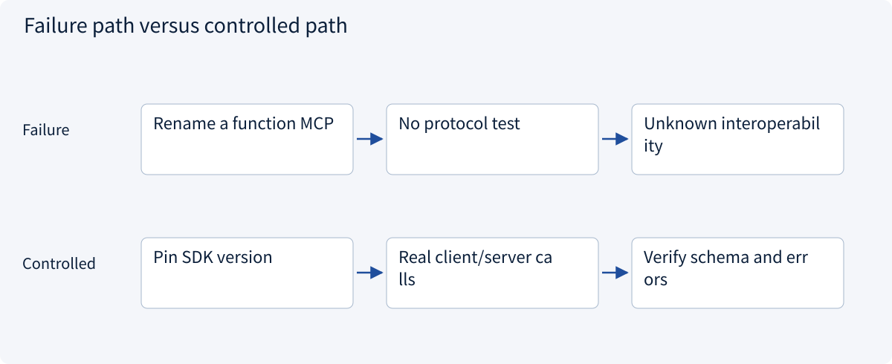
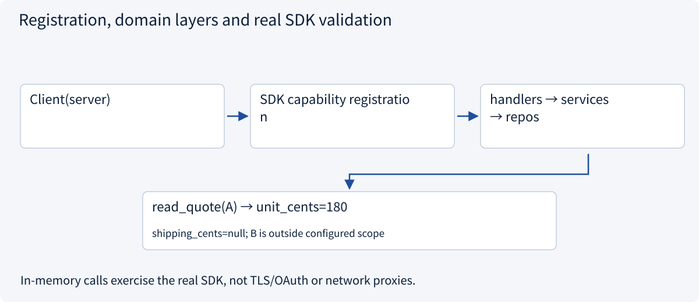
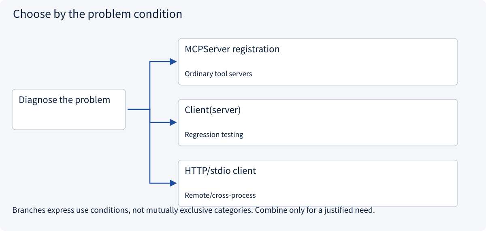

# 2.5.5 Build a real SDK server and client

> Visual route · Established approaches · Reference code

Baseline: MCP 2026-07-28 and official Python SDK 2.3.0; legacy handshakes are labeled separately.

## Start with the problem

A plain Python function is not an MCP server or an interoperability test.



## See the mechanism

Register capabilities with official MCPServer 2.3.0 and use a real Client. Domain checks remain in layered code. In-memory calls need no model.



## Choose an established approach



| Approach | Mechanism | Use when | Tradeoff / boundary |
|---|---|---|---|
| MCPServer registration | Type-hinted contracts | Ordinary tool servers | Still enforce business policy |
| Client(server) | Real SDK, no port/subprocess | Regression testing | No TLS/proxy/auth coverage |
| HTTP/stdio client | Change transport, retain capabilities | Remote/cross-process | Test network and authorization separately |

## Reference code

Expand the implementation corresponding to this mechanism. Training code is provided but not executed. See the reference-code guide for dependencies and verification limits.

[Reference code and verification limits](../../docs/zh/projects/03-code-guide.md)

<details><summary>Expand code and limits</summary>

```python
"""Official Python SDK 2.3.0; protocol 2026-07-28. No external model required."""

from .mcp_app.domain import Quote
from .mcp_app.handlers import QuoteHandlers
from .mcp_app.repos import QuoteRepository
from .mcp_app.routes import register_capabilities
from .mcp_app.services import QuoteService


def build_server(allowed_ids: frozenset[str] = frozenset({"A"})):
    from mcp.server import MCPServer  # v2; not the v1 FastMCP import path.

    repository = QuoteRepository((Quote("A", 180, None), Quote("B", 170, 80)))
    handlers = QuoteHandlers(QuoteService(repository, allowed_ids))
    server = MCPServer("Quotation teaching server")
    register_capabilities(server, handlers)
    return server


if __name__ == "__main__":
    # stdio is a protocol-defined subprocess transport. stdout is reserved for MCP.
    # SDK clients own start/close/wait/kill; diagnostics belong on stderr.
    build_server().run(transport="stdio")
```

</details>

## What the SDK example verifies

Expect discovery of `read_quote` with a required string argument. A returns 180 cents and unknown shipping. B, outside the configured scope, produces a tool error. The resource returns A as text; the prompt returns template messages without invoking a model.

The code pins official `mcp==2.3.0`, using `MCPServer` and `Client`. Old v1 `FastMCP` imports and the separate `fastmcp` project are not interchangeable APIs.

Registration binds protocol capabilities. Handlers map errors, services authorize and repositories read fictional data. The in-memory connection exercises the real SDK without a subprocess or port, but does not verify network/OAuth/proxy or other-host compatibility.


### Quotation domain

Part of the same real SDK Server assembled above.

<details><summary>Expand code and limits</summary>

```python
from dataclasses import dataclass


@dataclass(frozen=True)
class Quote:
    quote_id: str
    unit_cents: int
    shipping_cents: int | None
    currency: str = "CNY"
```

</details>

### Repository

Part of the same real SDK Server assembled above.

<details><summary>Expand code and limits</summary>

```python
from .domain import Quote


class QuoteRepository:
    def __init__(self, quotes: tuple[Quote, ...]):
        self._quotes = {quote.quote_id: quote for quote in quotes}

    def read(self, quote_id: str) -> Quote:
        quote = self._quotes.get(quote_id)
        if quote is None:
            raise LookupError("Quotation not found")
        return quote
```

</details>

### Trusted scope and resource authorization

Part of the same real SDK Server assembled above.

<details><summary>Expand code and limits</summary>

```python
from .domain import Quote
from .repos import QuoteRepository


class QuoteService:
    def __init__(self, repository: QuoteRepository, allowed_ids: frozenset[str]):
        self._repository = repository
        self._allowed_ids = allowed_ids  # Trusted configuration, not model arguments.

    def read(self, quote_id: str) -> Quote:
        if quote_id not in self._allowed_ids:
            raise PermissionError("Quotation is outside the permitted scope")
        return self._repository.read(quote_id)
```

</details>

### Handlers and protocol error mapping

Part of the same real SDK Server assembled above.

<details><summary>Expand code and limits</summary>

```python
from dataclasses import asdict

from .services import QuoteService


class QuoteHandlers:
    def __init__(self, service: QuoteService):
        self._service = service

    def read_quote(self, quote_id: str) -> dict[str, str | int | None]:
        """Read one authorized fictional quotation. No write or order action."""
        from mcp.server.mcpserver.exceptions import ToolError

        try:
            return asdict(self._service.read(quote_id))
        except (PermissionError, LookupError) as error:
            raise ToolError("Quotation unavailable in current scope") from error

    def quote_resource(self) -> str:
        """Read the approved quotation as textual context."""
        from mcp.server.mcpserver.exceptions import ResourceError

        try:
            quote = self._service.read("A")
        except (PermissionError, LookupError) as error:
            raise ResourceError("Quotation context unavailable") from error
        return f"Quote A: {quote.unit_cents} cents per unit; shipping unknown."

    def compare_prompt(self, quote_id: str) -> str:
        """Return a user-selectable template; this does not run a model."""
        return (
            f"Compare quotation {quote_id!r} using authorized sources. "
            "Keep missing shipping and unsupported facts unknown. Do not place an order."
        )
```

</details>

### Register Tool, Resource and Prompt

Part of the same real SDK Server assembled above.

<details><summary>Expand code and limits</summary>

```python
from .handlers import QuoteHandlers


def register_capabilities(server, handlers: QuoteHandlers) -> None:
    # Registration only: parsing/error mapping is in handlers, business rules in services.
    server.tool(name="read_quote")(handlers.read_quote)
    server.resource("quote://approved/A")(handlers.quote_resource)
    server.prompt(name="compare_quote")(handlers.compare_prompt)
```

</details>

## Change a condition

Does an in-memory pass prove remote OAuth deployment works?

<details><summary>Suggested answer</summary>

No. It verifies protocol behavior and domain rules, not transport infrastructure or OAuth.

</details>

[Official sources and approach rationale](../../docs/zh/resources.md)
