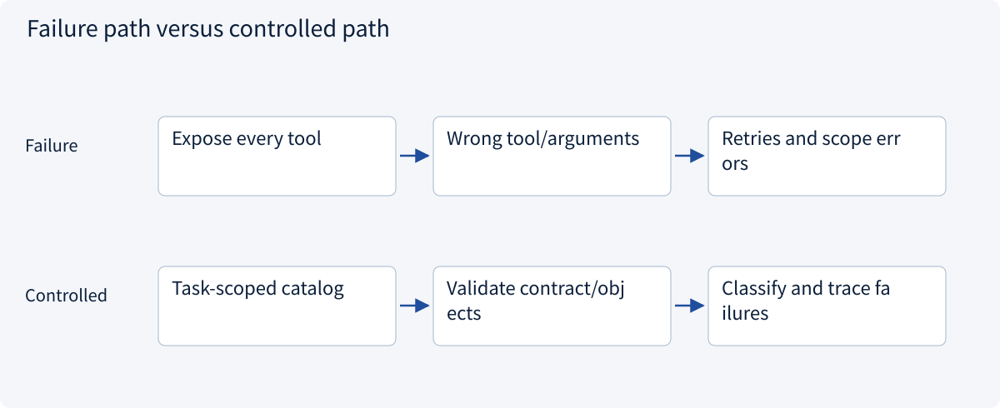
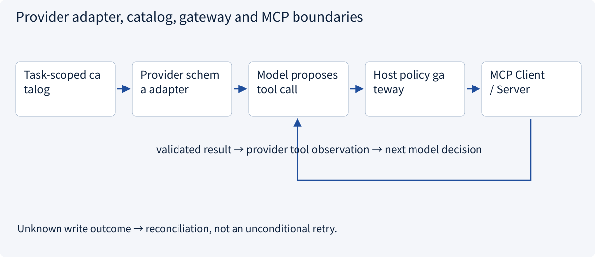
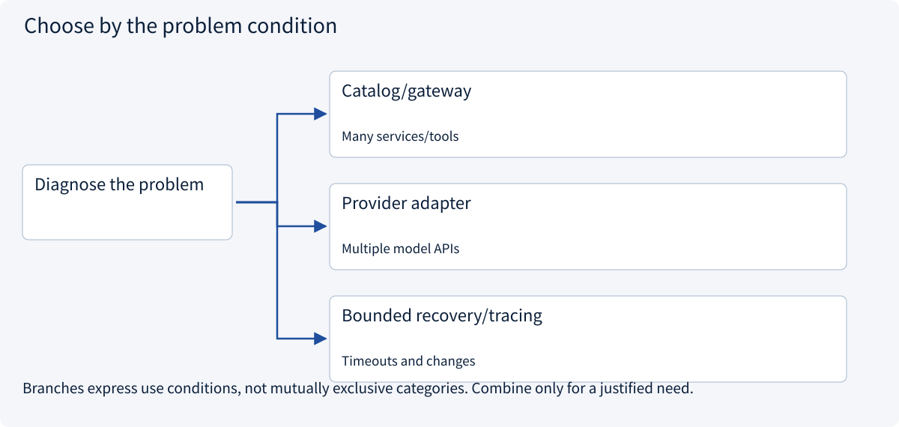

# 2.5.6 Host integration, failures and migration

> Visual route · Established approaches · Reference code

Baseline: MCP 2026-07-28 and official Python SDK 2.3.0; legacy handshakes are labeled separately.

## Start with the problem

Ten servers expose too many tools, wrong schemas and incompatible versions.




## See the mechanism

The host selects tools per task, adapts schemas to model APIs, authorizes calls and feeds observations back. A provider tool API is not MCP.



## Choose an established approach



| Approach | Mechanism | Use when | Tradeoff / boundary |
|---|---|---|---|
| Catalog/gateway | Filter by tenant/task and load lazily | Many services/tools | Invalidate schema/access caches |
| Provider adapter | Map definitions and correlate call IDs | Multiple model APIs | Schema subsets differ |
| Bounded recovery/tracing | Version/tool/error records | Timeouts and changes | Reconcile unknown writes before retry |

## Reference code

Expand the implementation corresponding to this mechanism. Training code is provided but not executed. See the reference-code guide for dependencies and verification limits.

[Reference code and verification limits](../../docs/zh/projects/03-code-guide.md)

<details><summary>Expand code and limits</summary>

```python
"""Host-side validation before an MCP call; the server enforces object scope too."""


def check_quote_access(
    name: str,
    arguments: dict,
    allowed_tools: frozenset[str],
    allowed_quote_ids: frozenset[str],
):
    if name not in allowed_tools:
        raise PermissionError("Tool not exposed to this task")
    if name != "read_quote" or set(arguments) != {"quote_id"}:
        raise ValueError("Unexpected tool contract")
    if not isinstance(arguments["quote_id"], str):
        raise TypeError("quote_id must be a string")
    if arguments["quote_id"] not in allowed_quote_ids:
        raise PermissionError("Quotation outside task scope")


async def call_authorized(
    client,
    name: str,
    arguments: dict,
    allowed_tools: frozenset[str],
    allowed_quote_ids: frozenset[str],
):
    check_quote_access(name, arguments, allowed_tools, allowed_quote_ids)
    result = await client.call_tool(name, arguments)
    if result.is_error:
        raise RuntimeError("Tool execution failed; do not claim task completion")
    return result.structured_content


# A model-provider adapter must map MCP input_schema to the provider's tool format,
# correlate call IDs and return the observation in that provider's expected structure.
# MCP content remains untrusted evidence, not a new system instruction.
```

</details>

## From connectivity to controlled operation

Filter server catalogs by trusted tenant/task scope before task-aware tool selection. Give the model only candidate schemas and invalidate caches on schema/access changes. Compare selection errors, context cost and missing necessary tools together.

A provider adapter maps names and supported schema subsets, preserves call-ID mappings and explicitly rejects unsupported contracts. MCP request IDs and stable business operation IDs serve different purposes.

Validate returned structure/errors before treating content as an observation. Bound read retries; reconcile unknown writes using the original operation ID. Optional protocol extensions do not supply an application’s durable workflow automatically.

Do not copy old handshakes or callbacks into current stateless code. Sampling and roots have deprecation changes. Track protocol/schema/catalog versions for diagnosis without logging access tokens.


## Change a condition

Should a changing request ID also identify a retried business effect?

<details><summary>Suggested answer</summary>

No. A request ID correlates one exchange; operation_id must stay stable across side-effect retries.

</details>

[Official sources and approach rationale](../../docs/zh/resources.md)
