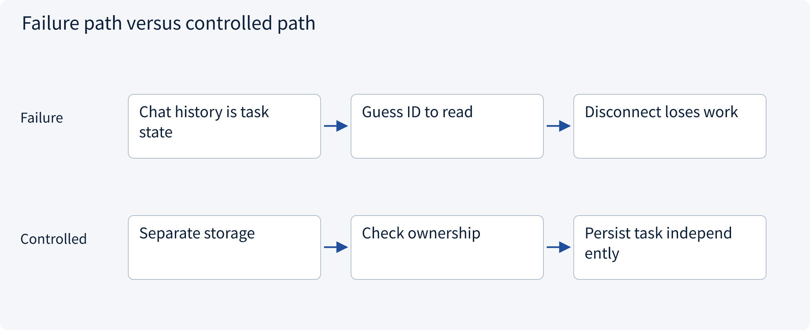
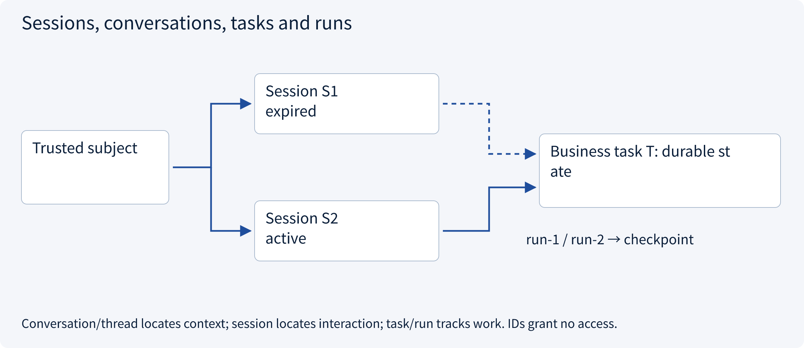
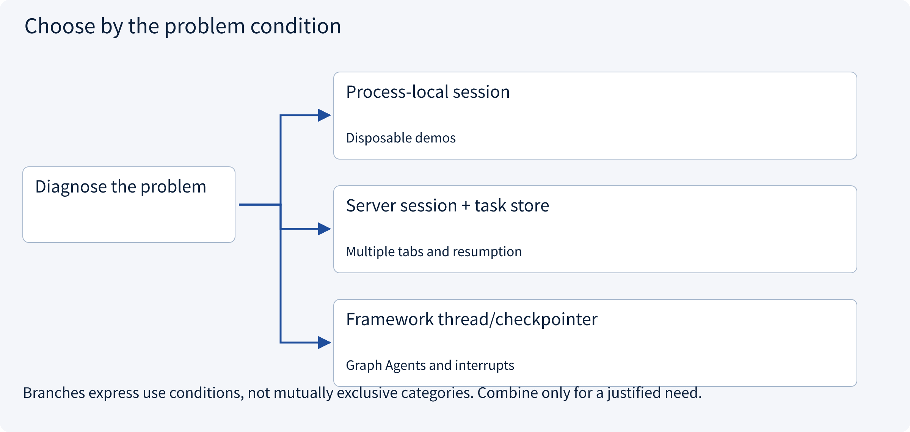
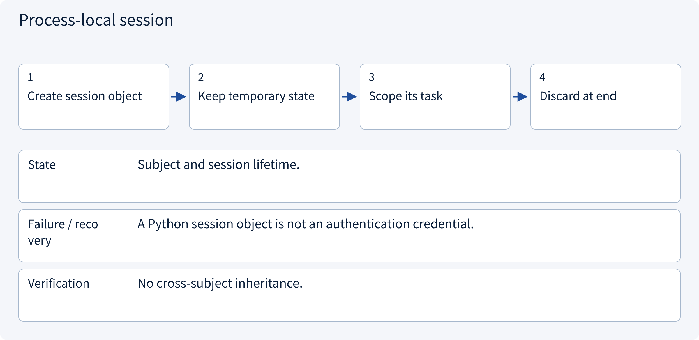
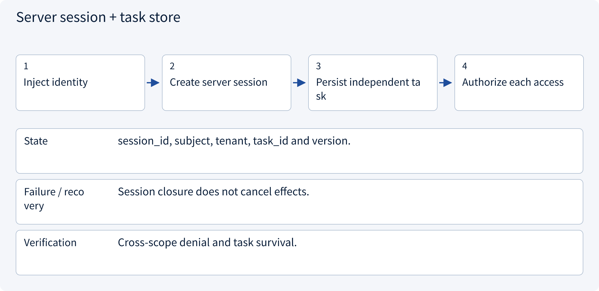
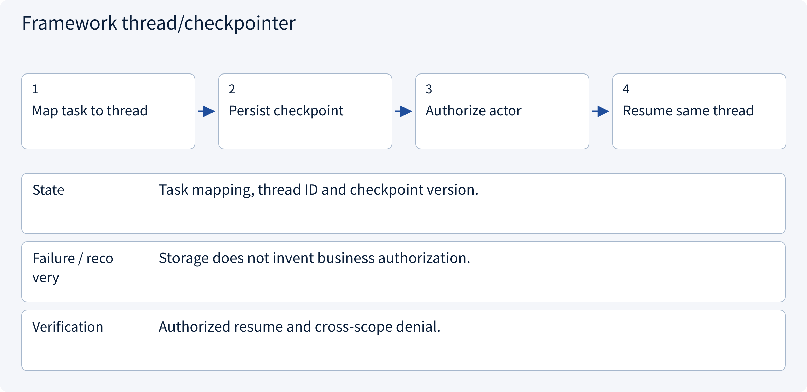

# 3.3.1 Sessions, conversations, tasks and runs

> Visual route · Established approaches · Reference code

Local reference: trusted identity injection and SQLite transactions, without a login server or remote writes.

## Start with the problem

Why should tasks survive page refresh or session expiry? Does knowing thread_id grant access?




## See the mechanism

Identity, application session, conversation, task and run have different lifetimes. Locators grant no authority; resumption requires fresh trusted identity and scope checks.



## Choose an established approach



| Approach | Mechanism | Use when | Tradeoff / boundary |
|---|---|---|---|
| Process-local session | Keep temporary messages/state | Disposable demos | No crash durability |
| Server session + task store | Bind trusted subject; persist tasks separately | Multiple tabs and resumption | Expiry, revocation and ownership design |
| Framework thread/checkpointer | Locate execution state by stable thread | Graph Agents and interrupts | Thread IDs are not credentials |

## Inside the mainstream approaches

### 1 · Process-local session



**Concrete trace:** The Skills Session is only a context container.

### 2 · Server session + task store



**Concrete trace:** Alice resumes in a new session; Bob cannot use a guessed task ID.

### 3 · Framework thread/checkpointer



**Concrete trace:** Authorize access before loading a LangGraph thread.

## Reference code

Expand the implementation corresponding to this mechanism. Training code is provided but not executed. See the reference-code guide for dependencies and verification limits.

[Reference code and verification limits](../../docs/zh/projects/03-code-guide.md)

<details><summary>Expand code and limits</summary>

```python
"""Application session, task and run are distinct identifiers and lifetimes."""

from .governance.repos import GovernanceRepository
from .governance.sessions import SessionService


def session_service(connection) -> SessionService:
    return SessionService(GovernanceRepository(connection))


# Identity comes from real authentication middleware in deployment; no login server is built.
# A conversation/thread ID locates context; it is never an access credential.
# resume() rechecks current session/membership and uses task-version CAS in one transaction.
```

</details>

## Required design artifact

Identity/session/conversation/task/run IDs and lifetimes, with access checks for each locator.

The reference implements application sessions and pending draft preparation, not OIDC, cookies or credential issuance. Local RBAC+ABAC does not deploy OPA/Cedar/OpenFGA. Membership changes increment one global policy epoch, conservatively invalidating approvals; production can version facts more narrowly.

Consumption prepares a pending local operation, not a remote write. Workers recheck current revocation/policy before fresh effects and query existing UNKNOWN outcomes. Session expiry does not erase tasks or issued effects.

References: [Official 1](https://cheatsheetseries.owasp.org/cheatsheets/Session_Management_Cheat_Sheet.html), [Official 2](https://docs.langchain.com/oss/python/langgraph/persistence).


### Identity, context and action contracts

Local architecture reference without live external effects.

<details><summary>Expand code and limits</summary>

```python
import hashlib
import json
from dataclasses import asdict, dataclass


@dataclass(frozen=True)
class Principal:
    subject: (
        str  # Supplied by trusted authentication middleware, never by model arguments.
    )


@dataclass(frozen=True)
class Context:
    subject: str
    tenant: str
    session_id: str


@dataclass(frozen=True)
class Action:
    tenant: str
    task_id: str
    operation: str
    resource_id: str
    amount_cents: int
    recipient: str
    evidence_version: int
    currency: str = "CNY"

    def validate(self) -> None:
        if self.operation != "create_draft" or any(
            not isinstance(value, str) or not value
            for value in (self.tenant, self.task_id, self.resource_id, self.recipient)
        ):
            raise ValueError("Unsupported or incomplete action")
        if self.currency != "CNY":
            raise ValueError("This reference supports only canonical CNY amounts")
        if (
            type(self.amount_cents) is not int
            or self.amount_cents <= 0
            or type(self.evidence_version) is not int
            or self.evidence_version <= 0
        ):
            raise ValueError("Invalid amount or evidence version")

    def payload(self) -> str:
        self.validate()
        return json.dumps(
            asdict(self), sort_keys=True, separators=(",", ":"), allow_nan=False
        )

    def fingerprint(self) -> str:
        return hashlib.sha256(self.payload().encode()).hexdigest()


@dataclass(frozen=True)
class Decision:
    allowed: bool
    needs_approval: bool
    reason: str
    policy_version: int
```

</details>

### Session/task lifecycle service

Local architecture reference without live external effects.

<details><summary>Expand code and limits</summary>

```python
"""Application-session service; authentication and browser cookies are separate concerns."""

from uuid import uuid4

from .domain import Context, Principal
from .repos import GovernanceRepository


class SessionService:
    def __init__(self, repository: GovernanceRepository):
        self.repository = repository

    def open(
        self, identity: Principal, tenant: str, now: int, lifetime: int = 3600
    ) -> str:
        if lifetime <= 0:
            raise ValueError("Invalid lifetime")
        with self.repository.transaction():
            if self.repository.member(identity.subject, tenant) is None:
                raise PermissionError("No tenant membership")
            key = uuid4().hex
            self.repository.create_session(
                key, identity.subject, tenant, now + lifetime
            )
        return key

    def context(self, identity: Principal, session_id: str, now: int) -> Context:
        row = self.repository.get("sessions", "session_id", session_id)
        if (
            row["subject"] != identity.subject
            or row["revoked"]
            or row["expires_at"] <= now
        ):
            raise PermissionError("Session unavailable or expired")
        if self.repository.member(identity.subject, row["tenant"]) is None:
            raise PermissionError("Tenant membership revoked")
        return Context(identity.subject, row["tenant"], session_id)

    def close(self, identity: Principal, session_id: str, now: int) -> None:
        with self.repository.transaction():
            self.context(identity, session_id, now)
            self.repository.revoke_session(session_id)
        # Closing a session neither deletes task state nor proves an external action was cancelled.

    def task(self, context: Context, task_id: str) -> dict:
        row = self.repository.get("tasks", "task_id", task_id)
        if row["tenant"] != context.tenant or row["owner"] != context.subject:
            raise PermissionError("Task outside actor scope")
        return row

    def create_task(
        self,
        identity: Principal,
        session_id: str,
        task_id: str,
        conversation_id: str,
        resource: str,
        now: int,
    ) -> None:
        with self.repository.transaction():
            context = self.context(identity, session_id, now)
            self.repository.create_task(
                task_id, context.tenant, context.subject, conversation_id, resource
            )

    def resume(
        self,
        identity: Principal,
        session_id: str,
        task_id: str,
        run_id: str,
        expected_version: int,
        now: int,
    ) -> None:
        with self.repository.transaction():
            context = self.context(identity, session_id, now)
            task = self.task(context, task_id)
            member = self.repository.member(context.subject, context.tenant)
            if member["role"] not in {"operator", "lead"}:
                raise PermissionError("Current role cannot resume work")
            self.repository.resume(task, session_id, run_id, expected_version)
```

</details>

## Change a condition

Does logout automatically revoke an issued remote write?

<details><summary>Suggested answer</summary>

No. Session invalidation, task cancellation and remote reconciliation are distinct.

</details>

[Official sources and approach rationale](../../docs/zh/resources.md)
