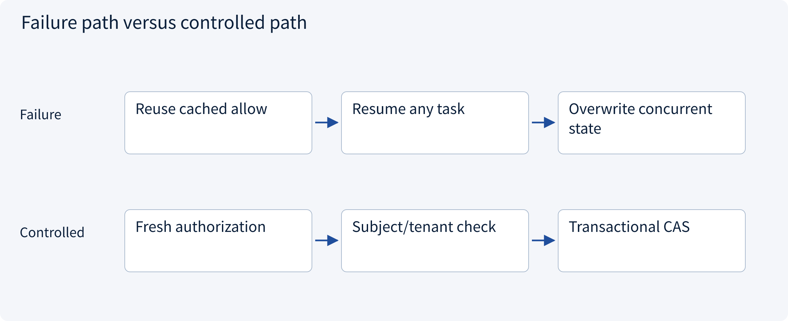
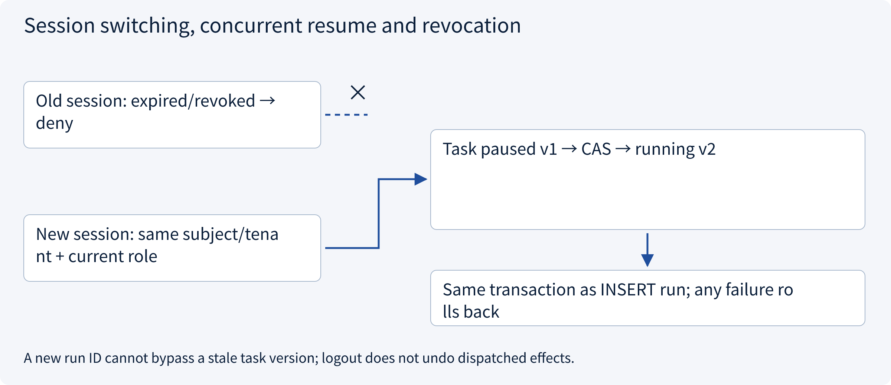
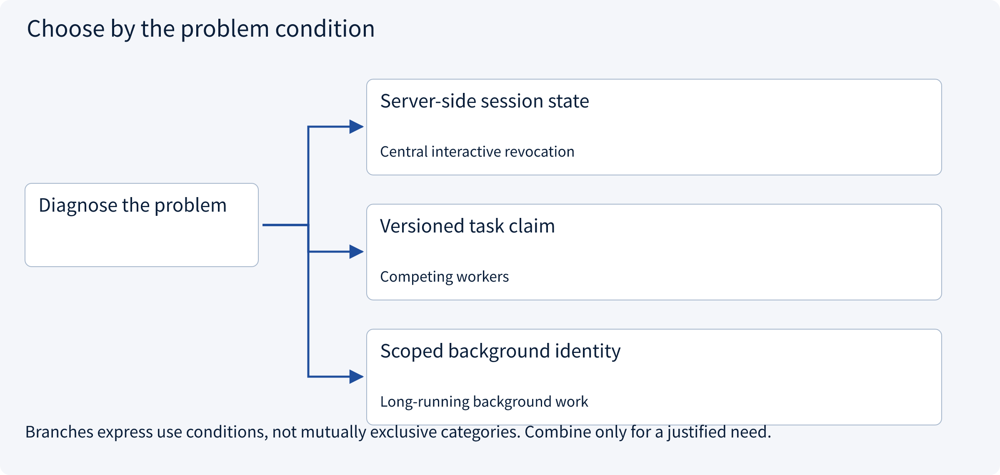
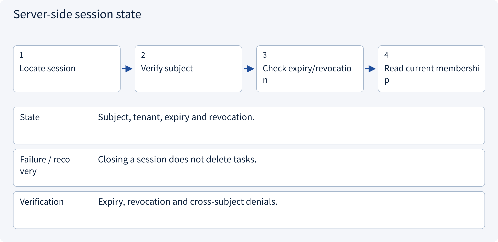
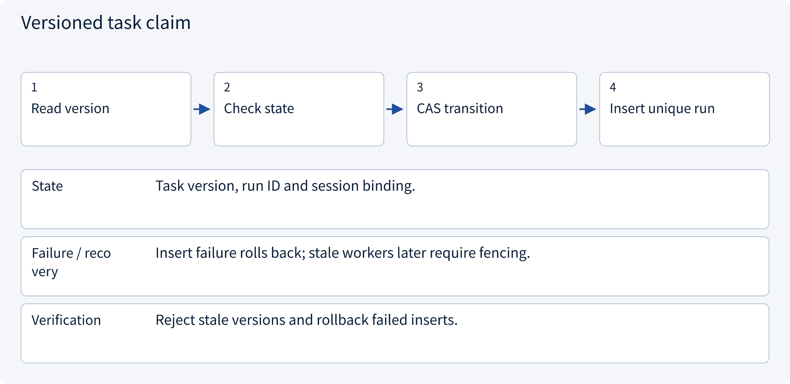
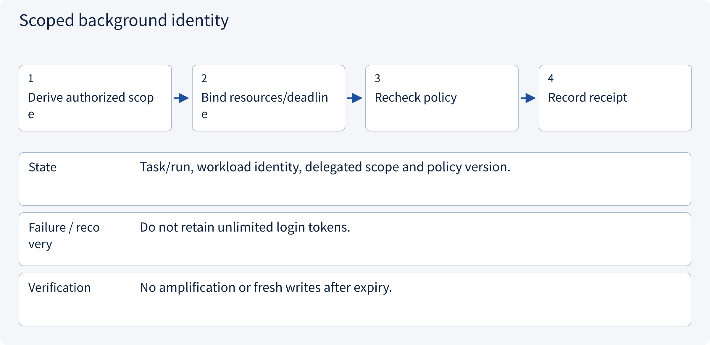

# 3.3.2 Session switching, concurrent resume and revocation

> Visual route · Established approaches · Reference code

Local reference: trusted identity injection and SQLite transactions, without a login server or remote writes.

## Start with the problem

How can a new session resume work without cross-tenant access, stale authority or competing workers?




## See the mechanism

Recheck current session and policy, then claim a task with an expected version and a new run. Conversation text cannot establish execution ownership.



## Choose an established approach



| Approach | Mechanism | Use when | Tradeoff / boundary |
|---|---|---|---|
| Server-side session state | Query expiry/revocation | Central interactive revocation | Storage availability/cost |
| Versioned task claim | CAS and run insertion atomically | Competing workers | Lease/fencing/timeouts still needed |
| Scoped background identity | Separate short-lived task authority | Long-running background work | Workload identity and revocation |

## Inside the mainstream approaches

### 1 · Server-side session state



**Concrete trace:** An expired session fails; a new authorized session can resume.

### 2 · Versioned task claim



**Concrete trace:** Two v1 claims produce only one v2 transition.

### 3 · Scoped background identity



**Concrete trace:** Next-day approval resumes via a worker identity, not yesterday’s browser cookie.

## Reference code

Expand the implementation corresponding to this mechanism. Training code is provided but not executed. See the reference-code guide for dependencies and verification limits.

[Reference code and verification limits](../../docs/zh/projects/03-code-guide.md)

<details><summary>Expand code and limits</summary>

```python
"""Resume the same task from a new authorized session; use a fresh run ID."""

from .governance.domain import Principal
from .session_lifecycle import session_service


def resume_task(
    connection,
    actor: Principal,
    session_id: str,
    task_id: str,
    run_id: str,
    expected_version: int,
    now: int,
) -> None:
    session_service(connection).resume(
        actor, session_id, task_id, run_id, expected_version, now
    )


# The CAS and run insert are one transaction. Reusing an old task version is rejected.
# A new session is allowed only for the same authorized subject and tenant.
```

</details>

## Required design artifact

Session revocation/expiry, task claim state machine, CAS conflicts and background identity policy.

The reference implements application sessions and pending draft preparation, not OIDC, cookies or credential issuance. Local RBAC+ABAC does not deploy OPA/Cedar/OpenFGA. Membership changes increment one global policy epoch, conservatively invalidating approvals; production can version facts more narrowly.

Consumption prepares a pending local operation, not a remote write. Workers recheck current revocation/policy before fresh effects and query existing UNKNOWN outcomes. Session expiry does not erase tasks or issued effects.

References: [Official 1](https://cheatsheetseries.owasp.org/cheatsheets/Session_Management_Cheat_Sheet.html).


### Persistence constraints

<details><summary>Expand code and limits</summary>

```sql
PRAGMA foreign_keys=ON;
CREATE TABLE policy_epoch (singleton INTEGER PRIMARY KEY CHECK(singleton=1), version INTEGER NOT NULL);
INSERT INTO policy_epoch VALUES(1,1);
CREATE TABLE members (
    subject TEXT NOT NULL, tenant TEXT NOT NULL, role TEXT NOT NULL, limit_cents INTEGER NOT NULL,
    PRIMARY KEY(subject,tenant)
);
CREATE TABLE sessions (
    session_id TEXT PRIMARY KEY, subject TEXT NOT NULL, tenant TEXT NOT NULL,
    expires_at INTEGER NOT NULL, revoked INTEGER NOT NULL DEFAULT 0
);
CREATE TABLE tasks (
    task_id TEXT PRIMARY KEY, tenant TEXT NOT NULL, owner TEXT NOT NULL,
    conversation_id TEXT NOT NULL, resource_id TEXT NOT NULL, evidence_version INTEGER NOT NULL DEFAULT 1,
    state TEXT NOT NULL CHECK(state IN ('paused','running','awaiting_approval','queued')),
    version INTEGER NOT NULL DEFAULT 1
);
CREATE TABLE runs (
    run_id TEXT PRIMARY KEY, task_id TEXT NOT NULL REFERENCES tasks(task_id),
    session_id TEXT NOT NULL REFERENCES sessions(session_id), task_version INTEGER NOT NULL
);
CREATE TABLE approvals (
    approval_id TEXT PRIMARY KEY, task_id TEXT NOT NULL REFERENCES tasks(task_id),
    tenant TEXT NOT NULL, requester TEXT NOT NULL, approver TEXT,
    action_json TEXT NOT NULL, action_hash TEXT NOT NULL, policy_version INTEGER NOT NULL,
    expires_at INTEGER NOT NULL,
    status TEXT NOT NULL CHECK(status IN ('pending','approved','consumed','revoked'))
);
CREATE TABLE operations (
    operation_id TEXT PRIMARY KEY, approval_id TEXT NOT NULL UNIQUE REFERENCES approvals(approval_id),
    task_id TEXT NOT NULL REFERENCES tasks(task_id), tenant TEXT NOT NULL,
    action_json TEXT NOT NULL, action_hash TEXT NOT NULL, state TEXT NOT NULL DEFAULT 'pending'
);
```

</details>

## Change a condition

Can a new run_id bypass a stale task version?

<details><summary>Suggested answer</summary>

No. Run identity and task ownership/version checks serve separate purposes.

</details>

[Official sources and approach rationale](../../docs/zh/resources.md)
