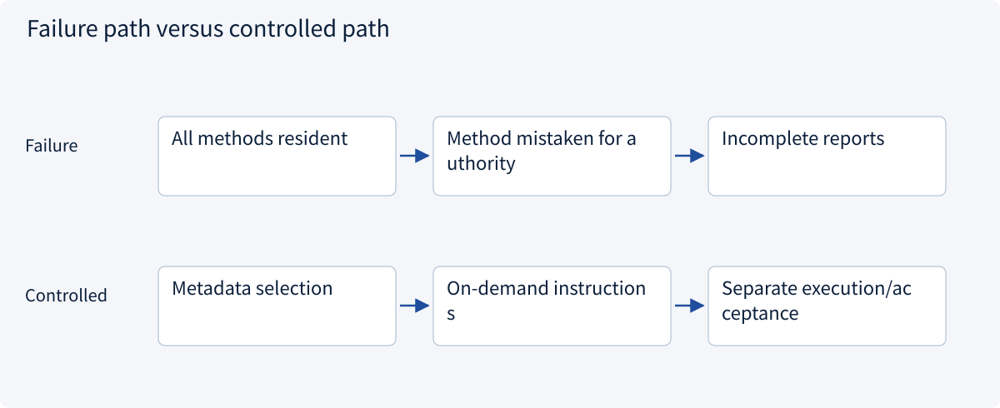
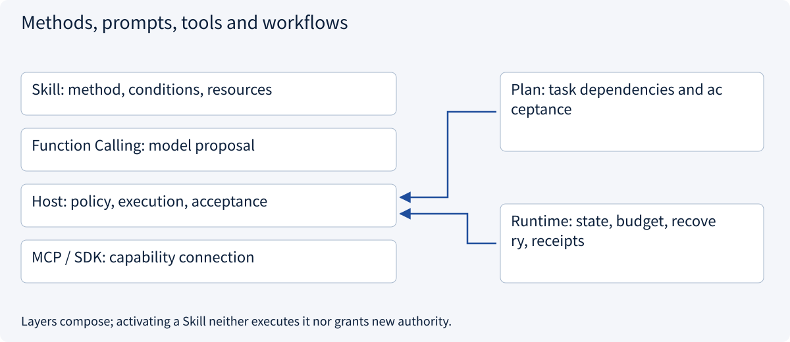
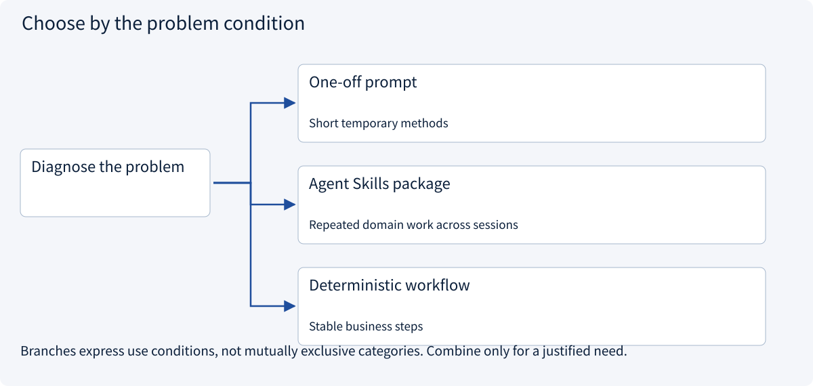
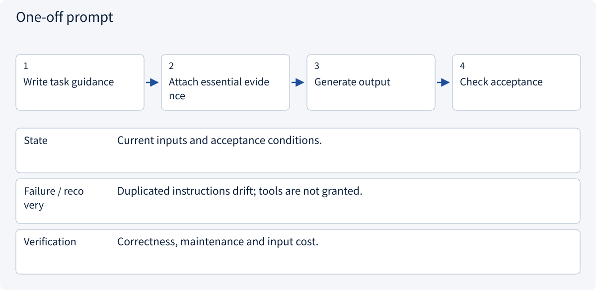
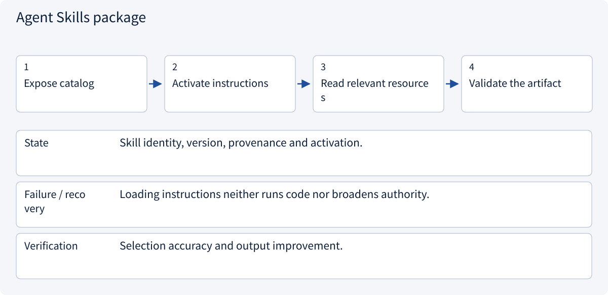
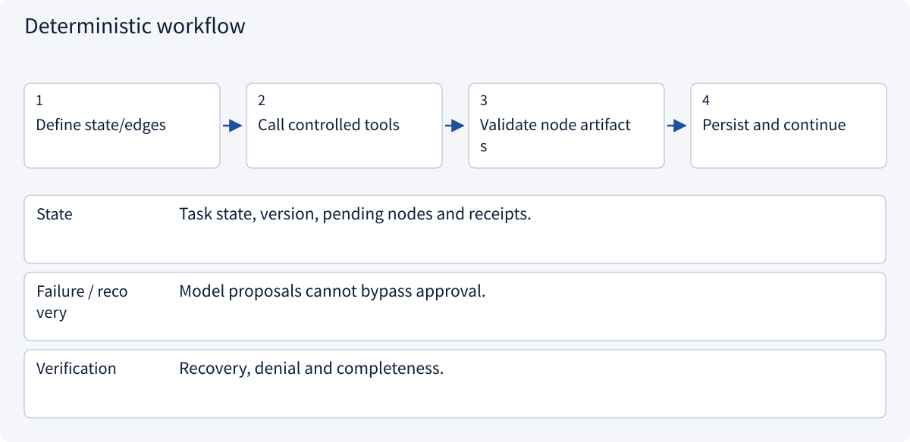

# 2.6.1 Methods, prompts, tools and workflows

> Visual route · Established approaches · Reference code

Based on Agent Skills format; version pins, bundle digests and tool bindings are example Host conventions, not execution authority.

## Start with the problem

Why do copied instructions still miss conditions or choose the wrong tool? Does storing them as a Skill execute anything?




## See the mechanism

A Skill packages a reusable method and resources. Models select methods and propose actions; the Host owns context, execution and policy. A plan tracks this task; MCP connects external capabilities.



## Choose an established approach



| Approach | Mechanism | Use when | Tradeoff / boundary |
|---|---|---|---|
| One-off prompt | Specify guidance in this task | Short temporary methods | Duplication and version drift |
| Agent Skills package | Load method/resources on demand | Repeated domain work across sessions | Discovery, selection and versioning |
| Deterministic workflow | Code controls edges and acceptance | Stable business steps | Open reasoning cannot all become branches |

## Inside the mainstream approaches

### 1 · One-off prompt



**Concrete trace:** A short temporary rewrite can use an ordinary prompt.

<details><summary>Expand steps, state and failure boundaries</summary>

1. Write task guidance
2. Attach essential evidence
3. Generate output
4. Check acceptance

**State** Current inputs and acceptance conditions.

**Failure / recovery** Duplicated instructions drift; tools are not granted.

**Verification** Correctness, maintenance and input cost.

</details>

### 2 · Agent Skills package



**Concrete trace:** Review instructions preserve unknown shipping; tools supply quotations.

<details><summary>Expand steps, state and failure boundaries</summary>

1. Expose catalog
2. Activate instructions
3. Read relevant resources
4. Validate the artifact

**State** Skill identity, version, provenance and activation.

**Failure / recovery** Loading instructions neither runs code nor broadens authority.

**Verification** Selection accuracy and output improvement.

</details>

### 3 · Deterministic workflow



**Concrete trace:** The service enforces draft approval independently of the Skill.

<details><summary>Expand steps, state and failure boundaries</summary>

1. Define state/edges
2. Call controlled tools
3. Validate node artifacts
4. Persist and continue

**State** Task state, version, pending nodes and receipts.

**Failure / recovery** Model proposals cannot bypass approval.

**Verification** Recovery, denial and completeness.

</details>

## Reference code

Expand the implementation corresponding to this mechanism. Training code is provided but not executed. See the reference-code guide for dependencies and verification limits.

[Reference code and verification limits](code-guide.md)

<details><summary>Expand code and limits</summary>

```python
"""Assemble the example Host; no scanning of user-installed skills or execution."""

import json
from pathlib import Path

from .skill_app.domain import Policy, RegistryEntry, Session
from .skill_app.repos import SkillRepository
from .skill_app.services import SkillService


def build_host(root: Path | None = None) -> tuple[SkillService, Session]:
    base = root or Path(__file__).with_name("skills")
    manifest = json.loads((base / "registry.json").read_text())
    registry = {
        name: RegistryEntry(
            row["version"],
            row["sha256"],
            tuple(row["bindings"]),
            row["metadata_sha256"],
        )
        for name, row in manifest.items()
    }
    service = SkillService(SkillRepository(base), registry, frozenset({"read_quote"}))
    session = Session(
        Policy(frozenset({"quote-review"}), frozenset({"read_quote"}), frozenset({"A"}))
    )
    return service, session


# Registry hashes/bindings are trusted deployment configuration, not model-generated.
# Do not auto-register a changed bundle using its freshly computed digest at runtime.
```

</details>

## Assign responsibilities in the architecture

| Part | Stores | Responsibility |
|---|---|---|
| Prompt | Current instructions/input | What to do now |
| Skill | Reusable method and resources | How to perform a class of tasks |
| Function Calling | Model tool schemas/proposals | Proposed capability and arguments |
| MCP | Client/Server message contracts | Discover and exchange capabilities |
| Workflow/Runtime | State, edges, budgets, receipts | Which action may run and how to recover |

These parts compose. A review Skill guides a model proposal; the Host authorizes direct SDK or MCP execution; deterministic checks accept the report. Short temporary guidance may use a normal prompt, and fixed arithmetic needs no model-selection round.

The running example has A at 180 cents plus unknown shipping and B at 170+80 cents. Preserve unknowns and compute totals from evidence. The conservative report contract declares no cheapest quote until all totals are known. Loading a Skill does not update model parameters.


References: [Agent Skills Specification](https://agentskills.io/specification), [Agent Skills Host Integration](https://agentskills.io/client-implementation/adding-skills-support)。


## Change a condition

Can Skills, Function Calling, MCP and a workflow coexist?

<details><summary>Suggested answer</summary>

Yes: method → model proposal → Host policy → direct SDK or MCP execution, with workflow state around the task.

</details>

[Official sources and approach rationale](resources.md)
