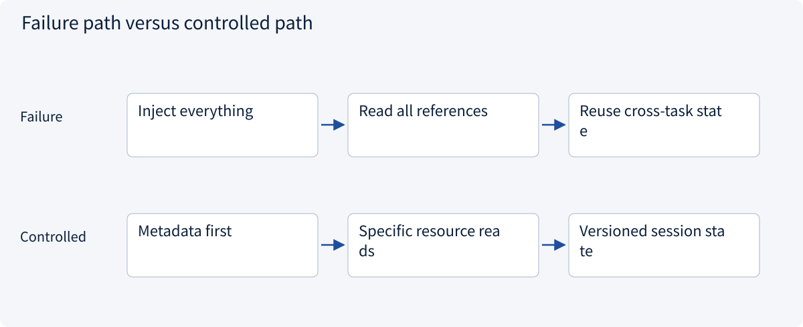
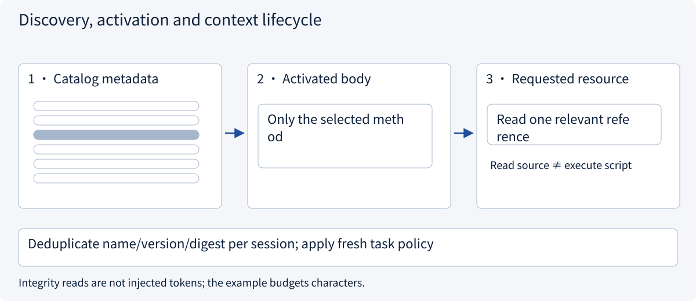
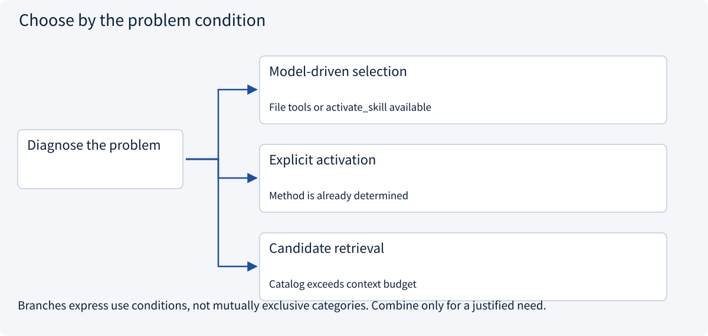
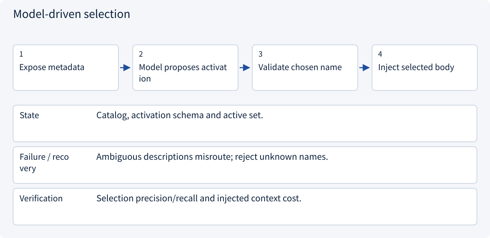
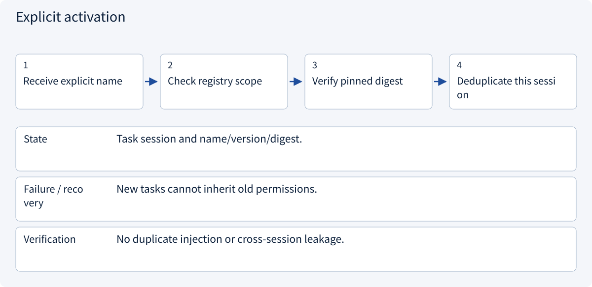
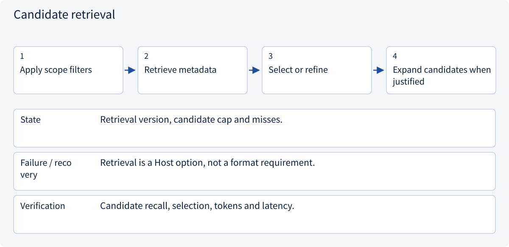

# 2.6.3 Discovery, activation and context lifecycle

> Visual route · Established approaches · Reference code

Based on Agent Skills format; version pins, bundle digests and tool bindings are example Host conventions, not execution authority.

## Start with the problem

Many installed Skills crowd context, repeated activations waste tokens, and compaction loses active versions.




## See the mechanism

Disclose catalog, instructions and resources separately; deduplicate within the task session. Distinguish storage integrity reads from actual model context and from code execution.



## Choose an established approach



| Approach | Mechanism | Use when | Tradeoff / boundary |
|---|---|---|---|
| Model-driven selection | Expose descriptions; model chooses activation | File tools or activate_skill available | Evaluate intent selection; avoid keyword-only claims |
| Explicit activation | User/trusted flow selects a name | Method is already determined | Still enforce availability and policy |
| Candidate retrieval | Scope first, retrieve bounded metadata | Catalog exceeds context budget | Unretrieved skills cannot be selected |

## Inside the mainstream approaches

### 1 · Model-driven selection



**Concrete trace:** Do not equate intent selection with a keyword match.

### 2 · Explicit activation



**Concrete trace:** Two activations retain one copy of the review method.

### 3 · Candidate retrieval



**Concrete trace:** Do not inject 200 bodies; no relevant candidate means no forced activation.

## Reference code

Expand the implementation corresponding to this mechanism. Training code is provided but not executed. See the reference-code guide for dependencies and verification limits.

[Reference code and verification limits](../../docs/zh/projects/03-code-guide.md)

<details><summary>Expand code and limits</summary>

```python
"""Three disclosure stages; repeated activation is deduplicated per task session."""

from .skill_host import build_host


def disclosure_trace() -> dict:
    service, session = build_host()
    catalog = service.catalog(
        session.policy
    )  # Only name + description enter the catalog.
    first = service.activate("quote-review", session)
    again = service.activate("quote-review", session)
    assert first is again
    reference = service.resource("quote-review", "references/conditions.md", session)
    return {
        "catalog": catalog,
        "active_count": len(session.active),
        "requested_resource": reference,
        "context": service.context(session),
    }


# Integrity checks read bundle bytes without injecting all those bytes into model context.
# This uses a character limit for illustration; a real Host should budget with its tokenizer.
```

</details>

## A cheap catalog is still finite

The baseline pattern exposes names/descriptions and lets the model load a selected body through file access or an activation tool. Explicit activation also works. Large-catalog retrieval is a Host option requiring scope filters and recall evaluation, not a keyword matcher disguised as intent selection.

| Stage | Model sees | Example Host also does |
|---|---|---|
| Discovery | Name/description | Read registered metadata |
| Activation | Chosen body and provenance | Verify digest/binding; deduplicate per session |
| Resource request | Requested detail/template/source | Reject traversal, budget characters, never execute source |
| Compaction/recovery | Active identity/rules or verifiable reference | Retain the pin and reload original approved bytes if needed |

Integrity reads touch bundle bytes without injecting all resources. Character budgets are illustrative; production needs the relevant tokenizer. Session-local state is not durable recovery or an OS sandbox, and storage is assumed trusted/read-only. Updates need a new reviewed registration while active tasks retain their pinned package.


References: [Official 1](https://agentskills.io/client-implementation/adding-skills-support)。


### Sessions and trusted policy

Host reference with fixed inputs/injected adapters, without a model request.

<details><summary>Expand code and limits</summary>

```python
from collections.abc import Awaitable, Callable
from dataclasses import dataclass, field


@dataclass(frozen=True)
class Descriptor:
    name: str
    description: str
    version: str  # Custom metadata, not a required Agent Skills field.
    declared_tools: str = ""  # Experimental declaration; never grants authority here.


@dataclass(frozen=True)
class RegistryEntry:
    version: str
    digest: str
    bindings: tuple[str, ...]
    metadata_digest: str = ""


@dataclass(frozen=True)
class Policy:
    allowed_skills: frozenset[str]
    allowed_tools: frozenset[str]
    quote_ids: frozenset[str]


@dataclass(frozen=True)
class Activated:
    name: str
    version: str
    digest: str
    instructions: str


@dataclass
class Session:
    policy: Policy
    char_limit: int = 12000  # Demonstration character budget, NOT a token estimate.
    active: dict[str, Activated] = field(default_factory=dict)
    resources: dict[tuple[str, str], str] = field(default_factory=dict)


ToolAdapter = Callable[[str, dict, Policy], Awaitable[dict]]
```

</details>

### Metadata and bundle integrity

Host reference with fixed inputs/injected adapters, without a model request.

<details><summary>Expand code and limits</summary>

```python
"""Bounded reads of an explicitly supplied, trusted, read-only package root."""

import hashlib
import json
import re
from dataclasses import asdict
from pathlib import Path

from .domain import Descriptor


def parse_frontmatter(text: str, directory_name: str) -> tuple[Descriptor, str]:
    import yaml

    lines = text.splitlines(keepends=True)
    if not lines or lines[0].strip() != "---":
        raise ValueError("Missing YAML frontmatter")
    end = next((i for i in range(1, len(lines)) if lines[i].strip() == "---"), None)
    if end is None:
        raise ValueError("Unclosed YAML frontmatter")
    metadata = yaml.safe_load("".join(lines[1:end]))
    if not isinstance(metadata, dict):
        raise TypeError("Frontmatter must be a mapping")
    name, description = metadata.get("name"), metadata.get("description")
    if (
        not isinstance(name, str)
        or not re.fullmatch(r"[a-z0-9]+(?:-[a-z0-9]+)*", name)
        or len(name) > 64
        or name != directory_name
    ):
        raise ValueError("Invalid skill/directory name")
    if not isinstance(description, str) or not 1 <= len(description.strip()) <= 1024:
        raise ValueError("Invalid description")
    extra = metadata.get("metadata", {})
    if not isinstance(extra, dict) or any(
        not isinstance(k, str) or not isinstance(v, str) for k, v in extra.items()
    ):
        raise ValueError("metadata must map strings to strings")
    tools = metadata.get("allowed-tools", "")
    if not isinstance(tools, str):
        raise TypeError("allowed-tools must be a string")
    return Descriptor(name, description, extra.get("version", ""), tools), "".join(
        lines[end + 1 :]
    ).strip()


def descriptor_digest(descriptor: Descriptor) -> str:
    return hashlib.sha256(
        json.dumps(asdict(descriptor), sort_keys=True).encode()
    ).hexdigest()


def snapshot_digest(files: dict[str, bytes]) -> str:
    digest = hashlib.sha256()
    for path, content in sorted(files.items()):
        # Length prefixes avoid ambiguous concatenation of filenames and bytes.
        label = path.encode()
        digest.update(len(label).to_bytes(8, "big") + label)
        digest.update(len(content).to_bytes(8, "big") + content)
    return digest.hexdigest()


class SkillRepository:
    def __init__(self, root: Path):
        self.root = root.resolve(strict=True)
        self.reads: list[str] = []  # Observable demonstration of disclosure stages.

    def package(self, name: str) -> Path:
        if not re.fullmatch(r"[a-z0-9]+(?:-[a-z0-9]+)*", name) or len(name) > 64:
            raise ValueError("Invalid skill name")
        path = self.root / name
        if path.is_symlink() or not path.resolve(strict=True).is_relative_to(self.root):
            raise PermissionError("Package escapes trusted root")
        return path

    def metadata(self, name: str) -> Descriptor:
        path = self.package(name) / "SKILL.md"
        if path.is_symlink():
            raise PermissionError("Symlinked entrypoint")
        self.reads.append(f"{name}:metadata")
        header = []
        # Read frontmatter without exposing the body or resources to the catalog.
        with path.open(encoding="utf-8") as source:
            for line in source:
                header.append(line)
                if sum(map(len, header)) > 16384:
                    raise ValueError("Oversized metadata")
                if len(header) > 1 and line.strip() == "---":
                    break
        descriptor, _ = parse_frontmatter("".join(header), name)
        return descriptor

    def snapshot(self, name: str) -> dict[str, bytes]:
        package = self.package(name)
        files, total = {}, 0
        for path in sorted(package.rglob("*")):
            if "__pycache__" in path.parts or path.suffix == ".pyc":
                continue  # Build artifacts are not part of this package manifest.
            if path.is_symlink():
                raise PermissionError("Symlinks are unsupported in this example")
            if not path.is_file():
                continue
            if path.stat().st_size > 65536:
                raise ValueError("Oversized resource")
            content = path.read_bytes()
            total += len(content)
            if total > 262144:
                raise ValueError("Oversized skill bundle")
            files[path.relative_to(package).as_posix()] = content
        self.reads.append(f"{name}:integrity-snapshot")
        return files


# Snapshot bytes are read for integrity; only requested content enters model context.
# Read-only trusted storage is assumed: this is not an OS sandbox or a TOCTOU defense.
```

</details>

### Activation, resource and binding service

Host reference with fixed inputs/injected adapters, without a model request.

<details><summary>Expand code and limits</summary>

```python
import json
from pathlib import PurePosixPath

from .domain import Activated, Policy, RegistryEntry, Session, ToolAdapter
from .repos import (
    SkillRepository,
    descriptor_digest,
    parse_frontmatter,
    snapshot_digest,
)


class SkillService:
    def __init__(
        self,
        repository: SkillRepository,
        registry: dict[str, RegistryEntry],
        available_tools: frozenset[str],
    ):
        self.repository, self.registry, self.available_tools = (
            repository,
            registry,
            available_tools,
        )

    def eligible(self, name: str, policy: Policy) -> RegistryEntry:
        entry = self.registry.get(name)
        if entry is None or name not in policy.allowed_skills:
            raise PermissionError("Skill unavailable to this task")
        if not set(entry.bindings) <= (policy.allowed_tools & self.available_tools):
            raise PermissionError("Required binding unavailable or unauthorized")
        return entry

    def catalog(self, policy: Policy) -> list[dict]:
        result = []
        for name in sorted(self.registry):
            try:
                entry = self.eligible(name, policy)
            except PermissionError:
                continue
            descriptor = self.repository.metadata(name)
            if descriptor_digest(descriptor) != entry.metadata_digest:
                raise PermissionError("Catalog metadata changed after registration")
            result.append({"name": name, "description": descriptor.description})
        return result

    def verified(
        self, name: str, policy: Policy
    ) -> tuple[RegistryEntry, dict[str, bytes]]:
        entry = self.eligible(name, policy)
        files = self.repository.snapshot(name)
        if snapshot_digest(files) != entry.digest:
            raise PermissionError("Bundle changed since trusted registration")
        descriptor, _ = parse_frontmatter(files["SKILL.md"].decode(), name)
        if descriptor.version != entry.version:
            raise PermissionError("Pinned version mismatch")
        return entry, files

    @staticmethod
    def fits(session: Session, content: str) -> None:
        used = sum(len(x.instructions) for x in session.active.values())
        used += sum(map(len, session.resources.values()))
        if used + len(content) > session.char_limit:
            raise ValueError("Skill context character budget exhausted")

    def activate(self, name: str, session: Session) -> Activated:
        entry, files = self.verified(name, session.policy)
        if name in session.active:
            return session.active[
                name
            ]  # No duplicate injection, but integrity was rechecked.
        _, body = parse_frontmatter(files["SKILL.md"].decode(), name)
        self.fits(session, body)
        loaded = Activated(name, entry.version, entry.digest, body)
        session.active[name] = loaded
        return loaded

    def resource(self, name: str, relative: str, session: Session) -> str:
        if name not in session.active:
            raise ValueError("Activate the skill first")
        path = PurePosixPath(relative)
        if (
            path.is_absolute()
            or ".." in path.parts
            or not path.parts
            or path.parts[0] not in {"references", "assets", "scripts"}
        ):
            raise PermissionError("Resource path outside bundle conventions")
        _, files = self.verified(name, session.policy)
        key = (name, path.as_posix())
        if key in session.resources:
            return session.resources[key]
        content = files[path.as_posix()].decode("utf-8")
        self.fits(session, content)
        session.resources[key] = (
            content  # Returning source never executes a bundled script.
        )
        return content

    async def invoke(
        self,
        name: str,
        tool: str,
        arguments: dict,
        session: Session,
        adapter: ToolAdapter,
    ) -> dict:
        if name not in session.active:
            raise ValueError("Activate the skill first")
        entry, _ = self.verified(name, session.policy)
        if tool not in entry.bindings:
            raise PermissionError("Tool is not a trusted binding for this skill")
        return await adapter(tool, arguments, session.policy)

    def context(self, session: Session) -> str:
        # Structured packaging aids provenance; it is not an authorization mechanism.
        return json.dumps(
            [
                {
                    "source": "approved-skill",
                    "name": x.name,
                    "version": x.version,
                    "digest": x.digest,
                    "instructions": x.instructions,
                }
                for x in session.active.values()
            ],
            ensure_ascii=False,
        )
```

</details>

### Activation request boundary

Host reference with fixed inputs/injected adapters, without a model request.

<details><summary>Expand code and limits</summary>

```python
from dataclasses import asdict

from .domain import Session
from .services import SkillService


class SkillHandler:
    def __init__(self, service: SkillService):
        self.service = service

    def activate(self, request: dict, session: Session) -> dict:
        if set(request) != {"name"} or not isinstance(request["name"], str):
            raise ValueError("Expected one skill name")
        return asdict(self.service.activate(request["name"], session))
```

</details>

### Protocol entry assembly

Host reference with fixed inputs/injected adapters, without a model request.

<details><summary>Expand code and limits</summary>

```python
from .domain import Session
from .handlers import SkillHandler


def activate_entry(handler: SkillHandler, request: dict, session: Session) -> dict:
    """Transport-neutral entry: the Host injects the trusted task session."""
    return handler.activate(request, session)
```

</details>

## Change a condition

Does reading files during discovery mean all body tokens enter context?

<details><summary>Suggested answer</summary>

No. Disk reads, integrity verification and model-context injection differ. The example budgets characters, not measured tokens.

</details>

[Official sources and approach rationale](../../docs/zh/resources.md)
